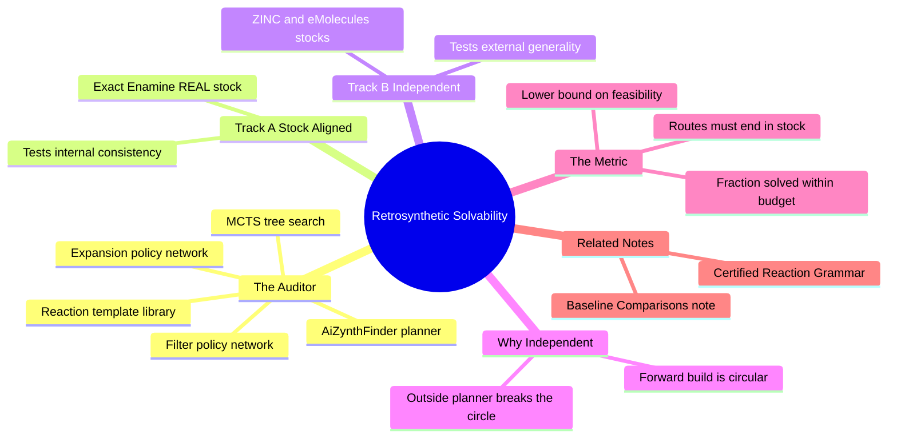

---
tags:
  - domain/benchmarking
  - depth/supporting
  - 3dsyntree
  - topic/retrosynthesis
module: "10. Benchmarking and Wet Lab Translation"
chapter: "Chapter 1. Computational Benchmarking"
type: concept
---

# 2. AiZynthFinder Retrosynthetic Solvability

> [!abstract] Core Idea
> AiZynthFinder is an independent, open-source retrosynthetic planning engine that works *backwards* from a target molecule to purchasable building blocks using Monte Carlo tree search guided by neural policies. 3D-SynTree uses it as an external auditor of its own synthesizability claims, in two tracks: one restricted to the exact Enamine REAL stock the generator designed with, and one free to use any commercial stock. Asking your own forward reaction grammar to certify your own molecules is circular reasoning — an independent planner is the cure.

Navigation: [[0. Benchmarking and Wet Lab Translation MOC]] · [[0. Master Vault Index]]

## 1. What It Is

**Retrosynthesis** is planning a synthesis in reverse: starting from the target molecule, repeatedly apply imaginary "undo" operations — **retro-reactions** or **transforms** — that cut the molecule into simpler **precursors**, until every remaining piece is a cheap, purchasable **building block** (a *stock* molecule, the commercial cousin of the synthons introduced in [[1. Building Blocks and Synthons]]). A molecule is **retrosynthetically solvable** when such a complete backward route exists: a tree whose root is the target and whose leaves are all in-stock chemicals.

**AiZynthFinder** is an automated retrosynthetic planning engine that performs this backward search with two engines working together: **Monte Carlo Tree Search (MCTS)** — the same explore/exploit tree-search family you know from game-playing AI — decides *which* precursor to expand next, and **neural network policies** rank *which* of the thousands of theoretically applicable reaction transforms to actually try. **Retrosynthetic solvability as a metric** is simply the fraction of a model's generated molecules for which AiZynthFinder finds a complete route within a fixed search budget.

## 2. Why It Exists

3D-SynTree builds molecules *forward* from its 32 certified reactions and its Enamine REAL synthon catalog. It is therefore tempting to declare every output molecule "synthesizable by construction". But that claim has a fatal logical flaw: **the grammar that built the molecule is the same authority certifying it**. If reaction templates or catalogs contain any error, bias, or over-optimistic assumption, the forward construction inherits and launders that error into a "synthesizable" label. This is **circular reasoning** — like a student writing their own exam and then reporting a perfect grade.

The taxonomy calls the honest alternative *retrosynthetic solvability: measuring independent synthesis feasibility*. Independent verification means a **different** planner, with a **different** reaction template library, trained by **different** people, must find a route without ever seeing 3D-SynTree's internal recipe. If an outsider can solve your molecule, the synthesizability claim has survived contact with an independent judge.

## 3. How It Works

### 3.1 The Backward Search Tree

AiZynthFinder represents retrosynthesis as a search tree:

- The **root** is the target molecule.
- Each **node** is an intermediate molecule (or a set of them after a disconnection).
- Each **edge** is a reaction transform applied in reverse — a *disconnection* that cuts strategic bonds and converts the pieces into precursor functional groups (an amide is un-cut into an acid plus an amine, a biaryl bond is un-cut into two halide/boronic acid partners).
- A node is **terminal-solved** when every molecule in it is found in the configured stock list.
- A node is **terminal-dead** when it exceeds the depth limit or no transform applies.

The route found is exactly the derivation-tree concept of [[2. Derivation Trees vs Molecular DAGs]], traversed from product back to leaves.

### 3.2 Monte Carlo Tree Search with Policy Networks

At each search iteration, MCTS does four familiar steps:

1. **Selection** — walk from the root, at each node choosing the child that best balances promised value against uncertainty (a upper-confidence-bound style rule).
2. **Expansion** — on the chosen precursor, apply the top-ranked retro-reaction templates. Here the **expansion policy network** does the heavy lifting: for a given molecule, dozens to thousands of transforms may *formally* apply; the network (trained on millions of published reaction examples) ranks the few chemically sensible ones so the tree does not drown in nonsense cuts.
3. **Rollout / filtering** — a second **filter policy** estimates the probability that each newly created precursor is itself synthesizable, pruning hopeless branches early.
4. **Backup** — the solved/unsolved outcome propagates back up the tree, sharpening the value estimates.

A fixed **search budget** (number of iterations and tree depth) is essential for fairness: with unlimited compute almost anything is *worth trying*, so the metric must be "solved within N iterations".

### 3.3 Track A: Stock-Aligned Verification

In **Track A**, AiZynthFinder's stock is set to the *exact* Enamine REAL building-block catalog 3D-SynTree designed with — the source pool behind the curated 50,000-synthon catalog described in [[3. Enamine REAL Space and Catalogs]]. The question Track A answers is narrow and sharp: *can this molecule be reached from the same bricks the generator was allowed to use?* This verifies the generator did not chemically "hallucinate" — that its outputs really live inside the purchasable-reaction space it claims to sample from.

### 3.4 Track B: Independent External Stock

In **Track B**, the stock is swapped for general, unaligned commercial inventories — large aggregator catalogs such as **ZINC** or **eMolecules** that collect building blocks from many vendors worldwide. Now the question broadens: *is this molecule synthesizable by the outside world's standards, using bricks 3D-SynTree never saw?* A molecule solved in Track B is robustly makeable — its route does not depend on any quirk of the Enamine catalog. The two tracks deliberately run as independent evaluations, decoupled so that neither stock contaminates the other's statistics.

### 3.5 Reading Solvability as a Metric

> [!example] Two molecules, two verdicts
> **Molecule 1** — a biaryl amide built by 3D-SynTree via amide coupling plus Suzuki–Miyaura coupling. Track A: AiZynthFinder disconnects the amide into an Enamine-stock acid and amine, then un-cuts the biaryl into a bromide and a boronate — both in stock. **Solved in both tracks.**
> **Molecule 2** — a diffusion-model output: a fused bridged ketal with three contiguous quaternary stereocenters and no functional handle anywhere. No template in the library offers a sensible first cut within budget. **Unsolved** — and independently confirming the Synthesizability Wall diagnosis.

## 4. What It Consists Of

- **MCTS search trees** — the backward exploration structure with selection, expansion, and backup.
- **Policy networks** — the expansion policy (which transform to apply) and the filter policy (is this precursor worth pursuing).
- **Reaction expansion rules** — the library of retro-reaction templates, extracted from reaction databases.
- **Commercial building-block stock lists** — Track A's Enamine REAL-aligned stock; Track B's independent ZINC/eMolecules-style stocks.
- **Route outputs** — complete reaction sequences from stock chemicals to the target.
- **Solvability rate** — the fraction of targets solved within budget; the headline metric.

## 5. What You Must Understand

> [!warning] Forward construction alone is circular
> "My forward SMARTS grammar built it, therefore it is synthesizable" grades your own homework. Only an *independent* backward planner (different templates, different training data) breaks the circle. For how 3D-SynTree's own forward rules work, see [[3. Reaction SMARTS and Isotope Provenance]] — then notice that this note exists precisely to *not trust them as a certificate*.

> [!warning] A found route is a plan, not a flask
> Solvability means "a plausible paper route exists". Real synthesis still confronts yields, stereochemical outcomes, and reagent compatibility. The empirical anchor is Enamine's own make-on-demand track record — the majority of catalog compounds are delivered successfully within weeks — but a specific novel route can still fail in the lab.

> [!tip] Unsolved does not mean unsynthesizable
> AiZynthFinder is bounded by its template library and budget. A molecule can be makeable by clever chemistry no template covers. Treat solvability as a *lower bound* on feasibility, and compare models only at identical budgets.

> [!note] Two tracks, two questions
> Track A tests *internal consistency* with the design catalog; Track B tests *external generality*. Report both — a model scoring well on A but poorly on B is over-fitted to one vendor's inventory.

## 6. Prerequisites

- [[2. The 32 Certified Reaction Grammar]] — the forward grammar whose synthesizability claims this note audits.
- [[3. Enamine REAL Space and Catalogs]] — what the stock-aligned Track A stock actually is, and where the 50,000 synthons come from.

## 7. Project Connection

The audit is wired into the `EvaluationPipeline` in `syntree/engine/evaluator.py`, and the decoupling into two independent verification tracks was formalized as Issue #44 [EVAL-03]. The evaluation deliberately ignores the derivation tree 3D-SynTree itself recorded for each molecule and forces AiZynthFinder to *rediscover* a route from scratch — the independence that makes the metric meaningful. Track A reuses the Enamine REAL stock alignment of the design catalog; Track B swaps in external stocks. The expected payoff of the whole architecture — every molecule assembled from certified reactions between catalog synthons — is that both tracks should solve nearly everything the generator emits, in stark contrast to freely generated 3D molecules, a contrast quantified in [[3. Baseline Comparisons TargetDiff SyntheMol]].

## 8. Required Depth

**Supporting** — AiZynthFinder is a verification *tool* consumed by the comparative benchmark, not a component of the generative engine itself; you need to understand what it certifies and why its independence matters, more than its internal search minutiae.

## 9. Further Dependencies

- [[3. Baseline Comparisons TargetDiff SyntheMol]] — the comparative benchmark reports Track A and Track B solvability rates for every competing model alongside PoseBusters pass rates from [[1. PoseBusters Physical Sanity Filters]].

## Concept Mind Map

