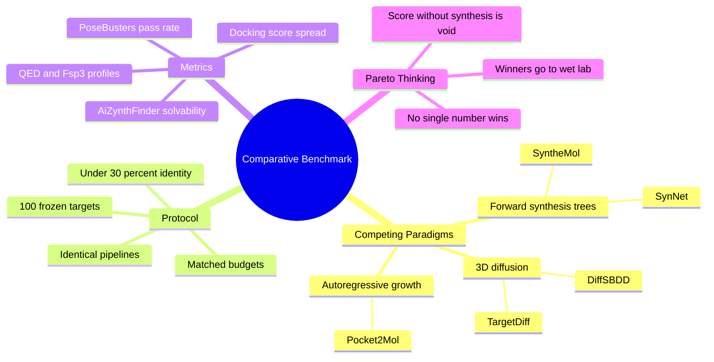

---
tags:
  - domain/benchmarking
  - depth/essential
  - 3dsyntree
  - topic/evaluation
module: "10. Benchmarking and Wet Lab Translation"
chapter: "Chapter 1. Computational Benchmarking"
type: concept
---

# 3. Baseline Comparisons TargetDiff SyntheMol

> [!abstract] Core Idea
> A claim like "3D-SynTree breaks the Synthesizability Wall" is only meaningful if it is tested head-to-head against the paradigms that fail it: 3D diffusion models (TargetDiff, DiffSBDD), 2D forward-synthesis trees (SyntheMol, SynNet), and autoregressive growth (Pocket2Mol). The comparative benchmark freezes 100 held-out protein targets, gives every method an identical generation budget, and pushes all outputs through the *same* PoseBusters, AiZynthFinder, and docking pipelines — then judges methods on the full **Pareto frontier** of physical validity, synthesizability, and affinity, because a docking score without synthesizability is worthless.

Navigation: [[0. Benchmarking and Wet Lab Translation MOC]] · [[0. Master Vault Index]]

## 1. What It Is

This note defines the **formal experimental methodology** for evaluating 3D-SynTree head-to-head against the three competing generative paradigms of structure-based drug design, on identical held-out targets:

| Paradigm | Representative models | How they generate |
| --- | --- | --- |
| **Atom-by-atom 3D diffusion** | TargetDiff, DiffSBDD | Denoising diffusion over continuous atom coordinates and atom types inside the pocket |
| **2D forward-synthesis trees** | SyntheMol, SynNet | Combinatorial assembly of purchasable building blocks through a forward reaction grammar |
| **Equivariant autoregressive growth** | Pocket2Mol | Sequential atom-by-atom placement with equivariant 3D networks |

A **benchmark** here is a fixed, pre-registered protocol: a frozen target list, matched budgets, identical evaluation pipelines, and pre-decided metrics — so that no method enjoys any procedural advantage. The design deliberately contrasts the two failure extremes from [[1. 3D-SynTree System Overview]]: diffusion models that ignore chemistry, and synthesis trees that ignore 3D.

## 2. Why It Exists

3D-SynTree's founding claim is that it escapes the **Synthesizability Wall** — the empirical fact that beautiful 3D generators emit unsynthesizable molecules (pentavalent carbons, impossible geometries, $<20\%$ retrosynthetic feasibility) — *without* falling into the opposite trap of forward-synthesis trees, which are trivially synthesizable but blind to the 3D cavity. A self-evaluation on 3D-SynTree's own favorite targets cannot prove that claim. Only a controlled comparison, where every method faces the same pockets, the same budget, and the same scoring pipeline, can separate architectural advantage from protocol luck. The benchmark is also the honesty device: it prevents the classic paper sin of comparing your best-case numbers to published worst-case numbers.

## 3. How It Works

### 3.1 The Frozen Test Manifest

The benchmark starts by freezing a **manifest of 100 test targets** — protein structures with known binding pockets, held out from training — selected by clustering all candidate proteins at **$<30\%$ MMseqs2 sequence identity** (the clustering criterion is 30% identity over 80% sequence coverage). Why so strict? Because related proteins teach a model the same pockets: if any test target is a sequence cousin of a training target, the model can pattern-match rather than design, and the benchmark silently measures memorization — the leakage problem dissected in [[3. Homology MMseqs2 Clustering and Data Leakage]]. Freezing the list before any evaluation runs also prevents post-hoc target cherry-picking. Every method receives the same pocket definition — the 10 Å cavity extraction of [[1. Binding Pockets and Cavity Extraction]] — so all generators condition on identical inputs.

### 3.2 The Competing Paradigms in One Paragraph Each

**TargetDiff and DiffSBDD (3D diffusion).** These models treat molecule generation as denoising random atom clouds inside the pocket: a neural network learns to reverse a noising process applied to continuous atom coordinates plus discrete atom types. They produce impressive 3D complementarity — atoms land exactly where the pocket wants them — but with *no chemical reaction model*: any atom may bond to any neighbor, which is exactly how pentavalent carbons and strained geometries appear. Their molecules typically fail PoseBusters at high rates and solve retrosynthesis at $<20\%$.

**SyntheMol and SynNet (2D forward-synthesis trees).** The mirror image: generation *is* synthesis planning. SyntheMol explores a space of enzymatic and reaction-based combinations of purchasable building blocks (trained with tree search on antibacterial data); SynNet learns a policy for assembling building blocks through a virtual reaction grammar. Every output is synthesizable almost by definition — and almost blind to the pocket: selection pressure comes from 2D activity models or docking of separate conformers, not from shape conditioned on the true 3D cavity.

**Pocket2Mol (autoregressive growth).** An intermediate point: it grows molecules atom by atom (or fragment by fragment) inside the pocket with equivariant networks, each placement conditioned on the growing structure. Autoregressive locality still means global shape and reaction-level constraints are absent, and coordinate-level placement reintroduces geometry risks.

**3D-SynTree** enters as the synthesis-constrained, pocket-conditioned alternative: every molecule is a certified-reaction tree over catalog synthons, with 3D geometry assembled via conformer embedding and dihedral choices — designed to hold *both* axes at once.

### 3.3 Matched Budgets and Identical Pipelines

Fairness is enforced procedurally:

- **Matched generation budgets** — every method produces the same number of candidate molecules per target, with comparable sampling effort (attempts, compute, and retry allowances), so a method cannot win by brute-forcing more samples and keeping the best.
- **Identical evaluation pipelines** — every molecule, from every method, goes through the *same* PoseBusters battery, the *same* AiZynthFinder Track A and Track B solvability audits, the *same* GNINA/Vina docking protocol, and the same property profiles (QED, $Fsp^3$ as covered in [[2. Fsp3 Saturation and the Flat Grease Trap]]).

> [!warning] The paired-design discipline
> Because target identity is shared, comparisons are *paired*: on target 37, method A's molecules and method B's molecules faced the exact same pocket. Analyze per-target differences, not just pooled means — pooled averages hide catastrophic per-target failure modes.

### 3.4 Paired Metrics and the Pareto Frontier

The core mental shift the benchmark demands is from single-number rankings to **Pareto frontier thinking**. Each method yields a profile over at least three axes: physical validity (PoseBusters pass rate), synthesis feasibility (solvability in both tracks), and target affinity (docking score distribution). Method X **dominates** method Y only if it is at least as good on *every* axis; the **Pareto frontier** is the set of methods no other method dominates.

> [!example] Why one number lies (illustrative numbers)
> | Method | Median docking | PoseBusters pass | Retrosynthesis solved |
> | --- | --- | --- | --- |
> | Diffusion model | $-10.2\text{ kcal/mol}$ | 15% | 12% |
> | Forward-synthesis tree | $-6.1\text{ kcal/mol}$ | 96% | 99% |
> | Synthesis-constrained 3D | $-8.4\text{ kcal/mol}$ | 84% | 96% |
> The diffusion model "wins" docking — and is useless: a $-10\text{ kcal/mol}$ score with near-zero synthesizability is not a drug discovery solution, it is a geometry the scorer likes and no chemist can make. The frontier reading: the constrained-3D method concedes some docking depth to diffusion while retaining synthesizability, and beats the trees where pocket-aware 3D matters. That trade-off — not a single score — is the scientific result.

### 3.5 Reading the Results Honestly

Report **metric distributions** per target (medians, spread, failure counts), not just averages. Declare every protocol choice in advance. Resist tuning your own model on the frozen manifest — if any hyperparameter ever saw the test targets, the leakage lesson of the prerequisite note applies with full force. The winners of this computational benchmark are exactly the molecules that earn passage to the wet-lab cascade of [[1. Assay Cascade Strategy and nanoDSF]].

## 4. What It Consists Of

- **Benchmark target manifest** — 100 held-out structures, clustered at $<30\%$ sequence identity, frozen before evaluation.
- **Matched sample sizes and budgets** — equal generation attempts, compute, and molecule counts per method per target.
- **Paired evaluation metrics** — per-target PoseBusters pass rates, AiZynthFinder Track A/B solvability, docking score distributions, QED/$Fsp^3$ profiles.
- **Identical pipelines** — one docking configuration, one validity battery, one solvability audit, applied to all methods.
- **Pareto frontier plots** — scatter plots and dominance analysis over validity, feasibility, and affinity axes.

## 5. What You Must Understand

> [!warning] Docking score alone is meaningless
> A model achieving $-10\text{ kcal/mol}$ with $0\%$ retrosynthetic feasibility is not a drug discovery solution. Affinity without physical validity is fantasy; affinity without synthesizability is unmakeable. You must evaluate the full Pareto frontier between physical validity, synthesis feasibility, and target affinity.

> [!warning] The manifest is only as honest as its clustering
> The $<30\%$ identity rule is not bureaucracy — it is the difference between measuring design and measuring memorization.

> [!tip] Memory hook: same pockets, same budget, same judges
> If any of the three differ between methods, you are comparing protocols, not models.

> [!note] Baselines are not straw men
> TargetDiff, DiffSBDD, SyntheMol, SynNet, and Pocket2Mol are strong, published systems, each excellent on its own axis. The benchmark's point is that the axes conflict, and 3D-SynTree's claim is simultaneous occupancy of both.

## 6. Prerequisites

- [[3. Homology MMseqs2 Clustering and Data Leakage]] — why the 100-target manifest must be clustered at $<30\%$ identity to be a valid test.
- [[1. PoseBusters Physical Sanity Filters]] — the physical-validity axis of the Pareto comparison.
- [[2. AiZynthFinder Retrosynthetic Solvability]] — the synthesizability axis of the Pareto comparison.

## 7. Project Connection

The benchmark protocol is implemented in `scripts/run_comparative_benchmark.py`, formalized as Issue #35 [EVAL-02], with the frozen 100-target manifest and identical evaluation flowing through the `EvaluationPipeline` in `syntree/engine/evaluator.py`. Architecturally, 3D-SynTree should sit toward the favorable corner of the Pareto plot because its action space *is* the certified reaction grammar over the curated synthon catalog — synthesizability is not a post-filter bolted onto a free generator but the substance of every action the policy can take — while its pocket conditioning through the geometric encoder supplies the 3D awareness the trees lack. The benchmark exists to test, not assume, exactly that.

## 8. Required Depth

**Essential** — this note is the methodological glue of the whole module: it defines the protocol that turns PoseBusters and AiZynthFinder from tools into evidence, and it decides which molecules proceed to wet-lab testing.

## 9. Further Dependencies

- [[1. Assay Cascade Strategy and nanoDSF]] — the top molecules from the Pareto-favorable region graduate into automated synthesis and biophysical screening.
- [[2. SPR Kinetics and X-Ray Complex Confirmation]] — the deep-confirmation endpoint where computational rankings finally meet physical reality.

## Concept Mind Map

