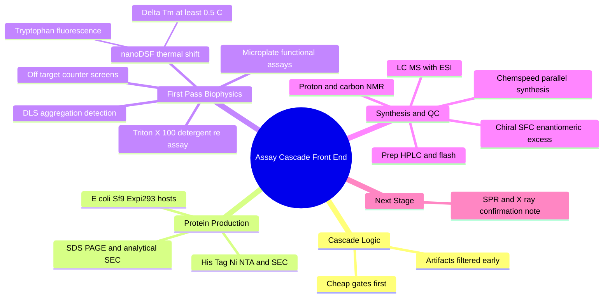

---
tags:
  - domain/benchmarking
  - depth/supporting
  - 3dsyntree
  - topic/wet-lab
module: "10. Benchmarking and Wet Lab Translation"
chapter: "Chapter 2. Wet Lab Translation"
type: concept
---

# 1. Assay Cascade Strategy and nanoDSF

> [!abstract] Core Idea
> The wet-lab assay cascade is the funnel that turns AI-designed molecules into validated hits: synthesize and purify them under automated parallel conditions, prove their identity with LC-MS and NMR, then run them through cheap, fast, high-throughput biophysical screens — nanoDSF thermal shifts, DLS aggregation checks, detergent re-assays, and off-target counter-screens — so that only genuinely binding, non-artifactual molecules earn the expensive downstream tests of the companion note.

Navigation: [[0. Benchmarking and Wet Lab Translation MOC]] · [[0. Master Vault Index]]

## 1. What It Is

An **assay cascade** is an ordered series of laboratory experiments, arranged from cheap, fast, and high-throughput to expensive, slow, and information-rich, through which candidate molecules are filtered. This note covers the **front half** of 3D-SynTree's cascade: (1) producing the compound — recombinant protein production for the target, and automated parallel chemical synthesis for the molecule, with full purification and quality-control (QC); and (2) the first-pass biophysical and biochemical screens — microplate functional assays, **nanoDSF** thermal-shift screening, **DLS** aggregation detection, detergent attenuation re-assays, and off-target counter-screens. The back half — SPR kinetics, ITC thermodynamics, X-ray co-crystallography, and cellular assays — is the subject of [[2. SPR Kinetics and X-Ray Complex Confirmation]].

An **assay** is any controlled experiment that produces a measurable readout (a number) when a molecule interacts with a biological system. The cascade exists because each assay answers a different question and costs a different amount.

## 2. Why It Exists

**Computational predictions remain hypotheses until proven by physical measurements.** Docking scores, QED values, and PoseBusters passes are all *in silico* surrogates — models of reality, not reality. The cascade is the machinery of proof. Its strict ordering is pure economics: a nanoDSF capillary experiment costs cents of protein and minutes of time; a synchrotron co-crystal structure costs months. Running every AI proposal straight into the expensive end would bankrupt the project, so the cascade front-loads experiments that eliminate most candidates cheaply — and, critically, it front-loads the **artifact filters**, because the most common early-discovery disaster is not a weak binder but a *fake* binder: a molecule that only looks like it works.

For 3D-SynTree the cascade is also the moment of truth for its core promise: every generated molecule arrives with a verified synthesis recipe, so it can enter synthesis **directly**, with no route development — the step where most AI-designed molecules historically die.

## 3. How It Works

### 3.1 The Cascade Logic

The funnel, in order: **synthesis and QC → nanoDSF thermal shift → DLS aggregation check → detergent re-assay → off-target counter-screen → (if survived) SPR/ITC → X-ray co-crystallography → cellular assays**. Each stage is a gate: molecules that fail are cheaply discarded; molecules that pass carry earned confidence forward. The stage ordering embodies three rules: cheap before expensive, high-throughput before low-throughput, and artifact-detection before artifact-exploitation (a well-behaved aggregator sails through a naive activity assay and wastes a crystallography slot).

### 3.2 Recombinant Protein Production and Quality Assurance

Every binding assay needs the target protein itself, produced by **recombinant expression** — inserting the gene for the protein into a host cell factory:

- **Expression hosts.** *E. coli* bacteria are fast, cheap, and high-yield, but cannot add human-style chemical modifications and often misfold complex human proteins. **Spodoptera frugiperda (Sf9)** insect cells, infected with baculovirus vectors, fold larger proteins better. **Human Expi293** cells give the most authentic human proteins with full modifications, at the highest cost and effort. The choice trades authenticity against speed.
- **Purification.** The gene is engineered with an affinity **tag** — commonly a **His-tag** (a short string of histidines that binds nickel in **Ni-NTA** resin) or a **Strep-tag** (which binds streptavidin-like resins) — allowing one pass over the affinity column to capture the protein selectively. **Size-exclusion chromatography (SEC)** then sorts the captured protein by size, separating the correctly folded monomer from debris.
- **QC: SDS-PAGE and analytical SEC.** **SDS-PAGE** (electrophoresis through a polyacrylamide gel) shows the protein's size and purity as bands. **Analytical SEC** reveals **monodispersity** — whether the protein exists as a single, uniform species in solution. A protein prep that is aggregated or a mixture of oligomeric states makes every downstream number untrustworthy: protein QC failures masquerade as molecule failures.

### 3.3 Microplate Functional Assays

The workhorse readout infrastructure is the **microplate reader**: 96- or 384-well plastic plates, each well a tiny reaction vessel, with an optical detector measuring **absorbance** (light absorbed by the product of an enzymatic reaction), **fluorescence intensity** (light emitted by a fluorescent reporter), or **luminescence** (light from a chemical reaction). One plate screens hundreds of conditions in parallel. Specialized variants used in medicinal labs — radiometric filter-binding and scintillation proximity assays, **fluorescence polarization (FP)** and **time-resolved FRET (TR-FRET)**, and microfluidic mobility-shift assays for kinase panels — all reduce to the same pattern: convert molecular binding into an optical signal that scales with dose.

### 3.4 nanoDSF: Thermal-Shift Screening

**nanoDSF** (nano-scale differential scanning fluorimetry) is the cheapest binding evidence in the cascade. Its principle: **intrinsic tryptophan fluorescence**. Tryptophan amino-acid residues (introduced in [[1. Amino Acids and Peptide Backbones]]) absorb UV light and re-emit fluorescence whose spectrum depends on the polarity of their surroundings — buried inside the folded protein they emit at one wavelength, exposed to water in the unfolded protein they emit at a longer wavelength (a red shift).

The experiment: fill a glass capillary with a few microliters of protein solution (plus or minus the test molecule), ramp the temperature upward, and record the fluorescence ratio through the melt. The protein **unfolds cooperatively** at a characteristic **melting temperature** $T_m$ — the midpoint of the unfolding transition. A molecule that genuinely binds the folded state preferentially stabilizes it, shifting the melt:

$$\Delta T_m = T_m^{(\text{protein + ligand})} - T_m^{(\text{protein alone})}$$

A shift of $\Delta T_m \ge 0.5\text{ }^\circ\text{C}$ is the conventional hit threshold — at or above it, stabilization exceeds assay noise and the molecule earns further study; below it, the evidence is indistinguishable from jitter. The "nano" refers to the capillary format: no reporter dye is added (dyes themselves perturb proteins and cause artifacts), and sample consumption is minuscule.

> [!note] What nanoDSF does and does not tell you
> A thermal shift says "the protein's folded state is stabilized — consistent with binding." It gives **no** binding strength ($K_D$), no kinetics, and no structural information. It is a triage instrument — the cheap first yes/no that the expensive assays of [[2. SPR Kinetics and X-Ray Complex Confirmation]] then quantify.

### 3.5 Counter-Screens and Artifact Elimination

Three gates protect the cascade from false positives:

- **Dynamic light scattering (DLS).** Shine a laser through the sample and watch the scattered light flicker: small molecules diffuse too fast to scatter measurably, but **particles** (aggregates) scatter strongly, and their flicker speed encodes their size (from nanometers upward). DLS thus measures the **particle-size distribution** of a compound solution, revealing **colloidal aggregation** — the notorious artifact where hundreds of compound molecules clump into oily droplets that adsorb and denature any protein they meet, producing fake "inhibition" in almost every assay.
- **Detergent attenuation.** The decisive follow-up: re-assay the hit in buffer containing a tiny amount ($0.01\%$) of non-ionic **Triton X-100** detergent, which disperses colloidal aggregates. If the activity **vanishes** in the presence of detergent, the "hit" was an aggregator — discard it. Real binding survives.
- **Off-target counter-screens.** Test the hit against a panel of unrelated reference proteins. A molecule that inhibits an unrelated enzyme with the same potency as the target is not a target binder; it is a promiscuous agent (the biochemical cousin of the flat-grease promiscuity in [[2. Fsp3 Saturation and the Flat Grease Trap]]).

### 3.6 High-Throughput Chemical Synthesis and Isolation

The chemistry wing of the cascade produces and proves the molecules:

- **Automated parallel synthesis.** Robotic workstations (e.g., **Chemspeed** platforms) execute dozens of reactions simultaneously in **multi-well reaction blocks** — automated solid dispensing, liquid reagent dosing, inert atmosphere, heated or cooled stirring, and vial-to-vial transfers, all under software control and typically on milligram scale.
- **Microwave-assisted organic synthesis (MAOS).** Microwave reactors heat polar reaction mixtures volumetrically and extremely fast, driving slow reactions (amide couplings, substitutions) to completion in minutes instead of hours — ideal inside an automated workflow.
- **Purification: prep-HPLC and flash chromatography.** **Preparative HPLC** runs reversed-phase liquid chromatography at scale, collecting the purified product peak by peak; **automated flash chromatography** pushes solvent through disposable silica cartridges for routine normal-phase cleanup.
- **QC: LC-MS with electrospray ionization (ESI).** Analytical liquid chromatography separates the sample's components and records a **retention time** (purity evidence), while **ESI** — a gentle ionization that sprays the dissolved molecule into charged droplets — delivers the molecular mass (the expected $[M+H]^+$ ion). Correct mass plus a single peak: the compound is what the recipe claims, at acceptable purity.
- **Structural confirmation: $^{1}\text{H}$-NMR and $^{13}\text{C}$-NMR.** Nuclear magnetic resonance reads each hydrogen and carbon atom's magnetic environment, confirming not just the formula but the *connectivity* — the atom-by-atom structure — of the product.
- **Chiral SFC for enantiomeric excess ($ee$).** Supercritical-fluid chromatography (liquid CO$_2$ as the mobile phase) through a **chiral stationary phase** physically separates mirror-image enantiomers. The **enantiomeric excess** $ee = |A - B| / (A + B) \times 100\%$ quantifies stereochemical purity. For 3D-SynTree this is a direct audit of the model: the policy *chose* a chiral parity at each synthesis step, and SFC checks whether the delivered compound honors that choice — the wrong enantiomer can be biologically inert.

## 4. What It Consists Of

| Cascade stage | Instrument | Question answered |
| --- | --- | --- |
| Protein production | Expression hosts, Ni-NTA/Strep resins, SEC | Is the target protein real, pure, monodisperse? |
| Functional screening | Microplate readers (absorbance, fluorescence, luminescence) | Does the molecule affect target function in bulk? |
| Thermal-shift triage | nanoDSF capillary fluorimeter | Does the molecule stabilize the folded protein ($\Delta T_m \ge 0.5\text{ }^\circ\text{C}$)? |
| Artifact filters | DLS plate reader, detergent re-assay | Is the "hit" a colloidal aggregator? |
| Counter-screens | Off-target protein panels | Is binding target-specific or promiscuous? |
| Synthesis | Chemspeed platforms, microwave reactors | Can the molecule be made quickly, in parallel? |
| Purification | Prep-HPLC, flash chromatography | Is the product isolated cleanly? |
| Identity QC | LC-MS (ESI), $^{1}\text{H}$/$^{13}\text{C}$-NMR, chiral SFC | Is the compound the right structure, pure, right enantiomer? |

## 5. What You Must Understand

> [!warning] Computational metrics are surrogates
> Docking scores and QED values are models. Real drug-discovery success is measured by clean 1:1 binding kinetics on SPR, high-resolution co-crystal density, and nanomolar cellular potency — the endpoints of this cascade and its companion note.

> [!warning] Aggregators are the number-one early false positive
> Colloidal aggregation fools functional assays, and only the DLS-plus-detergent discipline exposes it. A hit is not a hit until it survives $0.01\%$ Triton X-100.

> [!warning] Audit the protein before blaming the molecule
> A bad protein prep (aggregated, polydisperse) produces garbage in every downstream assay. SDS-PAGE and analytical SEC are prerequisites, not formalities.

> [!tip] Memory hook: make it, prove it, melt it, scatter it, then trust it
> Synthesis + LC-MS/NMR identity, nanoDSF melt shift, DLS scatter check — in that order — before any expensive assay.

> [!note] Enantiomeric excess closes the AI loop
> Chiral SFC is the physical verification of a *decision the model made* — the chiral parity action — making it one of the most direct model audits in the whole cascade.

## 6. Prerequisites

- [[2. Kinetic and Affinity Metrics IC50 Kd Ki]] — the measurement vocabulary ($K_D$, $\text{IC}_{50}$) that every cascade assay ultimately reports in.
- [[1. Amino Acids and Peptide Backbones]] — protein expression, purification tags, and the tryptophan residues that nanoDSF reads all build on amino-acid structure.
- [[1. Protein Ligand Binding Thermodynamics]] — why a bound ligand stabilizes the folded state and shifts $T_m$: binding free energy favors the ligand-bound, folded ensemble.

## 7. Project Connection

This cascade is the ultimate translational goal of 3D-SynTree: **every design includes a verified synthesis recipe** — a tree of certified reactions from `REACTION_TEMPLATES` in `syntree/chemistry/reactions.py` applied to catalog synthons from `SynthonCatalog` in `syntree/chemistry/catalog.py` — which is exactly what lets a molecule enter automated parallel synthesis with no route development. The alternative fulfillment path is Enamine's make-on-demand service (synthesis in roughly 3–4 weeks with a greater-than-80% success rate for catalog chemistry). Candidates are emitted by the `EvaluationPipeline` in `syntree/engine/evaluator.py` after the computational gates of [[3. Baseline Comparisons TargetDiff SyntheMol]], and the chiral-parity and torsion decisions recorded during assembly (per [[1. Stereochemistry Chirality and CIP Rules]]) are the specific claims that chiral SFC and, later, crystallographic dihedral verification put to the test.

## 8. Required Depth

**Supporting** — this is the operational front half of the wet-lab pipeline: you should understand what each instrument measures and why the cascade is ordered as it is, at a working-conceptual level rather than bench-protocol detail.

## 9. Further Dependencies

- [[2. SPR Kinetics and X-Ray Complex Confirmation]] — the molecules that survive this half of the cascade advance to kinetic, thermodynamic, structural, and cellular confirmation.

## Concept Mind Map

