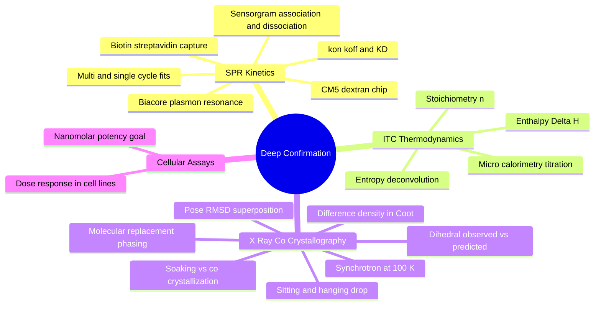

---
tags:
  - domain/benchmarking
  - depth/advanced
  - 3dsyntree
  - topic/biophysics
  - topic/crystallography
module: "10. Benchmarking and Wet Lab Translation"
chapter: "Chapter 2. Wet Lab Translation"
type: concept
---

# 2. SPR Kinetics and X-Ray Complex Confirmation

> [!abstract] Core Idea
> The deep-confirmation half of the assay cascade: surface plasmon resonance (SPR) watches a molecule bind and unbind a protein *in real time*, yielding the rates $k_{\text{on}}$, $k_{\text{off}}$ and the affinity $K_D$; isothermal titration calorimetry (ITC) counts the heat of binding to expose stoichiometry and the enthalpy/entropy split; and X-ray co-crystallography delivers the atomic ground truth — the experimental pose, superposed onto the AI's prediction, RMSD against it, and the observed junction dihedral $\phi_{\text{obs}}$ compared with the predicted $\phi_{\text{pred}}$. Cellular functional assays close the loop.

Navigation: [[0. Benchmarking and Wet Lab Translation MOC]] · [[0. Master Vault Index]]

## 1. What It Is

This note is the second half of the wet-lab cascade begun in [[1. Assay Cascade Strategy and nanoDSF]]. Where the front half asked "is it real, pure, and non-artifactual?", this half asks four sharper questions, each with a dedicated instrument:

1. **SPR (surface plasmon resonance)** — *how fast* does the molecule bind and dissociate? (kinetics: $k_{\text{on}}$, $k_{\text{off}}$, $K_D$)
2. **ITC (isothermal titration calorimetry)** — *how much heat* is released, per molecule of protein, and what does the enthalpy/entropy ledger look like? (thermodynamics: $n$, $\Delta H$, $\Delta S$)
3. **X-ray co-crystallography** — *where exactly* does every ligand atom sit in the experimental electron density, and does the observed geometry match the model's predicted pose and torsions?
4. **Cellular functional assays** — does the molecule actually *do something* to the target's function inside living human cells?

## 2. Why It Exists

A nanoDSF shift says "binding is plausible"; it cannot say whether the molecule stays bound for seconds or hours (residence time), whether binding is driven by tidy hydrogen bonds or by greasy water-shedding, or whether the molecule sits in the pocket the way the computer drew it. These distinctions decide whether a hit becomes a drug. And for a *generative 3D model* there is a uniquely pointed question no conventional program faces: **the model predicts specific molecular geometry inside the pocket — is that geometry real?** X-ray co-crystallography is the only technique that answers with atomic coordinates, making it the ultimate falsification test for the entire 3D-SynTree thesis: synthesizable molecules, correctly shaped by the torsion policy, sitting in the pocket as designed.

## 3. How It Works

### 3.1 SPR Instrumentation: Biacore and the Plasmon Signal

In a **Biacore**-type instrument, the target protein is immobilized on the gold surface of a sensor **chip**, and a microfluidic system flows the small molecule (**analyte**) solution across it. Light reflecting off the gold film couples into collective electron oscillations (**surface plasmons**) at a characteristic resonance angle that depends on the **refractive index** of the layer just above the gold. When mass from solution accumulates on the surface — because analyte binds immobilized protein — the local refractive index shifts, and the instrument reports the shift in **response units (RU)** in real time. Binding becomes an optical, label-free movie.

### 3.2 Chip Chemistry: CM5 and Capture Strategies

The standard **CM5 chip** carries a loose, hydrated **carboxymethyl dextran** matrix — a brush of carbohydrate polymer studded with carboxylic acid groups. Standard **amine coupling** activates those groups (EDC/NHS chemistry) so the protein's lysine side chains attach covalently. The gentler alternative is **biotin–streptavidin capture**: the protein is engineered with a biotin tag and simply captured on a streptavidin surface — oriented, intact, and replaceable. A **reference flow cell** (surface without protein, or an irrelevant protein) is measured simultaneously and subtracted, removing bulk refractive-index effects such as DMSO mismatch.

### 3.3 The Sensorgram: Association and Dissociation

A **sensorgram** is the RU-versus-time trace of one injection. During the **association phase**, analyte at concentration $C$ flows over the surface; complexes form faster than they fall apart and the trace rises. Buffer then replaces the sample; during the **dissociation phase** complexes decay and the trace falls. For a simple 1:1 interaction,

$$\frac{dR}{dt} = k_{\text{on}}\, C\, (R_{\max} - R) - k_{\text{off}}\, R$$

where $R_{\max}$ is the response at saturation. The rising and falling phases are simultaneously fitted for the two rates, and the equilibrium affinity follows:

$$K_D = \frac{k_{\text{off}}}{k_{\text{on}}}$$

(the metric relationships between $K_D$, $\text{IC}_{50}$, and $K_i$ are the subject of [[2. Kinetic and Affinity Metrics IC50 Kd Ki]]).

### 3.4 Multi-Cycle versus Single-Cycle Kinetics

**Multi-cycle kinetics** runs a series of injections at increasing analyte concentration, regenerating the surface (washing the ligand off) between cycles, and globally fits all sensorgrams to one $k_{\text{on}}$, $k_{\text{off}}$. **Single-cycle kinetics** injects the concentration series *back-to-back without regeneration* — indispensable for tight binders whose complexes dissociate too slowly to regenerate cleanly. Either way, the success criterion is the same: residuals of a **clean 1:1 fit**, flat baselines, and no drift — evidence that the molecule binds the target as a single, well-behaved species.

### 3.5 ITC: Label-Free Calorimetry and Thermodynamic Deconvolution

**Isothermal titration calorimetry** is the gold-standard orthogonal measurement: the small molecule is injected stepwise into a solution of protein in a sensitive microcalorimeter, and each injection releases or absorbs its **heat pulse** ($\mu\text{cal}$). Integrating the pulses against the molar ratio and fitting the binding isotherm yields, in one experiment:

- the **stoichiometry** $n$ — how many ligand molecules bind per protein (a clean $n \approx 1$ is the 1:1 sanity check);
- the **enthalpy** $\Delta H$ — the heat of the interaction itself, direct evidence for the hydrogen bonds and electrostatic contacts made and broken;
- the equilibrium $K_D$ — and from it $\Delta G = RT \ln K_D$, so the **entropy** follows by deconvolution: $\Delta S = (\Delta H - \Delta G)/T$.

The $\Delta H$ versus $-T\Delta S$ split tells you *why* the molecule binds — enthalpy-driven (specific interactions) or entropy-driven (hydrophobic desolvation) — information no other assay gives and the physical ledger underlying [[1. Protein Ligand Binding Thermodynamics]].

### 3.6 X-ray Co-Crystallography: From Drops to Density

**Growing crystals.** In **sitting-drop** or **hanging-drop vapor diffusion**, a microliter droplet of protein-plus-precipitant equilibrates against a larger reservoir; water slowly evaporates from the drop until the protein reaches supersaturation and, with luck, nucleates into ordered crystals. **Soaking** diffuses the ligand into pre-grown apo crystals (fast, but the crystal lattice may resist the ligand); **co-crystallization** crystallizes the protein–ligand complex from scratch (more reliable for capturing the true bound conformation). Both are attempted in parallel.

**Data collection.** The crystal is flash-cooled to cryogenic **100 K** (liquid-nitrogen stream) to suppress radiation damage, and diffraction is collected on a **synchrotron beamline** — the intense, tunable X-ray source that resolves atomic positions.

**Phasing.** The diffracted intensities lack phase information; **molecular replacement (MR)** supplies it by placing a known homologous structure (typically the apo structure of the same protein) into the new crystal's unit cell. Crucially, the ligand is **omitted** from the initial model, so the ligand's electron density appears only if the data genuinely contain it — the unbiased-difference-density discipline that prevents model bias from painting in the answer.

**Interpreting the maps.** The crystallographer inspects $F_o - F_c$ **difference maps** (observed minus calculated structure factors) in a graphical building suite such as **Coot**: a positive $F_o - F_c$ blob is *electron density present in the data but absent from the model* — exactly where unmodeled ligand atoms sit. The ligand is then built, atom by atom, only into density that is genuinely there.

### 3.7 Superposition, RMSD, and the Dihedral Audit

With the refined experimental complex in hand, the final act is comparison with the prediction:

- **Pose RMSD.** The experimental protein coordinates are superposed onto the in-silico pocket frame (the rigid-alignment mathematics of [[4. The Kabsch Algorithm and Rigid Alignment]]), and the heavy-atom **root-mean-square deviation** between the experimental and predicted ligand positions is computed. Sub-2 Å generally means the predicted pose is essentially confirmed; a ligand in a different sub-pocket or reversed orientation falsifies it.
- **Dihedral verification: $\phi_{\text{obs}}$ versus $\phi_{\text{pred}}$.** The single most pointed check for 3D-SynTree. The torsion angle about the newly formed junction single bond — the exact quantity the policy chose — is measured in the experimental structure ($\phi_{\text{obs}}$, read directly from the refined coordinates) and compared with the model's output ($\phi_{\text{pred}}$, the selected torsion bin plus refinement). Agreement validates the torsion head's pocket-conditioned choices; systematic disagreement is a model-improvement signal, not a failure of the experiment.

> [!example] The dihedral audit in numbers
> The policy places a biaryl junction in the 150–160° bin (anti-periplanar, avoiding an ortho-hydrogen clash). The co-crystal refines to $\phi_{\text{obs}} = 158^\circ$; heavy-atom pose RMSD $0.8\text{ Å}$. Predicted geometry: confirmed on both counts. Had the density shown $85^\circ$ with the ligand flipped, the torsion policy's pocket model would be indicted by the data.

### 3.8 Cellular Functional Assays: The Last Gate

Finally, the molecule is tested for **functional inhibition in living human cell lines**: cells carrying the target are dosed across a concentration series, and a functional readout (reporter signal, substrate conversion, proliferation) yields a dose–response curve and a cellular $\text{EC}_{50}$. The 3D-SynTree aspiration is **nanomolar cellular potency** — a molecule that works where it matters. Cellular potency conflates permeability, metabolic stability, and engagement (the ADMET factors of [[2. ADMET Pharmacokinetics and Metabolic Stability]]), which is exactly why it is the capstone: it is the first measurement that begins to resemble medicine rather than biophysics.

## 4. What It Consists Of

- **SPR instrument** — Biacore-class optics, microfluidics, gold sensor chips.
- **CM5 chip chemistry** — carboxymethyl dextran, amine coupling, biotin–streptavidin capture, reference subtraction.
- **Sensorgram** — association and dissociation phases; 1:1 kinetic model; $K_D = k_{\text{off}}/k_{\text{on}}$.
- **Kinetic designs** — multi-cycle with regeneration, or single-cycle concentration series.
- **ITC** — titration microcalorimeter; fitted $n$, $\Delta H$, $K_D$; derived $\Delta S$.
- **Crystallography workflow** — vapor-diffusion drops, soaking versus co-crystallization, 100 K synchrotron collection, molecular replacement phasing, $F_o - F_c$ maps in Coot.
- **Comparison toolkit** — Kabsch superposition, heavy-atom pose RMSD, $\phi_{\text{obs}}$ versus $\phi_{\text{pred}}$ dihedral audit.
- **Cellular assays** — dose–response functional inhibition in human cell lines.

## 5. What You Must Understand

> [!warning] Computational metrics are surrogates — these are the referees
> Real drug-discovery success is measured by clean 1:1 binding kinetics on SPR, high-resolution co-crystal density, and nanomolar cellular potency. A docking score is a hypothesis; this note's experiments are the verdicts.

> [!warning] Never build the ligand before you have seen its density
> Phasing with an apo model and inspecting $F_o - F_c$ difference maps *before* placing any ligand atom is the anti-bias discipline. A ligand modeled from hope rather than density is indistinguishable from fraud in a deposited structure.

> [!warning] SPR has its own artifacts
> Mass-transport limitation (analyte depleted near the surface), denatured immobilized protein, and DMSO mismatch all distort sensorgrams. Residuals, reference subtraction, and capture-oriented chips exist to control them.

> [!tip] Memory hook: watch it, heat it, see it, use it
> SPR *watches* binding in real time; ITC *heats* it apart into enthalpy and entropy; crystallography *sees* the atoms; cells tell you it *works*.

> [!note] $\phi_{\text{obs}}$ versus $\phi_{\text{pred}}$ is the thesis test
> Of every measurement in the cascade, the junction-dihedral comparison is the one that audits 3D-SynTree's central, distinctive claim: that choosing torsions pocket-conditionedly produces molecules with the right shape.

## 6. Prerequisites

- [[2. Rotatable Bonds and Dihedral Angles]] — the torsion angle definition that the $\phi_{\text{obs}}$ versus $\phi_{\text{pred}}$ audit measures.
- [[3. X-Ray Crystallography and PDB Artifacts]] — diffraction, electron density, phasing, and the deposition artifacts that bias structural data.
- [[2. Kinetic and Affinity Metrics IC50 Kd Ki]] — the $K_D$/$\text{IC}_{50}$ metric language SPR experiments report in.

## 7. Project Connection

This cascade is the ultimate translational goal of 3D-SynTree: every design includes a verified synthesis recipe, so its molecules can proceed directly from the computational gates of `EvaluationPipeline` in `syntree/engine/evaluator.py` into synthesis and this confirmation sequence. The dihedral audit checks the engine's core output directly: `ConformerEngine` in `syntree/chemistry/conformer.py` sets junction torsions with `apply_junction_torsion()` and reads them back with `get_dihedral()`, and the torsion heads — the final categorical action space of 36 bins of 10° plus sub-bin refinement, next to the continuous `ContinuousTorsionHead` predicting $[\cos\mu, \sin\mu, \log\kappa]$ with `rdMolTransforms.SetDihedralDeg` — are precisely the quantities $\phi_{\text{obs}}$ confronts. The isotope labels applied by `_tag_atoms()` (core atoms offset by `_CORE_MAP_OFFSET = 1000`, synthon atoms by `_SYNTHON_MAP_OFFSET = 2000`) guarantee that the exact predicted junction remains identifiable when the experimental coordinates are superposed with the Kabsch step `_kabsch()`. And the docking term $S_{\text{dock}}$ from GNINA/Vina inside `ThreeDReward` in `syntree/engine/rl.py` is the surrogate whose honesty this entire cascade audits.

## 8. Required Depth

**Advanced** — this is the capstone translational note: it presumes the whole computational stack and the cascade front end, and closes the loop from reward function to experimental reality.

## 9. Further Dependencies

- None — this is the terminal note of the vault's learning path, where prediction finally meets measurement; its companion and immediate upstream note is [[1. Assay Cascade Strategy and nanoDSF]], whose surviving hits are the molecules examined here.

## Concept Mind Map

## Cross-Domain Links

- [[AI/10. Numerical Analysis and High-Performance GPU Engineering/Chapter 1. Precision Dynamics and Numerics/1. IEEE 754 Floating-Point Formats FP32 FP16 BF16|1. IEEE 754 Floating-Point Formats FP32 FP16 BF16]] (AI vault) — wet-lab confirmation demands reproducible numerics - the motivation for the pure-FP32 policy on Tesla T4.
- [[AI/10. Numerical Analysis and High-Performance GPU Engineering/Chapter 1. Precision Dynamics and Numerics/2. Underflow Denormals and GradScaler Scale Collapse|2. Underflow Denormals and GradScaler Scale Collapse]] (AI vault) — FP16 GradScaler scale collapse once froze validation runs; pure FP32 eliminates the failure mode.
