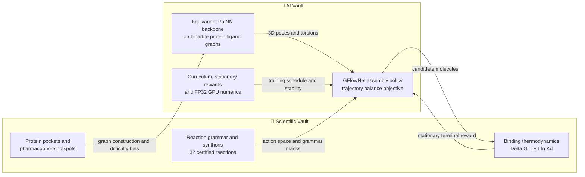

# SynPath-Project-Explained

> [!abstract] Mission
> **3D-SynTree (SynPath)** is a structure-based, synthesis-constrained molecular design system: it builds drug-like molecules *inside protein binding pockets* by assembling purchasable Enamine REAL synthons through certified medicinal-chemistry reactions, using an equivariant graph neural network and a GFlowNet assembly policy trained with physically grounded, stationary rewards.
>
> This site is the project's complete dual knowledge base: every scientific constraint, every mathematical derivation, and every engineering safeguard behind the system, written as one interconnected digital garden.

Maintained by [vtheonly](https://github.com/Vtheonly) · [Source on GitHub](https://github.com/Vtheonly/SynPath-Project-Explained)

## The Two Vaults

The knowledge base is organized as two mirrored curricula — the *scientific reality* of the problem and the *machine-learning machinery* built to solve it. Every module in one vault has a counterpart in the other, and the notes are cross-linked so you can jump between a chemical concept and the mathematics that implements it at any time.

> [!info] 🧪 Scientific & Chemical Foundations Vault
> Atoms, bonds, reaction grammar, synthons, protein pockets, stereochemistry, thermodynamics, circular statistics, and wet-lab translation.
>
> **10 modules · 58 concept notes · [[Chemistry/00. Master Index and System Map/0. Master Vault Index|Browse the Scientific Knowledge Vault →]]**

> [!tip] 🤖 AI, Mathematics & Systems Engineering Vault
> Tensor algebra, representation learning, attention, graph neural networks, Lie groups and equivariance, PaiNN, directional statistics, GFlowNets, training dynamics, and GPU numerics.
>
> **10 modules · 73 notes · [[AI/00. Master Index and System Map/0. Master AI Vault Index|Browse the AI & Engineering Vault →]]**

## How the Two Domains Interlock

Chemistry defines what is *physically meaningful*; the AI vault implements what is *mathematically possible*. The diagram below shows the main feedback loop of 3D-SynTree — chemical constraints feed the generative policy, and generated candidates are scored against physical reality.

## How to Navigate

- **File explorer (left sidebar):** expand `Chemistry/` or `AI/` and drill into numbered modules, chapters, and concept notes. Folders sort numerically from `00.` to `10.`.
- **Full-text search (top left):** finds any note by content or title.
- **Graph view (right sidebar):** the local graph shows the current note's neighborhood; open the global graph from the left sidebar to see the full cross-vault link structure.
- **Backlinks (right sidebar):** every note lists what links to it, so you can arrive at a concept from every direction.
- **Reading order inside a note:** each concept note follows a fixed 9-section schema — *What It Is → Why It Exists → How It Works → What It Consists Of → What You Must Understand → Prerequisites → Project Connection → Required Depth → Further Dependencies* — ending with a Mermaid mind map of the concept.
- **Dual roadmaps:** follow the [[Chemistry/00. Master Index and System Map/0. Master Vault Index|Chemistry master index]] or the [[AI/00. Master Index and System Map/0. Master AI Vault Index|AI master index]]; both list their modules in prerequisite order.
- **Cross-domain links:** notes that implement each other end with a *Cross-Domain Links* section connecting an AI method to the chemical reality it encodes (and vice versa).

## Module Map

| # | 🧪 Scientific & Chemical Foundations | 🤖 AI, Mathematics & Systems Engineering |
| --- | --- | --- |
| 01 | [[Chemistry/01. Chemistry Foundations/0. Chemistry Foundations MOC|Chemistry Foundations]] | [[AI/01. Advanced Tensor Algebra and Computational Graphs/0. Advanced Tensor Algebra MOC|Advanced Tensor Algebra & Computational Graphs]] |
| 02 | [[Chemistry/02. Medicinal Chemistry and Synthesis/0. Medicinal Chemistry and Synthesis MOC|Medicinal Chemistry & Synthesis]] | [[AI/02. Representation Learning and Latent Metric Spaces/0. Representation Learning MOC|Representation Learning & Latent Metric Spaces]] |
| 03 | [[Chemistry/03. Spatial Chemistry and Force Fields/0. Spatial Chemistry and Force Fields MOC|Spatial Chemistry & Force Fields]] | [[AI/03. Attention Mechanisms and Transformer Decoders/0. Attention and Transformers MOC|Attention Mechanisms & Transformer Decoders]] |
| 04 | [[Chemistry/04. Structural Biology and Protein Targets/0. Structural Biology and Protein Targets MOC|Structural Biology & Protein Targets]] | [[AI/04. Graph Neural Networks and Message Passing/0. Graph Neural Networks MOC|Graph Neural Networks & Message Passing]] |
| 05 | [[Chemistry/05. Pharmacology and Drug Discovery/0. Pharmacology and Drug Discovery MOC|Pharmacology & Drug Discovery]] | [[AI/05. Geometric Deep Learning and Lie Groups/0. Geometric Deep Learning MOC|Geometric Deep Learning & Lie Groups]] |
| 06 | [[Chemistry/06. Cheminformatics and Algorithms/0. Cheminformatics and Algorithms MOC|Cheminformatics & Algorithms]] | [[AI/06. Equivariant Architectures: PaiNN and Bipartite Graphs/0. Equivariant Architectures MOC|Equivariant Architectures: PaiNN & Bipartite Graphs]] |
| 07 | [[Chemistry/07. Geometric Deep Learning and Equivariance/0. Geometric Deep Learning and Equivariance MOC|Geometric Deep Learning & Equivariance]] | [[AI/07. Directional Statistics and Torsion Manifolds/0. Directional Statistics MOC|Directional Statistics & Torsion Manifolds]] |
| 08 | [[Chemistry/08. Circular Statistics and Torsion Heads/0. Circular Statistics and Torsion Heads MOC|Circular Statistics & Torsion Heads]] | [[AI/08. Generative Modeling, MDPs, and GFlowNets/0. GFlowNets and Generative Modeling MOC|Generative Modeling, MDPs & GFlowNets]] |
| 09 | [[Chemistry/09. Markov Decision Processes and GFlowNets/0. Markov Decision Processes and GFlowNets MOC|Markov Decision Processes & GFlowNets]] | [[AI/09. Training Dynamics, Optimization, and Curriculum Learning/0. Training Dynamics MOC|Training Dynamics, Optimization & Curriculum Learning]] |
| 10 | [[Chemistry/10. Benchmarking and Wet Lab Translation/0. Benchmarking and Wet Lab Translation MOC|Benchmarking & Wet Lab Translation]] | [[AI/10. Numerical Analysis and High-Performance GPU Engineering/0. Numerical Analysis and GPU Engineering MOC|Numerical Analysis & GPU Engineering]] |

## Start Here

| If you want to... | Start at |
| --- | --- |
| Understand the project before studying | [[Chemistry/00. Master Index and System Map/1. 3D-SynTree System Overview\|3D-SynTree System Overview]] |
| Follow the chemistry curriculum in strict prerequisite order | [[Chemistry/00. Master Index and System Map/0. Master Vault Index\|Master Vault Index]] |
| Follow the AI & engineering curriculum | [[AI/00. Master Index and System Map/1. Post-CNN Learning Roadmap and Prerequisites\|Post-CNN Learning Roadmap]] |
| See how the two vaults mirror each other | The Module Map above, or any note's *Cross-Domain Links* section |
