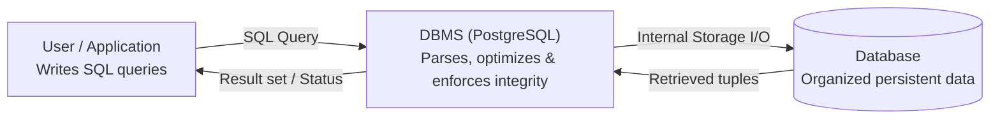

# Database Systems, Relational Model & SQL Overview

## 1. What Is Data and What Is a Database?

**Data** refers to any factual information that can be recorded, stored, and processed electronically—numbers, text strings, dates, boolean flags, sensor readings, product catalogs, course enrollments, or transaction logs. A **Database (DB)** is an organized collection of structured data that models a part of the real world and supports computer applications. Unlike scattered text files or ad-hoc spreadsheets, a database provides systematic storage, querying, integrity enforcement, concurrency control, security, and crash recovery.

### Database vs. Spreadsheet

Spreadsheets and databases both display rows and columns, but differ fundamentally in capability and purpose:

- **Scale & Complex Querying:** A spreadsheet works well for ten employees and basic sums. With thousands of records (e.g., finding every employee with at least 3 years of tenure and fewer than 3 absences), spreadsheets require brittle manual scanning or formulas, whereas a database executes a declarative SQL query in milliseconds.
- **Selective Access Control:** Spreadsheets are typically all-or-nothing. A database grants fine-grained access: a website user sees only their own `username` and `email`, while an administrator views internal IDs, registration dates, and audit histories.
- **Relational Structure:** Spreadsheets force data into flat grids, creating massive duplication; relational databases split entities into interconnected tables and recombine them cleanly via joins.

---

## 2. DBMS, RDBMS, and the SQL Standard vs. PostgreSQL

- **DBMS (Database Management System):** A software system that lets users define, create, maintain, and control access to databases across any model (relational, hierarchical, network, NoSQL).
- **RDBMS (Relational DBMS):** A DBMS built specifically on the relational model (e.g., **PostgreSQL**, MySQL, Oracle Database, Microsoft SQL Server, SQLite). An RDBMS translates raw scattered bytes on physical drives into clean logical tables and adds **queries**, **views**, and **ACID transactions** (for example, guaranteeing that a bank debit and credit both complete or both roll back together on power loss).
- **SQL (Structured Query Language):** The standardized **declarative** language (standardized by **ISO/IEC**) used to communicate with an RDBMS.
  - **Standard vs. Implementation (Ch 1 Slide 3):** SQL is the ISO/IEC standard language; PostgreSQL, MySQL, Oracle, and SQL Server are concrete implementations. **PostgreSQL** implements a large portion of the ISO/IEC SQL standard while adding powerful extensions (such as `ILIKE`, `$$` dollar-quoting, `IS DISTINCT FROM`, `MATERIALIZED VIEW` refresh commands, and `PL/pgSQL`) and showing minor syntactic differences from MySQL or Oracle.

### Front-End, Back-End, Client, and Server Decoupling

- **Client & Front-End:** The browser/UI layer (`HTML`, `CSS`, `JavaScript`) that presents data and collects input without ever needing SQL knowledge or direct database connections.
- **Server & Back-End:** Server-side application code (`Python`, `Java`, `Node.js`, `PHP`) + the RDBMS server. The back-end validates input, prevents SQL injection, enforces authorization, executes SQL against the database, and catches database errors so internal schema details are never leaked to end users.
- **Compatibility via Views:** If a back-end table splits `full_name` into `first_name` and `last_name`, a **view** can concatenate them back into `full_name` so front-end queries continue working unchanged.

---

## 3. SQL Language Categories & Course Organization

| Category | Full Name                    | Purpose                                                              | Main Statements                                                            |
| :------- | :--------------------------- | :------------------------------------------------------------------- | :------------------------------------------------------------------------- |
| **DDL**  | Data Definition Language     | Define, alter, or remove database structural objects (the blueprint) | `CREATE`, `ALTER`, `DROP` (`DATABASE`, `DOMAIN`, `TABLE`, `VIEW`, `INDEX`) |
| **DML**  | Data Manipulation Language   | Insert, update, and delete row data inside tables                    | `INSERT`, `UPDATE`, `DELETE`                                               |
| **DQL**  | Data Query Language          | Retrieve, filter, group, and analyze data (often grouped under DML)  | `SELECT`                                                                   |
| **DCL**  | Data Control Language        | Manage user privileges and object permissions                        | `GRANT`, `REVOKE`                                                          |
| **TCL**  | Transaction Control Language | Control atomic execution boundaries                                  | `BEGIN` / `START TRANSACTION`, `COMMIT`, `ROLLBACK`, `SAVEPOINT`           |

**Course Organization Matrix (Ch 1 Slide 5):**

- **DDL & Constraints:** `CREATE`, `ALTER`, `DROP`, `PRIMARY KEY`, `FOREIGN KEY`, `NOT NULL`, `UNIQUE`, `CHECK`, `DEFAULT`
- **Filtering & Sorting:** `WHERE`, `BETWEEN`, `IN`, `LIKE`/`ILIKE`, `IS NULL`, `ORDER BY`
- **Aggregation & Grouping:** `COUNT`, `SUM`, `AVG`, `MIN`, `MAX`, `GROUP BY`, `HAVING`
- **Joins & Set Operations:** `INNER`, `LEFT`, `RIGHT`, `FULL`, `CROSS`, `SELF`, `NATURAL`; `UNION`, `UNION ALL`, `INTERSECT`, `EXCEPT`
- **Subqueries, Expressions & CTEs:** `IN`, `EXISTS`, `ANY`/`SOME`, `ALL`, `CASE`, `WITH` / `WITH RECURSIVE`

---

## 4. The Relational Model, Terminology & Atomic Values

Introduced by **Edgar F. Codd (1970)**, the relational model builds on **mathematical set theory** and **first-order predicate logic**. Mathematically, given sets like $\{2, 4\}$ and $\{6, 8\}$, their Cartesian product yields ordered pairings; in a database, attribute domains combine into tuples describing real-world entities.

### Complete Terminology & Synonym Mapping

| Formal / Relational Term    | SQL / Table Term            | File-Processing / Casual Synonym | Meaning & Example                                                                                                                               |
| :-------------------------- | :-------------------------- | :------------------------------- | :---------------------------------------------------------------------------------------------------------------------------------------------- |
| **Entity Type / Relation**  | **Table**                   | File                             | Category of tracked object (`teacher`, `student`); a mathematical set of tuples. Note: "relational" comes from _relation_, not _relationships_. |
| **Specific Entity / Tuple** | **Row**                     | Record / Entry                   | One horizontal entity instance, e.g., `(101, 'Benali', 'Ahmed', 75000, 1)`.                                                                     |
| **Attribute**               | **Column**                  | Field                            | Vertical property defining one piece of metadata (`salary`, `first_name`).                                                                      |
| **Domain**                  | **Data Type & Constraints** | —                                | Set of valid values permitted in a column (`NUMERIC(10,2)`, `age > 0`).                                                                         |
| **Attribute Value**         | **Cell Value**              | Value                            | Concrete entry at the intersection of one row and one column.                                                                                   |
| **Cardinality**             | **Row Count**               | —                                | Number of tuples in a relation.                                                                                                                 |
| **Degree / Arity**          | **Column Count**            | —                                | Number of attributes in a relation.                                                                                                             |
| **NULL**                    | **NULL**                    | —                                | Absence of a value / unknown value (strictly distinct from `0`, `''`, or whitespace; tested only with `IS NULL` / `IS NOT NULL`).               |
| **Schema**                  | **Schema**                  | Blueprint                        | Structural definition of tables, columns, types, keys, and constraints.                                                                         |
| **View**                    | **Virtual Table**           | Saved Query                      | Named `SELECT` query presenting a filtered/joined subset without storing rows.                                                                  |

### Atomic Values (Prerequisite for 1NF)

An **atomic value** represents **one and only one unit of information** in a single cell—indivisible for the purposes of the application:

- **Full Name Violation:** Storing `'Caleb Daniel Curry'` in `full_name` prevents easy sorting or filtering by last name; decompose into `first_name`, `middle_name`, `last_name`.
- **Address Violation:** Storing `'123 Epic Lane, Legit, CA 73821'` in one cell blocks `WHERE state = 'CA'`; decompose into `street_address`, `city`, `state`, `zip_code`.
- **Multi-Valued Attribute Violation:** Storing `'The Matrix, Inception, Interstellar'` in `favorite_movies` prevents normal indexing, uniqueness, and deletion; extract into a child table `favorite_movies(user_id, movie)`.
- **Contextual Rule & Avoiding Over-Decomposition:** Phone numbers or `DATE` values (`'2026-11-12'`) are stored in single columns when always handled as single units—only split `area_code` or `year/month/day` if queries genuinely filter on them independently. Never split a single word like `'subscribe'` into individual characters.

---

## 5. The Three Design Schemas, Data Integrity & Naming Conventions

### Conceptual, Logical, and Physical Schemas

| Schema Level          | Level of Abstraction                     | Focus & Decisions                                                                                                                  |
| :-------------------- | :--------------------------------------- | :--------------------------------------------------------------------------------------------------------------------------------- |
| **Conceptual Schema** | Highest (DBMS-independent)               | Identifies entities, attributes, and business relationships (e.g., "one department has many teachers").                            |
| **Logical Schema**    | Intermediate (Relational, DBMS-agnostic) | Defines exact tables, columns, primary keys, foreign keys, data types, and normalized forms (`teacher`, `class`, `teacher_class`). |
| **Physical Schema**   | Concrete (DBMS-specific)                 | Configures PostgreSQL server, B-tree/hash indexes, partitioning, views, stored routines, security roles, and backups.              |

### Three Data Integrity Pillars

Good database design prevents **data anomalies** (update, insertion, and deletion anomalies) by enforcing:

1. **Entity Integrity:** Every row represents a distinct entity uniquely identified by a non-null `PRIMARY KEY` (e.g., distinguishing two people sharing the same name and phone number via `id`).
2. **Referential Integrity:** Every non-null `FOREIGN KEY` must point to a valid existing parent row (`CASCADE`, `RESTRICT`/`NO ACTION`, `SET NULL`).
3. **Domain Integrity:** Every cell conforms to its column's data type, length, range, and constraints (`CHECK`, `NOT NULL`, `UNIQUE`).

### Standard Naming Conventions

- **SQL Keywords:** `UPPERCASE` (`SELECT`, `FROM`, `WHERE`).
- **User-Defined Names:** `lowercase` with `snake_case` underscores—**never spaces** (`first_name`, `department_id`, not `first name` or `tbl_users`).
- **Tables vs. Columns:** Plural or collective domain nouns for tables (`users`, `order_items`—note the `university` course schema uses singular `department`, `class`, `teacher`, `student`, so always follow the instructor's exact schema names in course queries!), singular nouns for columns (`last_name`, `salary`), and specific names (`department_name`, `order_date`) over vague `name`/`date`.
- **Foreign Keys:** Named consistently after the referenced table and PK (`department_id`, `class_id`). Use natural language during whiteboard brainstorming, then convert to `snake_case` in the logical schema.
