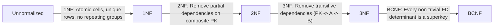

# Normalization & Functional Dependencies

Database normalization is a systematic progression of rules (**Normal Forms**) that refines a schema to eliminate redundancy, preserve lossless information, and prevent DML anomalies.

---

## 1. Anatomy of Database Anomalies (Worked Breakdown)

Consider an unnormalized flat table `R(product, client, address, date, quantity, amount)`:

| product   | client | address   | date  | quantity | amount |
| :-------- | :----- | :-------- | :---- | :------: | :----: |
| Cassettes | Dupuis | Lille     | 10/02 |   100    |  1000  |
| CD-ROM    | Dupuis | Lille     | 15/02 |   150    |  1500  |
| CD-ROM    | Martin | Marseille | 01/03 |    15    |  150   |
| Disks     | Dupont | Lyon      | 05/03 |   300    |  600   |

This design suffers from four severe flaws:

1. **Redundancy:** `Dupuis` and `Lille` repeat on every order Dupuis places.
2. **Update Anomaly:** If Dupuis moves from `Lille` to `Paris`, updating only row 1 leaves row 2 saying `Lille`—contradicting the database's truth.
3. **Deletion Anomaly:** If Martin cancels order `01/03`, deleting that row erases Martin and `Marseille` permanently from the system.
4. **Insertion Anomaly:** We cannot register a new client `Dubois` in `Dijon` before he places an order, because the row lacks product/date keys.

**Normalized Solution (3NF):**

- `R1_CLIENT(code_client PK, nom_client, adresse)` $\to$ adds Dubois anytime, keeps Martin on order deletion, updates Dupuis's address in 1 place.
- `R2_PRODUIT(code_produit PK, nom_produit, prix_unitaire)`
- `R3_COMMANDE(code_commande PK, code_client FK, date, code_produit FK, quantity)`

---

## 2. Functional Dependencies & Armstrong's Axioms

A **Functional Dependency (FD)** $X \to Y$ ("$X$ determines $Y$") states that whenever two tuples share the same value(s) for $X$, they **must** share the same value(s) for $Y$ (e.g., $\text{SSN} \to \text{Name}$).

### Armstrong's Axioms (Inference Rules)

1. **Reflexivity:** If $Y \subseteq X$, then $X \to Y$ _(trivial FD)_.
2. **Augmentation:** If $X \to Y$, then $XZ \to YZ$.
3. **Transitivity:** If $X \to Y$ and $Y \to Z$, then $X \to Z$.

- _(Derived rules)_ **Union:** If $X \to Y$ and $X \to Z$, then $X \to YZ$. **Decomposition:** If $X \to YZ$, then $X \to Y$ and $X \to Z$.

---

## 3. Normal Forms: 1NF, 2NF, 3NF, and BCNF

Normal forms are cumulative: a table in **3NF** automatically satisfies **2NF** and **1NF**.

### First Normal Form (1NF) — Atomicity

**Rule:** Every column contains atomic (indivisible) values of a single type, rows are unique, and no repeating groups exist.

- **Violation 1 (Multi-part cell):** `address = '123 Main St, Springfield, IL 62701'` $\to$ split into `street_address`, `city`, `state`, `postal_code`.
- **Violation 2 (Comma-separated list):** `email = 'caleb@example.com, caleb@work.com'` $\to$ extract `email(email_id PK, email, user_id FK)`.
- **Violation 3 (Repeating rows for multi-valued attribute):** Repeating `(5, Caleb, Curry, caleb@example.com)` and `(5, Caleb, Curry, caleb@work.com)` $\to$ extract `email` child table.

### Second Normal Form (2NF) — No Partial Dependencies

**Rule:** Must be in 1NF and every non-key attribute must depend on the **entire** primary key (never on only a proper subset of a composite primary key).

- _(Tables with a single-column primary key are automatically in 2NF!)_
- **Worked Violation (`book_author`):** Key is `(author_id, book_id)` with columns `author_position`, `isbn`, `book_title`.
  - `author_position` depends on `(author_id, book_id)` $\to$ full dependency (OK).
  - `isbn` and `book_title` depend **only on `book_id`** $\to$ **partial dependency!**
- **Fix:** Keep `book_author(author_id, book_id, author_position)` and move `isbn`, `book_title` to `book(book_id PK, isbn, book_title)`.

### Third Normal Form (3NF) — No Transitive Dependencies

**Rule:** Must be in 2NF and no non-key column may depend on another non-key column ($PK \to A \to B$).

- **Worked Example 1 (`review`):** `review(review_id PK, review_text, star_rating, star_meaning, user_id)`. Here `review_id -> star_rating -> star_meaning` (5 always means `'Excellent'`).
  - **Fix:** Keep `star_rating` in `review` (it depends directly on `review_id`), move `star_meaning` to `star_rating(star_rating PK, star_meaning)`.
- **Worked Example 2 (`employee`):** `employee(employee_id PK, name, department_id, department_name, department_location)`. Here `department_name` and `department_location` depend on non-key `department_id`.
  - **Fix:** Extract `department(department_id PK, department_name, department_location)` and keep `department_id` as FK in `employee`.

> [!TIP] Codd's Rule of Thumb for 3NF
> Every non-key attribute must provide a fact about **the key** (1NF), **the whole key** (2NF), and **nothing but the key** (3NF), so help me Codd.

### Boyce-Codd Normal Form (BCNF)

Stricter form of 3NF: for **every non-trivial FD** $X \to Y$, $X$ must be a **superkey**. Only differs from 3NF when a table has multiple overlapping candidate keys where a non-key attribute determines part of a candidate key.

*(Denormalization—storing derived totals like `nbqualif` in `Pilote` or precomputed materializations—is applied deliberately *after* achieving 3NF only when profiling confirms join bottlenecks, and must then be protected by triggers or refresh routines.)*

---

## 4. Worked TD Exercises (`Source TD Dépendance Fonctionnelle`)

### Exercise 1: Apartment Occupancy

Attributes: `Propriétaire (P)`, `Occupant (O)`, `Adresse (A)`, `Noapt (N)`, `Nbpièces (nb1)`, `Nbpersonnes (nb2)`.
Initial FDs: $O \to A$, $O \to N$, $O \to nb2$, $A,N \to P$, $A,N \to O$, $A,N \to nb1$.

1. **Transitive Closure:** From $O \to A, N$ and $A,N \to P, nb1$, we deduce $O \to \{A, N, nb2, P, nb1\}$ and $A,N \to \{P, O, nb1, nb2\}$.
2. **Candidate Keys:** **`{O}`** and **`{A, N}`** (minimal determinants of all attributes).
3. **3NF Verification:**
   - **2NF:** Key $O$ is single-attribute; under key $\{A,N\}$, neither $P$, $nb1$, nor $nb2$ depends on just $A$ or just $N$. $\to$ **2NF holds**.
   - **3NF:** $A,N \to O \to nb2$ goes through $O$, which IS a candidate key (not a non-key attribute!). No non-key attribute determines another non-key attribute. $\to$ **Already in 3NF!**

### Exercise 2: University Courses

Attributes: `C (Cours)`, `P (Prof)`, `H (Heure)`, `S (Salle)`, `E (Etudiant)`, `N (Note)`.
Initial FDs: $C \to P$, $H,S \to C$, $H,P \to S$, $C,E \to N$, $H,E \to S$.

1. **Inferences:** $H,E \to S$ and $H,S \to C \implies H,E \to C$; $H,E \to C$ and $C \to P \implies H,E \to P$; $H,E \to C$ and $C,E \to N \implies H,E \to N$.
2. **Candidate Key:** **`{H, E}`** (given a time and student, we determine room $S$, course $C$, professor $P$, and grade $N$).
3. **3NF Failure:** $H, E \to C \to P$ is a **transitive dependency** where $C$ is _not_ a superkey! Updating a professor for course $C$ would require updating every enrolled student's schedule row.
4. **3NF Decomposition:**
   - `R1(C, E, N)` — PK `(C, E)` (preserves $C, E \to N$)
   - `R2(C, P)` — PK `(C)` (preserves $C \to P$)
   - `R3(H, S, C)` — PK `(H, S)` (preserves $H, S \to C$)
   - `R4(H, E, S)` — PK `(H, E)` (or `R4(H, E, C)` linking student/hour to course & schedule)
