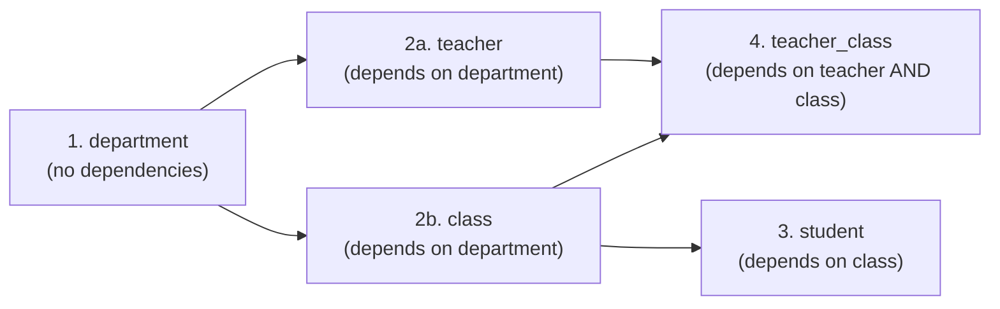

# The University Database Setup, Constraints & DML

This note integrates **Chapter 1 (Slides 6–7, 44–48)**, **TP 1 (Parts A–S)**, and **TP 2 Part I**, serving as the complete reference for setting up, populating, modifying, and auditing the **`university`** database in **PostgreSQL / pgAdmin 4**.

---

## 1. Environment Setup & Connecting via pgAdmin 4 (TP 1 Parts A–B, TP 2 Part I)

### Tool Roles

- **SQL:** The declarative language used to communicate with the database.
- **PostgreSQL:** The RDBMS server that executes SQL statements (default port `5432`, superuser `postgres`).
- **pgAdmin 4:** The graphical administration interface used to manage servers and run SQL via the **Query Tool** (click Run or press **F5**).

### Database Creation & Verification Workflow

1. Open pgAdmin 4, expand **Servers**, connect to your PostgreSQL server, open a **Query Tool**, and create the database:
   ```sql
   CREATE DATABASE university;
   ```
2. Refresh **Databases**, locate `university`, right-click it, and open a new **Query Tool** connected specifically to `university` (tables created while connected to the default `postgres` database will not be inside `university`!).
3. Verify the connection and existing base tables (TP 1 Part B.1 & TP 2 Part I):

   ```sql
   SELECT current_database(), current_user, version();

   SELECT table_name
   FROM information_schema.tables
   WHERE table_schema = 'public'
     AND table_type = 'BASE TABLE'
   ORDER BY table_name;
   ```

   _(Important TP 2/TP 3 reminder: Always reuse the `university` tables and data created in TP 1; do not recreate the four main tables or duplicate TP 1 `INSERT` statements.)_

---

## 2. The `university` Relational Schema & DDL (TP 1 Parts C–E)

The database contains four core entity tables (`department`, `class`, `teacher`, `student`) plus the N:N junction table (`teacher_class`) introduced in TP 1 Part E:

```mermaid
erDiagram
    DEPARTMENT ||--o{ TEACHER : "employs (ON DELETE SET NULL)"
    DEPARTMENT ||--o{ CLASS : "contains (ON DELETE CASCADE)"
    CLASS ||--o{ STUDENT : "enrolls (ON DELETE SET NULL)"
    TEACHER ||--o{ TEACHER_CLASS : "teaches (ON DELETE CASCADE)"
    CLASS ||--o{ TEACHER_CLASS : "taught in (ON DELETE CASCADE)"

    DEPARTMENT {
        integer department_id PK
        varchar department_name "NOT NULL UNIQUE"
    }
    TEACHER {
        integer teacher_id PK
        varchar last_name "NOT NULL"
        varchar first_name "NOT NULL"
        numeric salary "DEFAULT 30000"
        integer department_id FK "nullable"
    }
    CLASS {
        integer class_id PK
        varchar class_name "NOT NULL"
        integer department_id FK
    }
    STUDENT {
        integer student_id PK
        varchar last_name "NOT NULL"
        varchar first_name "NOT NULL"
        integer age "NOT NULL CHECK (age > 0 AND age < 150)"
        integer class_id FK "nullable"
    }
    TEACHER_CLASS {
        integer teacher_id PK_FK
        integer class_id PK_FK
    }
```

### Complete Table Creation Scripts (TP 1 Parts D & E)

```sql
-- 1. department (no dependencies)
CREATE TABLE department (
    department_id INTEGER PRIMARY KEY,
    department_name VARCHAR(50) NOT NULL UNIQUE
);

-- 2. teacher (depends on department)
CREATE TABLE teacher (
    teacher_id INTEGER PRIMARY KEY,
    last_name VARCHAR(50) NOT NULL,
    first_name VARCHAR(50) NOT NULL,
    salary NUMERIC(10,2) DEFAULT 30000,
    department_id INTEGER REFERENCES department(department_id)
        ON DELETE SET NULL
        ON UPDATE CASCADE
);

-- 3. class (depends on department)
CREATE TABLE class (
    class_id INTEGER PRIMARY KEY,
    class_name VARCHAR(50) NOT NULL,
    department_id INTEGER REFERENCES department(department_id)
        ON DELETE CASCADE
        ON UPDATE CASCADE
);

-- 4. student (depends on class)
CREATE TABLE student (
    student_id INTEGER PRIMARY KEY,
    last_name VARCHAR(50) NOT NULL,
    first_name VARCHAR(50) NOT NULL,
    age INTEGER NOT NULL CHECK (age > 0 AND age < 150),
    class_id INTEGER REFERENCES class(class_id)
        ON DELETE SET NULL
        ON UPDATE CASCADE
);

-- 5. teacher_class (N:N junction table; depends on teacher AND class)
CREATE TABLE teacher_class (
    teacher_id INTEGER NOT NULL,
    class_id INTEGER NOT NULL,
    PRIMARY KEY (teacher_id, class_id),
    FOREIGN KEY (teacher_id) REFERENCES teacher(teacher_id)
        ON DELETE CASCADE
        ON UPDATE CASCADE,
    FOREIGN KEY (class_id) REFERENCES class(class_id)
        ON DELETE CASCADE
        ON UPDATE CASCADE
);
```

_(Schema comparison note: Lecture Ch 1 Slide 6 summarizes `student.age` as `SMALLINT` without `CHECK` and omits `DEFAULT 30000` on `salary`; TP 1 defines the complete PostgreSQL lab DDL above.)_

### Why `teacher_class` Is Designed This Way (TP 1 Part E Q1–Q7)

1. **Why not add `class_id` to `teacher`?** Each teacher could reference only **one** class.
2. **Why not add `teacher_id` to `class`?** Each class could reference only **one** teacher.
3. **Why not store `'10, 20, 30'` in one column?** Violates **First Normal Form (1NF)** (non-atomic cell), breaks foreign-key validation, and prevents standard SQL joins.
4. **Junction table principles:** `teacher_class` holds one row per `(teacher, class)` assignment, uses `PRIMARY KEY (teacher_id, class_id)` (a compound key preventing duplicate assignments), leaves `teacher` and `class` completely unmodified, and can later hold relationship attributes like `academic_year` or `semester` (Part P.5 / Part R.23).

---

## 3. Foreign-Key Referential Actions (TP 1 Part H Q1–Q8)

For the complete table of referential actions (`CASCADE`, `SET NULL`, `RESTRICT`, `NO ACTION`, `SET DEFAULT`), see [[03 - Keys, Data Types & Static Constraints (PostgreSQL)]]. Here are the exact answers to **TP 1 Part H.4 (`Q1`–`Q8`)**:

- **Q1 (Deleting a department):** `teacher.department_id` becomes `NULL` (`ON DELETE SET NULL`), while `class` rows for that department are deleted (`ON DELETE CASCADE`).
- **Q2 (Updating `department.department_id`):** `teacher.department_id` and `class.department_id` automatically update to the new ID (`ON UPDATE CASCADE`).
- **Q3 (Why `SET NULL` instead of `CASCADE` on `teacher.department_id`?):** Teachers are valuable university staff; removing or reorganizing a department must preserve teacher records so they can be reassigned later.
- **Q4 (What if `ON DELETE CASCADE` were used on `teacher.department_id`?):** Deleting a department would accidentally delete all its teachers from the database!
- **Q5 (What if `ON UPDATE CASCADE` were replaced by `ON UPDATE RESTRICT`?):** Any attempt to renumber a `department_id` that still has teachers (or classes) would be **rejected** by PostgreSQL.
- **Q6 (Can `ON DELETE SET NULL` be used on a `NOT NULL` FK?):** **No**—setting the column to `NULL` on parent deletion would violate the `NOT NULL` constraint (PostgreSQL rejects the action/invalidates the rule).
- **Q7 (Concrete SQL triggering `ON UPDATE CASCADE`):**
  ```sql
  UPDATE department SET department_id = 100 WHERE department_id = 1;
  -- All teachers and classes previously in department 1 now have department_id = 100
  ```
- **Q8 (Why `ON DELETE CASCADE` in `teacher_class` instead of `SET NULL`?):** Both `teacher_id` and `class_id` are `NOT NULL` and form the **composite primary key** of `teacher_class`. Primary key columns can never be `NULL`, and an assignment without a teacher or class is meaningless, so removing a teacher or class must cascade-delete its junction rows.

---

## 4. Insertion Order & Complete TP 1 Seed Dataset (TP 1 Parts I–K)

Because foreign keys require referenced parent rows to exist first, insertion must follow the **dependency graph**:



### Answers to Insertion Order Questions (TP 1 Part I.2 Q1–Q8)

- **Q1–Q4:** `department` has no FKs, so it goes first; `teacher` and `class` reference `department`, so they follow `department`; `student` references `class`, so it follows `class`; `teacher_class` references **both** `teacher` and `class`, so it must be inserted last.
- **Q5 (Insert student with non-existent `class_id = 99`):** PostgreSQL rejects the insertion with a **foreign-key constraint violation** (`insert or update on table "student" violates foreign key constraint`).
- **Q6–Q7 (Insert teacher with `department_id = NULL` or student with `class_id = NULL`):** **Yes!** Both FK columns are nullable (no `NOT NULL` constraint). In SQL, a `NULL` foreign key means "no parent assigned yet" and satisfies referential integrity (e.g., **student 8 Farah Ines** has `class_id = NULL`).
- **Q8 (Insert `teacher_class` with missing `teacher_id`):** Rejected by PostgreSQL with a foreign-key constraint violation.

### Exact TP 1 Dataset (Ch 1 Slide 7 & TP 1 Part J–K)

Key assumptions tested throughout **TD 1, TP 2, TD 2, TP 3, and TD 3**:

- **Department 5 (`Chimie`)** has **0 teachers** and **0 classes**.
- **Teacher 109 (`Khelifi Nora`)** has **`salary = NULL`**.
- **Class 50 (`M1-Physique`)** has **0 students**.
- **Student 8 (`Farah Ines`)** has **`class_id = NULL`**.

```sql
-- J.1: Departments
INSERT INTO department (department_id, department_name) VALUES
(1, 'Informatique'),
(2, 'Mathématiques'),
(3, 'Électronique'),
(4, 'Physique'),
(5, 'Chimie');

-- J.2: Teachers
INSERT INTO teacher (teacher_id, last_name, first_name, salary, department_id) VALUES
(101, 'Benali', 'Ahmed', 75000, 1),
(102, 'Saidi', 'Nadia', 62000, 1),
(103, 'Karim', 'Samir', 48000, 2),
(104, 'Haddad', 'Amel', 85000, 2),
(105, 'Mansouri', 'Ali', 55000, 3),
(106, 'Rahmani', 'Sara', 72000, 3),
(107, 'Bensaid', 'Omar', 45000, 4),
(108, 'Ahmed', 'Yasmine', 68000, 1),
(109, 'Khelifi', 'Nora', NULL, 1);

-- J.3: Classes
INSERT INTO class (class_id, class_name, department_id) VALUES
(10, 'M1-GL', 1),
(20, 'M1-IA', 1),
(30, 'M1-Math', 2),
(40, 'M1-Elec', 3),
(50, 'M1-Physique', 4);

-- J.4: Students
INSERT INTO student (student_id, last_name, first_name, age, class_id) VALUES
(1, 'Ahmed', 'Karim', 22, 10),
(2, 'Ali', 'Sara', 23, 10),
(3, 'Amine', 'Yacine', 21, 20),
(4, 'Benali', 'Lina', 24, 20),
(5, 'Brahimi', 'Omar', 22, 30),
(6, 'Chibani', 'Amel', 23, 30),
(7, 'Dali', 'Sami', 21, 40),
(8, 'Farah', 'Ines', 22, NULL),
(9, 'Ahmed', 'Salim', 25, 10),
(10, 'Ali', 'Nadia', 20, 20);

-- J.5: Teacher-Class Assignments (14 pairs)
INSERT INTO teacher_class (teacher_id, class_id) VALUES
(101, 10), (101, 20),
(102, 10), (102, 30),
(103, 30),
(104, 30), (104, 40),
(105, 40),
(106, 40), (106, 50),
(107, 50),
(108, 10), (108, 20),
(109, 20);
```

---

## 5. DML Operations: `INSERT`, `UPDATE`, `DELETE` (Ch 1 Slides 44–48 & TP 1 Part M)

### `INSERT` Forms (Ch 1 Slides 45–46)

1. **Single row (positional):** `INSERT INTO department VALUES (6, 'Biologie');`
2. **Multiple rows:** `INSERT INTO department VALUES (7, 'Génie Civil'), (8, 'Chimie Industrielle');`
3. **Explicit column list:** `INSERT INTO department (department_id, department_name) VALUES (9, 'Biotechnologie');` (omitted columns receive `DEFAULT` or `NULL`).
4. **From another query (`INSERT ... SELECT`):**
   ```sql
   INSERT INTO destination_table
   SELECT ... FROM source_table WHERE ...;
   ```

### `UPDATE` & Composite-Key Replacement (TP 1 Part M.1–M.5)

Always use `WHERE` unless you intend to overwrite every row in the table! Use `BEGIN; ... ROLLBACK;` (or restore values afterwards) when running temporary tests.

```sql
-- M.1: Modify one teacher's salary
UPDATE teacher SET salary = 78000 WHERE teacher_id = 101;

-- M.2: Increase department 1 salaries by 5% (explicitly excluding NULL)
UPDATE teacher SET salary = salary * 1.05
WHERE department_id = 1 AND salary IS NOT NULL;

-- M.3: Assign student 8 to class 10
UPDATE student SET class_id = 10 WHERE student_id = 8;

-- M.4: Increase salaries below 50000 by 10%
UPDATE teacher SET salary = salary * 1.10 WHERE salary < 50000;

-- M.5: Reassign teacher 103 from class 30 to class 40 in junction table
-- Note: Replace composite key via DELETE + INSERT (not direct UPDATE of PK!)
DELETE FROM teacher_class WHERE teacher_id = 103 AND class_id = 30;
INSERT INTO teacher_class (teacher_id, class_id) VALUES (103, 40);
```

### `DELETE` (Ch 1 Slide 48)

```sql
DELETE FROM table_name WHERE condition;
```

---

## 6. Testing Integrity Constraints & Structural Changes (TP 1 Parts O, P, Q)

### Part O: Observing PostgreSQL Integrity Enforcement (`O.1`–`O.10`)

> [!WARNING] Source Discrepancy on `O.5`, `O.6`, `O.7`
> In TP 1 Part D, `teacher.salary` had no `CHECK` constraint (it was added and dropped in Part F), and `class.class_name` had neither `UNIQUE` nor `CHECK`. To observe `O.5`–`O.7` fail as intended, add those constraints via `ALTER TABLE` first (and drop them afterwards if continuing with the default schema):
>
> ```sql
> ALTER TABLE teacher ADD CONSTRAINT chk_teacher_salary CHECK (salary IS NULL OR salary > 0);
> ALTER TABLE class ADD CONSTRAINT uq_class_name UNIQUE (class_name);
> ALTER TABLE class ADD CONSTRAINT chk_class_name_len CHECK (LENGTH(class_name) >= 3);
> ```

| Test     | Attempted `INSERT`                                                                                           | Result / Violated Constraint                                                                                    |
| :------- | :----------------------------------------------------------------------------------------------------------- | :-------------------------------------------------------------------------------------------------------------- |
| **O.1**  | `INSERT INTO department VALUES (1, 'Biology');`                                                              | Rejected: **`PRIMARY KEY`** (`department_id = 1` already exists).                                               |
| **O.2**  | `INSERT INTO teacher VALUES (110, 'Test', 'Student', 50000, 99);`                                            | Rejected: **`FOREIGN KEY`** (department `99` does not exist).                                                   |
| **O.3**  | `INSERT INTO teacher VALUES (111, NULL, 'Test', 50000, 1);`                                                  | Rejected: **`NOT NULL`** on `last_name`.                                                                        |
| **O.4**  | `INSERT INTO student VALUES (11, 'Test', 'Student', -5, 10);`                                                | Rejected: **`CHECK`** on `student.age` (`age > 0 AND age < 150`).                                               |
| **O.5**  | `INSERT INTO teacher VALUES (113, 'Test', 'Salary', -1000, 1);`                                              | Rejected: **`CHECK`** `chk_teacher_salary` _(once added!)_.                                                     |
| **O.6**  | `INSERT INTO class VALUES (60, 'M1-GL', 1);`                                                                 | Rejected: **`UNIQUE`** on `class.class_name` _(once added!)_.                                                   |
| **O.7**  | `INSERT INTO class VALUES (61, 'AB', 1);`                                                                    | Rejected: **`CHECK`** on `class.class_name` _(once added!)_.                                                    |
| **O.8**  | `INSERT INTO teacher_class VALUES (101, 10);`                                                                | Rejected: **Composite `PRIMARY KEY (teacher_id, class_id)`** — prevents duplicate assignments in the N:N table. |
| **O.9**  | `INSERT INTO teacher_class VALUES (999, 10);`                                                                | Rejected: **`FOREIGN KEY (teacher_id)`** (teacher `999` missing).                                               |
| **O.10** | `INSERT INTO teacher (teacher_id, last_name, first_name, department_id) VALUES (112, 'Default', 'Test', 1);` | **Succeeds!** Assigned **`salary = 30000.00`** by `DEFAULT 30000`.                                              |

### Part P (`ALTER TABLE`) & Part Q (Final Verification)

```sql
-- P.1–P.4: Modify student structure (revert age rename before TP 2/3!)
ALTER TABLE student ADD COLUMN email VARCHAR(100);
ALTER TABLE student DROP COLUMN email;
ALTER TABLE student RENAME COLUMN age TO student_age;
ALTER TABLE student ALTER COLUMN student_age TYPE SMALLINT;

-- P.5: Extend junction table with relationship attribute
ALTER TABLE teacher_class ADD COLUMN academic_year VARCHAR(10);
UPDATE teacher_class SET academic_year = '2025-2026';
```

- **Part Q Counts:** `department`: `5`, `teacher`: `9`, `class`: `5`, `student`: `10`, `teacher_class`: `14` _(note: Part Q printed `13`, whereas Part J inserts 14 pairs)_; verify Chimie exists, M1-Physique exists, Khelifi Nora has `NULL` salary, Farah Ines has `NULL` `class_id` (after restoring `M.3`), Benali Ahmed teaches M1-GL & M1-IA, and M1-Math is taught by $\ge 2$ teachers.

---

## 7. Worked Solutions: TP 1 Part R (All 28 Exercises) & Part S (16-Step Final Challenge)

### Part R Solutions (`R.1`–`R.28`)

```sql
-- R.1: All department names alphabetically
SELECT department_name FROM department ORDER BY department_name ASC;

-- R.2: Teachers earning > 70000
SELECT last_name, first_name, salary FROM teacher WHERE salary > 70000;

-- R.3: Salary between 50000 and 80000
SELECT * FROM teacher WHERE salary BETWEEN 50000 AND 80000;

-- R.4: Students younger than 23
SELECT * FROM student WHERE age < 23;

-- R.5: Students whose last name starts with A
SELECT * FROM student WHERE last_name LIKE 'A%';

-- R.6: Teachers with non-NULL salary
SELECT * FROM teacher WHERE salary IS NOT NULL;

-- R.7: Students without a class
SELECT * FROM student WHERE class_id IS NULL;

-- R.8: All classes ordered by class_name
SELECT * FROM class ORDER BY class_name;

-- R.9: Three highest salaries (NULLS LAST critical in PostgreSQL!)
SELECT DISTINCT salary FROM teacher WHERE salary IS NOT NULL
ORDER BY salary DESC FETCH FIRST 3 ROWS ONLY;

-- R.10: Teachers from dept 1 earning > 60000
SELECT * FROM teacher WHERE department_id = 1 AND salary > 60000;

-- R.11–R.13: Updates (run inside BEGIN; ... ROLLBACK; if keeping original TP1 state)
UPDATE teacher SET salary = 52000 WHERE teacher_id = 103;
UPDATE teacher SET salary = salary * 1.05 WHERE department_id = 3 AND salary IS NOT NULL;
UPDATE student SET age = 21 WHERE student_id = 10;
```

- **R.14 (`INSERT` vs `UPDATE` vs `ALTER TABLE` vs `SELECT`):**
  - `INSERT` (DML): adds **new rows** to an existing table.
  - `UPDATE` (DML): modifies **existing row values** in a table.
  - `ALTER TABLE` (DDL): modifies the **table structure/schema** (columns, data types, constraints).
  - `SELECT` (DQL/DML): **reads/queries** data without changing stored tables or structure.

```sql
-- R.15–R.17: Managing constraints
ALTER TABLE class ADD CONSTRAINT uq_class_name UNIQUE (class_name);
-- Verify: INSERT INTO class VALUES (99, 'M1-GL', 1); -> fails

-- R.16: Note Part D created an unnamed CHECK on student.age; inspect name in pg_constraint first!
ALTER TABLE student DROP CONSTRAINT student_age_check; -- typical auto-generated name in PostgreSQL
ALTER TABLE student ADD CONSTRAINT chk_student_age CHECK (age >= 18 AND age < 150);

-- R.17: Drop UNIQUE on class_name
ALTER TABLE class DROP CONSTRAINT uq_class_name;

-- R.18: Each teacher with names of classes they teach
SELECT t.last_name, t.first_name, c.class_name
FROM teacher t
JOIN teacher_class tc ON t.teacher_id = tc.teacher_id
JOIN class c ON tc.class_id = c.class_id
ORDER BY t.last_name, c.class_name;

-- R.19: Each class with names of its teachers
SELECT c.class_name, t.last_name, t.first_name
FROM class c
JOIN teacher_class tc ON c.class_id = tc.class_id
JOIN teacher t ON tc.teacher_id = t.teacher_id
ORDER BY c.class_name, t.last_name;

-- R.20: Teachers teaching more than 2 classes
SELECT t.teacher_id, t.last_name, t.first_name, COUNT(tc.class_id) AS class_count
FROM teacher t JOIN teacher_class tc ON t.teacher_id = tc.teacher_id
GROUP BY t.teacher_id, t.last_name, t.first_name
HAVING COUNT(tc.class_id) > 2;

-- R.21: Classes taught by exactly 1 teacher
SELECT c.class_id, c.class_name, COUNT(tc.teacher_id) AS teacher_count
FROM class c JOIN teacher_class tc ON c.class_id = tc.class_id
GROUP BY c.class_id, c.class_name
HAVING COUNT(tc.teacher_id) = 1;

-- R.22: Teachers who teach no class
SELECT t.teacher_id, t.last_name, t.first_name
FROM teacher t LEFT JOIN teacher_class tc ON t.teacher_id = tc.teacher_id
WHERE tc.class_id IS NULL;

-- R.23: Add semester column to teacher_class and set to 'S1'
ALTER TABLE teacher_class ADD COLUMN semester VARCHAR(10);
UPDATE teacher_class SET semester = 'S1';

-- R.24–R.25: Deleting a teacher or class (inside reversible test)
BEGIN;
DELETE FROM teacher WHERE teacher_id = 109; -- corresponding rows in teacher_class (109, 20) vanish via ON DELETE CASCADE
DELETE FROM class WHERE class_id = 50;      -- corresponding rows in teacher_class (106, 50), (107, 50) vanish via ON DELETE CASCADE
ROLLBACK;

-- R.26: All constraints of teacher using pg_constraint
SELECT c.conname, c.contype, pg_get_constraintdef(c.oid) AS definition
FROM pg_constraint c
JOIN pg_class t ON c.conrelid = t.oid
WHERE t.relname = 'teacher';

-- R.27: All constraints of class using information_schema
SELECT constraint_name, constraint_type
FROM information_schema.table_constraints
WHERE table_schema = 'public' AND table_name = 'class';

-- R.28: ON DELETE and ON UPDATE rules of all foreign keys in public schema
SELECT tc.table_name, rc.constraint_name, rc.delete_rule, rc.update_rule
FROM information_schema.referential_constraints rc
JOIN information_schema.table_constraints tc
  ON rc.constraint_name = tc.constraint_name
 AND rc.constraint_schema = tc.constraint_schema
WHERE tc.table_schema = 'public'
ORDER BY tc.table_name, rc.constraint_name;
```

### Part S: 16-Step Final Challenge (`Biology` Lifecycle Walkthrough)

```sql
BEGIN; -- Wrap in transaction or clean up after observing step 16!

-- 1–7: Create Biology dept, teacher, update salary, class, student, and assign 2 teachers
INSERT INTO department (department_id, department_name) VALUES (6, 'Biology');
INSERT INTO teacher (teacher_id, last_name, first_name, salary, department_id) VALUES (115, 'Ziani', 'Meriem', 58000, 6);
UPDATE teacher SET salary = 61000 WHERE teacher_id = 115;
INSERT INTO class (class_id, class_name, department_id) VALUES (60, 'M1-Bio', 6);
INSERT INTO student (student_id, last_name, first_name, age, class_id) VALUES (12, 'Kaci', 'Rami', 22, 60);
INSERT INTO teacher_class (teacher_id, class_id) VALUES (115, 60);
INSERT INTO teacher_class (teacher_id, class_id) VALUES (101, 60); -- existing teacher Benali

-- 8–10: Inspect rows, teachers of M1-Bio, classes of teacher 115
SELECT * FROM department WHERE department_id = 6;
SELECT t.teacher_id, t.last_name, t.first_name FROM teacher t
JOIN teacher_class tc ON t.teacher_id = tc.teacher_id WHERE tc.class_id = 60;
SELECT c.class_id, c.class_name FROM class c
JOIN teacher_class tc ON c.class_id = tc.class_id WHERE tc.teacher_id = 115;

-- 11–12: Consistency guarantees
-- PKs prevent duplicate IDs and duplicate (115, 60) assignments; FKs guarantee every teacher, class, student,
-- and assignment points to existing parents, without modifying teacher or class schemas for the N:N link.

-- 13–15: Add & drop CHECK on department_name, add DEFAULT on salary
ALTER TABLE department ADD CONSTRAINT chk_dept_name_len CHECK (LENGTH(department_name) >= 3);
ALTER TABLE department DROP CONSTRAINT chk_dept_name_len;
ALTER TABLE teacher ALTER COLUMN salary SET DEFAULT 35000;

-- 16: Delete Biology department and trace cascades!
DELETE FROM department WHERE department_id = 6;
SELECT * FROM teacher WHERE teacher_id = 115;      -- Exists with department_id = NULL (ON DELETE SET NULL)
SELECT * FROM class WHERE class_id = 60;           -- Deleted (ON DELETE CASCADE from department)
SELECT * FROM student WHERE student_id = 12;       -- Exists with class_id = NULL (ON DELETE SET NULL from class)
SELECT * FROM teacher_class WHERE class_id = 60;   -- Both (115,60) and (101,60) deleted (ON DELETE CASCADE from class)

ROLLBACK;
```
