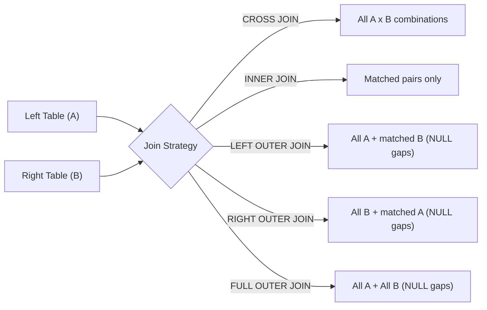

# Querying, Filtering, Aggregation & Joins

This note integrates **Chapter 1 (Slides 12–29)**, **TP 1 (Parts L & N)**, **TD 1 (Questions 1*–19*, 30)**, and the complete join mechanics from the vault (`INNER`, `LEFT`, `RIGHT`, `FULL OUTER`, `CROSS`, `SELF JOIN`, `NATURAL JOIN`, 3-table chains, and `NOT NULL` foreign key interactions).

---

## 1. `SELECT` Syntax, Logical Execution Order & Quoting Rules

### Standard `SELECT` Syntax (Ch 1 Slides 12–13)

```sql
SELECT [ DISTINCT | ALL ] select_list
FROM table1 [, table2 ...]
[ WHERE condition ]
[ GROUP BY grouping_columns ]
[ HAVING group_condition ]
[ ORDER BY sort_expressions ]
[ OFFSET n ROWS ]
[ FETCH FIRST m ROWS ONLY ];
```

- **Logical Processing Order (Critical for Avoiding Errors!):**
  1. `FROM` / `JOIN` (build working table)
  2. `WHERE` (filter raw rows)
  3. `GROUP BY` (form groups)
  4. `HAVING` (filter groups)
  5. `SELECT` (evaluate expressions & create column aliases)
  6. `DISTINCT` (remove duplicate output rows; `ALL` is the default)
  7. `ORDER BY` (sort by expression, alias, or 1-based column position; `ASC` default, `DESC` descending)
  8. `OFFSET ... ROWS` / `FETCH FIRST ... ROWS ONLY` (skip first $n$ rows, return at most $m$ rows; PostgreSQL/MySQL also support `LIMIT m OFFSET n`).
- Because `SELECT` runs _after_ `WHERE`, **column aliases cannot be used in `WHERE`** (they _can_ be used in `ORDER BY`).

### Quoting Rules (Common Exam Pitfall!)

- **Single quotes (`'...'`):** **String literals** (`WHERE first_name LIKE '%am%'`, `WHERE last_name = 'Ahmed'`). _Never use double quotes for strings in PostgreSQL—PostgreSQL treats `"..."` as a column/table identifier!_
- **Double quotes (`"..."`):** **Identifiers** containing spaces or case sensitivity (`SELECT salary AS "Monthly Salary"`). Simple lowercase aliases (`AS monthly_salary`) need no quotes. _(MySQL uses backticks `` `...` `` for identifiers and permissively accepts `"..."` for strings, which violates ANSI SQL.)_

---

## 2. Filtering (`WHERE`), Pattern Matching & `NULL`

- **Logical Operator Precedence:** `NOT` binds tightest, then `AND`, then `OR`. Always parenthesize `OR` conditions combined with `AND` (`WHERE age BETWEEN 21 AND 23 AND (class_id = 10 OR class_id = 20)`).
- **`BETWEEN a AND b`:** Inclusive interval ($a \le x \le b$).
- **`IN (v1, v2, ...)`:** Membership in an explicit list.
- **`LIKE` vs. PostgreSQL `ILIKE` (TP 1 Part N.7–N.8):**
  - `%` matches **0 or more** characters; `_` matches **exactly 1** character.
  - `LIKE 'A%'` is **case-sensitive** in PostgreSQL (matches `'Ahmed'`, skips `'ahmed'`).
  - `ILIKE 'a%'` is a **PostgreSQL extension** for case-insensitive pattern matching.
- **`NULL` Testing:** `salary = NULL` or `salary <> NULL` evaluates to `UNKNOWN` (excluded by `WHERE`). Always test **`IS NULL`** and **`IS NOT NULL`**.
- **Sorting with `NULL`:** In PostgreSQL, `ORDER BY salary DESC` places `NULL`s **first** by default (`NULLS FIRST` for `DESC`, `NULLS LAST` for `ASC`). Add `NULLS LAST` when sorting top salaries (`ORDER BY salary DESC NULLS LAST`).

---

## 3. Built-in Functions, Aggregations & Grouping Nuances

### Scalar & Aggregate Functions (Ch 1 Slide 15)

| Category        | Functions                                                    | Example             |
| :-------------- | :----------------------------------------------------------- | :------------------ |
| **Aggregation** | `COUNT(*)`, `COUNT(col)`, `SUM()`, `AVG()`, `MIN()`, `MAX()` | `AVG(salary)`       |
| **Character**   | `UPPER()`, `LOWER()`, `LENGTH()`                             | `UPPER(last_name)`  |
| **Numeric**     | `ROUND(val, n)`, `ABS(val)`                                  | `ROUND(average, 2)` |
| **Dates**       | `CURRENT_DATE`, `CURRENT_TIMESTAMP`                          | `CURRENT_TIMESTAMP` |

### `NULL` Semantics in Aggregations (Critical Nuance!)

- **`COUNT(*)`** counts **every physical row** in the table/group (returns `9` on `teacher`).
- **`COUNT(col)`, `SUM(col)`, `AVG(col)`, `MIN(col)`, `MAX(col)` ignore `NULL`s completely!**
  - Teacher 109 (`Khelifi Nora`) has `salary = NULL`. Thus `COUNT(salary)` is `8` (not 9), and `AVG(salary)` in department 1 (`75000`, `62000`, `68000`, `NULL`) computes $(75000 + 62000 + 68000)/3 = \mathbf{68333.33}$ (Ch 1 Slide 20)!
  - **Fixing `NULL` math when needed:** Use `COALESCE(salary, 0)` (ANSI SQL / PostgreSQL; `IFNULL(salary, 0)` in MySQL) inside `AVG(COALESCE(salary, 0))` if missing salaries should count as `0`.
- **Empty set:** `COUNT(*)` returns **`0`**, whereas `AVG`, `SUM`, `MIN`, `MAX` return **`NULL`**.

### `GROUP BY` and `HAVING` vs. `WHERE`

- **`WHERE`** filters raw rows **before** grouping (cannot reference aggregate functions like `AVG(salary)`).
- **`GROUP BY`** collapses rows sharing identical values in the grouping column(s). Every non-aggregated column in `SELECT` must appear in `GROUP BY`.
- **`HAVING`** filters aggregated groups **after** `GROUP BY` (`HAVING AVG(salary) > 60000` returns only department `1` with `68333.33`, Ch 1 Slide 20).

---

## 4. Complete Guide to SQL Joins

In a normalized database, joins belong to **DQL/DML** (`SELECT`)—they reassemble fragmented tables virtually without altering stored tables.



### A. `CROSS JOIN` (Cartesian Product)

Pairs every row of Table A with every row of Table B (Ch 1 Slide 21: `9 teachers × 5 departments = 45 rows`):

```sql
SELECT t.last_name, t.first_name, d.department_name
FROM teacher AS t CROSS JOIN department AS d;
```

_(Old SQL-89 comma syntax `FROM teacher t, department d` without `WHERE` produces a `CROSS JOIN`; in ANSI-92, `JOIN` without `ON` is a syntax error unless `CROSS JOIN` or `NATURAL JOIN` is used.)_

### B. `INNER JOIN` (Match or Die)

Returns **only rows matching the `ON` condition** in both tables. The `INNER` keyword is optional (`JOIN` = `INNER JOIN`), and logical table order (`A JOIN B` vs. `B JOIN A`) does not change the result set.

- **Filtering effect:** On `student s INNER JOIN class c ON s.class_id = c.class_id` (Ch 1 Slide 22), **9 students appear** and **Farah Ines** (`class_id = NULL`) disappears! Similarly, in a `Customer` / `Card` schema, customers with no card (`Sarah`) vanish; in `Student(SID, Name, DeptID)` / `Department`, a student with an unmatched `DeptID = 99` (`Leila`) disappears.

#### Multi-Table `INNER JOIN` Chains & Cumulative Filtering

Chaining `INNER JOIN`s evaluates matches pairwise—every additional join acts as an extra filter, shrinking unmatched orphans out of the result:

1. **Course `university` 3-Table Chain (Ch 1 Slide 27):** `student s JOIN class c ON s.class_id = c.class_id JOIN department d ON c.department_id = d.department_id` $\to$ displays each enrolled student, class, and department (drops Farah).
2. **Banking Lookup Pattern (`customer` $\to$ `card` $\to$ `card_type`):** Connects `customer` to `card` on `customer_id`, then `card` to lookup table `card_type` (`Visa`, `Mastercard`, `rate`) on `card_type_id`. Any customer with no card or unissued `card_type` (`Amex`) disappears.
3. **Video-Sharing Walkthrough (`user` $\to$ `comment` $\to$ `video`):**
   - Suppose 6 users (`1..6`, where `6: BestSpeller` has no comments), 8 videos (`1..8`, where `8: Database Design 8` has no comments), and 6 comments (`comment.user_id` and `comment.video_id` both `NOT NULL`).
   - Step 1 (`user INNER JOIN comment`): keeps all 6 comments, drops `BestSpeller`.
   - Step 2 (`... INNER JOIN video`): keeps all 6 comments, drops `Database Design 8`.

### C. Outer Joins (`LEFT`, `RIGHT`, `FULL OUTER`)

Preserve unmatched rows from one or both sides, filling missing columns with `NULL` (keyword `OUTER` is optional):

- **`LEFT OUTER JOIN`:** Keeps **all rows from the left table** (`student s LEFT JOIN class c` keeps **Farah** with `class_name = NULL`, Ch 1 Slide 23; `Customers LEFT JOIN Orders` keeps **Charlie** with `OrderID = NULL`).
- **`RIGHT OUTER JOIN`:** Keeps **all rows from the right table** (`student s RIGHT JOIN class c` keeps **M1-Physique** with `last_name = NULL`, Ch 1 Slide 24; `customer RIGHT JOIN card` keeps unassigned card `104` with `name = NULL`). Every `A RIGHT JOIN B` can be rewritten equivalently as `B LEFT JOIN A`; preferring `LEFT JOIN` consistently makes multi-table queries easier to read.
- **Finding Orphans Pattern:** `LEFT JOIN ... WHERE right_table.pk IS NULL` returns only unmatched left rows (e.g., customers with no card, teachers with no class).
- **`FULL OUTER JOIN`:** Keeps **all rows from both tables** (`student s FULL OUTER JOIN class c` keeps **both Farah and M1-Physique**, Ch 1 Slide 25).
  - _DBMS Note:_ **PostgreSQL supports `FULL OUTER JOIN` natively.** **MySQL does not**; simulate it in MySQL via `(SELECT ... LEFT JOIN ...) UNION (SELECT ... RIGHT JOIN ...)` (using `UNION` to deduplicate matched rows).

#### Chaining Outer Joins Across 3 Tables (`user` $\to$ `comment` $\to$ `video`)

- **Sequential Trap:** `FROM user LEFT JOIN comment ... RIGHT JOIN video ...` first preserves all users (`Carol`, `Dave` with `NULL` comments), then Step 2 (`RIGHT JOIN video`) **eliminates `Carol` and `Dave`** because their `NULL` `video_id` fails to match any video, while keeping Video 3 (`Joins`) with `NULL` user/comment!
- **Clean Strategy:** Always place the primary table whose rows must ALL survive first in `FROM`, and chain `LEFT OUTER JOIN`s consistently (`FROM video LEFT JOIN comment ... LEFT JOIN user ...`).

### D. How `NOT NULL` Foreign Keys Affect Joins

When a child FK like `comment.user_id` is declared **`NOT NULL`**, every comment is guaranteed to match a user:

| Join Query                | Users Included           | Comments Included | `NULL`s Produced                       |
| :------------------------ | :----------------------- | :---------------- | :------------------------------------- |
| `user INNER JOIN comment` | Only users with comments | All               | None                                   |
| `comment LEFT JOIN user`  | Only users with comments | All               | None (**identical to `INNER JOIN`**!)  |
| `user LEFT JOIN comment`  | **All users**            | All               | `NULL` comment fields for silent users |

_(By contrast, when `card.customer_id` is nullable, `card LEFT JOIN customer` differs from `INNER JOIN` by preserving unassigned cards.)_

### E. `SELF JOIN` & Table Aliases

There is no `SELF JOIN` keyword—you join a table to itself using **mandatory distinct table aliases** (`t1` and `t2`, `e` and `m`):

1. **Same-Group Pairs without Duplicates (Ch 1 Slide 26 — `university`):**
   Find pairs of teachers in the same department:
   ```sql
   SELECT t1.last_name AS teacher1, t2.last_name AS teacher2, t1.department_id
   FROM teacher t1
   JOIN teacher t2
     ON t1.department_id = t2.department_id
    AND t1.teacher_id < t2.teacher_id;
   ```

   - **Why `t1.teacher_id < t2.teacher_id`?** (1) Prevents pairing a teacher with themselves (`Benali, Benali`); (2) keeps each unordered pair **once** (`Benali, Saidi` without `Saidi, Benali`). Produces 8 pairs: 6 in dept 1, 1 in dept 2 (`Karim, Haddad`), 1 in dept 3 (`Mansouri, Rahmani`). _(Using `E1.ID <> E2.ID` prevents self-matches but emits both `(A,B)` and `(B,A)`.)_
2. **Hierarchical Employee-Manager (`Diana Prince`, `Bruce Wayne`, `Clark Kent`):**
   ```sql
   SELECT e.first_name AS employee, m.first_name AS manager
   FROM employee AS e
   LEFT OUTER JOIN employee AS m ON e.manager_id = m.employee_id;
   ```
   Using `LEFT OUTER JOIN` ensures the CEO (`Diana`, `manager_id = NULL`) stays in the output with `NULL` manager rather than vanishing under `INNER JOIN`. Same pattern applies to referral chains (`u1.referred_by = u2.user_id`).
3. **Sequential Lookup:** Find flights departing from the same city as `'F09'`:
   ```sql
   SELECT F2.code FROM Flight F1 JOIN Flight F2 ON F1.departure = F2.departure WHERE F1.code = 'F09';
   ```

### F. `NATURAL JOIN`

`SELECT * FROM student NATURAL JOIN class;` (Ch 1 Slides 28–29) auto-joins on the shared column `class_id`, eliminates the duplicate column (`7` columns total instead of `8`), and returns the 9 enrolled students (dropping Farah Ines). **Avoid in production** because adding an unrelated same-named column later breaks the join silently.

---

## 5. Worked Course Queries: TP 1 (Parts L & N) and TD 1 (Q1*–19*, Q30)

### TP 1 Part L (`L.1`–`L.8`) & Part N (`N.1`–`N.11`)

```sql
-- L.1 / L.2: Teachers with classes / Classes with teachers
SELECT t.teacher_id, t.last_name, t.first_name, c.class_id, c.class_name
FROM teacher t
JOIN teacher_class tc ON t.teacher_id = tc.teacher_id
JOIN class c ON tc.class_id = c.class_id
ORDER BY t.teacher_id, c.class_id;

-- L.3 / L.5: Classes taught per teacher (LEFT JOIN keeps 0; add HAVING COUNT(tc.class_id) > 1 for >1)
SELECT t.teacher_id, t.last_name, t.first_name, COUNT(tc.class_id) AS number_of_classes
FROM teacher t LEFT JOIN teacher_class tc ON t.teacher_id = tc.teacher_id
GROUP BY t.teacher_id, t.last_name, t.first_name
ORDER BY number_of_classes DESC;

-- L.4 / L.6: Teachers per class (LEFT JOIN keeps 0; add HAVING COUNT(tc.teacher_id) > 1 for >1)
SELECT c.class_id, c.class_name, COUNT(tc.teacher_id) AS number_of_teachers
FROM class c LEFT JOIN teacher_class tc ON c.class_id = tc.class_id
GROUP BY c.class_id, c.class_name
ORDER BY number_of_teachers DESC;

-- L.7 / L.8: Teachers with no class / Classes with no teacher
SELECT t.teacher_id, t.last_name, t.first_name
FROM teacher t LEFT JOIN teacher_class tc ON t.teacher_id = tc.teacher_id
WHERE tc.class_id IS NULL;

SELECT c.class_id, c.class_name
FROM class c LEFT JOIN teacher_class tc ON c.class_id = tc.class_id
WHERE tc.teacher_id IS NULL;

-- N.1–N.11 highlights:
SELECT last_name, first_name, salary AS monthly_salary FROM teacher;
SELECT last_name, first_name FROM teacher WHERE last_name LIKE 'A%';   -- case-sensitive
SELECT last_name, first_name FROM teacher WHERE last_name ILIKE 'a%';  -- PostgreSQL case-insensitive
```

### TD 1 Questions `1*`–`19*` and `30` (Full Solutions & Pitfall Alerts)

```sql
-- 1*. Display last_name, first_name, salary
SELECT last_name, first_name, salary FROM teacher;

-- 2*. Rename salary as Monthly Salary
SELECT last_name, first_name, salary AS "Monthly Salary" FROM teacher;

-- 3*. Salary >= 70000
SELECT * FROM teacher WHERE salary >= 70000;

-- 4*. Department 1 AND salary > 65000
SELECT * FROM teacher WHERE department_id = 1 AND salary > 65000;

-- 5*. Students aged 21..23 and class_id is 10 or 20
SELECT * FROM student WHERE (age BETWEEN 21 AND 23) AND (class_id = 10 OR class_id = 20);

-- 6*. Teachers with salary between 50000 and 75000
SELECT * FROM teacher WHERE salary BETWEEN 50000 AND 75000;

-- 7*. Students whose first_name contains 'am' (use single quotes '%am%', NOT double quotes!)
SELECT * FROM student WHERE first_name LIKE '%am%';

-- 8*. Salary unavailable / 9*. Salary available
SELECT * FROM teacher WHERE salary IS NULL;
SELECT * FROM teacher WHERE salary IS NOT NULL;

-- 10*. Different student ages
SELECT DISTINCT age FROM student;

-- 11*. All teachers ordered by salary highest to lowest
SELECT * FROM teacher ORDER BY salary DESC;

-- 12*. Ordered by department_id ASC, then salary DESC
SELECT * FROM teacher ORDER BY department_id ASC, salary DESC;

-- 13*. Student age and age after 5 years
SELECT student_id, last_name, first_name, age, age + 5 AS age_after_5_years FROM student;

-- 14*. Total teachers, avg salary, min salary
SELECT COUNT(*) AS total_teachers, AVG(salary) AS average_salary, MIN(salary) AS minimum_salary FROM teacher;

-- 15*. Number of teachers in each department (teacher table only)
SELECT department_id, COUNT(*) AS number_of_teachers FROM teacher GROUP BY department_id;

-- 16*. Per department: count, avg, min, max
SELECT department_id, COUNT(*) AS number_of_teachers,
       AVG(salary) AS average_salary, MIN(salary) AS minimum_salary, MAX(salary) AS maximum_salary
FROM teacher GROUP BY department_id;

-- 17*. Departments having at least two teachers
SELECT department_id, COUNT(*) AS number_of_teachers
FROM teacher GROUP BY department_id HAVING COUNT(*) >= 2;

-- 18*. Each teacher with department name (INNER JOIN)
SELECT t.last_name, t.first_name, d.department_name, t.salary
FROM teacher t INNER JOIN department d ON t.department_id = d.department_id;

-- 19*. All departments, including departments with no teachers (LEFT JOIN)
-- Critical: COUNT(t.teacher_id) returns 0 for Chimie; COUNT(*) would wrongly return 1!
SELECT d.department_id, d.department_name, COUNT(t.teacher_id) AS number_of_teachers
FROM department d LEFT JOIN teacher t ON d.department_id = t.department_id
GROUP BY d.department_id, d.department_name
ORDER BY d.department_id;

-- 30.1 Departments without teachers (Chimie) -> NOT EXISTS avoids duplicate rows & short-circuits
SELECT d.* FROM department d
WHERE NOT EXISTS (SELECT 1 FROM teacher t WHERE t.department_id = d.department_id);

-- 30.2 Classes without students (M1-Physique) -> NOT EXISTS short-circuits on first student
SELECT c.* FROM class c
WHERE NOT EXISTS (SELECT 1 FROM student s WHERE s.class_id = c.class_id);

-- 30.3 Students without classes (Farah Ines) -> LEFT JOIN + IS NULL (or directly WHERE s.class_id IS NULL)
SELECT s.* FROM student s
LEFT JOIN class c ON s.class_id = c.class_id
WHERE c.class_id IS NULL;
```
