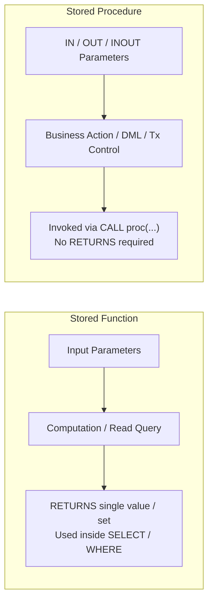

# Stored Functions, Stored Procedures & Dynamic SQL

This note integrates **Chapter 2 Slides 34–42**, **TP 2 (Exercises 8–9, Ex 12 Tasks 5–7, Part IV Q12, Q18, Q19)**, **TD 2 (Exercises 9*–15)**, **Dynamic SQL (`PREPARE`/`EXECUTE`, `EXECUTE IMMEDIATE`)**, and **Legacy Airline TD 4 Stored Routines** (`EffectifsHeure`, `PlusExperimente`, `factorielle`).

---

## 1. Stored Functions vs. Stored Procedures



| Property | Stored Function | Stored Procedure |
| :--- | :--- | :--- |
| **Primary Purpose** | Calculate and return a result | Perform an action (modify data, run multi-step workflows) |
| **Return Clause** | **Must** declare `RETURNS type` and execute `RETURN val;` | **No `RETURNS` clause** (outputs via `OUT`/`INOUT` params or result sets in MySQL) |
| **Invocation** | Inside SQL expressions (`SELECT number_of_teachers(1);`) | Standalone statement (`CALL increase_department_salaries(1, 5);`) |
| **DML / Transactions** | Avoid/restrict side effects (forbidden from `COMMIT`/`ROLLBACK`) | Can execute `INSERT`/`UPDATE`/`DELETE` and transaction control (`COMMIT`/`ROLLBACK` in PostgreSQL/MySQL) |
| **Benefits** | Reuse logic across queries, encapsulate calculations, centralize formulas | Centralize business validation & safe multi-step updates |

### Determinism & MySQL Replication Hazard (Legacy Note)
In MySQL with Statement-Based Binary Logging (`binlog`), calling a non-deterministic function (`NOW()`, `RAND()`) inside an `INSERT`/`UPDATE` can write `0.45` on the Master and `0.82` when replayed on a Replica (`Error 1418`). Always declare functions with `DETERMINISTIC`, `NO SQL`, or `READS SQL DATA` in MySQL (or set `SET GLOBAL log_bin_trust_function_creators = 1;` only under Row-Based Replication). PostgreSQL supports `IMMUTABLE` / `STABLE` / `VOLATILE` optimization markers instead.

---

## 2. Worked Stored Functions (Ch 2 Slides 34–39, TP 2 Ex 8, TD 2 Ex 9*–12)

### A. Counting Teachers by Department (`number_of_teachers` / `count_teachers_by_department`)
**Ch 2 Slides 38–39, TP 2 Ex 8 Task 1, TD 2 Ex 9* & Ex 12 Task 6:**
```sql
-- ISO SQL/PSM (Ch 2 Slide 38):
-- CREATE FUNCTION number_of_teachers(p_department INTEGER) RETURNS INTEGER
-- BEGIN ATOMIC DECLARE nb INTEGER; SELECT COUNT(*) INTO nb FROM teacher WHERE department_id = p_department; RETURN nb; END;

-- PostgreSQL PL/pgSQL (TP 2 Ex 8 Task 1 / TD 2 Ex 9*):
CREATE OR REPLACE FUNCTION number_of_teachers(p_department INTEGER)
RETURNS INTEGER
LANGUAGE plpgsql
AS $$
DECLARE
    nb INTEGER;
BEGIN
    SELECT COUNT(*) INTO nb
    FROM teacher
    WHERE department_id = p_department;

    RETURN nb;
END;
$$;

-- Test single call and per-department listing (also solves TP 2 Ex 12 Task 6 via count_teachers_by_department):
SELECT number_of_teachers(1); -- returns 4
SELECT number_of_teachers(5); -- returns 0

SELECT department_id, department_name, number_of_teachers(department_id) AS number_of_teachers
FROM department
ORDER BY department_id;
-- Expected: (1, Informatique, 4), (2, Mathématiques, 2), (3, Électronique, 2), (4, Physique, 1), (5, Chimie, 0)
```
- **Why does department 5 (`Chimie`) appear with `0` even though it has no teachers (TD 2 Ex 9* & TP 2 Ex 8)?**
  1. The outer query runs `FROM department`, so every row in `department` (including department `5`) is visited and passed into `number_of_teachers(department_id)`.
  2. Inside the function, `COUNT(*)` over 0 matching rows in `teacher` evaluates to **`0`**, **not `NULL`**. (`RETURN` sends that result back to the caller and terminates the function.)

### B. Average Salary by Department (`average_salary` — TD 2 Ex 10)
```sql
CREATE OR REPLACE FUNCTION average_salary(p_department INTEGER)
RETURNS NUMERIC(10,2)
LANGUAGE plpgsql
AS $$
DECLARE
    v_avg NUMERIC(10,2);
BEGIN
    SELECT AVG(salary) INTO v_avg
    FROM teacher
    WHERE department_id = p_department;

    RETURN v_avg;
END;
$$;

SELECT average_salary(1); -- 68333.33 (averages 75000, 62000, 68000; skips teacher 109's NULL)
SELECT average_salary(5); -- NULL
```
- **Why does `average_salary(5)` return `NULL` while `number_of_teachers(5)` returns `0`?**
  When a department has 0 teachers (or when all its teachers have `NULL` salary), `COUNT(*)` is `0`, whereas **`AVG(salary)` returns `NULL`** because dividing by 0 non-null elements is mathematically undefined.

### C. Salary Classification (`salary_category` — TP 2 Ex 8 Tasks 2–3, Ex 12 Task 5, TD 2 Ex 11)
Notice the two curriculum signatures:
- **Signature 1 (`salary_category(p_salary)` — TP 2 Ex 8 Task 2):** Takes a numeric salary directly so it can be reused inside any `SELECT` expression (`SELECT teacher_id, last_name, first_name, salary, salary_category(salary) AS category FROM teacher ORDER BY teacher_id;`) without duplicating `IF/ELSIF` logic across queries.
- **Signature 2 (`salary_category(p_teacher_id)` — TD 2 Ex 11):** Takes a teacher ID, queries `teacher`, and explicitly handles **non-existent teacher IDs** via `IF NOT FOUND`:
```sql
CREATE OR REPLACE FUNCTION salary_category(p_teacher_id INTEGER)
RETURNS VARCHAR(20)
LANGUAGE plpgsql
AS $$
DECLARE
    v_salary teacher.salary%TYPE;
BEGIN
    SELECT salary INTO v_salary
    FROM teacher
    WHERE teacher_id = p_teacher_id;

    IF NOT FOUND THEN
        RETURN 'Teacher not found'; -- alternative: RAISE EXCEPTION 'Teacher % does not exist.', p_teacher_id;
    ELSIF v_salary IS NULL THEN
        RETURN 'Unknown';
    ELSIF v_salary >= 70000 THEN
        RETURN 'High';
    ELSIF v_salary >= 50000 THEN
        RETURN 'Medium';
    ELSE
        RETURN 'Low';
    END IF;
END;
$$;
```

### D. Calculating a Salary Increase (`calculate_increased_salary` — TD 2 Ex 12)
Formula: $S_{\text{new}} = S_{\text{old}} \times \left(1 + \frac{r}{100}\right)$.
- **NULL salary:** Return `NULL` (an unknown salary remains unknown; never invent a number).
- **Invalid rate:** If `p_rate IS NULL` or `p_rate <= 0` (or exceeds policy caps), raise an exception (`RAISE EXCEPTION`) rather than decreasing salaries or returning silent garbage.
```sql
CREATE OR REPLACE FUNCTION calculate_increased_salary(p_salary NUMERIC, p_rate NUMERIC)
RETURNS NUMERIC(10,2)
LANGUAGE plpgsql
AS $$
BEGIN
    IF p_rate IS NULL OR p_rate <= 0 THEN
        RAISE EXCEPTION 'Invalid increase rate: %. Must be strictly positive.', p_rate;
    END IF;
    IF p_salary IS NULL THEN
        RETURN NULL;
    END IF;
    RETURN ROUND(p_salary * (1 + p_rate / 100.0), 2);
END;
$$;
```

---

## 3. Worked Stored Procedures (Ch 2 Slides 40–42, TP 2 Ex 9 & 12, TD 2 Ex 13–15)

### A. Department Salary Increase (`increase_salaries` / `increase_department_salaries` — Ch 2 Slide 42, TP 2 Ex 9, TD 2 Ex 13)
```sql
-- TP 2 Ex 9 / TD 2 Ex 13 (validated PostgreSQL procedure)
CREATE OR REPLACE PROCEDURE increase_department_salaries(
    p_department_id INTEGER,
    p_rate NUMERIC
)
LANGUAGE plpgsql
AS $$
BEGIN
    IF p_rate IS NULL OR p_rate <= 0 OR p_rate > 20 THEN
        RAISE EXCEPTION 'Rate must be greater than 0 and at most 20 percent.';
    END IF;

    IF NOT EXISTS (SELECT 1 FROM department WHERE department_id = p_department_id) THEN
        RAISE EXCEPTION 'Department % does not exist.', p_department_id;
    END IF;

    UPDATE teacher
    SET salary = salary * (1 + p_rate / 100.0)
    WHERE department_id = p_department_id
      AND salary IS NOT NULL;

    RAISE NOTICE 'Salary increase applied to department %.', p_department_id;
END;
$$;
```
**Key rules tested in TP 2 Ex 9 & Ex 12 (Task 7):**
- Invoke via **`CALL increase_department_salaries(1, 5);`** (not `SELECT`).
- Calling with `p_rate = 25` raises an exception (`> 20`).
- Calling with `p_department_id = 5` (Chimie, 0 teachers) succeeds with 0 rows modified.
- `AND salary IS NOT NULL` ensures teachers with `NULL` salaries (like 109) stay `NULL` rather than entering arithmetic.
- Always test inside `BEGIN; CALL increase_department_salaries(1, 5); SELECT ...; ROLLBACK;` so original TP 1 salaries are preserved!

### B. Safely Increasing One Teacher's Salary (`increase_teacher_salary` — TD 2 Ex 14*)
Checks all 3 preconditions before performing the `UPDATE`:
```sql
CREATE OR REPLACE PROCEDURE increase_teacher_salary(p_teacher_id INTEGER, p_rate NUMERIC)
LANGUAGE plpgsql
AS $$
DECLARE
    v_salary teacher.salary%TYPE;
BEGIN
    IF p_rate IS NULL OR p_rate <= 0 THEN
        RAISE EXCEPTION 'Increase rate must be positive.';
    END IF;

    SELECT salary INTO v_salary FROM teacher WHERE teacher_id = p_teacher_id;
    IF NOT FOUND THEN
        RAISE EXCEPTION 'Teacher % does not exist.', p_teacher_id;
    END IF;
    IF v_salary IS NULL THEN
        RAISE EXCEPTION 'Teacher % has a NULL salary and cannot be increased.', p_teacher_id;
    END IF;

    UPDATE teacher
    SET salary = salary * (1 + p_rate / 100.0)
    WHERE teacher_id = p_teacher_id;
END;
$$;
```

### C. Conditional Department Raises Using `CASE` (TD 2 Ex 15)
Rates: Informatique `5%`, Mathématiques `7%`, Électronique `6%`, Physique `4%`, Chimie `3%`.
- **Department with 0 teachers (Chimie):** Zero rows join in `teacher`, so 0 rows update cleanly without error.
- **Department not covered by rules:** Always include **`ELSE 0`** (or raise an explicit error / check) inside `CASE`—**if you omit `ELSE`**, an uncovered department makes `CASE` return `NULL`, turning `salary * (1 + NULL / 100.0)` into `NULL` and wiping out the teacher's salary!
```sql
CREATE OR REPLACE PROCEDURE apply_department_raises_case()
LANGUAGE plpgsql
AS $$
BEGIN
    UPDATE teacher t
    SET salary = salary * (1 + (
        CASE d.department_name
            WHEN 'Informatique' THEN 5
            WHEN 'Mathématiques' THEN 7
            WHEN 'Électronique' THEN 6
            WHEN 'Physique' THEN 4
            WHEN 'Chimie' THEN 3
            ELSE 0
        END
    ) / 100.0)
    FROM department d
    WHERE t.department_id = d.department_id
      AND t.salary IS NOT NULL;
END;
$$;
```

### Persistence & Cleanup Rules (TP 2 Part IV Q18 & Q19)
- **Stored permanently in DB catalog:** Views, materialized views, stored functions, stored procedures, audit tables (`salary_history`), triggers, and `manager` table. Anonymous `DO $$` blocks execute once and are **not** stored.
- **Why roll back / restore test updates?** To preserve the baseline TP 1 data assumptions (e.g., `teacher 101 = 75000`, `teacher 109 = NULL`, `student 8 = NULL`) so subsequent exercises and percentage increases remain accurate and repeatable.

---

## 4. Dynamic SQL & SQL Injection Defense (From `05 PLSQL`)

Static SQL validates table/column names at compile time. **Dynamic SQL** builds SQL strings at runtime (e.g., when a table name is passed as a parameter):
- **MySQL:** `PREPARE stmt FROM @sql; EXECUTE stmt USING @param; DEALLOCATE PREPARE stmt;`
- **Oracle:** `EXECUTE IMMEDIATE 'UPDATE emp SET salary = :1 WHERE id = :2' USING v_sal, v_id;`
- **PostgreSQL PL/pgSQL:** `EXECUTE 'DELETE FROM ' || quote_ident(p_table) || ' WHERE id = $1' USING p_id;`
> [!WARNING] SQL Injection Prevention
> Never concatenate user values directly into dynamic SQL (`'WHERE user = ''' || input || ''''`). Always pass values via **bind variables** (`?`, `:1`, `$1` + `USING`) and sanitize dynamic object identifiers (like table names via `quote_ident()` in PostgreSQL).

---

## 5. Legacy Airline TD 4 Worked Routines (Preserved from `05 PLSQL`)

*(MySQL schema: `Compagnie(comp, ...)`, `Pilote(brevet, nom, nbHVol, comp, nbqualif, grade)`)*

### 1. `EffectifsHeure(pcomp, pheuresVol)` — Scalar Function
Counts pilots exceeding `pheuresVol` in `pcomp` (or across all companies if `pcomp IS NULL`):
```sql
DELIMITER $$
CREATE FUNCTION EffectifsHeure(pcomp VARCHAR(4), pheuresVol DECIMAL(7,2))
RETURNS SMALLINT
DETERMINISTIC READS SQL DATA
BEGIN
    DECLARE v_resultat SMALLINT DEFAULT 0;
    IF pcomp IS NULL THEN
        SELECT COUNT(*) INTO v_resultat FROM Pilote WHERE nbHVol > pheuresVol;
    ELSE
        SELECT COUNT(*) INTO v_resultat FROM Pilote WHERE nbHVol > pheuresVol AND comp = pcomp;
    END IF;
    RETURN v_resultat;
END $$
DELIMITER ;
```

### 2. `PlusExperimente(INOUT pcomp, OUT pnom, OUT pheuresVol)` — `INOUT` / `OUT` Procedure
If `pcomp IS NOT NULL`, finds the top pilot in that company; if `pcomp IS NULL`, finds the top pilot globally and writes their company code back into `INOUT pcomp`:
```sql
DELIMITER $$
CREATE PROCEDURE PlusExperimente(
    INOUT pcomp VARCHAR(4),
    OUT pnom VARCHAR(15),
    OUT pheuresVol DECIMAL(7,2)
)
BEGIN
    IF pcomp IS NOT NULL THEN
        SELECT nom, nbHVol INTO pnom, pheuresVol
        FROM Pilote WHERE comp = pcomp ORDER BY nbHVol DESC LIMIT 1;
    ELSE
        SELECT nom, nbHVol, comp INTO pnom, pheuresVol, pcomp
        FROM Pilote ORDER BY nbHVol DESC LIMIT 1;
    END IF;
END $$
DELIMITER ;
-- Usage: SET @c = NULL; CALL PlusExperimente(@c, @name, @hrs); SELECT @c, @name, @hrs;
```

### 3. Recursive `factorielle(n)` & Recursion Safeguards
$$n! = \begin{cases} 1 & n \le 1 \\ n \times (n-1)! & n > 1 \end{cases}$$
- Trace for `factorielle(4)`: `4 * factorielle(3)` $\to$ `3 * factorielle(2)` $\to$ `2 * factorielle(1)` $\to$ base case `1` $\to$ unwinds `2 -> 6 -> 24`.
- **MySQL limitation:** Recursive *functions* trigger **`Error 1424: Recursive stored functions and triggers are not allowed`**. Recursive *procedures* require raising `SET max_sp_recursion_depth = 255;`. Prefer iterative loops (`WHILE`/`LOOP`) in production to avoid stack memory overhead.
