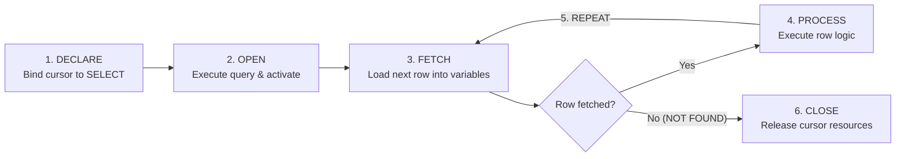

# Cursors & Row-by-Row Processing

This note integrates **Chapter 2 Cursor Module (Slides 43–60)**, **TP 3 (Part I Exercises 1–7 & Part III Exercise 15)**, **TD 3 (Part I Exercises 1*–6)**, **TD 2 Exercise 3***, and **Legacy Airline TD 4 Cursors (`total_hvol_AF` & `Gestion_Pilotes`)**.

---

## 1. What Is a Cursor & When Should We Use One?

A `SELECT` query may return zero, one, or many rows. Whereas standard SQL is **set-oriented**, a **cursor** is a named handle (like a bookmark moving down a list of rows) enabling a stored routine to process query results **one row at a time**.
- *Important distinction:* A cursor is a **programming interface**—it does not necessarily mean the DBMS physically reads disk blocks one row at a time.

### Cursor vs. Set-Based SQL (Ch 2 Slides 46, 54 & TD 3 Ex 6)
Before writing a cursor, ask: **"Can one SQL statement handle all qualifying rows?"**
- **Prefer Set-Based SQL** (`UPDATE ... WHERE`, `DELETE ... WHERE`, `INSERT ... SELECT`, `GROUP BY`, `CASE`) for ordinary bulk transformations, filtering, and aggregation—it executes far faster inside the optimizer without row-by-row context switching or long-held locks.
- **Use a Cursor** when each row requires sequential row-by-row decisions, complex multi-step procedural validation, calling a stored procedure or printing row-level `RAISE NOTICE` diagnostics per row, or maintaining sequential stateful accumulators (such as stopping mid-way when a running budget hits zero).

---

## 2. The 6-Step Explicit Cursor Lifecycle & Syntax Comparison



### Side-by-Side: ISO SQL/PSM vs. PostgreSQL PL/pgSQL

| Step | ISO SQL/PSM (Ch 2 Slides 48–52, 58) | PostgreSQL PL/pgSQL Explicit Cursor (TP 3) |
| :--- | :--- | :--- |
| **1. Declare** | `DECLARE c CURSOR FOR SELECT ...;` | `c CURSOR FOR SELECT ...;` inside `DECLARE` |
| **End-of-Data** | `DECLARE v_done BOOLEAN DEFAULT FALSE;`<br>`DECLARE CONTINUE HANDLER FOR NOT FOUND SET v_done = TRUE;` | Check built-in **`NOT FOUND`** immediately after `FETCH`: `EXIT WHEN NOT FOUND;` |
| **2. Open** | `OPEN c;` | `OPEN c;` |
| **3. Fetch & Test** | `read_loop: LOOP`<br>&nbsp;&nbsp;`FETCH c INTO v1, v2;`<br>&nbsp;&nbsp;`IF v_done THEN LEAVE read_loop; END IF;` | `LOOP`<br>&nbsp;&nbsp;`FETCH c INTO v1, v2;`<br>&nbsp;&nbsp;`EXIT WHEN NOT FOUND;` |
| **4–6. Close** | `END LOOP; CLOSE c;` | `END LOOP; CLOSE c;` |

### Tracing the Loop & Five Common Cursor Errors (Ch 2 Slides 52–53)
An **extra `FETCH` after the final row** is how the loop discovers the result set is exhausted (`v_done = TRUE` / `NOT FOUND`).
1. **Forgetting `OPEN`:** `FETCH` fails because the cursor is not active.
2. **Forgetting end-of-data handling (or testing *after* processing):** Never assume variable values are valid after a failed `FETCH`! Checking `v_done` / `NOT FOUND` *after* processing duplicates the last row's calculation or crashes.
3. **Wrong number or order of target variables:** `SELECT` columns must align positionally and by type with `FETCH ... INTO` variables (use `table.col%TYPE`).
4. **Forgetting `CLOSE`:** Keeps memory/cursor resources allocated longer than necessary.
5. **Long-running cursor loops:** Prolong transactions and hold locks or MVCC snapshots.

---

## 3. Cursor `FOR` Loops, Types, Attributes & Row Locking

### PostgreSQL Cursor `FOR` Loop (TP 3 Part I.1.2 & Ex 6–7, 15)
Automatically declares an implicit cursor, opens it, fetches each row into `rec RECORD`, exits at end-of-data, and closes it:
```sql
DO $$
DECLARE rec RECORD;
BEGIN
    FOR rec IN SELECT teacher_id, last_name, first_name FROM teacher ORDER BY teacher_id LOOP
        RAISE NOTICE 'Teacher ID: %, Name: % %', rec.teacher_id, rec.first_name, rec.last_name;
    END LOOP;
END $$;
```

### Cursor Types, Attributes & `FOR UPDATE` Locking (Ch 2 Slide 55 & `05 PLSQL`)
- **Forward-only** (default, single direction) vs. **Scrollable** (`SCROLL`, moves backward/jumps) vs. **Read-only** (retrieving data).
- **Implicit Cursor Attributes (Oracle/PLSQL):** `SQL%FOUND`, `SQL%NOTFOUND`, `SQL%ROWCOUNT`; **Explicit:** `emp_cursor%ISOPEN`, `%FOUND`, `%NOTFOUND`, `%ROWCOUNT`.
- **Pessimistic Row Locking (`FOR UPDATE`):** Adding `FOR UPDATE` to `DECLARE c CURSOR FOR SELECT ... FOR UPDATE;` places **Exclusive (X) locks** on selected rows on `OPEN` until `COMMIT`/`ROLLBACK`. *(Oracle uses `UPDATE ... WHERE CURRENT OF c;`; PostgreSQL/MySQL update using the fetched primary key `WHERE teacher_id = v_id;`.)*

---

## 4. Worked Course Exercises: Ch 2, TD 2 Ex 3* & TP 3 (Ex 1–7, Ex 15)

### Ch 2 Slide 58: TD 2 Ex 3* Using an SQL/PSM Cursor
```sql
BEGIN ATOMIC
    DECLARE v_department_id INTEGER;
    DECLARE v_done BOOLEAN DEFAULT FALSE;
    DECLARE department_cursor CURSOR FOR
        SELECT department_id FROM department WHERE department_id BETWEEN 1 AND 5 ORDER BY department_id;
    DECLARE CONTINUE HANDLER FOR NOT FOUND SET v_done = TRUE;

    OPEN department_cursor;
    department_loop: LOOP
        FETCH department_cursor INTO v_department_id;
        IF v_done THEN LEAVE department_loop; END IF;
        SELECT v_department_id AS department_id;
    END LOOP;
    CLOSE department_cursor;
END;
```
*(Bug note on the `file.md` draft snippet: it wrote `SELECT id_department` instead of `department_id` and mixed MySQL `DECLARE done INT` syntax.)*

### TP 3 Part I (Exercises 1–7) & Part III (Exercise 15) in PostgreSQL PL/pgSQL
```sql
-- TP 3 Ex 1: Display Teachers Using an Explicit Cursor
DO $$
DECLARE
    v_id teacher.teacher_id%TYPE;
    v_last_name teacher.last_name%TYPE;
    v_first_name teacher.first_name%TYPE;
    c_teachers CURSOR FOR SELECT teacher_id, last_name, first_name FROM teacher ORDER BY teacher_id;
BEGIN
    OPEN c_teachers;
    LOOP
        FETCH c_teachers INTO v_id, v_last_name, v_first_name;
        EXIT WHEN NOT FOUND;
        RAISE NOTICE 'Teacher ID: %, Name: % %', v_id, v_first_name, v_last_name;
    END LOOP;
    CLOSE c_teachers;
END $$;

-- TP 3 Ex 2: Classify Teachers According to Their Salaries
DO $$
DECLARE
    v_id teacher.teacher_id%TYPE;
    v_last_name teacher.last_name%TYPE;
    v_salary teacher.salary%TYPE;
    v_category VARCHAR(30);
    c_teachers CURSOR FOR SELECT teacher_id, last_name, salary FROM teacher ORDER BY teacher_id;
BEGIN
    OPEN c_teachers;
    LOOP
        FETCH c_teachers INTO v_id, v_last_name, v_salary;
        EXIT WHEN NOT FOUND;
        IF v_salary IS NULL THEN v_category := 'Unknown salary';
        ELSIF v_salary >= 70000 THEN v_category := 'High salary';
        ELSIF v_salary >= 50000 THEN v_category := 'Medium salary';
        ELSE v_category := 'Low salary';
        END IF;
        RAISE NOTICE 'Teacher: %, Salary: %, Category: %', v_last_name, v_salary, v_category;
    END LOOP;
    CLOSE c_teachers;
END $$;

-- TP 3 Ex 3: Count Teachers Using a Cursor (+ Set Equivalent: SELECT COUNT(*) FROM teacher;)
DO $$
DECLARE
    v_teacher_id teacher.teacher_id%TYPE;
    v_count INTEGER := 0;
    c_teachers CURSOR FOR SELECT teacher_id FROM teacher;
BEGIN
    OPEN c_teachers;
    LOOP
        FETCH c_teachers INTO v_teacher_id;
        EXIT WHEN NOT FOUND;
        v_count := v_count + 1;
    END LOOP;
    CLOSE c_teachers;
    RAISE NOTICE 'Total number of teachers: %', v_count;
END $$;

-- TP 3 Ex 4: Calculate Total Salary (Ignoring NULLs!)
DO $$
DECLARE
    v_salary teacher.salary%TYPE;
    v_total NUMERIC := 0;
    c_salaries CURSOR FOR SELECT salary FROM teacher;
BEGIN
    OPEN c_salaries;
    LOOP
        FETCH c_salaries INTO v_salary;
        EXIT WHEN NOT FOUND;
        IF v_salary IS NOT NULL THEN
            v_total := v_total + v_salary;
        END IF;
    END LOOP;
    CLOSE c_salaries;
    RAISE NOTICE 'Total salary: %', v_total;
END $$;

-- TP 3 Ex 5: Display Teachers and Their Departments (Cursor with Join)
DO $$
DECLARE
    v_id teacher.teacher_id%TYPE;
    v_last_name teacher.last_name%TYPE;
    v_department department.department_name%TYPE;
    c_teachers CURSOR FOR
        SELECT t.teacher_id, t.last_name, d.department_name
        FROM teacher t JOIN department d ON t.department_id = d.department_id
        ORDER BY t.teacher_id;
BEGIN
    OPEN c_teachers;
    LOOP
        FETCH c_teachers INTO v_id, v_last_name, v_department;
        EXIT WHEN NOT FOUND;
        RAISE NOTICE 'ID: %, Teacher: %, Department: %', v_id, v_last_name, v_department;
    END LOOP;
    CLOSE c_teachers;
END $$;

-- TP 3 Ex 7: Identify Teachers Eligible for a Bonus (Cursor FOR Loop)
DO $$
DECLARE rec RECORD;
BEGIN
    FOR rec IN SELECT teacher_id, last_name, salary FROM teacher ORDER BY teacher_id LOOP
        IF rec.salary IS NULL THEN
            RAISE NOTICE '%: Salary unavailable', rec.last_name;
        ELSIF rec.salary < 60000 THEN
            RAISE NOTICE '%: Eligible for bonus', rec.last_name;
        ELSE
            RAISE NOTICE '%: Not eligible for bonus', rec.last_name;
        END IF;
    END LOOP;
END $$;

-- TP 3 Ex 15: Combined Cursor Processing (Counts, Total & Non-NULL Average)
DO $$
DECLARE
    rec RECORD;
    v_total_teachers INTEGER := 0;
    v_paid_teachers INTEGER := 0;
    v_total_salary NUMERIC := 0;
    v_average_salary NUMERIC;
BEGIN
    FOR rec IN SELECT teacher_id, last_name, salary FROM teacher LOOP
        v_total_teachers := v_total_teachers + 1;
        IF rec.salary IS NOT NULL THEN
            v_paid_teachers := v_paid_teachers + 1;
            v_total_salary := v_total_salary + rec.salary;
        END IF;
    END LOOP;

    IF v_paid_teachers > 0 THEN
        v_average_salary := v_total_salary / v_paid_teachers;
    ELSE
        v_average_salary := NULL;
    END IF;

    RAISE NOTICE 'Total teachers: %', v_total_teachers;
    RAISE NOTICE 'Teachers with a salary: %', v_paid_teachers;
    RAISE NOTICE 'Total salary: %', v_total_salary;
    RAISE NOTICE 'Average salary: %', v_average_salary;
END $$;
```

---

## 5. Worked Solutions: TD 3 Part I (Exercises 1*–6)

### TD 3 Ex 1* (Individual Raises by Dept ID) & Ex 6 (Cursor vs. Set-Based SQL)
Rules: Dept 1 (`5%`), Dept 2 (`7%`), Dept 3 (`6%`), Dept 4 (`4%`), Others (`3%`); `NULL` salary ineligible.
```sql
-- SQL/PSM Solution for TD 3 Ex 1*
BEGIN ATOMIC
    DECLARE v_done BOOLEAN DEFAULT FALSE;
    DECLARE v_id INTEGER;
    DECLARE v_salary DECIMAL(10,2);
    DECLARE v_dept INTEGER;
    DECLARE v_rate DECIMAL(5,2);
    DECLARE v_raise DECIMAL(10,2);
    DECLARE v_new_salary DECIMAL(10,2);

    DECLARE c_teachers CURSOR FOR SELECT teacher_id, salary, department_id FROM teacher;
    DECLARE CONTINUE HANDLER FOR NOT FOUND SET v_done = TRUE;

    OPEN c_teachers;
    read_loop: LOOP
        FETCH c_teachers INTO v_id, v_salary, v_dept;
        IF v_done THEN LEAVE read_loop; END IF;

        IF v_salary IS NULL THEN
            SELECT v_id AS teacher_id, 'Ineligible (NULL salary)' AS status;
        ELSE
            CASE v_dept
                WHEN 1 THEN SET v_rate = 5;
                WHEN 2 THEN SET v_rate = 7;
                WHEN 3 THEN SET v_rate = 6;
                WHEN 4 THEN SET v_rate = 4;
                ELSE SET v_rate = 3;
            END CASE;
            SET v_raise = v_salary * (v_rate / 100.0);
            SET v_new_salary = v_salary + v_raise;
            SELECT v_id AS teacher_id, v_salary AS current_salary, v_raise AS raise_amount, v_new_salary AS new_salary;
        END IF;
    END LOOP;
    CLOSE c_teachers;
END;
```
**TD 3 Ex 6 Comparison — Single Set-Based `UPDATE` Equivalent:**
```sql
UPDATE teacher
SET salary = salary * (1 + (
    CASE department_id
        WHEN 1 THEN 0.05
        WHEN 2 THEN 0.07
        WHEN 3 THEN 0.06
        WHEN 4 THEN 0.04
        ELSE 0.03
    END
))
WHERE salary IS NOT NULL;
```
- **Which is preferable for bulk updates?** The **single set-based `UPDATE`**—one set scan, optimized execution plan, minimal lock duration, no cursor overhead.
- **When is a cursor more appropriate?** When each row requires custom row-by-row diagnostic printing, calling an external stored procedure/API, or sequential stateful logic (e.g., allocating raises sequentially until a global department budget runs out).

### TD 3 Ex 2, Ex 3, Ex 4, Ex 5 (PL/pgSQL / SQL-PSM Ready Implementations)
```sql
-- TD 3 Ex 2: Compare Teachers' Salaries with Department Average
DO $$
DECLARE
    v_name VARCHAR(101);
    v_salary teacher.salary%TYPE;
    v_dept department.department_name%TYPE;
    v_dept_avg NUMERIC;
    v_rec_msg VARCHAR(30);
    c_comp CURSOR FOR
        SELECT t.first_name || ' ' || t.last_name, t.salary, d.department_name,
               (SELECT AVG(t2.salary) FROM teacher t2 WHERE t2.department_id = t.department_id)
        FROM teacher t LEFT JOIN department d ON t.department_id = d.department_id
        ORDER BY t.teacher_id;
BEGIN
    OPEN c_comp;
    LOOP
        FETCH c_comp INTO v_name, v_salary, v_dept, v_dept_avg;
        EXIT WHEN NOT FOUND;
        IF v_salary IS NULL THEN v_rec_msg := 'Salary unknown';
        ELSIF v_salary < v_dept_avg THEN v_rec_msg := 'Raise recommended';
        ELSE v_rec_msg := 'Salary acceptable';
        END IF;
        RAISE NOTICE 'Teacher: %, Salary: %, Dept: %, Status: %', v_name, v_salary, v_dept, v_rec_msg;
    END LOOP;
    CLOSE c_comp;
END $$;
```
- **TD 3 Ex 3 (Classify Teachers):** Note boundary detail—TD 3 writes `< 50000` Low, `between 50000 and 70000` Medium, `> 70000` High, `NULL` Unknown (`IF v_salary IS NULL ... ELSIF v_salary < 50000 ... ELSIF v_salary <= 70000 ... ELSE 'High salary'`), whereas TP 2 / TD 2 classify `>= 70000` as High (`< 70000` Medium). Always match the wording of the active question!
- **TD 3 Ex 4 (Classify Students by Age):** `IF v_age IS NULL` $\to$ `'Age unknown'`, `ELSIF v_age < 20` $\to$ `'Young student'`, `ELSIF v_age <= 25` $\to$ `'Regular student'`, `ELSE` $\to$ `'Mature student'`.
- **TD 3 Ex 5 (Students According to Class):** Fetch `(student_id, first_name, last_name, class_id)` into variables: (1) `IF v_class_id IS NULL` $\to$ `'Student not assigned to a class'`; (2) else look up `SELECT class_name INTO v_class_name FROM class WHERE class_id = v_class_id;` — if `FOUND`, display `'Assigned to: ' || v_class_name`; (3) if `NOT FOUND` (only possible if FK integrity is disabled/corrupted), report `'Inconsistency: class_id ' || v_class_id || ' does not exist!'`. *(Using a separate `SELECT INTO` inside the loop keeps `EXIT WHEN NOT FOUND` cleanly tied to the cursor `FETCH` in PL/pgSQL only if you check the inner `FOUND` immediately before looping back!)*

---

## 6. Legacy Airline TD 4 Cursors (`total_hvol_AF` & `Gestion_Pilotes`)

Preserved from `05 PLSQL` (MySQL syntax with `DECLARE CONTINUE HANDLER FOR NOT FOUND` and `FOR UPDATE` row locking):
- **`total_hvol_AF()`:** Sums `nbHVol` for `comp = 'AF'` row-by-row. Notice **declaration order in MySQL is strict**: (1) Local variables $\to$ (2) Cursors $\to$ (3) Handlers! Tracing 2 rows (`1200.00`, `850.50`): Fetch 1 $\to$ `v_total = 1200.00`; Fetch 2 $\to$ `v_total = 2050.50`; Fetch 3 fails $\to$ `NOT FOUND` sets `v_done = TRUE` $\to$ `IF v_done THEN LEAVE` prevents adding `850.50` twice!
- **`Gestion_Pilotes()` (Cursor with `FOR UPDATE` + Transaction Atomicity):**
```sql
DELIMITER $$
CREATE PROCEDURE Gestion_Pilotes()
BEGIN
    DECLARE v_done INT DEFAULT FALSE;
    DECLARE v_error_flag INT DEFAULT FALSE;
    DECLARE v_brevet VARCHAR(6);
    DECLARE v_comp VARCHAR(4);

    DECLARE cur_pilotes CURSOR FOR SELECT brevet, comp FROM Pilote FOR UPDATE;
    DECLARE CONTINUE HANDLER FOR NOT FOUND SET v_done = TRUE;
    DECLARE CONTINUE HANDLER FOR SQLEXCEPTION SET v_error_flag = TRUE;

    START TRANSACTION;
    OPEN cur_pilotes;
    pilot_loop: LOOP
        FETCH cur_pilotes INTO v_brevet, v_comp;
        IF v_done OR v_error_flag THEN LEAVE pilot_loop; END IF;

        IF v_comp = 'AF' THEN
            UPDATE Pilote SET nbHVol = nbHVol + 100 WHERE brevet = v_brevet;
        ELSEIF v_comp = 'SING' THEN
            UPDATE Pilote SET nbHVol = nbHVol - 100 WHERE brevet = v_brevet;
        ELSE
            DELETE FROM Pilote WHERE brevet = v_brevet;
        END IF;
    END LOOP pilot_loop;
    CLOSE cur_pilotes;

    IF v_error_flag THEN ROLLBACK; ELSE COMMIT; END IF;
END $$
DELIMITER ;
```
