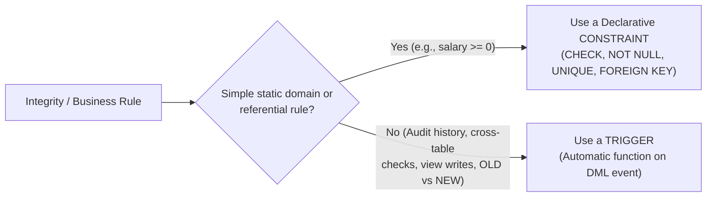

# Triggers, Automatic Auditing & Constraints vs Triggers

This note integrates **Chapter 2 (Slides 61–76)**, **TP 2 (Exercise 10, Ex 12 Task 8, Part IV Q15–16)**, **TD 2 (Exercises 16*–18*)**, **`information_schema` / `pg_constraint` metadata**, and **all preserved trigger patterns from the prior vault** (real-world automation triggers and all 5 TD 4 Aviation triggers).

---

## 1. Static Constraints vs. Dynamic Triggers (Ch 2 Slide 76 & TD 2 Ex 16*)

Static integrity constraints (`CHECK`, `NOT NULL`, `UNIQUE`, `PRIMARY KEY`, `FOREIGN KEY`) evaluate **single-row state rules declaratively before disk write**. **Dynamic integrity** handles rules involving **state transitions** (`OLD` vs. `NEW`), **automatic side-effect actions** (auditing, counter sync, restocking), or **cross-table logic**.



### TD 2 Ex 16*: Preventing Negative Salaries
1. **Using a `CHECK` constraint:**
   ```sql
   ALTER TABLE teacher
   ADD CONSTRAINT chk_salary_non_negative
   CHECK (salary IS NULL OR salary >= 0); -- or CHECK (salary >= 0)
   ```
2. **Is a trigger necessary?** **No.** A `CHECK` constraint is declarative, faster, simpler to maintain, and enforced automatically across all `INSERT` and `UPDATE` operations. A trigger is unnecessary overhead here.
3. **How should the rule treat `NULL` salary?** In the `university` schema, some teachers (like teacher `109` Khelifi Nora) legitimately have a `NULL` salary. Under SQL Three-Valued Logic, `NULL >= 0` evaluates to `UNKNOWN`, so `CHECK (salary >= 0)` **allows `NULL`** while rejecting any negative number such as `-5000`. Writing `CHECK (salary IS NULL OR salary >= 0)` documents this intent explicitly.

---

## 2. Trigger Concepts: ECA Model, Timing, Scope & `OLD`/`NEW` (Ch 2 Slides 61–69)

A **trigger** is a stored procedural action invoked **automatically** by the DBMS (never called manually!) whenever a specified table/view DML event occurs (**Event–Condition–Action** model).

| Trigger Property | Options | Meaning & Typical Uses |
| :--- | :--- | :--- |
| **Events** | `INSERT`, `UPDATE [OF col]`, `DELETE` | Which DML modification activates the trigger (`SELECT` cannot fire triggers). |
| **Timing** | `BEFORE` | Executes **before** static constraints & physical write; used to **validate data, abort via exception, or normalize/clean `NEW` values** in flight. |
| | `AFTER` | Executes **after** the operation succeeds; used to **record audit trails, update history tables, or sync related tables**. Returned value is ignored. |
| | `INSTEAD OF` | Replaces the requested operation; used on **non-updatable views** to execute custom DML against underlying base tables. |
| **Scope** | `FOR EACH ROW` | Fires once per affected row (if `UPDATE teacher SET salary = salary + 1000;` touches 9 rows, fires **9 times**). **Required to access `OLD`/`NEW`.** |
| | `FOR EACH STATEMENT` | Fires **once** for the entire SQL statement regardless of row count (Ch 2 Slide 63); has no access to row-level `OLD` or `NEW`. |

### `OLD` and `NEW` Pseudo-Row Availability (Ch 2 Slide 64 & TP 2 Part IV Q16)
| DML Event | `OLD` (Row Before Operation) | `NEW` (Row After Operation) |
| :--- | :---: | :---: |
| **`INSERT`** | Not available | Available |
| **`UPDATE`** | Available | Available |
| **`DELETE`** | Available | Not available |

---

## 3. Automatic Salary Auditing: SQL/PSM vs. PostgreSQL (Ch 2 Slides 65–68, TP 2 Ex 10, TD 2 Ex 17–18*)

### Step 1: Designing the Audit Table (TD 2 Ex 17 & TP 2 Ex 10)
| Column | Type | Purpose & Primary Key Justification |
| :--- | :--- | :--- |
| `audit_id` / `history_id` | `INTEGER GENERATED ALWAYS AS IDENTITY PRIMARY KEY` | **Appropriate Primary Key:** uniquely identifies each salary-change event because the same teacher can receive multiple salary changes over time (even at the same timestamp inside one transaction). |
| `teacher_id` | `INTEGER NOT NULL` | Identifies which teacher's salary changed. |
| `old_salary` | `NUMERIC(10,2)` | Stores the salary before the update (nullable to record `NULL -> value` transitions). |
| `new_salary` | `NUMERIC(10,2)` | Stores the salary after the update (nullable to record `value -> NULL` transitions). |
| `modification_date` / `changed_at` | `TIMESTAMP NOT NULL DEFAULT CURRENT_TIMESTAMP` | Automatically records the date and time of the modification. |

### Step 2: SQL/PSM Trigger vs. PostgreSQL Two-Step Trigger (TP 2 Part IV Q15)

**A. ISO SQL/PSM Syntax (Ch 2 Slides 66–67 & TD 2 Ex 18*):**
In SQL/PSM, the procedural action sits directly inside `CREATE TRIGGER ... BEGIN ATOMIC ... END;`:
```sql
CREATE TRIGGER salary_audit_trigger
AFTER UPDATE OF salary ON teacher
REFERENCING OLD ROW AS OLD NEW ROW AS NEW
FOR EACH ROW
BEGIN ATOMIC
    IF OLD.salary IS DISTINCT FROM NEW.salary THEN
        INSERT INTO salary_audit (teacher_id, old_salary, new_salary, modification_date)
        VALUES (OLD.teacher_id, OLD.salary, NEW.salary, CURRENT_TIMESTAMP);
    END IF;
END;
```

> [!WARNING] Crucial NULL Bug Fix: `IS DISTINCT FROM` vs. `<>` (TP 2 Ex 10 vs. Ch 2 Slide 66)
> Ch 2 Slide 66 writes `IF OLD.salary <> NEW.salary`, which **silently fails when either salary is `NULL`** (`NULL <> 50000` evaluates to `UNKNOWN`, so updating teacher `109`'s `NULL` salary to `50000` would NOT be audited!). Always use **`OLD.salary IS DISTINCT FROM NEW.salary`**, which safely treats `NULL` as distinct from non-`NULL` while still preventing fake audit records when a salary is updated to its identical value!

**B. PostgreSQL Two-Step Syntax (TP 2 Ex 10 & Ex 12 Task 8):**
PostgreSQL separates the **trigger function** (reusable logic returning `TRIGGER`) from the **trigger** (table event binding via `EXECUTE FUNCTION`):
```sql
CREATE TABLE IF NOT EXISTS salary_history (
    history_id INTEGER GENERATED ALWAYS AS IDENTITY PRIMARY KEY,
    teacher_id INTEGER NOT NULL,
    old_salary NUMERIC(10,2),
    new_salary NUMERIC(10,2),
    changed_at TIMESTAMP NOT NULL DEFAULT CURRENT_TIMESTAMP
);

CREATE OR REPLACE FUNCTION log_salary_change()
RETURNS TRIGGER
LANGUAGE plpgsql
AS $$
BEGIN
    IF OLD.salary IS DISTINCT FROM NEW.salary THEN
        INSERT INTO salary_history (teacher_id, old_salary, new_salary)
        VALUES (OLD.teacher_id, OLD.salary, NEW.salary);
    END IF;
    RETURN NEW; -- ignored for AFTER triggers, required by BEFORE row triggers to let write continue
END;
$$;

DROP TRIGGER IF EXISTS trg_salary_change ON teacher;
CREATE TRIGGER trg_salary_change
AFTER UPDATE OF salary ON teacher
FOR EACH ROW
EXECUTE FUNCTION log_salary_change();
```
**Reversible Transaction Test & Atomicity (TP 2 Ex 10 & Ex 12 Task 8):**
```sql
BEGIN;
UPDATE teacher SET salary = 64000 WHERE teacher_id = 102;
SELECT * FROM salary_history ORDER BY history_id; -- shows 62000.00 -> 64000.00
ROLLBACK;
-- Both the teacher update AND the audit row are undone because the trigger executes inside the same transaction!
```

---

## 4. `INSTEAD OF` Triggers on Join Views (Ch 2 Slides 70–75)

Because `teacher_department_view` joins `teacher` and `department`, it is not automatically updatable—an `INSERT` supplies `department_name` (`'Computer Science'`), whereas `teacher` stores `department_id`. An **`INSTEAD OF INSERT` trigger** replaces the invalid view insert with a lookup + insert into `teacher`:

```sql
CREATE VIEW teacher_department_view AS
SELECT t.teacher_id, t.first_name, t.salary, d.department_name
FROM teacher t JOIN department d ON t.department_id = d.department_id;

-- SQL/PSM (Ch 2 Slide 73)
CREATE TRIGGER teacher_view_insert
INSTEAD OF INSERT ON teacher_department_view
REFERENCING NEW ROW AS new_row
FOR EACH ROW
BEGIN ATOMIC
    INSERT INTO teacher (teacher_id, first_name, salary, department_id)
    SELECT new_row.teacher_id, new_row.first_name, new_row.salary, d.department_id
    FROM department d
    WHERE d.department_name = new_row.department_name;
END;
```
*(In PostgreSQL, create a `RETURNS TRIGGER` function executing the same `INSERT ... SELECT` and returning `NEW`, bound with `CREATE TRIGGER teacher_view_insert INSTEAD OF INSERT ON teacher_department_view FOR EACH ROW EXECUTE FUNCTION ...;`.)* When the user runs `INSERT INTO teacher_department_view VALUES (201, 'Karim', 55000, 'Computer Science');`, the trigger maps `'Computer Science'` to `department_id = 1`, inserts `(201, 'Karim', 55000, 1)` into `teacher`, and the new teacher becomes visible through the view!

---

## 5. Metadata Catalogs (`information_schema` & `pg_constraint`)

Every table, column, constraint, and trigger definition is registered in system metadata catalogs:
- **`information_schema.TABLE_CONSTRAINTS`** (ANSI standard): Exposes `CONSTRAINT_CATALOG` (`def`), `CONSTRAINT_SCHEMA`, `CONSTRAINT_NAME` (auto-generated names like `etudiants_chk_1` when unnamed—required to `DROP CONSTRAINT`), `CONSTRAINT_TYPE` (`PRIMARY KEY`, `FOREIGN KEY`, `UNIQUE`, `CHECK`), and `ENFORCED` (`YES`/`NO`). Dropping a constraint deletes catalog metadata instantaneously without rewriting data rows.
- **`information_schema.TRIGGERS`** / **`SHOW TRIGGERS;`** / **`SHOW CREATE TRIGGER name;`** (MySQL) / **`pg_constraint`** (PostgreSQL).

---

## 6. Architectural Restrictions & Preserved Legacy Triggers (`02 Integrity` & TD 4)

### Trigger Restrictions & Best Practices
1. **No Transaction Control:** Triggers cannot issue `START TRANSACTION`, `COMMIT`, or `ROLLBACK`—they run inside the triggering statement's transaction.
2. **Mutating Table / Infinite Recursion Hazard:** Modifying the same table a row-level trigger is attached to can trigger mutating-table errors (Oracle) or infinite trigger recursion. Keep triggers fast (they run synchronously!) and avoid multi-table trigger chains (`T1 -> T2 -> T3`).

### Preserved Real-World Trigger Patterns (MySQL Syntax from Prior Vault)
1. **Audit Trail on Delete (`Clients_Audit`) & Negative Salary Guard (`Before_Update_Employee`):**
   ```sql
   CREATE TRIGGER save_deleted_client AFTER DELETE ON Clients FOR EACH ROW
   BEGIN
       INSERT INTO Clients_Audit (client_id, name, deleted_at) VALUES (OLD.id, OLD.name, NOW());
   END;

   CREATE TRIGGER Before_Update_Employee BEFORE UPDATE ON employees FOR EACH ROW
   BEGIN
       IF NEW.salary < 0 THEN SIGNAL SQLSTATE '45000' SET MESSAGE_TEXT = 'Salary cannot be negative'; END IF;
       INSERT INTO salary_history (emp_id, old_sal, new_sal) VALUES (OLD.id, OLD.salary, NEW.salary);
   END;
   ```
2. **Order Cancellation Stock Sync & Denormalized Category Count:**
   - `handle_order_cancellation` (`BEFORE UPDATE ON Orders`): `IF NEW.status = 'cancelled' AND OLD.status != 'cancelled' THEN UPDATE Products SET stock_quantity = stock_quantity + OLD.quantity WHERE id = OLD.product_id; END IF;`.
   - `sync_category_product_count` (`AFTER INSERT ON Products`): increments `Product_Categories.Active_Product_Count`.
3. **Cursor Inside a Trigger (`Process_Completed_Order`):** When `Orders.Status` transitions to `'Completed'`, an `AFTER UPDATE` trigger declares a cursor over `Order_Items`, registers `DECLARE CONTINUE HANDLER FOR NOT FOUND SET finished = 1;`, loops with `FETCH`, and decrements `Inventory.StockLevel`.

### All 5 Aviation TD 4 Triggers (`Pilote` & `Qualifications`)
Schema: `Pilote(brevet, nom, nbHVol, comp, nbqualif, grade)` and `Qualifications(brevet, typa, dateexpiration)`.
```sql
DELIMITER $$

-- Ex 7 & Ex 8: Maintain denormalized Pilote.nbqualif on DELETE and INSERT (COALESCE prevents NULL math)
CREATE TRIGGER TrigDelQualif AFTER DELETE ON Qualifications FOR EACH ROW
BEGIN
    UPDATE Pilote SET nbqualif = COALESCE(nbqualif, 1) - 1 WHERE brevet = OLD.brevet;
END $$

CREATE TRIGGER TrigInsQualif AFTER INSERT ON Qualifications FOR EACH ROW
BEGIN
    UPDATE Pilote SET nbqualif = COALESCE(nbqualif, 0) + 1 WHERE brevet = NEW.brevet;
END $$

-- Ex 9: Transferring a qualification between pilots (skip no-op if only expiration date changed)
CREATE TRIGGER TrigUpdQualif AFTER UPDATE ON Qualifications FOR EACH ROW
BEGIN
    IF OLD.brevet <> NEW.brevet THEN
        UPDATE Pilote SET nbqualif = COALESCE(nbqualif, 1) - 1 WHERE brevet = OLD.brevet;
        UPDATE Pilote SET nbqualif = COALESCE(nbqualif, 0) + 1 WHERE brevet = NEW.brevet;
    END IF;
END $$

-- Ex 10: Dynamic Grade Validation / In-Flight Correction (BEFORE INSERT)
CREATE TRIGGER TrigInsGrade BEFORE INSERT ON Pilote FOR EACH ROW
BEGIN
    IF NEW.grade = 'CDB'  AND (NEW.nbHVol NOT BETWEEN 1000 AND 4000 OR NEW.nbHVol IS NULL) THEN SET NEW.grade = NULL; END IF;
    IF NEW.grade = 'COPI' AND (NEW.nbHVol NOT BETWEEN 100  AND 1000 OR NEW.nbHVol IS NULL) THEN SET NEW.grade = NULL; END IF;
    IF NEW.grade = 'INST' AND (NEW.nbHVol < 3000 OR NEW.nbHVol IS NULL)                     THEN SET NEW.grade = NULL; END IF;
END $$

-- Ex 11: Block > 3 Qualifications (Modern SIGNAL + Legacy <5.5 TRACE table crash workaround)
CREATE TRIGGER CheckMaxQualif BEFORE INSERT ON Qualifications FOR EACH ROW
BEGIN
    DECLARE current_count INT DEFAULT 0;
    SELECT COALESCE(nbqualif, 0) INTO current_count FROM Pilote WHERE brevet = NEW.brevet;
    IF current_count >= 3 THEN
        SIGNAL SQLSTATE '45000' SET MESSAGE_TEXT = 'Pilot cannot have more than 3 qualifications.';
        -- Legacy workaround when SIGNAL was unavailable: INSERT INTO TRACE VALUES (NULL);
    END IF;
END $$

DELIMITER ;
```
