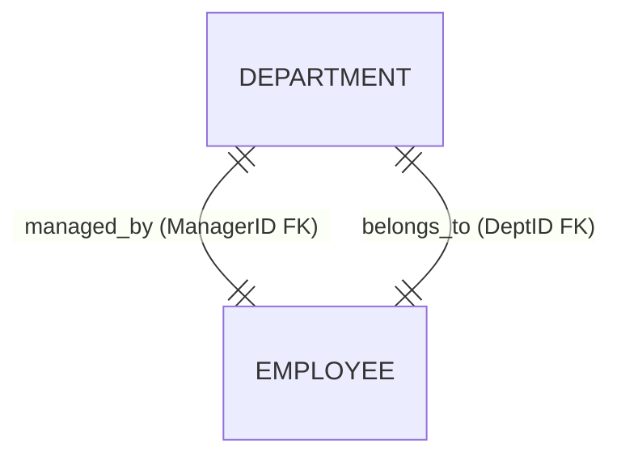
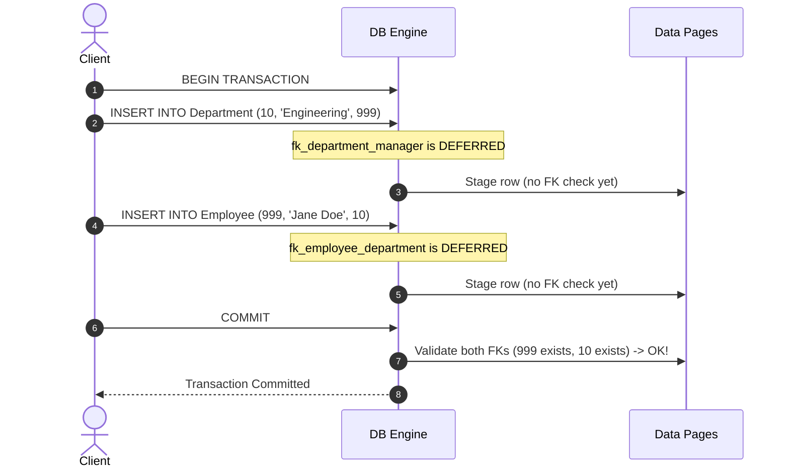

# Schema-Level Assertions & Deferrable Constraints

While `CHECK` and `FOREIGN KEY` constraints enforce row-level and parent–child rules immediately, advanced relational design addresses two problems that standard checks cannot solve alone: **global multi-table invariants** (`ASSERTION`) and **cyclic foreign-key deadlocks** (`DEFERRABLE`).

---

## 1. Schema-Level Assertions (`CREATE ASSERTION`)

A standard `CHECK` constraint can inspect only columns of the **single row** being written; it cannot aggregate across rows or query other tables. An **Assertion** is a standalone, schema-level integrity constraint defining a condition that the entire database must satisfy at all times.

```sql
-- Global invariant 1: No employee earns more than their direct manager
CREATE ASSERTION check_salary_hierarchy CHECK (
    NOT EXISTS (
        SELECT 1
        FROM Employee E
        JOIN Manager M ON E.ManagerID = M.ManagerID
        WHERE E.Salary > M.Salary
    )
);

-- Global invariant 2: Department salary sum never exceeds department budget
CREATE ASSERTION check_department_budget CHECK (
    NOT EXISTS (
        SELECT D.ID
        FROM Departments D
        JOIN Employees E ON D.ID = E.DeptID
        GROUP BY D.ID, D.Budget
        HAVING SUM(E.Salary) > D.Budget
    )
);
```

### Why Modern RDBMS Engines Omit Native `CREATE ASSERTION`
Although defined in ANSI SQL, **PostgreSQL, MySQL, and Oracle do not implement `CREATE ASSERTION` natively**. Enforcing an arbitrary multi-table subquery on *every* `INSERT`, `UPDATE`, or `DELETE` across any referenced table (`Departments` or `Employees`) triggers expensive table scans/joins and kills write throughput. **Modern Workaround:** Implement cross-table invariants via **triggers** (or explicit validation inside **stored procedures**).

---

## 2. Cyclic Dependencies & Deferrable Constraints

### The Bootstrap Deadlock
Consider two mutually referencing tables where both foreign keys are mandatory:
- Every `Department` must have a `ManagerID` referencing `Employee(ID)`.
- Every `Employee` must have a `DeptID` referencing `Department(ID)`.



Under normal immediate checking, **neither row can be inserted first**: inserting `Department` fails because its manager doesn't exist in `Employee`, and inserting `Employee` fails because their department doesn't exist in `Department`.

### The Solution: `DEFERRABLE` Constraints (Supported in PostgreSQL & Oracle)
Instead of checking constraints after every individual SQL statement, a **`DEFERRABLE`** constraint postpones verification until **`COMMIT`**:

| Deferrability Mode | Behavior |
| :--- | :--- |
| **`NOT DEFERRABLE`** *(Default)* | Checked immediately after each statement; cannot be deferred. |
| **`DEFERRABLE INITIALLY IMMEDIATE`** | Checked immediately by default, but can be switched via `SET CONSTRAINTS ... DEFERRED;` inside a transaction. |
| **`DEFERRABLE INITIALLY DEFERRED`** | Automatically waits until `COMMIT` to validate all writes in the transaction as a group. |

```sql
CREATE TABLE Employee (
    ID INT PRIMARY KEY,
    Name VARCHAR(100),
    DeptID INT
);

CREATE TABLE Department (
    ID INT PRIMARY KEY,
    Name VARCHAR(100),
    ManagerID INT,
    CONSTRAINT fk_department_manager FOREIGN KEY (ManagerID) REFERENCES Employee(ID)
        DEFERRABLE INITIALLY DEFERRED
);

ALTER TABLE Employee
ADD CONSTRAINT fk_employee_department FOREIGN KEY (DeptID) REFERENCES Department(ID)
    DEFERRABLE INITIALLY DEFERRED;
```


