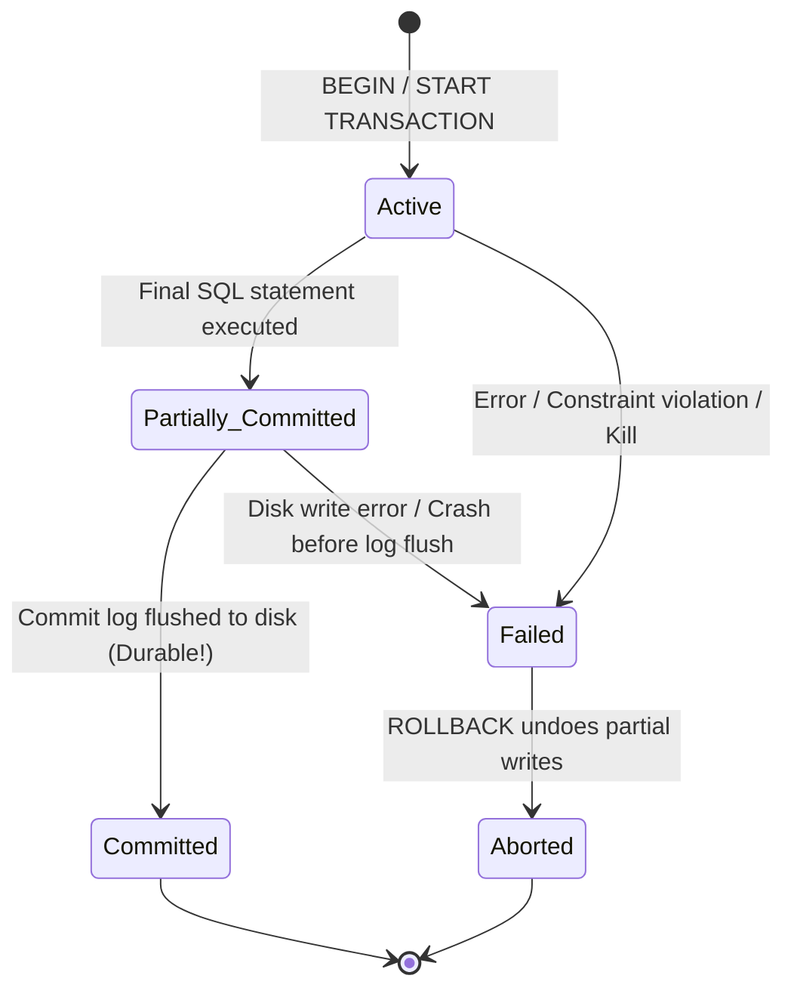

# ACID Properties, Transaction Control & Crash Recovery

This note consolidates **Transaction Management, ACID Properties, Transaction Control Syntax (`COMMIT`, `ROLLBACK`, `SAVEPOINT`), Write-Ahead Logging (WAL), ARIES Crash Recovery, PostgreSQL TP 2 Transaction Behavior, and all Crash/Recovery Exercises from TD N°5**.

---

## 1. Transactions & ACID Properties

A **transaction** is a **Logical Unit of Work (LUW)**—a sequence of DML statements executed as a single indivisible operation ("All or Nothing") that moves the database from one valid state to another.

| Property | Concept | Mechanism & Non-IT Analogies |
| :--- | :--- | :--- |
| **A — Atomicity** | "All or Nothing": either every statement succeeds, or none apply. | Undo logs & `ROLLBACK`. *Vending Machine:* insert coin + press button $\to$ get drink, or get coin back (never lose coin without drink). *Banking:* debiting Ali without crediting Sara is undone. |
| **C — Consistency** | Preserves all schema constraints (`PK`, `FK`, `CHECK`) and domain invariants (`Sum(Accounts)` constant). | Constraint validation & atomic boundaries. *Bookkeeping:* debits always balance credits; money cannot vanish or appear from nowhere. |
| **I — Isolation** | Intermediate uncommitted states remain hidden from concurrent transactions. | Locking / MVCC. *Fitting Rooms:* customers try outfits privately without others seeing unfinished choices. |
| **D — Durability** | Once `COMMIT` succeeds, changes persist permanently even after immediate power loss. | **Write-Ahead Logging (WAL)**. *Notarized Contract:* legally survives even if the office burns down. |

### Transaction State Machine

*(Distinction: In **Partially Committed**, statements have executed in RAM buffers, so data is NOT yet crash-safe; only **Committed** guarantees Durability.)*

---

## 2. Transaction Control Mechanics, Auto-Commit & `SAVEPOINT`

Think of an explicit transaction as **"Draft Mode"**:
- **`COMMIT` ("Save" / Point of No Return):** Persists buffered changes, makes them visible to other sessions, and releases locks. Once committed, `ROLLBACK` cannot undo it.
- **`ROLLBACK` ("Undo" / `Ctrl+Z`):** Discards all pending changes since `START TRANSACTION` and releases locks.
- **Inside vs. Outside Transaction Scope (Auto-Commit):** By default (`AUTOCOMMIT = 1`), every single SQL line auto-commits immediately—a failure halfway through an order script (order inserted, inventory subtraction crashed) leaves the DB corrupted! Disabling auto-commit (`SET AUTOCOMMIT = 0;` in MySQL or wrapping inside `BEGIN;` / `START TRANSACTION; ... COMMIT;`) places multiple statements inside a safe atomic bubble.

### `SAVEPOINT` Lifecycle ("On and Off" Bookmarks)
A **Savepoint** creates a named checkpoint inside an open transaction for **partial rollbacks**:
```sql
-- Example adapted from Course Source 20 (Compagnie table)
BEGIN;
    INSERT INTO Compagnie VALUES ('EJ', 'Easy Jet', ...); -- Step 1
    SAVEPOINT P1;                                        -- Bookmark P1 active

    UPDATE Compagnie SET city = 'Blagnac' WHERE comp = 'EJ'; -- Step 2
    SAVEPOINT P2;                                        -- Bookmark P2 active

    DELETE FROM Compagnie WHERE comp = 'C1';             -- Step 3 (mistake!)

    ROLLBACK TO SAVEPOINT P2; -- Undoes Step 3 only; keeps Steps 1 & 2; Tx stays OPEN!
    -- Rolling back to P1 would undo Steps 2 & 3 AND destroy later savepoint P2!
COMMIT; -- Persists remaining work and destroys all savepoints
```
- **Destruction ("OFF"):** Savepoints disappear on `COMMIT`, full `ROLLBACK`, `RELEASE SAVEPOINT name;`, or when rolling back to an *earlier* savepoint (`P1` destroys `P2`). Reusing an existing savepoint name overwrites the old bookmark.

### Crash Timing Outcomes (3 Scenarios)
| Crash Timing | Intuitive Analogy | Recovery Action & Outcome |
| :--- | :--- | :--- |
| **Stop BEFORE `COMMIT`** | Typing a long email and crashing before clicking Send | **Implicit `ROLLBACK` (`UNDO`)**: changes were uncommitted; database restores original state. |
| **Stop DURING `COMMIT`** | Clicking "Pay Now" on a banking app and phone dies | Depends on WAL: **Log missing `COMMIT`** $\to$ **Undo** (money stays). **Log has `COMMIT`** $\to$ **Redo / Roll Forward** (data saved!). |
| **Stop DURING `ROLLBACK`** | Clicking Delete on a file and crashing at 50% | Recovery detects incomplete abort and **finishes `UNDO`** on reboot $\to$ changes completely removed. |

---

## 3. PostgreSQL Transaction Semantics Taught in TP 2

1. **Reversible Testing (`BEGIN; ... ROLLBACK;`):** Used in TP 2 Ex 1, 9, 10, 12 to test `UPDATE`/`CALL` safely and revert changes without altering TP 1 baseline data.
2. **Trigger Atomicity (TP 2 Ex 10):** An `AFTER UPDATE` trigger inserting into `salary_history` executes **within the same transaction** as the triggering `UPDATE`. Running `ROLLBACK` undoes **both** the salary change and the audit row.
3. **PL/pgSQL `EXCEPTION` Block Rollback (TP 2 Part II.7):** A `BEGIN ... EXCEPTION ... END;` block acts as an **implicit savepoint**—when an error is caught by `EXCEPTION`, **PostgreSQL automatically rolls back every database change made inside that protected block** to its entry state before executing the handler!
4. **Materialized View Refresh Independence (TP 2 Ex 2):** `REFRESH MATERIALIZED VIEW` is a separate operation from base-table updates; restoring base salaries requires explicitly refreshing again.

---

## 4. Buffer Pool Policies, Write-Ahead Logging (WAL) & ARIES Recovery

### Buffer Management: `STEAL / NO-FORCE`
- **STEAL vs. NO-STEAL:** Can RAM frames containing uncommitted writes be flushed to disk to free memory? High-performance engines choose **`STEAL`** (requires **`UNDO`** on crash).
- **FORCE vs. NO-FORCE:** Must all modified pages flush to disk synchronously at `COMMIT`? Engines choose **`NO-FORCE`** (fast random-write avoidance; requires **`REDO`** on crash).

### Write-Ahead Logging (WAL) & Log Record Structure
Because sequential disk writes to an append-only **Log (Journal)** are far faster than scattered page writes, **WAL enforces two strict rules**:
1. A modification's log record must reach non-volatile disk **before** its corresponding dirty data page flushes to disk.
2. A transaction is not committed until its `COMMIT` log record is flushed to disk.

Each log record carries: **`LSN`** (monotonic Log Sequence Number), **`PrevLSN`** (backward link to prior record of the same `TxID` for fast undo), **`TxID`**, **`Type`** (`START`, `UPDATE`, `COMMIT`, `ABORT`, `CLR`—Compensating Log Record written during undo so crash during recovery never repeats undos!), **`PageID`**, **`UndoData`** (before-image), and **`RedoData`** (after-image).

### Checkpoints & ARIES 3-Phase Crash Recovery
Periodically, the DBMS flushes dirty RAM pages to disk and writes a **`CHECKPOINT`** marker in the log so reboot recovery skips older history. Upon restart after a crash:
1. **Analysis Phase:** Scans forward from the last `CHECKPOINT` to identify dirty pages and active ("loser") transactions lacking a `COMMIT`/`ABORT`.
2. **REDO Phase (Roll Forward):** Replays logged operations forward from the oldest unwritten dirty page ("repeating history") for both committed and uncommitted transactions up to crash time.
3. **UNDO Phase (Roll Back):** Scans backward along `PrevLSN` chains to reverse all uncommitted ("loser") transactions, emitting `CLR` records.

### Four Failure Types & High Availability Replication
| Failure Type | Cause | Recovery Solution |
| :--- | :--- | :--- |
| **1. Transaction Failure** | Division by zero, constraint violation, deadlock victim | Transaction `ROLLBACK` (`UNDO`) |
| **2. System Crash** | Power failure, OS panic (volatile RAM lost) | **WAL** + **Checkpoints** + **ARIES** (`REDO`/`UNDO`) |
| **3. Disk Failure** | Physical drive/sector corruption | **RAID**, Backups, Master-Replica **WAL Streaming** |
| **4. Catastrophe** | Fire, flood, datacenter outage | Off-site Backups & Geo-Replication |

- **Replication:** Master streams WAL to Replicas (**Synchronous** waits for replica confirmation = zero data loss, higher latency; **Asynchronous** commits locally and streams in background = low latency, slight lag risk), paired with automated **Failover** via load balancer.

---

## 5. Worked TD N°5 Recovery & Transaction Exercises

- **TD 5 Ex 1 (ACID + Banking):** See Section 1 (Vending machine analogy; without Atomicity, mid-transfer crash destroys/creates money; without Durability, confirmed deposits vanish after server crash).
- **TD 5 Ex 2 (`Comptes` Transfer & Crash):**
  ```sql
  START TRANSACTION;
  UPDATE Comptes SET solde = solde - 100 WHERE id = 1; -- Ali: 500 -> 400
  UPDATE Comptes SET solde = solde + 100 WHERE id = 2; -- Sara: 300 -> 400
  COMMIT;
  ```
  *Crash after debiting Ali, before crediting Sara:* Upon restart, WAL shows `UPDATE` on `id=1` with **no `COMMIT`**. Recovery runs **`UNDO`** (Atomicity), restoring `Ali = 500, Sara = 300`.
- **TD 5 Ex 5 (Log Recovery Analysis):**
  Log: `[LSN 101] T1: START` $\to$ `[102] T1: UPDATE id=1 (-200)` $\to$ `[103] T2: START` $\to$ `[104] T2: UPDATE id=2 (+200)` $\to$ `[105] T1: COMMIT` $\to$ **CRASH**.
  - **T1** is a **Winner** (`COMMIT` present) $\to$ **`REDO`** ensures `-200` on `id=1` is persisted.
  - **T2** is a **Loser** (no `COMMIT`) $\to$ **`UNDO`** reverses `+200` on `id=2`, restoring `id=2`'s original balance.
- **TD 5 Ex 6 (University Registration `Inscriptions` / `Cours`):**
  ```sql
  START TRANSACTION;
  UPDATE Compte_Etudiant SET solde = solde - 250 WHERE etudiant_id = 412;
  INSERT INTO Inscriptions VALUES (412, 'CS-301', CURRENT_DATE);
  UPDATE Cours SET places = places - 1 WHERE cours_id = 'CS-301' AND places > 0;
  COMMIT;
  ```
  Crash after Step 2 triggers automatic **`UNDO`** refunding the student and deleting the `Inscriptions` row, enforcing **Consistency** (`places > 0`), **Atomicity** (all 3 steps together), and **Isolation** (preventing two students from taking the last seat).
