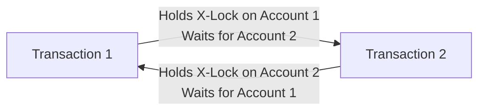

# Concurrency Anomalies, Isolation Levels & Locking Protocols

This note covers **Concurrency Anomalies, SQL Isolation Levels, Two-Phase Locking (2PL), Timestamp Ordering, Optimistic Concurrency Control (OCC), MVCC, Deadlocks, and TD N°5 Exercises 3 & 4**.

---

## 1. Concurrency Anomalies (Step-by-Step Traces)

When transactions execute concurrently without sufficient isolation, interleaving operations produce five classic anomalies:

1. **Dirty Read (*Lecture Sale*):** $T_1$ reads data written by $T_2$ before $T_2$ commits; $T_2$ later rolls back, leaving $T_1$ acting on data that never existed.
   | Time | $T_1$ | $T_2$ | DB State |
   | :--- | :--- | :--- | :--- |
   | $t_1$ | | `UPDATE account SET balance = 1200 WHERE id=1;` | `1200` (Uncommitted) |
   | $t_2$ | `SELECT balance FROM account WHERE id=1;` *(reads 1200)* | | `1200` |
   | $t_3$ | | `ROLLBACK;` | `1000` (Restored!) |
   | $t_4$ | *Makes decision using phantom 1200!* | | `1000` |
2. **Non-Repeatable (Fuzzy) Read:** $T_1$ reads `balance = 1000`; $T_2$ runs `UPDATE ... SET balance = 1200; COMMIT;`; $T_1$ reads the same row again within the same transaction and receives `1200`.
3. **Phantom Read (*Lecture Fantôme*):** $T_1$ runs `SELECT * FROM account WHERE balance > 1000;` (3 rows); $T_2$ executes `INSERT INTO account VALUES (99, 1500); COMMIT;`; $T_1$ re-runs the range query and receives **4 rows** (row 99 appeared as a "phantom").
4. **Lost Update (*Mise à Jour Perdue*):** $T_1$ reads `stock = 100`, $T_2$ reads `stock = 100`. $T_1$ writes `90` (`-10`) and commits; $T_2$ writes `95` (`-5`) and commits. $T_1$'s subtraction of `10` is **silently overwritten** (`95` instead of `85`).
5. **Write-Skew (Snapshot Isolation Edge Case):** Two transactions read an overlapping set under MVCC Snapshot Isolation (e.g., checking two doctors are on call), and each updates a *different* row (taking themselves off call), leaving 0 doctors on call!

---

## 2. SQL Isolation Levels (`SET TRANSACTION ISOLATION LEVEL ...;`)

| Isolation Level | Dirty Read? | Non-Repeatable? | Phantom Read? | Mechanism & Performance |
| :--- | :---: | :---: | :---: | :--- |
| **`READ UNCOMMITTED`** | Possible | Possible | Possible | No read locks; fastest, unsafe *(PostgreSQL maps this to `READ COMMITTED`)*. |
| **`READ COMMITTED`** | Prevented | Possible | Possible | Short-lived shared locks or per-statement MVCC snapshot. **Default in PostgreSQL & Oracle.** |
| **`REPEATABLE READ`** | Prevented | Prevented | Possible (SQL Std) | Long-lived read locks or per-transaction snapshot. **Default in MySQL InnoDB** *(InnoDB next-key locks & PostgreSQL snapshot MVCC also prevent standard phantoms, though PostgreSQL snapshot isolation permits write-skew)*. |
| **`SERIALIZABLE`** | Prevented | Prevented | Prevented | Range/predicate locks or Serializable Snapshot Isolation (SSI); slowest under heavy contention, safest. |

---

## 3. Concurrency Control Protocols (Pessimistic vs. Optimistic)

### A. Lock-Based Protocols (Pessimistic)
Assumes conflicts are frequent and acquires locks before accessing rows:
- **Shared Lock (S-Lock):** For reads; compatible with other S-locks, incompatible with X-locks.
- **Exclusive Lock (X-Lock):** For writes (`INSERT`/`UPDATE`/`DELETE`/`SELECT ... FOR UPDATE`); incompatible with **all** S- and X-locks.

**Two-Phase Locking (2PL) — Guarantees Conflict Serializability:**
1. **Growing Phase:** Transaction acquires locks and **cannot release any lock**.
2. **Shrinking Phase:** Once the transaction releases its first lock, it **cannot acquire any new locks**.
- *Basic 2PL Flaw:* Releasing an X-lock early risks **cascading rollbacks** if the writer later aborts after a reader consumed the value.
- **Strict 2PL (S2PL):** Holds **all X-locks until `COMMIT`/`ROLLBACK`** (eliminates cascading rollbacks).
- **Strong Strict 2PL (SS2PL):** Holds **both S-locks and X-locks until end of transaction**.

### B. Timestamp Ordering (TO) & Thomas Write Rule
Non-locking protocol assigning each transaction a unique monotonic timestamp $TS(T_i)$, tracking $R\_TS(Q)$ (youngest reader) and $W\_TS(Q)$ (youngest writer) on each data item $Q$:
- **Read $T_i(Q)$:** If $TS(T_i) < W\_TS(Q)$ (a younger future transaction already wrote $Q$), **abort & restart $T_i$**; otherwise allow read and set $R\_TS(Q) = \max(R\_TS(Q), TS(T_i))$.
- **Write $T_i(Q)$:**
  - If $TS(T_i) < R\_TS(Q)$ (a younger future transaction already read old $Q$), **abort & restart $T_i$**.
  - If $TS(T_i) < W\_TS(Q)$ (a younger transaction already wrote newer $Q$), standard TO aborts $T_i$, whereas the **Thomas Write Rule** safely **ignores the obsolete write** and lets $T_i$ continue!
  - Otherwise execute write and set $W\_TS(Q) = TS(T_i)$.
- *Trade-off:* Deadlocks are impossible, but high contention causes frequent aborts/restarts.

### C. Optimistic Concurrency Control (OCC)
Assumes conflicts are rare (ideal for read-heavy workloads):
1. **Read Phase:** Read without locks; stage writes in private local RAM buffers (tracking row `version` or `timestamp`).
2. **Validation Phase:** At `COMMIT`, verify via Backward or Forward validation whether concurrent commits modified read rows.
3. **Write Phase:** Flush private updates if valid; otherwise abort & retry.

### D. Multi-Version Concurrency Control (MVCC — PostgreSQL & InnoDB)
Updates create a **new timestamped row version** (`Min_TS`, `Max_TS`) rather than overwriting in place. Readers inspect the snapshot version valid at their start time—**"Readers do not block Writers, and Writers do not block Readers."** Old dead row versions are reclaimed asynchronously (e.g., PostgreSQL `VACUUM`).

---

## 4. Deadlocks (*Interblocage*)

- **Prevention (Timestamp-Based):**
  - **Wait-Die (Non-preemptive):** Older $T_{\text{old}}$ waits for $T_{\text{young}}$; younger $T_{\text{young}}$ requesting an older transaction's lock immediately aborts (**dies**).
  - **Wound-Wait (Preemptive):** Older $T_{\text{old}}$ aborts (**wounds**) $T_{\text{young}}$ and takes the lock; younger $T_{\text{young}}$ waits for $T_{\text{old}}$.
- **Detection & Resolution:** Maintain a **Wait-For Graph (WFG)** of waiting edges $T_i \to T_j$; detect cycles periodically (or via lock timeouts) and abort a chosen **victim** (minimizing rollback cost by considering age, locks held, and rows modified).

---

## 5. Worked TD N°5 Exercises (Ex 3 & Ex 4)

- **TD 5 Ex 3 (`Produits(id, stock)`):**
  - *Q1 (Dirty Read):* $T_1$ updates stock $100 \to 90$; $T_2$ reads `90`; $T_1$ runs `ROLLBACK` ($\to 100$); $T_2$ acted on invalid `90`.
  - *Q2 (Lost Update):* $T_1$ & $T_2$ both read `100`; $T_1$ writes `90` (`-10`) and commits; $T_2$ writes `95` (`-5`) and commits—overwriting $T_1$ (`95` instead of `85`).
  - *Q3 (Fix):* Pessimistic locking via **`SELECT stock FROM Produits WHERE id = 1 FOR UPDATE;`** inside the transaction (acquires X-lock so concurrent updaters queue until `COMMIT`, demonstrated in `Gestion_Pilotes` cursor locking in [[04 - Cursors & Row-by-Row Processing]]!).
- **TD 5 Ex 4 (Choosing Isolation Levels):**
  - *Approximate analytics (like counts):* `READ UNCOMMITTED` / `READ COMMITTED` (speed > precision).
  - *Standard banking transfers:* `READ COMMITTED` + `FOR UPDATE` or `REPEATABLE READ`.
  - *Inventory preventing negative stock under contention:* `SERIALIZABLE` (or explicit `FOR UPDATE` row locks).
