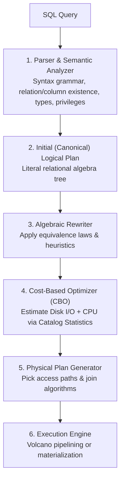
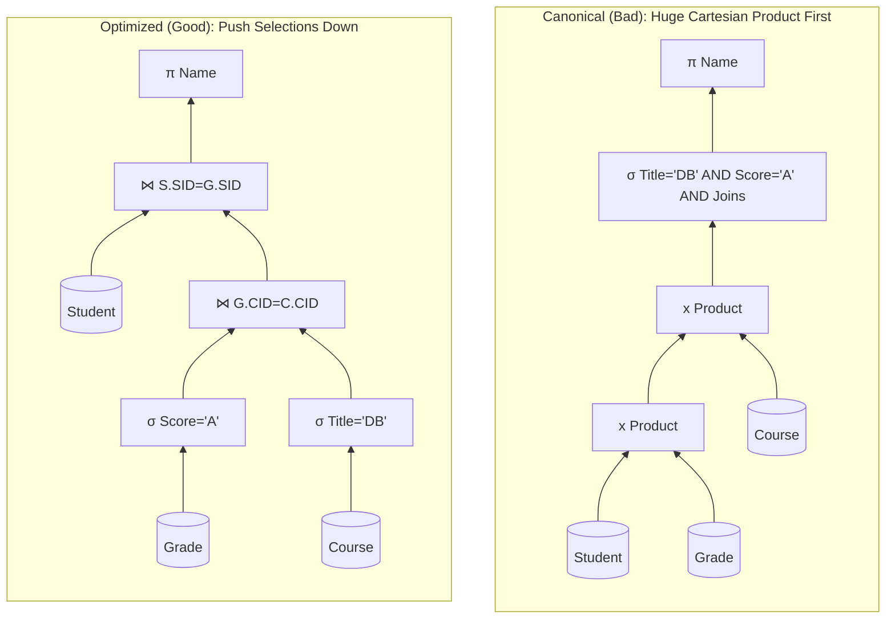
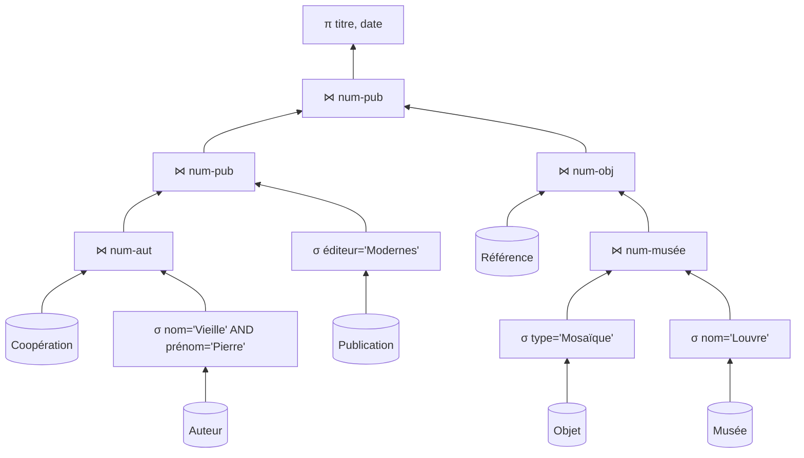

# Query Processing, Algebraic Rewriting & Cost Estimation

This note consolidates **Query Processing Architecture, Logical Plans, Algebraic Rewrite Heuristics, Cost Models, Catalog Statistics & Histograms, the Mathematical Proof of Heuristic Failure (`Film`/`Seance`), and Worked TD N°4 Exercises (`Trains & Wagons`, `Archaeology DB`)**.

---

## 1. Query Processing Lifecycle

Because SQL is **declarative**, the DBMS must translate a query into an optimal procedural execution plan:



---

## 2. Algebraic Equivalence Rules & Optimization Heuristics

Data flows bottom-up from base relations (leaves) through selections/joins to the final projection (root).

### Mathematical Equivalence Laws
1. **Join Commutativity:** $R \bowtie S \equiv S \bowtie R$ (smaller relation chosen as outer/build side).
2. **Join Associativity:** $(R \bowtie S) \bowtie T \equiv R \bowtie (S \bowtie T)$ (evaluates different join orderings).
3. **Selection–Join Commutativity (Selection Pushdown):** $\sigma_C(R \bowtie S) \equiv (\sigma_C(R)) \bowtie S$ whenever predicate $C$ references only attributes of $R$.
4. **Selection Decomposition / Commutativity:** $\sigma_{C_1 \land C_2}(R) \equiv \sigma_{C_1}(\sigma_{C_2}(R)) \equiv \sigma_{C_2}(\sigma_{C_1}(R))$.
5. **Projection Cascade:** $\pi_{L_1}(\pi_{L_2}(R)) \equiv \pi_{L_1}(R)$ for $L_1 \subseteq L_2$.

### The Four Golden Heuristics (and Canonical vs. Optimized Example)
1. **Push Selections Down ($\sigma$):** Split `WHERE A=1 AND B=2` into atomic selections and push them directly onto base tables to shrink row counts *before* joins.
2. **Push Projections Down ($\pi$):** Discard unneeded columns early (always retaining join keys!) to shrink tuple byte-width and fit more tuples per page.
3. **Replace Cartesian Products ($\times$) with Joins ($\bowtie$):** Convert $\sigma_{R.k=S.k}(R \times S)$ into a direct join $R \bowtie_{R.k=S.k} S$.
4. **Join Most Restrictive (Smallest) Relations First:** $(Small \bowtie Medium) \bowtie Huge$ keeps intermediate results tiny.

*Example (`Student`, `Grade`, `Course` — `'Databases'` & `'A'`):*


---

## 3. Cost Estimation, Statistics & Histograms

### Cost Variables & Cardinality Formulas
Disk **I/O transfers**—Reads ($E$, *Entrées*) and Writes ($S$, *Sorties*)—dominate cost:
- **Catalog Metadata:** Tuple count $N_R$, page count $P_R$, distinct values $V(A, R)$ (for PK, $V = N_R$), and min/max bounds.
- **Selectivity ($Sel$) & Output Size:**
  - *Equality ($\sigma_{A=val}(R)$):* $Sel = \frac{1}{V(A,R)} \implies \text{Size} = \frac{N_R}{V(A,R)}$.
  - *Inequality ($\sigma_{A>val}(R)$):* $Sel = \frac{Max - val}{Max - Min}$.
  - *Join ($R \bowtie_A S$):* $\text{Est. Size} = \frac{N_R \times N_S}{\max(V(A,R), V(A,S))}$ (for FK joins, typically $\approx$ child table size).
- **Histograms (Skewed Data Distributions):**
  - **Equi-Width:** Equal value-range buckets (`1-10`, `11-20`, `21-30`)—inaccurate when values cluster heavily (e.g., 80% of customers in Paris).
  - **Equi-Depth (Height-Balanced):** Variable-width buckets each holding roughly the **same row count**—much more accurate on skewed data.
- **Statistics Acquisition Strategies:**
  1. **Periodic Triggering (`ANALYZE` in PostgreSQL, `DBMS_STATS` in Oracle):** Off-peak full analysis; highly accurate, but becomes stale between runs after massive bulk writes.
  2. **Real-Time Sampling (e.g., MySQL InnoDB sampling 8 random pages):** Always up-to-date on sudden changes, slightly noisy on non-uniform data clumps.

---

## 4. Mathematical Proof: When "Filter First" Fails (`Film` & `Seance`)

Pushing selections down is **almost always** best, **except** when a weak selection filters out very few rows while the join is highly selective and intermediate disk/memory write cost ($S$) dominates!

**Setup:**
- `Film`: $P_{\text{Film}} = 8$ pages; `Seance`: $P_{\text{Seance}} = 50$ pages.
- Selection $\sigma_{heure > 14}(\text{Seance})$ has selectivity **$0.90$** (90% survive!).
- Join `Film` $\bowtie$ `Seance` has selectivity **$0.20$** (only 20% survive!).

### Plan A: Naive Plan (Join First, Filter Later)
1. **Block Nested Loop Join** (`Film` 8p $\times$ `Seance` 50p):
   - Reads ($E$): $8 \times 50 = 400E$.
   - Writes ($S$, 20% survive): $50 \times 0.20 = 10S$.
2. **Selection** on the 10-page intermediate result:
   - Reads ($E$): $10E$.
   - Writes ($S$, 90% survive): $10 \times 0.90 = 9S$.
- **Total Cost A:** $(400 + 10)E + (10 + 9)S = 410E + 19S = \mathbf{429\text{ I/O}}$.

### Plan B: "Optimized" Plan (Filter First, Join Later)
1. **Selection** on `Seance` (50 pages):
   - Reads ($E$): $50E$.
   - Writes ($S$, 90% survive): $50 \times 0.90 = 45S$.
2. **Join** `Film` (8p) with filtered `Seance` (45p):
   - Reads ($E$): $8 \times 45 = 360E$.
   - Writes ($S$, 20% survive): $45 \times 0.20 = 9S$.
- **Total Cost B:** $(50 + 360)E + (45 + 9)S = 410E + 54S = \mathbf{464\text{ I/O}}$.

**Conclusion:** Plan B costs **35 I/O more** ($464$ vs. $429$) because materializing the barely filtered 45-page intermediate result ($45S$) cost far more than doing the highly restrictive join first!

---

## 5. Worked TD N°4 Exercises

### Exercise 1: Trains & Wagons
- **Schema & Volume:** `Train(NoTrain, NoWagon)` ($60{,}000$ rows, $2{,}000$ distinct trains), `Wagon(NoWagon, TypeWagon, ...)` ($200{,}000$ rows).
- **Query:** *"Find wagon type for Train 4002."*
  ```sql
  SELECT W.TypeWagon
  FROM Train T JOIN Wagon W ON T.NoWagon = W.NoWagon
  WHERE T.NoTrain = 4002;
  ```
- **Tree (a) Naive vs. Tree (b) Optimized:**
  - **Equivalence (Q1):** Yes—by **commutativity of selection and join**, $\sigma_{NoTrain=4002}(Train \bowtie Wagon) \equiv (\sigma_{NoTrain=4002}(Train)) \bowtie Wagon$ because `NoTrain` belongs solely to `Train`.
  - **Volume Comparison (Q2):** Tree (a) joins all $60{,}000 \times 200{,}000$ rows (~200k intermediate tuples, ~260k operations) before filtering; Tree (b) filters `Train` first down to $\frac{60{,}000}{2{,}000} = \mathbf{30\text{ rows}}$ and performs ~30 index lookups on `Wagon.NoWagon`—orders of magnitude faster.

### Exercise 2: Archaeology Database (6-Table Multi-Join)
Schema: `Objet(num-obj, type, num-musée)`, `Musée(num-musée, nom)`, `Publication(num-pub, titre, date, éditeur)`, `Auteur(num-aut, nom, prénom)`, `Coopération(num-aut, num-pub)`, `Référence(num-pub, num-obj)`.
- **Goal:** Titles and dates of publications written by `'Pierre Vieille'` (editor `'Modernes'`) referencing `'Mosaïque'` objects in the `'Louvre'`.
- **Canonical Plan:** 6-way Cartesian product ($1000^6 = 10^{18}$ tuples if 1,000 rows each!) $\to$ single giant `WHERE`. Unexecutable.
- **Optimized Plan:** Push selections down to leaves (`Auteur`, `Publication`, `Objet`, `Musée`), convert Cartesian products into selective joins along two independent branches, join via `Référence`, and push projections (`titre`, `date`, join keys) down:


