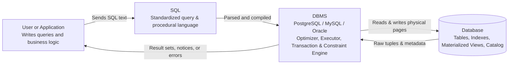
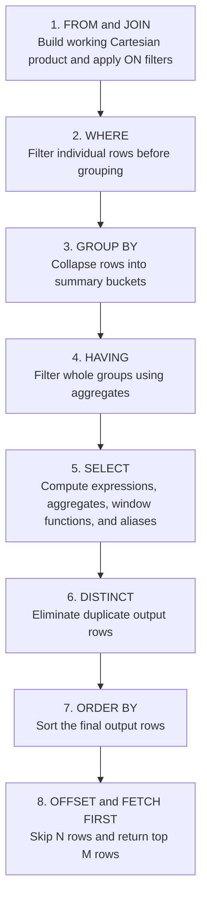
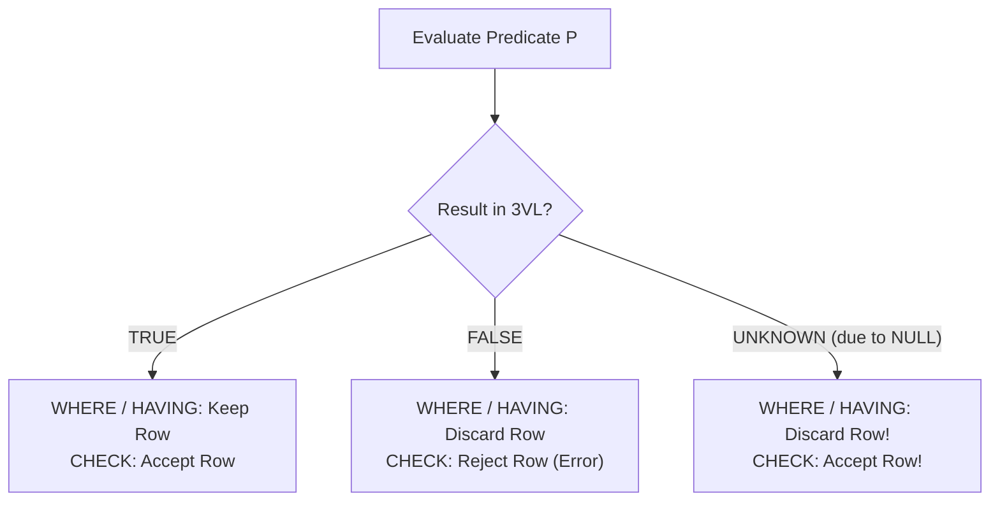
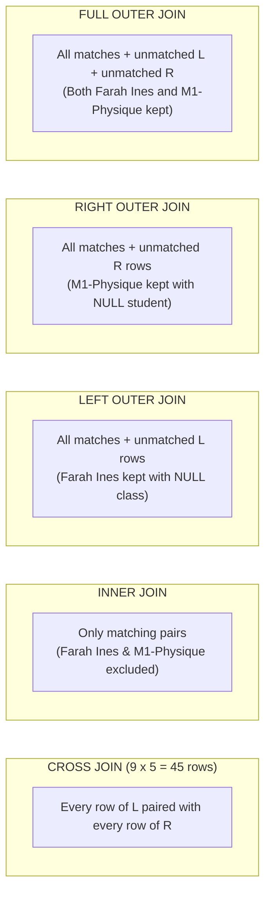
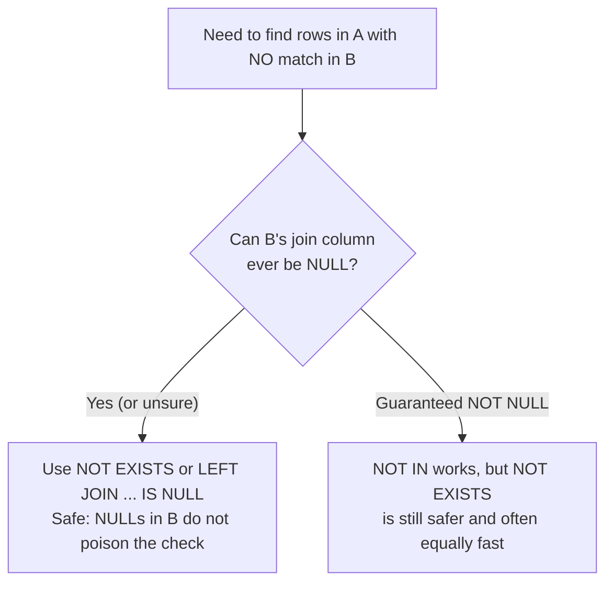
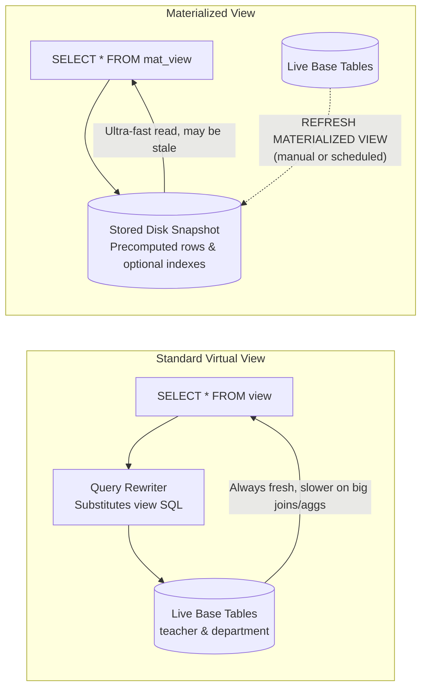
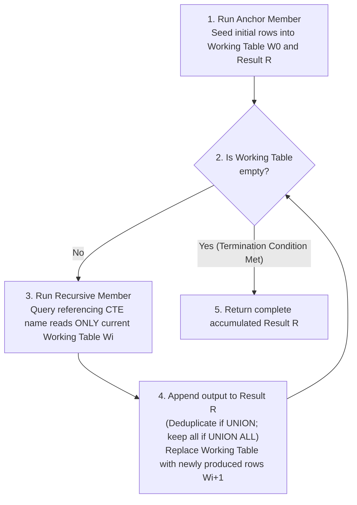
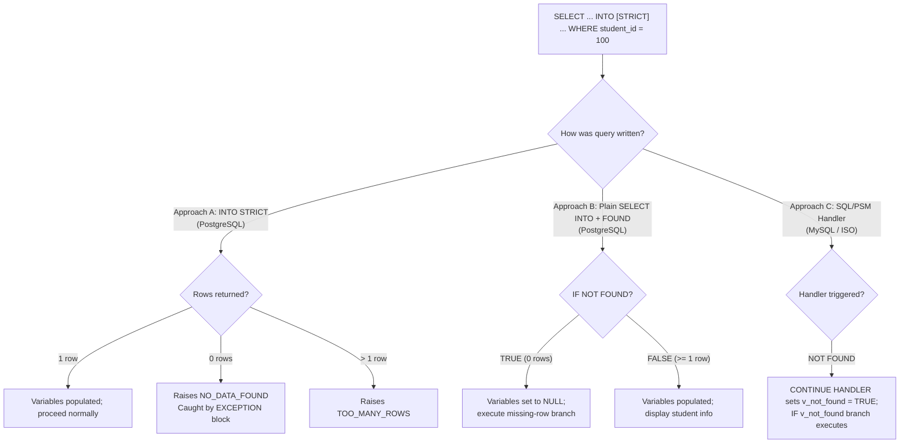
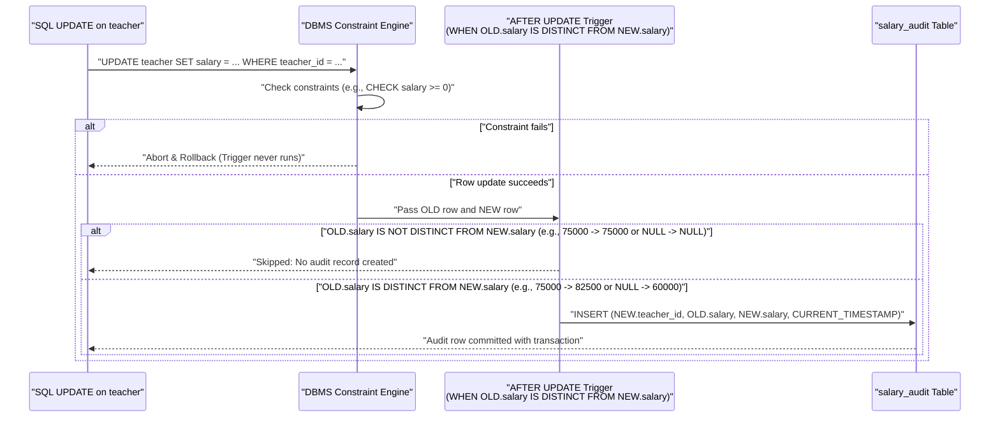

# 1. Course Context, Relational Architecture, and the University Dataset

> [!abstract] Master Note Scope
> This single comprehensive Obsidian reference unifies the **Advanced Databases (Master GL / I2A)** lecture slides (**Chapter 1: Introduction to Advanced SQL**), **Tutorial 1** (Questions 1 to 31), **Tutorial 2** (Exercises 1 to 18), and a **line-by-line forensic review and correction** of your handwritten notebook solutions. Every concept is built from first principles so that you never have to look anything up elsewhere.

## 1.1. Core Database Concepts and SQL Standardization

To understand advanced SQL programming, it helps to separate three terms that beginners frequently blur together:

1. **Database (DB):** A structured, persistent collection of organized data representing objects and relationships from a real-world domain (such as a university with departments, classes, teachers, and students). A database by itself is passive storage; it does not enforce rules or answer queries on its own.
2. **Database Management System (DBMS):** The active software engine (such as PostgreSQL, MySQL, Oracle Database, Microsoft SQL Server, or SQLite) that manages storage on disk, parses queries, checks integrity constraints, optimizes execution plans, controls concurrent access, and enforces security.
3. **Structured Query Language (SQL):** The standardized declarative language (maintained by ISO/IEC 9075) used by users and applications to communicate with a relational DBMS.



> [!important] Standard SQL vs. DBMS Dialects (Why Syntax Differs)
> **SQL is a specification**, whereas **PostgreSQL, MySQL, Oracle, and SQL Server are concrete implementations**. While core `SELECT`, `INSERT`, `UPDATE`, and `DELETE` behave nearly identically across systems, procedural extensions, error handling, string concatenation, case sensitivity in `LIKE`, and `NULL` sorting vary significantly across engines.
> - Your **lecture slides** explicitly target **PostgreSQL**, which implements most of the ISO/IEC SQL standard while providing **PL/pgSQL** (`DO $$ ... $$`, `RAISE NOTICE`, `INTO STRICT`, `IS DISTINCT FROM`) for procedural blocks.
> - **Tutorial 2** uses the generic term **SQL/PSM** (*SQL/Persistent Stored Modules*, ISO/IEC 9075-4), whose closest mainstream syntax exists in MySQL/MariaDB and IBM Db2 (`BEGIN ATOMIC`, `DECLARE CONTINUE HANDLER FOR NOT FOUND`).
> - Whenever syntax is DBMS-dependent, this note provides **both** the **PostgreSQL** implementation and the **ISO SQL/PSM** equivalent, and clearly explains the differences.

---

## 1.2. Course Structure and SQL Command Categories

SQL statements are grouped into functional sub-languages based on what they act upon:

| Sub-Language | Full Name | Main Statements Covered | What It Modifies |
| :--- | :--- | :--- | :--- |
| **DDL** | Data Definition Language | `CREATE`, `ALTER`, `DROP` | Database schema objects (tables, views, materialized views, constraints, functions, procedures, triggers) |
| **DML** | Data Manipulation Language | `INSERT`, `UPDATE`, `DELETE` | Row data inside tables (and updatable views) |
| **DQL** | Data Query Language | `SELECT`, `WITH` (CTEs) | Nothing on disk; computes and returns a result set |
| **DCL / TCL** | Data / Transaction Control | `GRANT`, `REVOKE`, `COMMIT`, `ROLLBACK` | Permissions and transaction boundaries (critical inside procedures) |

---

## 1.3. The University Database Schema and Entity Relationships

Every slide example, Tutorial 1 question, and Tutorial 2 exercise operates on the same four-table **`university`** relational schema. Understanding every column, type, nullability rule, and foreign key is essential before writing a single query.

```mermaid
erDiagram
    DEPARTMENT ||--o{ CLASS : "1:N via department_id"
    DEPARTMENT ||--o{ TEACHER : "1:N via department_id"
    CLASS ||--o{ STUDENT : "1:N via class_id"

    DEPARTMENT {
        INTEGER department_id PK "Unique department identifier"
        VARCHAR department_name "NOT NULL (max 50 chars)"
    }

    CLASS {
        INTEGER class_id PK "Unique class identifier"
        VARCHAR class_name "NOT NULL (max 50 chars)"
        INTEGER department_id FK "References department(department_id)"
    }

    TEACHER {
        INTEGER teacher_id PK "Unique teacher identifier"
        VARCHAR last_name "NOT NULL (max 50 chars)"
        VARCHAR first_name "NOT NULL (max 50 chars)"
        NUMERIC salary "NUMERIC(10,2), Nullable"
        INTEGER department_id FK "References department(department_id)"
    }

    STUDENT {
        INTEGER student_id PK "Unique student identifier"
        VARCHAR last_name "NOT NULL (max 50 chars)"
        VARCHAR first_name "NOT NULL (max 50 chars)"
        SMALLINT age "Nullable"
        INTEGER class_id FK "Nullable FK to class(class_id)"
    }
```

> [!tip] Subtle Schema Details Students Often Miss
> 1. **`salary` is `NUMERIC(10,2)` and nullable:** A teacher row can exist without a known salary (`NULL`). Also, never declare PL/pgSQL variables holding salaries as `INTEGER`, or fractional cents will be truncated!
> 2. **`student.class_id` is a nullable Foreign Key:** A foreign key enforces that *if* a value is non-null, it must match a primary key in `class`. However, **`NULL` is allowed** unless `NOT NULL` is also specified. This models a student who is registered at the university but not yet assigned to a class.
> 3. **1:N Relationships allow 0 children:** A department can have zero teachers and zero classes, and a class can have zero enrolled students. Many queries in Tutorials 1 and 2 explicitly test whether your SQL preserves those "empty parent" rows!

---

## 1.4. Complete Reference Dataset and Built-in Edge Cases

Keeping the exact rows from Slide 7 right in front of you makes it easy to trace every query by hand and catch subtle bugs before running SQL.

### 1.4.1. Table Content: `department` (5 Rows)

| `department_id` | `department_name` | Edge-Case Role in Course |
| :--- | :--- | :--- |
| `1` | `Informatique` | Largest department (4 teachers, 2 classes, 1 teacher with `NULL` salary) |
| `2` | `Mathématiques` | Contains highest-paid teacher (`85000`) and low-paid teacher (`48000`) |
| `3` | `Électronique` | 2 teachers (`55000` and `72000`), average `63500` (just below overall average) |
| `4` | `Physique` | Only 1 teacher (`45000`), 1 class (`M1-Physique`) with 0 students |
| `5` | `Chimie` | **0 teachers and 0 classes** (tests `LEFT JOIN`, `NOT EXISTS`, and functions on empty sets) |

### 1.4.2. Table Content: `class` (5 Rows)

| `class_id` | `class_name` | `department_id` | Edge-Case Role in Course |
| :--- | :--- | :--- | :--- |
| `10` | `M1-GL` | `1` | 3 students enrolled |
| `20` | `M1-IA` | `1` | 3 students enrolled |
| `30` | `M1-Math` | `2` | 2 students enrolled |
| `40` | `M1-Elec` | `3` | 1 student enrolled |
| `50` | `M1-Physique` | `4` | **0 students enrolled** (tests `RIGHT JOIN`, `FULL OUTER JOIN`, and anti-joins) |

### 1.4.3. Table Content: `teacher` (9 Rows)

| `teacher_id` | `last_name` | `first_name` | `salary` | `department_id` | Edge-Case Role |
| :--- | :--- | :--- | :--- | :--- | :--- |
| `101` | `Benali` | `Ahmed` | `75000` | `1` | Frequent update target (`WITH CHECK OPTION`, Ex. 8) |
| `102` | `Saidi` | `Nadia` | `62000` | `1` | Below dept 1 avg (`68333.33`) and overall avg (`63750`) |
| `103` | `Karim` | `Samir` | `48000` | `2` | Lowest salary in dept 2 (sets `ANY` threshold) |
| `104` | `Haddad` | `Amel` | `85000` | `2` | Highest overall salary in university |
| `105` | `Mansouri` | `Ali` | `55000` | `3` | Medium category |
| `106` | `Rahmani` | `Sara` | `72000` | `3` | Highest in dept 3 (sets `ALL` threshold in T1 Q27) |
| `107` | `Bensaid` | `Omar` | `45000` | `4` | Lowest overall salary in university |
| `108` | `Ahmed` | `Yasmine` | `68000` | `1` | Above overall avg (`63750`), **below** own dept avg (`68333.33`) |
| `109` | `Khelifi` | `Nora` | `NULL` | `1` | **Missing salary** (tests `IS NULL`, `AVG`, `CASE`, `ORDER BY`, triggers) |

> [!info] Precomputed Reference Statistics for `teacher`
> - **Total rows (`COUNT(*)`):** `9`
> - **Non-null salaries (`COUNT(salary)`):** `8` (Nora Khelifi is ignored by aggregates on `salary`)
> - **Total salary sum:** $75000 + 62000 + 48000 + 85000 + 55000 + 72000 + 45000 + 68000 = 510{,}000$
> - **Overall university average (`AVG(salary)`):** $510{,}000 / 8 = \mathbf{63{,}750.00}$
> - **Department 1 (`Informatique`) stats:** `COUNT(*) = 4`, `COUNT(salary) = 3`, `SUM = 205000`, `AVG = 68333.33`, `MIN = 62000`, `MAX = 75000`
> - **Department 2 (`Mathématiques`) stats:** `COUNT(*) = 2`, `SUM = 133000`, `AVG = 66500.00`, `MIN = 48000`, `MAX = 85000`
> - **Department 3 (`Électronique`) stats:** `COUNT(*) = 2`, `SUM = 127000`, `AVG = 63500.00`, `MIN = 55000`, `MAX = 72000`
> - **Department 4 (`Physique`) stats:** `COUNT(*) = 1`, `SUM = 45000`, `AVG = 45000.00`, `MIN = 45000`, `MAX = 45000`
> - **Department 5 (`Chimie`) stats:** `0` teachers (`AVG`, `MIN`, `MAX` are `NULL` when outer-joined)

### 1.4.4. Table Content: `student` (10 Rows)

| `student_id` | `last_name` | `first_name` | `age` | `class_id` | Edge-Case Role |
| :--- | :--- | :--- | :--- | :--- | :--- |
| `1` | `Ahmed` | `Karim` | `22` | `10` | Duplicate `last_name` (`Ahmed`) across students |
| `2` | `Ali` | `Sara` | `23` | `10` | Duplicate `last_name` (`Ali`) across classes `10` and `20` |
| `3` | `Amine` | `Yacine` | `21` | `20` | Age 21, class 20 |
| `4` | `Benali` | `Lina` | `24` | `20` | Age 24 (outside `21..23`) |
| `5` | `Brahimi` | `Omar` | `22` | `30` | Dept 2 student |
| `6` | `Chibani` | `Amel` | `23` | `30` | `first_name` starts with uppercase `Am` (`LIKE` case-sensitivity test) |
| `7` | `Dali` | `Sami` | `21` | `40` | `first_name` contains lowercase `am` |
| `8` | `Farah` | `Ines` | `22` | `NULL` | **Unassigned student** (excluded by `INNER JOIN` and `NATURAL JOIN`) |
| `9` | `Ahmed` | `Salim` | `25` | `10` | Age 25 (outside `21..23`) |
| `10` | `Ali` | `Nadia` | `20` | `20` | Age 20 (outside `21..23`) |

---

## 1.5. SQL Data Types and the True Meaning of NULL

| Data Type | Storage / Semantics | Example | Critical Reminders |
| :--- | :--- | :--- | :--- |
| `INTEGER` | 4-byte signed whole number | `101`, `-5` | Integer division `10 / 100` evaluates to `0` in SQL; always divide by `100.0` for rates |
| `SMALLINT` | 2-byte signed integer ($-32{,}768$ to $+32{,}767$) | `22`, `500` | Ideal for compact bounded attributes like `age` |
| `VARCHAR(n)` | Variable-length string up to $n$ characters | `'Ahmed'` | No trailing-space padding; preferred over `CHAR(n)` for names |
| `CHAR(n)` | Fixed-length string padded with spaces to length $n$ | `'M'` | Padding can subtly affect comparisons and string length |
| `NUMERIC(p, s)` | Exact fixed-point decimal ($p$ total digits, $s$ after decimal) | `75000.50` | **Mandatory for salaries/money** because binary floats suffer rounding errors |
| `REAL` / `DOUBLE PRECISION` | IEEE 754 single/double floating-point (approximate) | `12.45` | Never use for financial equality checks |
| `NULL` | **Not a data type**, but a universal marker for missing/unknown data | `NULL` | Represents *absence of a value*, never `0` and never empty string `''` (except legacy Oracle quirks) |

> [!warning] Never Confuse `NULL`, `0`, and `''`
> - `0` means the salary is known to be zero.
> - `''` means a string exists and has zero characters.
> - `NULL` means the value is **unknown, missing, or not applicable**. Any arithmetic operation with `NULL` (`NULL * 1.10`, `NULL + 5`) yields `NULL`.

---

# 2. Core SQL Foundations and Advanced Query Mechanics

## 2.1. Data Definition Language and Integrity Constraints

DDL defines structural objects and enforces business rules directly inside the database catalog. Declarative constraints are always preferred over application-side checks because they protect data regardless of which application or manual SQL script writes to the table.

| Constraint | Purpose | Behavior with `NULL` | Example |
| :--- | :--- | :--- | :--- |
| `PRIMARY KEY` | Uniquely identifies every row in a table | **Implicitly `NOT NULL` and `UNIQUE`** | `teacher_id INTEGER PRIMARY KEY` |
| `NOT NULL` | Prohibits missing values in a column | Rejects `NULL` | `last_name VARCHAR(50) NOT NULL` |
| `UNIQUE` | Prevents duplicate non-null values | Allows multiple `NULL`s (by default) because `NULL <> NULL` | `email VARCHAR(100) UNIQUE` |
| `CHECK` | Validates a Boolean predicate on each row | **Permits `NULL`!** Only rejects rows where condition is `FALSE` | `CHECK (salary >= 0)` |
| `FOREIGN KEY` | Guarantees referential integrity to a parent PK/UNIQUE key | Permits `NULL` unless column is also `NOT NULL` | `FOREIGN KEY (department_id) REFERENCES department(department_id)` |
| `DEFAULT` | Supplies a value if `INSERT` omits the column | Applied only when column is omitted (explicit `NULL` overrides `DEFAULT`) | `changed_at TIMESTAMP DEFAULT CURRENT_TIMESTAMP` |

> [!tip] Useful DDL Operations Beyond Table Creation
> - **Adding a constraint later:** `ALTER TABLE teacher ADD CONSTRAINT chk_salary_nonnegative CHECK (salary >= 0);`
> - **Removing a column:** `ALTER TABLE student DROP COLUMN email;`
> - **Dropping a table:** `DROP TABLE test_table;` (fails if another table's foreign key references it unless `CASCADE` is specified in PostgreSQL).
> - **Referential Actions on Foreign Keys:** You can append `ON DELETE RESTRICT` (default: block deleting a department that still has teachers), `ON DELETE CASCADE` (delete child rows automatically), or `ON DELETE SET NULL` (preserve child row, clear FK).

---

## 2.2. SELECT Clause Mechanics and Logical Execution Order

One of the biggest conceptual gaps in SQL tutorials is the difference between **lexical order** (how you write a query) and **logical execution order** (the order in which the DBMS conceptually evaluates the clauses).



> [!danger] Three Classic Errors Explained by Execution Order
> 1. **Why can't `WHERE` use a `SELECT` column alias?** Because Step 2 (`WHERE`) runs *before* Step 5 (`SELECT`) creates the alias! For example, `SELECT salary * 1.1 AS new_sal FROM teacher WHERE new_sal > 70000;` fails. Repeat the expression in `WHERE` or wrap it in a CTE.
> 2. **Why *can* `ORDER BY` use a `SELECT` alias or column position?** Because Step 7 (`ORDER BY`) runs *after* Step 5 (`SELECT`). So `ORDER BY new_sal DESC` or `ORDER BY 2 DESC` works!
> 3. **Why can't `WHERE` contain `AVG(salary)` or `COUNT(*)`?** Aggregates summarize groups created in Step 3 (`GROUP BY`). Step 2 (`WHERE`) operates row-by-row *before* groups exist. Row-level filtering belongs in `WHERE`; group-level filtering belongs in `HAVING`.

### 2.2.1. Pagination: `OFFSET` and `FETCH FIRST`

ISO SQL standard pagination (supported in PostgreSQL, Oracle 12c+, Db2, SQL Server) uses:

```sql
SELECT last_name, first_name, salary
FROM teacher
ORDER BY salary DESC NULLS LAST
OFFSET 2 ROWS
FETCH FIRST 3 ROWS ONLY;
```

- **Always pair `OFFSET`/`FETCH` with a deterministic `ORDER BY`** (ideally ending with a unique key like `teacher_id`), because relational tables have no inherent physical row order.
- PostgreSQL also supports the non-standard shorthand `LIMIT 3 OFFSET 2`.

---

## 2.3. Filtering, Built-in Operators, and Three-Valued Logic

SQL does **not** use classical Boolean logic (`TRUE`, `FALSE`). Because `NULL` represents an unknown value, SQL uses **Three-Valued Logic (3VL)**: `TRUE`, `FALSE`, and `UNKNOWN`.

| Operator / Test | Result when `x = 10` | Result when `x = NULL` | Critical Notes |
| :--- | :--- | :--- | :--- |
| `x = 10` | `TRUE` | **`UNKNOWN`** | Never returns `TRUE` or `FALSE` for `NULL` |
| `x = NULL` | **`UNKNOWN`** | **`UNKNOWN`** | **Always wrong!** Even comparing `NULL = NULL` yields `UNKNOWN` |
| `x <> NULL` | **`UNKNOWN`** | **`UNKNOWN`** | **Always wrong!** |
| `x IS NULL` | `FALSE` | **`TRUE`** | The *only* standard scalar predicate that turns `NULL` into `TRUE` |
| `x IS NOT NULL` | `TRUE` | **`FALSE`** | Reliable check for presence of a value |
| `x IS DISTINCT FROM 10` | `FALSE` | **`TRUE`** | Null-safe inequality (`NULL IS DISTINCT FROM NULL` is `FALSE`) |



> [!warning] The Asymmetric Rule of `UNKNOWN`
> - In **`WHERE` and `HAVING`**, a row is kept **only if** the condition evaluates to **`TRUE`**. Both `FALSE` and `UNKNOWN` drop the row!
> - In **`CHECK` constraints**, a row is rejected **only if** the condition evaluates to **`FALSE`**. Both `TRUE` and `UNKNOWN` allow the row!

### 2.3.1. Built-in Filtering Operators and Precedence

1. **Logical Operator Precedence:** `NOT` binds tightest, then `AND`, then `OR` (`NOT > AND > OR`). Always wrap `OR` branches inside parentheses when combining them with `AND` (e.g., `age BETWEEN 21 AND 23 AND (class_id = 10 OR class_id = 20)`).
2. **`BETWEEN a AND b`:** Strictly **inclusive** (`>= a AND <= b`), where `a` must be $\le b$. (`salary BETWEEN 75000 AND 50000` returns nothing!).
3. **`IN (v1, v2, ...)`:** Equivalent to `x = v1 OR x = v2 OR ...`.
4. **`LIKE 'pattern'`:**
   - `%` matches zero or more characters; `_` matches **exactly one** character.
   - **Dialect Trap:** In **PostgreSQL**, `LIKE` is **case-sensitive** (`'Amel' LIKE '%am%'` is `FALSE`!). Use **`ILIKE`** (PostgreSQL extension) or `LOWER(col) LIKE '%am%'` for case-insensitive matching. In MySQL default collations, `LIKE` is case-insensitive.

---

## 2.4. Built-in SQL Functions, Aggregation, and Grouping

### 2.4.1. Scalar vs. Aggregate Functions

| Category | Function | Behavior & `NULL` Rule |
| :--- | :--- | :--- |
| **Aggregate** | `COUNT(*)` | Counts **all rows** in the group, even if every column is `NULL` |
| **Aggregate** | `COUNT(col)` | Counts only rows where `col` is **non-null** |
| **Aggregate** | `SUM(col)`, `AVG(col)` | Ignores `NULL`s; returns `NULL` if 0 non-null rows exist |
| **Aggregate** | `MIN(col)`, `MAX(col)` | Ignores `NULL`s; works on numbers, strings, dates; returns `NULL` on empty sets |
| **String** | `UPPER(s)`, `LOWER(s)`, `LENGTH(s)` | Returns `NULL` if `s` is `NULL` |
| **Numeric** | `ROUND(val, d)`, `ABS(val)` | Exact rounding with `NUMERIC`; `ROUND(double, int)` requires cast to `NUMERIC` in PostgreSQL |
| **Temporal** | `CURRENT_DATE`, `CURRENT_TIMESTAMP` | Returns transaction start date/timestamp in PostgreSQL (note: standard SQL omits `()`!) |

> [!danger] Correction to Lecture Slide 20
> Slide 20 displays two `GROUP BY` / `HAVING` result tables on our dataset:
> 1. `SELECT department_id, COUNT(*) AS number_of_teachers FROM teacher GROUP BY department_id;`
>    - Slide 20's illustration stops after departments `1 (4)`, `2 (2)`, `3 (2)`, omitting **`4 (1)`** (Omar Bensaid). Running the query on the real dataset produces **4 rows** (still omitting `5` Chimie, which has no rows in `teacher`).
> 2. `SELECT department_id, AVG(salary) AS average_salary FROM teacher GROUP BY department_id HAVING AVG(salary) > 60000;`
>    - Slide 20's illustration shows only `1 (68333.33)`, omitting departments **`2 (66500.00)`** and **`3 (63500.00)`**, both of which exceed `60000`! Always double-check against actual data when studying slides.

---

## 2.5. Cartesian Products and All Relational Join Variants

Joins combine rows from two or more tables based on matching predicates. Let $L$ be the left table and $R$ be the right table.



### 2.5.1. Summary of All Join Types Used in the Course

| Join Type | Row Retention | Critical Pitfalls & Rules |
| :--- | :--- | :--- |
| `CROSS JOIN` | Every combination ($\|L\| \times \|R\|$) | No `ON` clause; accidental omission of `WHERE` in comma joins causes massive cross products |
| `INNER JOIN` | Only rows satisfying `ON` (`TRUE`) | Rows with `NULL` join keys (e.g., Farah Ines) silently disappear |
| `LEFT JOIN` | All left rows + matched right rows | **Trap:** Filtering right-table columns in `WHERE` (e.g. `WHERE c.department_id = 1`) turns a `LEFT JOIN` back into an `INNER JOIN`! Put right-table conditions in `ON` |
| `RIGHT JOIN` | All right rows + matched left rows | Easily rewritten as a `LEFT JOIN` by swapping table order (most teams standardize on `LEFT JOIN` for readability) |
| `FULL OUTER JOIN` | All rows from both sides | Keeps unmatched rows on both ends padded with `NULL`s |
| `SELF JOIN` | Table joined to itself using distinct aliases (`t1`, `t2`) | For unordered pairs in the same group, use `t1.teacher_id < t2.teacher_id` (prevents `(Benali, Benali)` and avoids duplicating `(Benali, Saidi)` and `(Saidi, Benali)`) |
| `NATURAL JOIN` | Implicit equality on **all** identically named columns | **Dangerous in production:** If a new table later adds a column with the same name (e.g., `created_at` or `department_id`), the join silently changes semantics! Always prefer explicit `ON` |

> [!tip] Why `SELF JOIN` Uses `<` Instead of `<>`
> If you write `ON t1.department_id = t2.department_id AND t1.teacher_id <> t2.teacher_id`, you eliminate self-pairs `(101, 101)`, **but** you still get symmetric duplicates: both `(Benali, Saidi)` and `(Saidi, Benali)`! Using **`t1.teacher_id < t2.teacher_id`** guarantees each unordered pair appears **strictly once**.

---

## 2.6. Set Operations and Union Compatibility

Set operations combine the **result sets** of two `SELECT` queries vertically (stacking rows), unlike joins which combine columns horizontally.

| Operator | Meaning | Duplicate Handling | `NULL` Comparison Behavior |
| :--- | :--- | :--- | :--- |
| `UNION` | Rows in Query A **or** Query B | Removes duplicates (requires sort/hash) | Two `NULL`s are treated as **equal** (deduplicated to one `NULL`) |
| `UNION ALL` | Rows in Query A **or** Query B | Keeps all duplicates (faster, no deduplication) | Keeps all `NULL` rows |
| `INTERSECT` | Rows common to **both** A and B | Removes duplicates (`INTERSECT ALL` keeps min multiplicity) | Matches `NULL` with `NULL` |
| `EXCEPT` | Rows in A **that are not in** B | Removes duplicates (`MINUS` in Oracle) | Treats `NULL` as equal to `NULL` |

> [!important] Rules for All Set Operations
> 1. **Union Compatibility:** Both `SELECT` queries must produce the **exact same number of columns**, and corresponding columns must have **compatible data types**.
> 2. **Column Names & Sorting:** Output column headers come from the **first `SELECT`**. If you want to sort the combined result, write **one `ORDER BY` at the very end** of the entire query (individual sub-queries cannot have top-level `ORDER BY` without parentheses).

---

## 2.7. Subqueries and the Infamous NULL Traps

A subquery is a query nested inside another SQL statement (`WHERE`, `FROM`, `SELECT`, or `HAVING`).

### 2.7.1. Scalar vs. Multi-Row vs. Correlated Subqueries

- **Scalar subquery:** Returns at most 1 row and 1 column (e.g., `WHERE salary > (SELECT AVG(salary) FROM teacher)`). If it returns 0 rows, it evaluates to `NULL`; if it returns $>1$ rows, the DBMS raises a runtime error (`more than one row returned by a subquery used as an expression`).
- **Uncorrelated multi-row subquery:** Executes once independently and returns a set of values for `IN`, `NOT IN`, `ANY`/`SOME`, or `ALL`.
- **Correlated subquery:** References a column from the outer query (e.g., `WHERE t.department_id = d.department_id` inside `EXISTS`). Conceptually evaluated once per outer row (though the optimizer often rewrites it into a semi-join or anti-join).

### 2.7.2. Quantifiers and Set Membership Operators

1. **`x IN (subquery)`:** Equivalent to `x = v1 OR x = v2 OR ...` or `x = ANY (subquery)`.
2. **`x > ANY (subquery)` / `x > SOME (subquery)`:** `ANY` and `SOME` are strict ISO SQL synonyms. Means `x` is greater than **at least one** value returned (effectively `x > MIN(non-null values)` when no `NULL` issues interfere).
3. **`x > ALL (subquery)`:** Means `x` is greater than **every** value returned (effectively `x > MAX(all values)`).
   - **Check Slide 41 vs. Tutorial 1 Q27:**
     - Slide 41 runs `salary > ALL (SELECT salary FROM teacher WHERE department_id = 2)`. Department 2 has `{48000, 85000}`. Nobody earns $> 85000$, so Slide 41 returns **0 rows**.
     - Tutorial 1 Q27 runs `salary > ALL (SELECT salary FROM teacher WHERE department_id = 3)`. Department 3 has `{55000, 72000}`. Two teachers earn $> 72000$: **Benali (`75000`)** and **Haddad (`85000`)**.

> [!danger] The Infamous `NOT IN` and `ALL` NULL Trap!
> Suppose a subquery returns `(1, 2, NULL)`. What does `WHERE department_id NOT IN (1, 2, NULL)` do?
> - SQL expands `x NOT IN (1, 2, NULL)` to: `x <> 1 AND x <> 2 AND x <> NULL`.
> - Because `x <> NULL` is **always `UNKNOWN`**, and `TRUE AND UNKNOWN` is **`UNKNOWN`**, the entire `WHERE` clause evaluates to `UNKNOWN` (or `FALSE`) for **every single row**!
> - Result: **`NOT IN` returns 0 rows whenever the subquery yields even a single `NULL`!**
> - The exact same catastrophe happens with **`> ALL (subquery)`** if the subquery contains a `NULL` (e.g., `salary > ALL (SELECT salary FROM teacher WHERE department_id = 1)` returns **0 rows** because Nora Khelifi's salary is `NULL`!).
> - **Best Practice:** Always prefer **`NOT EXISTS`** over `NOT IN` when `NULL`s are possible, or explicitly filter `WHERE col IS NOT NULL` inside the subquery!



---

## 2.8. Common Table Expressions with the `WITH` Clause

A Common Table Expression (CTE) defines a named, query-scoped virtual table using `WITH`.

```sql
WITH average_salary AS (
    SELECT AVG(salary) AS avg_salary
    FROM teacher
)
SELECT t.last_name, t.salary
FROM teacher t
CROSS JOIN average_salary a
WHERE t.salary > a.avg_salary;
```

> [!note] Slide 43 Improvement
> Slide 43 writes `FROM teacher t, average_salary a WHERE t.salary > a.avg_salary;`. While old ANSI-89 comma joins work, writing **`CROSS JOIN`** explicitly documents your intent so future maintainers don't think you forgot a join condition!

- **Why use CTEs over nested subqueries?**
  1. Readability: breaks complex queries into linear top-to-bottom steps.
  2. Reusability: the same CTE can be referenced multiple times in the main query.
  3. Recursion: `WITH RECURSIVE` enables graph/tree traversal and sequence generation (covered in Section 4.3).
- **Important nuance:** A CTE only exists for the duration of that single statement; unlike a `VIEW`, it is **not** saved in the database catalog.

---

## 2.9. Data Manipulation Language and Safe Modification Rules

1. **`INSERT`:**
   - Positional: `INSERT INTO department VALUES (6, 'Biologie');` (fragile if column order changes).
   - Explicit column list (best practice): `INSERT INTO department (department_id, department_name) VALUES (9, 'Biotechnologie');`.
   - Multi-row: `INSERT INTO department VALUES (7, 'Génie Civil'), (8, 'Chimie Industrielle');`.
   - Bulk from query: `INSERT INTO destination_table (col1, col2) SELECT c1, c2 FROM source_table WHERE ...;`.
2. **`UPDATE`:**
   - `UPDATE teacher SET salary = salary * 1.10 WHERE teacher_id = 101;`
   - **Always double-check your `WHERE` clause!** Running `UPDATE teacher SET salary = ...` without `WHERE` updates **every row in the table**.
3. **`DELETE`:**
   - `DELETE FROM teacher WHERE teacher_id = 109;`
   - **Omitting `WHERE` deletes every row in the table!** Note also that deleting a parent row (e.g., `department 1`) fails if child rows in `teacher` or `class` still reference it under default `RESTRICT` foreign keys.

---

## 2.10. Conditional Logic Using `CASE` Expressions

`CASE` is an **expression** (returning a single scalar value), not a procedural statement—so it can appear inside `SELECT`, `WHERE`, `ORDER BY`, `SET` in `UPDATE`, and even `GROUP BY`.

There are two syntactic forms:

1. **Searched `CASE` (supports arbitrary boolean conditions, ranges, and `IS NULL`):**
   ```sql
   SELECT
       last_name,
       salary,
       CASE
           WHEN salary >= 70000 THEN 'High'
           WHEN salary >= 50000 THEN 'Medium'
           WHEN salary IS NOT NULL THEN 'Low'
           ELSE 'Not reported'
       END AS category
   FROM teacher;
   ```
2. **Simple `CASE` (equality check against one expression):**
   ```sql
   CASE department_name
       WHEN 'Informatique' THEN 5
       WHEN 'Mathématiques' THEN 7
       ELSE 0
   END
   ```

> [!danger] Three `CASE` Traps Students Constantly Hit
> 1. **Order Matters (Short-Circuiting):** `CASE` stops at the **first** `WHEN` branch that evaluates to `TRUE`. If you wrote `WHEN salary >= 50000` *before* `WHEN salary >= 70000`, a teacher earning `85000` would be classified as `'Medium'`! Always order numeric thresholds from strictest/highest to widest (or use bounded intervals like `>= 50000 AND < 70000`).
> 2. **Simple `CASE col WHEN NULL` NEVER matches!** Because simple `CASE` uses `=` equality (`col = NULL` is `UNKNOWN`). Always use **searched `CASE`** with `WHEN col IS NULL` when checking for `NULL`!
> 3. **Omitting `ELSE` returns `NULL`:** If no `WHEN` branch matches and `ELSE` is omitted, `CASE` silently returns `NULL`. Inside an `UPDATE` calculation, that `NULL` can wipe out existing column data!

---

# 3. Tutorial 1: Exhaustive Solutions and Dataset Verification

Every question below is solved cleanly in PostgreSQL/ISO SQL, verified against Slide 7's exact dataset, and annotated with common pitfalls. (Priority questions are marked with `*` just as in the tutorial sheet.)

## 3.1. Basic Projection, Aliases, Filtering, and Pattern Matching (Questions 1 to 10)

### 3.1.1. Question 1*: Display `last_name`, `first_name`, and `salary` of teachers

```sql
SELECT last_name, first_name, salary
FROM teacher;
```

- **Explanation:** Implements the relational **projection** operator ($\pi$), returning all 9 rows from `teacher` (including Nora Khelifi with `salary = NULL`) while hiding `teacher_id` and `department_id`.

### 3.1.2. Question 2*: Rename `salary` as `Monthly Salary`

```sql
SELECT last_name, first_name, salary AS "Monthly Salary"
FROM teacher;
```

- **Tip:** Double quotes `"Monthly Salary"` are **mandatory** because the alias contains a space (and preserves mixed case in PostgreSQL). Single quotes `'Monthly Salary'` are for string literals, not identifiers, and will cause a syntax error in PostgreSQL.

### 3.1.3. Question 3*: Teachers with salary greater than or equal to 70,000

```sql
SELECT teacher_id, last_name, first_name, salary, department_id
FROM teacher
WHERE salary >= 70000;
```

- **Result (3 rows):** `Benali Ahmed (75000)`, `Haddad Amel (85000)`, `Rahmani Sara (72000)`. Note that Nora Khelifi (`NULL`) fails `NULL >= 70000` (`UNKNOWN`) and is excluded.
- **Warning:** Write `70000`, **never** `70.000` (in SQL, `.` is the decimal separator, so `70.000` means seventy!).

### 3.1.4. Question 4*: Teachers in department 1 with salary greater than 65,000

```sql
SELECT teacher_id, last_name, first_name, salary, department_id
FROM teacher
WHERE department_id = 1
  AND salary > 65000;
```

- **Result (2 rows):** `Benali Ahmed (75000)` and `Ahmed Yasmine (68000)`. (`Saidi Nadia` has `62000`; `Khelifi Nora` has `NULL`).

### 3.1.5. Question 5*: Students aged 21 to 23 whose `class_id` is 10 or 20 (Logical Operators)

```sql
SELECT student_id, last_name, first_name, age, class_id
FROM student
WHERE age >= 21
  AND age <= 23
  AND (class_id = 10 OR class_id = 20);
```

- **Why parentheses around `OR` are mandatory:** Because `AND` has higher precedence than `OR`, omitting parentheses parses as `(age >= 21 AND age <= 23 AND class_id = 10) OR class_id = 20`, which would wrongly return student 4 (`Benali Lina`, age 24) and student 10 (`Ali Nadia`, age 20)!
- **Result (3 rows):** `1 Ahmed Karim (22, 10)`, `2 Ali Sara (23, 10)`, `3 Amine Yacine (21, 20)`.

### 3.1.6. Question 6*: Teachers with salary between 50,000 and 75,000 using `BETWEEN`

```sql
SELECT teacher_id, last_name, first_name, salary
FROM teacher
WHERE salary BETWEEN 50000 AND 75000;
```

- **Explanation:** `BETWEEN` is **inclusive** on both ends (`>= 50000 AND <= 75000`), so `Benali (75000)` **is included**!
- **Result (5 rows):** `Benali (75000)`, `Saidi (62000)`, `Mansouri (55000)`, `Rahmani (72000)`, `Ahmed (68000)`.

### 3.1.7. Question 7*: Students whose `first_name` contains `am` using `LIKE`

```sql
-- Standard / Case-sensitive in PostgreSQL:
SELECT student_id, last_name, first_name
FROM student
WHERE first_name LIKE '%am%';

-- Case-insensitive (PostgreSQL ILIKE, or portable LOWER):
SELECT student_id, last_name, first_name
FROM student
WHERE LOWER(first_name) LIKE '%am%';
```

- **Crucial Dialect Check on Slide 7:**
  - `Dali Sami` has lowercase `am` in `Sami` -> matched by both queries.
  - `Chibani Amel` has uppercase `Am` in `Amel` -> **missed** by PostgreSQL's case-sensitive `LIKE '%am%'`, **matched** by `ILIKE '%am%'` or `LOWER(first_name) LIKE '%am%'` (and matched by MySQL's default case-insensitive `LIKE`). Always mention this difference on exams!

### 3.1.8. Question 8*: Teachers whose salary is not available (`IS NULL`)

```sql
SELECT teacher_id, last_name, first_name, salary
FROM teacher
WHERE salary IS NULL;
```

- **Result (1 row):** `109 Khelifi Nora (NULL)`. (`WHERE salary = NULL` would return 0 rows!).

### 3.1.9. Question 9*: Teachers whose salary is available (`IS NOT NULL`)

```sql
SELECT teacher_id, last_name, first_name, salary
FROM teacher
WHERE salary IS NOT NULL;
```

- **Result (8 rows):** Teachers `101` through `108`.

### 3.1.10. Question 10*: Distinct student ages using `DISTINCT`

```sql
SELECT DISTINCT age
FROM student
ORDER BY age;
```

- **Result (6 rows):** `20, 21, 22, 23, 24, 25` (`ORDER BY` added for clean presentation). Note that if multiple students had `NULL` age, `DISTINCT` collapses all `NULL`s into one `NULL` entry.

---

## 3.2. Sorting, NULL Ordering, and Calculated Columns (Questions 11 to 13)

### 3.2.1. Question 11*: All teachers ordered by salary from highest to lowest

```sql
SELECT teacher_id, last_name, first_name, salary
FROM teacher
ORDER BY salary DESC NULLS LAST;
```

- **Critical PostgreSQL Detail:** In PostgreSQL (and Oracle), `NULL` sorts **highest** by default—meaning `ORDER BY salary DESC` puts **Khelifi Nora (`NULL`) at the very top**! Writing **`NULLS LAST`** guarantees the highest numeric salary (`85000` Haddad Amel) appears first and `NULL` appears at the bottom. (In MySQL and SQL Server, `DESC` puts `NULL` last automatically).

### 3.2.2. Question 12*: Ordered by `department_id` ascending, then `salary` descending

```sql
SELECT teacher_id, last_name, first_name, department_id, salary
FROM teacher
ORDER BY department_id ASC, salary DESC NULLS LAST;
```

- **Explanation:** `ASC` is the default if omitted, though stating it explicitly improves clarity. `DESC` applies **only** to `salary`, not `department_id`.

### 3.2.3. Question 13*: Each student's age and age after five years

```sql
SELECT student_id, last_name, first_name, age AS current_age, age + 5 AS age_in_5_years
FROM student;
```

- **Reminder:** Does not mutate the `student` table; computes a derived projection column at query time. If `age` were `NULL`, `age + 5` would evaluate to `NULL`.

---

## 3.3. Aggregation, Grouping, and Filtering Groups (Questions 14 to 17)

### 3.3.1. Question 14*: Total number of teachers, average salary, and minimum salary

```sql
SELECT
    COUNT(*) AS total_teachers,
    AVG(salary) AS average_salary,
    MIN(salary) AS minimum_salary
FROM teacher;
```

- **Exact Result:** `total_teachers = 9`, `average_salary = 63750.00` ($510000 / 8$), `minimum_salary = 45000`.
- **Subtle Point:** Using `COUNT(*)` counts all 9 teachers, whereas `COUNT(salary)` would return `8` because it skips Nora Khelifi's `NULL`. Using `ROUND(AVG(salary), 2)` formats cleanly to 2 decimal places.

### 3.3.2. Question 15*: Number of teachers in each department (`GROUP BY`)

```sql
SELECT department_id, COUNT(*) AS number_of_teachers
FROM teacher
GROUP BY department_id
ORDER BY department_id;
```

- **Exact Result:** `(1 -> 4)`, `(2 -> 2)`, `(3 -> 2)`, `(4 -> 1)`. Department `5` (`Chimie`) does not appear because `teacher` contains no rows with `department_id = 5`.

### 3.3.3. Question 16*: Detailed salary statistics per department

```sql
SELECT
    department_id,
    COUNT(*) AS number_of_teachers,
    ROUND(AVG(salary), 2) AS average_salary,
    MIN(salary) AS minimum_salary,
    MAX(salary) AS maximum_salary
FROM teacher
GROUP BY department_id
ORDER BY department_id;
```

- **Exact Results:**
  - Dept `1`: count `4`, avg `68333.33`, min `62000`, max `75000`
  - Dept `2`: count `2`, avg `66500.00`, min `48000`, max `85000`
  - Dept `3`: count `2`, avg `63500.00`, min `55000`, max `72000`
  - Dept `4`: count `1`, avg `45000.00`, min `45000`, max `45000`

### 3.3.4. Question 17*: Departments having at least two teachers (`HAVING`)

```sql
SELECT department_id, COUNT(*) AS number_of_teachers
FROM teacher
GROUP BY department_id
HAVING COUNT(*) >= 2
ORDER BY department_id;
```

- **Why `HAVING` and not `WHERE`?** Because `COUNT(*)` is computed *after* rows are grouped by `department_id`.
- **Result:** Departments `1 (4)`, `2 (2)`, and `3 (2)`.

---

## 3.4. Combining Tables with Inner and Outer Joins (Questions 18 to 19)

### 3.4.1. Question 18*: Each teacher with their department name (`INNER JOIN`)

```sql
SELECT
    t.last_name,
    t.first_name,
    d.department_name,
    t.salary
FROM teacher t
INNER JOIN department d
    ON t.department_id = d.department_id;
```

- **Result:** All 9 teachers matched with their department names (`Chimie` excluded because it has no teachers).

### 3.4.2. Question 19*: All departments, including those with no teachers (`LEFT JOIN`)

```sql
SELECT
    d.department_id,
    d.department_name,
    t.last_name,
    t.first_name,
    t.salary
FROM department d
LEFT JOIN teacher t
    ON d.department_id = t.department_id
ORDER BY d.department_id, t.teacher_id;
```

- **Key Concept:** `department` must be on the **left** of `LEFT JOIN` so all 5 departments are preserved. Department `5` (`Chimie`) appears with `NULL` in `last_name`, `first_name`, and `salary`.
- **Aggregation Trap Warning:** If you ever count teachers after a `LEFT JOIN`, you **must** write `COUNT(t.teacher_id)` (returns `0` for `Chimie`), **never** `COUNT(*)` (which would falsely return `1` for the `NULL`-padded row of `Chimie`!).

---

## 3.5. Subqueries, Membership, Existence, and Quantifiers (Questions 20 to 27)

### 3.5.1. Question 20*: Teachers earning more than the overall average salary

```sql
SELECT teacher_id, last_name, first_name, salary
FROM teacher
WHERE salary > (
    SELECT AVG(salary)
    FROM teacher
);
```

- **Trace:** Subquery returns `63750.00`. Outer query returns **4 teachers**: `Benali (75000)`, `Haddad (85000)`, `Rahmani (72000)`, `Ahmed (68000)`.

### 3.5.2. Question 21*: Teachers in departments with at least one teacher earning > 70,000 (`IN`)

```sql
SELECT teacher_id, last_name, first_name, salary, department_id
FROM teacher
WHERE department_id IN (
    SELECT department_id
    FROM teacher
    WHERE salary > 70000
);
```

- **Trace:** Subquery finds teachers `101 (dept 1)`, `104 (dept 2)`, `106 (dept 3)` -> returns `{1, 2, 3}`. Outer query returns **all 8 teachers** belonging to departments `1, 2, 3` (including `Saidi`, `Karim`, `Mansouri`, and `Khelifi` with `NULL` salary!). Only `Bensaid Omar` (dept 4) is excluded.

### 3.5.3. Question 22*: Students whose `class_id` belongs to department 1 (`IN`)

```sql
SELECT student_id, last_name, first_name, class_id
FROM student
WHERE class_id IN (
    SELECT class_id
    FROM class
    WHERE department_id = 1
);
```

- **Trace:** Subquery yields classes `{10, 20}`. Outer query returns **6 students**: IDs `1, 2, 9` (class 10) and `3, 4, 10` (class 20). Student `8` (`NULL`) evaluates `NULL IN (10, 20)` to `UNKNOWN` and is excluded.

### 3.5.4. Question 23*: Departments with at least one teacher (`EXISTS`)

```sql
SELECT d.department_id, d.department_name
FROM department d
WHERE EXISTS (
    SELECT 1
    FROM teacher t
    WHERE t.department_id = d.department_id
);
```

- **Why `SELECT 1`?** `EXISTS` only tests whether the subquery returns **at least one row**; it discards column values entirely. Writing `SELECT 1` (instead of `SELECT *`) signals intent clearly and avoids suggesting any column projection matters.
- **Result:** Departments `1, 2, 3, 4`.

### 3.5.5. Question 24*: Departments with no teachers (`NOT EXISTS`)

```sql
SELECT d.department_id, d.department_name
FROM department d
WHERE NOT EXISTS (
    SELECT 1
    FROM teacher t
    WHERE t.department_id = d.department_id
);
```

- **Result:** `5 Chimie`.

### 3.5.6. Question 25*: Teachers earning more than at least one teacher in department 2 (`ANY`)

```sql
SELECT teacher_id, last_name, first_name, salary
FROM teacher
WHERE salary > ANY (
    SELECT salary
    FROM teacher
    WHERE department_id = 2
);
```

- **Trace:** Department 2 salaries are `{48000, 85000}`. Being greater than *at least one* of them means `salary > 48000`.
- **Result (6 rows):** `Benali (75000)`, `Saidi (62000)`, `Haddad (85000)`, `Mansouri (55000)`, `Rahmani (72000)`, `Ahmed (68000)`. (Excluded: `Karim 48000`, `Bensaid 45000`, `Khelifi NULL`).

### 3.5.7. Question 26*: Rewrite Question 25 using `SOME` and explain `ANY` vs. `SOME`

```sql
SELECT teacher_id, last_name, first_name, salary
FROM teacher
WHERE salary > SOME (
    SELECT salary
    FROM teacher
    WHERE department_id = 2
);
```

- **Relationship between `ANY` and `SOME`:** In ISO SQL (and PostgreSQL/MySQL/Oracle/SQL Server), `ANY` and `SOME` are **100% semantically identical aliases**. Historically, SQL introduced `SOME` so queries like `= SOME (...)` read more naturally in English than `= ANY (...)`, and to distinguish `<> ANY` (which is true if a value differs from *just one* item—usually a bug!) from `NOT IN` / `<> ALL`.

### 3.5.8. Question 27*: Teachers earning more than every teacher in department 3 (`ALL`)

```sql
SELECT teacher_id, last_name, first_name, salary
FROM teacher
WHERE salary > ALL (
    SELECT salary
    FROM teacher
    WHERE department_id = 3
);
```

- **Trace:** Department 3 (`Électronique`) salaries are `{55000, 72000}`. Being greater than *every* value requires `salary > 72000`.
- **Result (2 rows):** `Benali Ahmed (75000)` and `Haddad Amel (85000)`.
- **Reminder:** Notice how Q27 uses `department_id = 3` (2 rows returned), whereas Slide 41 used `department_id = 2` (0 rows returned because max is `85000`). Also, if the subquery ever had a `NULL` salary, `> ALL` would return 0 rows unless `WHERE salary IS NOT NULL` is added inside the subquery!

---

## 3.6. Advanced Synthesis Queries and Multi-Condition Analysis (Questions 28 to 31)

### 3.6.1. Question 28: Teachers beating university average, in a $\ge 2$-teacher department, and beating own department's average

```sql
WITH dept_stats AS (
    SELECT
        department_id,
        COUNT(*) AS dept_teacher_count,
        AVG(salary) AS dept_avg_salary
    FROM teacher
    GROUP BY department_id
),
univ_stats AS (
    SELECT AVG(salary) AS univ_avg_salary
    FROM teacher
)
SELECT
    t.last_name,
    t.first_name,
    t.salary,
    d.department_name
FROM teacher t
INNER JOIN department d ON t.department_id = d.department_id
INNER JOIN dept_stats ds ON t.department_id = ds.department_id
CROSS JOIN univ_stats us
WHERE t.salary > us.univ_avg_salary
  AND ds.dept_teacher_count >= 2
  AND t.salary > ds.dept_avg_salary;
```

- **Alternative Correlated Subquery Version (without CTEs):**
  ```sql
  SELECT t.last_name, t.first_name, t.salary, d.department_name
  FROM teacher t
  INNER JOIN department d ON t.department_id = d.department_id
  WHERE t.salary > (SELECT AVG(salary) FROM teacher)
    AND (SELECT COUNT(*) FROM teacher t2 WHERE t2.department_id = t.department_id) >= 2
    AND t.salary > (SELECT AVG(t3.salary) FROM teacher t3 WHERE t3.department_id = t.department_id);
  ```
- **Step-by-Step Dataset Trace (Why `Ahmed Yasmine` is Eliminated!):**
  - University average = `63750.00`. Teachers above it: `Benali (75000, dept 1)`, `Haddad (85000, dept 2)`, `Rahmani (72000, dept 3)`, `Ahmed (68000, dept 1)`.
  - All three departments (`1, 2, 3`) have $\ge 2$ teachers (`4, 2, 2`).
  - Compare against own department average:
    - `Benali (75000)` > Dept 1 avg (`68333.33`) -> **KEPT**
    - `Ahmed Yasmine (68000)` < Dept 1 avg (`68333.33`) -> **EXCLUDED!** (Beats the university overall, fails her own department!)
    - `Haddad (85000)` > Dept 2 avg (`66500.00`) -> **KEPT**
    - `Rahmani (72000)` > Dept 3 avg (`63500.00`) -> **KEPT**
- **Final Output (3 rows):** `Benali Ahmed`, `Haddad Amel`, `Rahmani Sara`.

### 3.6.2. Question 29: Department statistics filtered by teacher count $\ge 2$ and average > university average

```sql
SELECT
    d.department_name,
    COUNT(t.teacher_id) AS number_of_teachers,
    ROUND(AVG(t.salary), 2) AS average_salary,
    MAX(t.salary) AS maximum_salary
FROM department d
LEFT JOIN teacher t ON d.department_id = t.department_id
GROUP BY d.department_id, d.department_name
HAVING COUNT(t.teacher_id) >= 2
   AND AVG(t.salary) > (SELECT AVG(salary) FROM teacher)
ORDER BY average_salary DESC;
```

- **Why `GROUP BY d.department_id, d.department_name`?** Grouping by both the Primary Key and `department_name` prevents accidentally merging two hypothetically identically named departments and satisfies strict SQL `GROUP BY` rules across all dialects.
- **Exact Dataset Trace:**
  - `Informatique` (1): `4` teachers, avg `68333.33` ($> 63750$), max `75000` -> **KEPT**
  - `Mathématiques` (2): `2` teachers, avg `66500.00` ($> 63750$), max `85000` -> **KEPT**
  - `Électronique` (3): `2` teachers, avg `63500.00` ($< 63750$) -> **EXCLUDED**
  - `Physique` (4): `1` teacher ($< 2$) -> **EXCLUDED**
  - `Chimie` (5): `0` teachers ($< 2$) -> **EXCLUDED**

### 3.6.3. Question 30: Choosing `LEFT JOIN` vs. `NOT EXISTS` for Missing Associations

Let's examine all three sub-cases carefully, choosing the cleanest technique among `LEFT JOIN` and `NOT EXISTS` (plus explaining how case 3 relates to single-table `IS NULL`):

1. **Departments without teachers (`Chimie`):**
   ```sql
   SELECT d.department_id, d.department_name
   FROM department d
   WHERE NOT EXISTS (
       SELECT 1
       FROM teacher t
       WHERE t.department_id = d.department_id
   );
   ```
   - **Why `NOT EXISTS` works well:** For each department `d`, the DBMS checks if *any* row in `teacher` references `d.department_id`. It stops immediately on the very first match (short-circuiting) and never suffers from `NULL` pitfalls or accidental row multiplication.

2. **Classes without students (`M1-Physique`):**
   ```sql
   SELECT c.class_id, c.class_name
   FROM class c
   LEFT JOIN student s ON c.class_id = s.class_id
   WHERE s.student_id IS NULL;
   ```
   - **Why this `LEFT JOIN` anti-join works:** `LEFT JOIN` retains every class `c`. If students are enrolled, `s.student_id` (a non-null Primary Key) is populated. If **no** student matches `c.class_id`, SQL pads all `student` columns with `NULL`. Filtering `WHERE s.student_id IS NULL` (always test the child's **Primary Key** or a `NOT NULL` column, never a nullable attribute!) isolates exactly the empty classes (`50 M1-Physique`). (`NOT EXISTS` works identically well here too.)

3. **Students without classes (`Farah Ines`):**
   ```sql
   -- Direct and fastest (no join needed, since class_id lives on student):
   SELECT s.student_id, s.last_name, s.first_name
   FROM student s
   WHERE s.class_id IS NULL;

   -- Using NOT EXISTS (strictly adhering to the two prompt choices):
   SELECT s.student_id, s.last_name, s.first_name
   FROM student s
   WHERE NOT EXISTS (
       SELECT 1
       FROM class c
       WHERE c.class_id = s.class_id
   );

   -- Equivalent LEFT JOIN anti-join:
   SELECT s.student_id, s.last_name, s.first_name
   FROM student s
   LEFT JOIN class c ON s.class_id = c.class_id
   WHERE c.class_id IS NULL;
   ```
   - **Why both `NOT EXISTS` and `LEFT JOIN ... WHERE c.class_id IS NULL` work (and why direct `IS NULL` is underlying reason):** For student 8 (`Farah Ines`), `s.class_id` is `NULL`. Inside `NOT EXISTS`, `c.class_id = NULL` evaluates to `UNKNOWN`, so the subquery returns 0 rows -> `NOT EXISTS` becomes `TRUE`! Similarly, `LEFT JOIN` finds no match in `class`, padding `c.class_id` with `NULL`, so `WHERE c.class_id IS NULL` matches! Because `student.class_id` has a Foreign Key to `class(class_id)`, a student without a valid class *must* have `s.class_id IS NULL`—making `WHERE s.class_id IS NULL` the cleanest query in practice, while `NOT EXISTS` also protects against broken/unenforced FKs.

### 3.6.4. Question 31: Full Comprehensive Teacher Compensation Report

Requirements: display `Teacher ID, Last Name, First Name, Department, Salary, Department Average Salary, Salary Category` (`High`, `Medium`, `Low`, `Not specified`), plus comparison to department average (`Above Department Average`, `At Department Average`, `Below Department Average`), ordered by `department_name ASC`, `salary DESC`.

```sql
WITH dept_averages AS (
    SELECT
        department_id,
        AVG(salary) AS dept_avg
    FROM teacher
    GROUP BY department_id
)
SELECT
    t.teacher_id AS "Teacher ID",
    t.last_name AS "Last Name",
    t.first_name AS "First Name",
    d.department_name AS "Department",
    t.salary AS "Salary",
    ROUND(da.dept_avg, 2) AS "Department Average Salary",
    CASE
        WHEN t.salary >= 70000 THEN 'High'
        WHEN t.salary >= 50000 THEN 'Medium'
        WHEN t.salary IS NOT NULL THEN 'Low'
        ELSE 'Not specified'
    END AS "Salary Category",
    CASE
        WHEN t.salary IS NULL OR da.dept_avg IS NULL THEN 'Not specified'
        WHEN t.salary > da.dept_avg THEN 'Above Department Average'
        WHEN t.salary = da.dept_avg THEN 'At Department Average'
        ELSE 'Below Department Average'
    END AS "Comparison Status"
FROM teacher t
INNER JOIN department d ON t.department_id = d.department_id
INNER JOIN dept_averages da ON t.department_id = da.department_id
ORDER BY d.department_name ASC, t.salary DESC NULLS LAST;
```

> [!tip] Bonus: Modern Window Function Alternative
> Notice how a window function computes `AVG(t.salary) OVER (PARTITION BY t.department_id)` in a single pass without needing a separate CTE or self-join:
> ```sql
> ROUND(AVG(t.salary) OVER (PARTITION BY t.department_id), 2) AS "Department Average Salary"
> ```
> Window functions keep all individual teacher rows intact while computing aggregate values over each department partition!

- **Exact Result Verification (Ordered by `department_name` ASC, `salary` DESC):**
  1. `Électronique` — `106 Rahmani Sara`, `72000`, avg `63500.00`, `High`, `Above Department Average`
  2. `Électronique` — `105 Mansouri Ali`, `55000`, avg `63500.00`, `Medium`, `Below Department Average`
  3. `Informatique` — `101 Benali Ahmed`, `75000`, avg `68333.33`, `High`, `Above Department Average`
  4. `Informatique` — `108 Ahmed Yasmine`, `68000`, avg `68333.33`, `Medium`, `Below Department Average`
  5. `Informatique` — `102 Saidi Nadia`, `62000`, avg `68333.33`, `Medium`, `Below Department Average`
  6. `Informatique` — `109 Khelifi Nora`, `NULL`, avg `68333.33`, `Not specified`, `Not specified`
  7. `Mathématiques` — `104 Haddad Amel`, `85000`, avg `66500.00`, `High`, `Above Department Average`
  8. `Mathématiques` — `103 Karim Samir`, `48000`, avg `66500.00`, `Low`, `Below Department Average`
  9. `Physique` — `107 Bensaid Omar`, `45000`, avg `45000.00`, `Low`, **`At Department Average`** (the only teacher whose salary equals their department average!)

---

# 4. Advanced Database Objects and Procedural SQL Architecture

Before tackling Tutorial 2, let's build the conceptual bridge that explains *why* views, recursive CTEs, stored procedures/functions, and triggers exist and how they interact inside the DBMS.

## 4.1. Standard Virtual Views, Updatability, and Check Options

A **standard view** (`CREATE VIEW`) is a **named, persistent `SELECT` query saved in the database catalog**. It stores **no row data of its own** (only its SQL definition).

- **Why use views?**
  1. **Security / Least Privilege:** Expose `teacher_public_view` without the sensitive `salary` column.
  2. **Abstraction & Reuse:** Hide complex multi-table joins (`teacher_department_view`) behind a clean virtual table interface.
  3. **Logical Data Independence:** If underlying tables are normalized or refactored, updating the view definition keeps existing applications working.
- **Persistence Myth Clarification:** A standard view is **NOT temporary** and is **NOT deleted when you close your session**! Its *definition* persists permanently in the database schema until you explicitly execute `DROP VIEW`. What does not persist is a *stored snapshot of row data*—every `SELECT` from the view dynamically executes/rewrites against the live underlying tables. (A session-scoped temporary object would be `CREATE TEMP VIEW` or `CREATE TEMP TABLE`, which is completely different.)

### 4.1.1. When Is a View Updatable? (`WITH CHECK OPTION`)

Can you run `INSERT`, `UPDATE`, or `DELETE` directly against a view? Under ISO SQL and PostgreSQL, a view is **automatically updatable** only if it maps cleanly back to single base-table rows:
1. Its `FROM` clause contains **exactly one** base table (or one updatable view)—no `JOIN`s!
2. It has **no** `GROUP BY`, `HAVING`, `DISTINCT`, `UNION`/`INTERSECT`/`EXCEPT`, `LIMIT`/`OFFSET`, or window functions.
3. Its `SELECT` list contains simple column references (no computed expressions or aggregates on updated columns).

Even when a view *is* updatable, a subtle **disappearing-row anomaly** arises: suppose view `it_teacher` filters `WHERE department_id = 1`. If someone updates teacher `101` *through* `it_teacher` to `SET department_id = 2`, the row succeeds in changing on the base `teacher` table and immediately **vanishes** from `it_teacher`!
Adding **`WITH CHECK OPTION`** forces the DBMS to reject any `INSERT` or `UPDATE` through the view whose resulting row would fail the view's own `WHERE` condition.

- **Optional nuance (`LOCAL` vs. `CASCADED`):** When stacking views on top of views, `WITH CASCADED CHECK OPTION` (the default) validates the `WHERE` predicates of the current view **and all underlying views**; `WITH LOCAL CHECK OPTION` validates only views that themselves have a check option.

---

## 4.2. Materialized Views and Physical Snapshot Trade-Offs

Unlike a standard view, a **materialized view** executes its query at creation time and **physically writes the resulting rows to disk**, just like a table.



| Dimension | Standard View | Materialized View |
| :--- | :--- | :--- |
| **Data Storage** | Stores only query SQL metadata (zero row data bytes) | Stores both query SQL **and** physical rows on disk (can even be indexed!) |
| **Query Execution** | Re-executes the underlying query dynamically on every `SELECT` | Reads precomputed snapshot directly from disk (huge speedup for aggregates/joins) |
| **Result Freshness** | **Always 100% real-time** (reflects every committed change immediately) | **Snapshot at last refresh** (becomes stale when base tables change until refreshed) |
| **Persistence** | Permanent schema object until `DROP VIEW` | Permanent schema object until `DROP MATERIALIZED VIEW` |

> [!tip] `REFRESH MATERIALIZED VIEW CONCURRENTLY`
> In PostgreSQL, a plain `REFRESH MATERIALIZED VIEW mv;` acquires an exclusive lock that blocks readers while recomputing. Creating a `UNIQUE INDEX` on the materialized view allows **`REFRESH MATERIALIZED VIEW CONCURRENTLY mv;`**, which lets queries keep reading the old snapshot while the new snapshot is computed!

---

## 4.3. Recursive Common Table Expressions

A **recursive CTE** (`WITH RECURSIVE`) lets SQL iterate over a growing working table declaratively—essential for sequences, org charts, hierarchies, and graph traversal.



- **Anatomy:**
  1. **Anchor member (non-recursive term):** Executes once to establish the initial base rows.
  2. **Set operator (`UNION ALL` or `UNION`):** Combines anchor and recursive iterations. (`UNION ALL` is faster and standard for acyclic generation; `UNION` deduplicates rows and stops cycles in cyclic graphs.)
  3. **Recursive member:** References the CTE itself and applies the transition step plus a **termination condition** (e.g., `WHERE n < 10`).

---

## 4.4. SQL Persistent Stored Modules vs. PostgreSQL Procedural Language

Why did Tutorial 2 say "SQL/PSM" while your PostgreSQL slides and lab run PL/pgSQL? Because **SQL is declarative**, and procedural extensions differ across DBMS vendors:

| Feature | ISO SQL/PSM (e.g., MySQL / MariaDB / Db2) | PostgreSQL PL/pgSQL |
| :--- | :--- | :--- |
| **Block delimiters** | `BEGIN ... END` / `BEGIN ATOMIC ... END` | `DO $$ DECLARE ... BEGIN ... END $$;` (anonymous) |
| **Variable declaration** | `DECLARE v_x INT DEFAULT 0;` (inside `BEGIN...END`) | Inside `DECLARE` section before `BEGIN`: `v_x INTEGER := 0;` |
| **Variable assignment** | `SET v_x = 10;` | `v_x := 10;` |
| **`FOR` integer loop** | No `FOR i IN 1..5`; uses `WHILE i <= 5 DO ... END WHILE;` | `FOR i IN 1..5 LOOP ... END LOOP;` |
| **`IF` block** | `IF cond THEN ... ELSEIF ... ELSE ... END IF;` | `IF cond THEN ... ELSIF ... ELSE ... END IF;` |
| **Checking 0 rows** | `DECLARE CONTINUE HANDLER FOR NOT FOUND SET done = TRUE;` | Implicit `FOUND` boolean **or** `SELECT ... INTO STRICT` + `EXCEPTION WHEN NO_DATA_FOUND` |
| **Error handling** | `DECLARE EXIT/CONTINUE HANDLER FOR SQLSTATE '22012' ...;` | `EXCEPTION WHEN division_by_zero THEN ...;` (or `WHEN SQLSTATE '22012'`) |
| **Raising error / msg** | `SIGNAL SQLSTATE '45000' SET MESSAGE_TEXT = '...';` / `SELECT '...';` | `RAISE EXCEPTION '...';` / `RAISE NOTICE '...', val;` |
| **Trigger syntax** | Inline body inside `CREATE TRIGGER ... BEGIN ... END;` | Two steps: `CREATE FUNCTION ... RETURNS TRIGGER` + `CREATE TRIGGER ... EXECUTE FUNCTION ...` |

---

## 4.5. Stored Functions vs. Stored Procedures

| Feature | Stored Function (`CREATE FUNCTION`) | Stored Procedure (`CREATE PROCEDURE`) |
| :--- | :--- | :--- |
| **Primary Purpose** | Compute and **return a value** (or table) | Execute a **business action / workflow** (DML updates, validation, transactions) |
| **Return Value** | **Mandatory** (`RETURNS type` + `RETURN val;`) | Optional (`OUT`/`INOUT` params, no `RETURN expr;`) |
| **How Called** | Inside SQL expressions (`SELECT fn(x)`, `WHERE`, `ORDER BY`) | Standalone `CALL proc(x);` statement |
| **Transaction Control** | Cannot `COMMIT`/`ROLLBACK` inside a function | Supports `COMMIT` and `ROLLBACK` inside procedure (PostgreSQL 11+) |
| **Early Exit** | `RETURN val;` | `RETURN;` (exits immediately with no return value) or `RAISE EXCEPTION` |

---

## 4.6. Declarative Integrity Constraints vs. Procedural Triggers

- **Declarative Constraints (`CHECK`, `NOT NULL`, `UNIQUE`, `PRIMARY KEY`, `FOREIGN KEY`):**
  - Enforced natively by the core storage/query engine.
  - Fastest performance, zero procedural boilerplate, self-documenting in schema metadata, and works reliably across bulk imports.
  - **Limitation:** A `CHECK` constraint can **only inspect columns of the current single row** being inserted or updated. It cannot compare `NEW.salary` against `OLD.salary`, inspect other rows/tables, or insert rows into an audit log.
- **Triggers (`CREATE TRIGGER`):**
  - Event-driven callbacks (`BEFORE` or `AFTER` `INSERT` / `UPDATE` / `DELETE`, `FOR EACH ROW` or `FOR EACH STATEMENT`).
  - Essential for **auditing** (`salary_audit`), cross-table invariants, or state-transition rules (e.g., "salary cannot decrease by more than 20%").
  - **Rule of Thumb:** **Never write a trigger for something a `CHECK` or `FOREIGN KEY` constraint can enforce!**

---

# 5. Tutorial 2: Exhaustive Solutions for Views, Procedural SQL, and Triggers

## 5.1. Exercise 1: Standard Views, Nested Views, and Check Options

### 5.1.1. Question 1: `teacher_public_view` and querying for `'Ahmed'`

```sql
CREATE VIEW teacher_public_view AS
SELECT
    teacher_id,
    last_name,
    first_name,
    department_id
FROM teacher;

SELECT *
FROM teacher_public_view
WHERE first_name = 'Ahmed';
```

- **Explanation:** By omitting `salary` from the view's projection list, users granted `SELECT` on `teacher_public_view` (and denied direct access to `teacher`) can look up teachers without seeing compensation data.
- **Result for `first_name = 'Ahmed'`:** `(101, 'Benali', 'Ahmed', 1)`. (Note: Teacher `108` is `Ahmed Yasmine`, where `Ahmed` is her *last* name, not `first_name`!)

### 5.1.2. Question 2: `teacher_department_view` based on multiple tables

```sql
CREATE VIEW teacher_department_view AS
SELECT
    t.teacher_id,
    t.last_name,
    t.first_name,
    t.salary,
    d.department_name
FROM teacher t
INNER JOIN department d
    ON t.department_id = d.department_id;
```

- **Reasoning:** Joins `teacher` and `department` on `department_id` so consumers see human-readable department names alongside teacher records. Notice this view is **not** automatically updatable because its `FROM` clause joins two tables.

### 5.1.3. Question 3: Nested views (`computer_science_teacher_view` and `computer_science_high_salary_view`)

```sql
CREATE VIEW computer_science_teacher_view AS
SELECT *
FROM teacher_department_view
WHERE department_name = 'Informatique';

CREATE VIEW computer_science_high_salary_view AS
SELECT *
FROM computer_science_teacher_view
WHERE salary >= 70000;
```

- **How Nested Views Execute:** When you query `computer_science_high_salary_view`, the DBMS expands the view tree recursively down to `teacher` and `department`, merging all predicates (`department_name = 'Informatique' AND salary >= 70000`).
- **Result of querying `computer_science_high_salary_view`:** Returns only **`101 Benali Ahmed (75000, Informatique)`**.
- **Critical Trap:** Do **not** write `70.000` (means `70`) or `'70000'` (string comparison fails or breaks type safety)! Write `70000`.

### 5.1.4. Question 4: View restricted to Informatique using `WITH CHECK OPTION`

> [!warning] Why We Must Base This View Directly on `teacher`, NOT `teacher_department_view`!
> `teacher_department_view` contains an `INNER JOIN`, so it is read-only (not automatically updatable). To demonstrate `WITH CHECK OPTION` preventing an `UPDATE`, the view must query the single base table `teacher` directly!

```sql
CREATE VIEW informatique_teacher_view AS
SELECT
    teacher_id,
    last_name,
    first_name,
    salary,
    department_id
FROM teacher
WHERE department_id = (
    SELECT department_id
    FROM department
    WHERE department_name = 'Informatique'
)
WITH CHECK OPTION;
```

- **Purpose of `WITH CHECK OPTION`:** Enforces **view membership consistency** on DML (`INSERT` and `UPDATE`). It guarantees that no row can be inserted into or modified through `informatique_teacher_view` if the resulting row would violate the view's `WHERE` predicate (which would cause the row to mysteriously "disappear" from the view immediately after modification).
- **Example of an Update That Must Be Rejected:**
  ```sql
  -- Teacher 101 (Benali Ahmed) belongs to Informatique (department_id = 1).
  -- Attempting to transfer him to Mathématiques (department_id = 2) via the view:
  UPDATE informatique_teacher_view
  SET department_id = 2
  WHERE teacher_id = 101;
  ```
  - **Without `WITH CHECK OPTION`:** Succeeds! Teacher `101`'s `department_id` becomes `2` in `teacher`, and teacher `101` instantly disappears from `informatique_teacher_view`.
  - **With `WITH CHECK OPTION`:** **Rejected!** PostgreSQL raises `ERROR: new row violates check option for view "informatique_teacher_view"`. (Conversely, `UPDATE informatique_teacher_view SET salary = 78000 WHERE teacher_id = 101;` **succeeds** because `department_id` remains `1`.)

### 5.1.5. Question 5: Dropping a view

```sql
DROP VIEW computer_science_high_salary_view;
-- Safe idempotent variant:
-- DROP VIEW IF EXISTS computer_science_high_salary_view;
```

- **Dependency Note:** Dropping `computer_science_high_salary_view` succeeds cleanly because no other view depends on it. However, trying to drop `teacher_public_view` or `teacher_department_view` while `computer_science_teacher_view` depends on it fails in PostgreSQL unless you write `DROP VIEW ... CASCADE;` (which drops dependent views too!). Also, `DROP VIEW` deletes **only** the view definition—it never deletes rows from `teacher` or `department`.

---

## 5.2. Exercise 2: Materialized Views and Refresh Mechanics

### 5.2.1. Question 1: Define `department_average_salary`

```sql
CREATE MATERIALIZED VIEW department_average_salary AS
SELECT
    d.department_id,
    d.department_name,
    ROUND(AVG(t.salary), 2) AS avg_salary
FROM department d
LEFT JOIN teacher t ON d.department_id = t.department_id
GROUP BY d.department_id, d.department_name;
```

- **Note:** Using `LEFT JOIN` from `department` ensures all 5 departments (including `5 Chimie` with `avg_salary = NULL`) are stored in the materialized snapshot. (If you wrote `SELECT department_id, AVG(salary) FROM teacher GROUP BY department_id`, only departments `1..4` would appear.)
- **Syntax Reminder:** PostgreSQL creates and populates materialized views immediately (`WITH DATA` is the default). If you want an unpopulated shell to fill later, append `WITH NO DATA`. (Note: standard MySQL does *not* natively support `CREATE MATERIALIZED VIEW`; PostgreSQL and Oracle do.)

### 5.2.2. Question 2: Retrieve stored average salaries

```sql
SELECT department_id, department_name, avg_salary
FROM department_average_salary
ORDER BY department_id;
```

### 5.2.3. Question 3: Why results become outdated after a salary update

Because a materialized view **caches a static physical copy** of the query output on disk at the moment of creation (or last refresh). Unlike a regular view, PostgreSQL does **not** automatically maintain or recompute a materialized view whenever `INSERT`, `UPDATE`, or `DELETE` runs on `teacher`. Until refreshed, queries against `department_average_salary` keep reading the old cached values.

### 5.2.4. Question 4: Statement to refresh `department_average_salary`

```sql
REFRESH MATERIALIZED VIEW department_average_salary;
```

- **Advanced tip:** If you create `CREATE UNIQUE INDEX idx_mv_dept ON department_average_salary (department_id);`, you can use **`REFRESH MATERIALIZED VIEW CONCURRENTLY department_average_salary;`** so readers are never blocked during refresh.

### 5.2.5. Question 5: Regular View vs. Materialized View Comparison

| Aspect | Regular (Standard) View | Materialized View |
| :--- | :--- | :--- |
| **Data Storage** | Stores **only the SQL definition** in metadata; zero physical rows stored | Stores both the SQL definition **and** the actual computed result rows on disk |
| **Query Execution** | Rewrites and re-executes the underlying query against live base tables every time | Reads precomputed rows straight from disk (avoiding repeated joins and `GROUP BY` scans) |
| **Result Freshness** | **Always up-to-date** (reflects every committed change immediately) | **Potentially stale** (reflects only the snapshot as of creation or the latest `REFRESH`) |

### 5.2.6. Question 6: One Advantage and One Limitation

- **Advantage:** **Dramatically faster read performance** for expensive analytical aggregations (such as department averages across millions of payroll rows), and you can even build **indexes** directly on the materialized view.
- **Limitation:** **Data staleness and maintenance overhead**—the stored statistics lag behind real-time modifications until explicitly refreshed, consume extra disk space, and refreshing large materialized views costs CPU/I/O (and locks reads unless `CONCURRENTLY` is configured).

---

## 5.3. Exercise 3: Iterating over Departments in Procedural SQL

**Requirement:** Iterate over department identifiers `1` to `5` and display each identifier.

### 5.3.1. PostgreSQL PL/pgSQL Solution

```sql
DO $$
DECLARE
    v_dept_id INTEGER;
BEGIN
    FOR v_dept_id IN 1..5 LOOP
        RAISE NOTICE 'Department ID: %', v_dept_id;
    END LOOP;
END $$;
```

- **How `FOR v_dept_id IN 1..5 LOOP` works:** Automatically initializes `v_dept_id := 1`, executes the body, increments by `1`, and terminates after `v_dept_id = 5` (inclusive bounds `1..5`). Note: in PL/pgSQL `FOR` integer loops, declaring `v_dept_id` in `DECLARE` is optional (the loop implicitly scopes it), though declaring it explicitly is good practice when translating from SQL/PSM.

### 5.3.2. ISO SQL/PSM (MySQL / MariaDB Style) Solution

```sql
DELIMITER //
CREATE PROCEDURE list_department_ids()
BEGIN
    DECLARE v_dept_id INT DEFAULT 1;
    WHILE v_dept_id <= 5 DO
        SELECT v_dept_id AS department_id;
        SET v_dept_id = v_dept_id + 1;
    END WHILE;
END //
DELIMITER ;

CALL list_department_ids();
```

---

## 5.4. Exercise 4: Processing Students and Distinguishing NULL from Missing Rows

**Requirements:** Process student IDs `1` to `10`, retrieve `class_id`, explicitly distinguish a student whose `class_id` is `NULL` from a student who does not exist, and explain why the two cases must not be treated as equivalent.

### 5.4.1. PostgreSQL PL/pgSQL Solution

```sql
DO $$
DECLARE
    v_student_id INTEGER;
    v_class_id   INTEGER;
BEGIN
    FOR v_student_id IN 1..10 LOOP
        SELECT class_id
        INTO v_class_id
        FROM student
        WHERE student_id = v_student_id;

        IF NOT FOUND THEN
            RAISE NOTICE 'Student %: DOES NOT EXIST in student table.', v_student_id;
        ELSIF v_class_id IS NULL THEN
            RAISE NOTICE 'Student %: EXISTS, but class_id IS NULL (not assigned to a class).', v_student_id;
        ELSE
            RAISE NOTICE 'Student %: Enrolled in class_id = %.', v_student_id, v_class_id;
        END IF;
    END LOOP;
END $$;
```

### 5.4.2. ISO SQL/PSM (MySQL Style) Solution — Note the Handler Reset!

```sql
DELIMITER //
CREATE PROCEDURE process_students_1_to_10()
BEGIN
    DECLARE v_student_id INT DEFAULT 1;
    DECLARE v_class_id INT;
    DECLARE v_not_found BOOLEAN DEFAULT FALSE;

    DECLARE CONTINUE HANDLER FOR NOT FOUND SET v_not_found = TRUE;

    WHILE v_student_id <= 10 DO
        -- CRITICAL: Reset state variables before EVERY iteration!
        SET v_not_found = FALSE;
        SET v_class_id = NULL;

        SELECT class_id INTO v_class_id
        FROM student
        WHERE student_id = v_student_id;

        IF v_not_found THEN
            SELECT CONCAT('Student ', v_student_id, ': DOES NOT EXIST') AS status;
        ELSEIF v_class_id IS NULL THEN
            SELECT CONCAT('Student ', v_student_id, ': EXISTS with NULL class_id') AS status;
        ELSE
            SELECT CONCAT('Student ', v_student_id, ': class_id = ', v_class_id) AS status;
        END IF;

        SET v_student_id = v_student_id + 1;
    END WHILE;
END //
DELIMITER ;
```

> [!danger] Subtle Trap in Loops: Stale `v_not_found` and Stale `v_class_id`!
> - In SQL/PSM `CONTINUE HANDLER FOR NOT FOUND`, once a missing row sets `v_not_found = TRUE`, it **stays `TRUE` forever** unless you reset `SET v_not_found = FALSE;` at the start of every loop iteration!
> - In MySQL, when `SELECT ... INTO` finds 0 rows, MySQL leaves `v_class_id` untouched with **the previous student's value**! In PostgreSQL, `SELECT ... INTO` sets `v_class_id` to `NULL` when 0 rows match—which means **checking `v_class_id IS NULL` alone cannot distinguish Student `8` (`Farah Ines`, who exists with `class_id = NULL`) from a missing student!** Checking **`FOUND`** (or `INTO STRICT` / `NOT FOUND` handler) is mandatory.

### 5.4.3. Why These Two Situations Must Not Be Treated as Equivalent (Q4)

1. **Different Real-World Semantics:**
   - **`class_id IS NULL` (Student 8, Farah Ines):** The student **is registered** in the university, has valid personal attributes (`last_name`, `first_name`, `age`), and simply awaits class assignment. Business action: *assign her to a class*.
   - **Student Does Not Exist (`NOT FOUND`):** No such person exists in the database (invalid ID, deleted student, or typo). Business action: *reject request, log error, or register a new student*.
2. **Data Integrity & Bug Prevention:** Treating "missing entity" identically to "existing entity with unassigned field" corrupts reports (e.g., counting non-existent IDs as "unassigned students"), causes silent logic failures, and breaks auditing/API contracts.

---

## 5.5. Exercise 5: Generating Sequences with Recursive Common Table Expressions

### 5.5.1. Questions 1, 2, and 3: Recursive CTE, Members, and Termination

```sql
WITH RECURSIVE numbers AS (
    -- Anchor Member (Base Case): runs once
    SELECT 1 AS n

    UNION ALL

    -- Recursive Member (Inductive Step): reads previous working table
    SELECT n + 1
    FROM numbers
    WHERE n < 10  -- Termination Condition guard!
)
SELECT n
FROM numbers;
```

- **Anchor Member:** `SELECT 1 AS n` — produces the initial working table containing `{1}`. Does not reference `numbers`.
- **Recursive Member:** `SELECT n + 1 FROM numbers WHERE n < 10` — references `numbers` (which holds only the rows added in the immediately preceding step) and produces the next integer.
- **Termination Condition (`WHERE n < 10`):**
  - Why `< 10` and **not** `<= 10`? Trace step 10: when the working table contains `n = 10`, `10 < 10` evaluates to `FALSE`, so the recursive member outputs **0 rows**. Because the working table becomes empty, recursion terminates cleanly with `1..10`. (Had you written `WHERE n <= 10`, row `10` would emit `10 + 1 = 11`!)
  - **Safety Tip:** If you accidentally omit the termination condition, PostgreSQL can run infinitely unless capped (`SET statement_timeout`), while MySQL defaults to `cte_max_recursion_depth = 1000` and errors out.

### 5.5.2. Question 4: Recursive CTE vs. Procedural Loop

| Dimension | Recursive CTE (`WITH RECURSIVE`) | Procedural Loop (`FOR` / `WHILE` in SQL/PSM or PL/pgSQL) |
| :--- | :--- | :--- |
| **Paradigm** | **Declarative & set-based:** specifies *what* rows belong in the relation | **Imperative & row-by-row:** specifies *step-by-step control flow* |
| **Where Usable** | Directly inside any `SELECT`, `INSERT`, `UPDATE`, `DELETE`, or `VIEW` query | Only inside stored routines or anonymous `DO` blocks |
| **Side Effects** | **Pure query:** cannot execute `RAISE NOTICE`, mutate external variables, or commit | Can execute arbitrary DML, `COMMIT`, print notices, and branch on exceptions |
| **Best Use Case** | Tree/graph traversal (org hierarchies, prerequisites), generating calendar/number series inline | Complex multi-step workflows, validation with error reporting, row-by-row external logic |

---

## 5.6. Exercise 6: Handling Division by Zero Across Dialects

### 5.6.1. PostgreSQL PL/pgSQL Implementation

```sql
DO $$
DECLARE
    v_numerator   NUMERIC := 100;
    v_denominator NUMERIC := 0;
    v_result      NUMERIC;
BEGIN
    v_result := v_numerator / v_denominator;
    RAISE NOTICE 'Result: %', v_result;
EXCEPTION
    WHEN division_by_zero THEN
        RAISE NOTICE 'Error caught (SQLSTATE %): Cannot divide % by zero.', SQLSTATE, v_numerator;
END $$;
```

### 5.6.2. ISO SQL/PSM (MySQL / Db2 Style) Implementation

```sql
DELIMITER //
CREATE PROCEDURE safe_divide(IN p_num NUMERIC(10,2), IN p_den NUMERIC(10,2))
BEGIN
    DECLARE v_result NUMERIC(10,2);

    DECLARE EXIT HANDLER FOR SQLSTATE '22012'
    BEGIN
        SELECT 'Error: Division by zero (SQLSTATE 22012)' AS error_message;
    END;

    IF p_den = 0 THEN
        -- MySQL returns NULL for / 0 unless ERROR_FOR_DIVISION_BY_ZERO + strict mode is active;
        -- SIGNAL explicitly raises standard SQLSTATE '22012' reliably across MySQL configurations:
        SIGNAL SQLSTATE '22012' SET MESSAGE_TEXT = 'Division by zero';
    END IF;

    SET v_result = p_num / p_den;
    SELECT v_result AS result;
END //
DELIMITER ;
```

### 5.6.3. Purpose of Exception Handler & DBMS-Dependent Syntax

- **Purpose of the exception handler:** Prevents an unhandled runtime error from crashing the program or unexpectedly aborting the surrounding transaction, allowing graceful recovery, fallback values, or clear diagnostics (`SQLSTATE '22012'` is the universal ISO SQL code for division by zero).
- **Which parts depend on the DBMS?**
  1. **Handler syntax:** PostgreSQL uses `EXCEPTION WHEN division_by_zero THEN ...` (inspired by Oracle PL/SQL); ISO SQL/PSM & MySQL use `DECLARE EXIT/CONTINUE HANDLER FOR SQLSTATE '22012' ...`; SQL Server T-SQL uses `BEGIN TRY ... END TRY BEGIN CATCH ... END CATCH`.
  2. **Block wrapper & output:** PostgreSQL uses `DO $$ ... $$` and `RAISE NOTICE` / `RAISE EXCEPTION`; MySQL uses `CREATE PROCEDURE` with `DELIMITER` and `SELECT` / `SIGNAL`.
  3. **Division-by-zero runtime behavior:** PostgreSQL, Oracle, and SQL Server throw an immediate error on `/ 0`; **MySQL silently returns `NULL`** by default unless `ERROR_FOR_DIVISION_BY_ZERO` is enabled in strict SQL mode!

---

## 5.7. Exercise 7: Handling a Missing Student Record Explicitly

Attempt to retrieve the information of `student_id = 100` (which does **not** exist in our 10-row `student` table).



### 5.7.1. Questions 1 & 2: Program Behavior When Student Exists vs. Does Not Exist

1. **If the student exists (e.g., testing with `student_id = 1`):** `SELECT INTO` succeeds, populates local variables (`v_last`, `v_first`, `v_age`, `v_class`) with row values, `FOUND` is `TRUE` (and no `NO_DATA_FOUND` exception occurs), and the program displays the student's details.
2. **If the student does not exist (`student_id = 100`):** The `SELECT` matches `0` rows:
   - With `INTO STRICT`, PostgreSQL raises `NO_DATA_FOUND` (`P0002`), jumping immediately to the `EXCEPTION` handler to display `'Student 100 not found'`.
   - With plain `SELECT INTO` (PostgreSQL), variables become `NULL` and `FOUND` becomes `FALSE`, triggering the `IF NOT FOUND` branch.
   - With SQL/PSM `CONTINUE HANDLER FOR NOT FOUND`, the handler sets `v_not_found := TRUE`, and control advances to the `IF v_not_found` branch.

### 5.7.2. Question 3: Complete Implementations Across Dialects

#### Approach A: PostgreSQL `INTO STRICT` + `EXCEPTION WHEN NO_DATA_FOUND`

```sql
DO $$
DECLARE
    v_last  VARCHAR(50);
    v_first VARCHAR(50);
    v_age   SMALLINT;
    v_class INTEGER;
BEGIN
    SELECT last_name, first_name, age, class_id
    INTO STRICT v_last, v_first, v_age, v_class
    FROM student
    WHERE student_id = 100;

    RAISE NOTICE 'Student 100: % %, age %, class %', v_first, v_last, v_age, v_class;
EXCEPTION
    WHEN NO_DATA_FOUND THEN
        RAISE NOTICE 'Student 100 not found.';
    WHEN TOO_MANY_ROWS THEN
        RAISE NOTICE 'Data integrity error: multiple rows found for student 100.';
END $$;
```

#### Approach B: PostgreSQL Explicit `IF NOT FOUND` Check

```sql
DO $$
DECLARE
    v_last  VARCHAR(50);
    v_first VARCHAR(50);
    v_age   SMALLINT;
    v_class INTEGER;
BEGIN
    SELECT last_name, first_name, age, class_id
    INTO v_last, v_first, v_age, v_class
    FROM student
    WHERE student_id = 100;

    IF NOT FOUND THEN
        RAISE NOTICE 'Student 100 does not exist.';
    ELSE
        RAISE NOTICE 'Student exists: % % (age: %, class_id: %)',
            v_first, v_last, v_age, COALESCE(v_class::TEXT, 'Unassigned');
    END IF;
END $$;
```

#### Approach C: ISO SQL/PSM `DECLARE CONTINUE HANDLER FOR NOT FOUND` (MySQL / Db2 Style)

```sql
DELIMITER //
CREATE PROCEDURE get_student_100()
BEGIN
    DECLARE v_last      VARCHAR(50);
    DECLARE v_first     VARCHAR(50);
    DECLARE v_age       SMALLINT;
    DECLARE v_class     INT;
    DECLARE v_not_found BOOLEAN DEFAULT FALSE;

    DECLARE CONTINUE HANDLER FOR NOT FOUND SET v_not_found = TRUE;

    SELECT last_name, first_name, age, class_id
    INTO v_last, v_first, v_age, v_class
    FROM student
    WHERE student_id = 100;

    IF v_not_found THEN
        SELECT 'Student 100 does not exist.' AS result;
    ELSE
        SELECT v_last AS last_name, v_first AS first_name, v_age AS age, v_class AS class_id;
    END IF;
END //
DELIMITER ;
```

### 5.7.3. Question 4: Why Missing-Row Handling Should Be Explicit

1. **Silent Failure Prevention:** Without `STRICT` or checking `FOUND`/`NOT FOUND`, a plain `SELECT INTO` simply leaves variables `NULL` (PostgreSQL) or holding garbage/stale values (MySQL) and continues executing downstream arithmetic, `INSERT`s, or misleading notices!
2. **Disambiguation from Valid `NULL` Attributes:** Explicit `NOT FOUND` checks ensure "student does not exist" is never confused with an existing student whose optional attribute (like `class_id` or `age`) happens to be `NULL`.
3. **Clear Diagnostics & User Feedback:** Allows returning meaningful errors instead of crashing with raw database tracebacks or silently doing nothing.

---

## 5.8. Exercise 8: Controlled Salary Update with Pre-Validation

**Requirements:** Increase `teacher_id = 101`'s salary by `10%`, checking first that the teacher exists and salary is not `NULL`, updating only if checks succeed, reporting error/status otherwise.

```sql
DO $$
DECLARE
    v_salary NUMERIC(10, 2);
BEGIN
    -- Step 1: Retrieve current salary
    SELECT salary
    INTO v_salary
    FROM teacher
    WHERE teacher_id = 101;

    -- Step 2: Check existence
    IF NOT FOUND THEN
        RAISE EXCEPTION 'Update aborted: Teacher 101 does not exist.';
    END IF;

    -- Step 3: Check non-null salary
    IF v_salary IS NULL THEN
        RAISE EXCEPTION 'Update aborted: Teacher 101 has a NULL salary.';
    END IF;

    -- Step 4: Safe update (75000 -> 82500)
    UPDATE teacher
    SET salary = salary * 1.10
    WHERE teacher_id = 101;

    RAISE NOTICE 'Success: Teacher 101 salary updated from % to %.',
        v_salary, ROUND(v_salary * 1.10, 2);
END $$;
```

- **Why Should Validation Take Place *Before* the Update?**
  1. **Prevents Silent No-Ops:** A bare `UPDATE teacher SET salary = salary * 1.10 WHERE teacher_id = 999;` succeeds silently with `0 rows updated`—the caller cannot tell without extra checks whether the ID was invalid or the salary was `NULL`.
  2. **Avoids `NULL` Propagation & Unnecessary Locks/Triggers:** Attempting `NULL * 1.10` computes `NULL` and still fires `UPDATE` row locks and `BEFORE`/`AFTER UPDATE` triggers needlessly.
  3. **Fail-Fast Cleanliness & Atomicity:** Rejecting invalid preconditions *before* mutating data avoids performing partial writes or needing expensive rollbacks later in larger multi-step procedures.

---

## 5.9. Exercise 9: Counting Teachers by Department with a Stored Function

### 5.9.1. Stored Function `number_of_teachers(p_department)`

```sql
CREATE OR REPLACE FUNCTION number_of_teachers(p_department INTEGER)
RETURNS INTEGER
AS $$
DECLARE
    v_count INTEGER;
BEGIN
    SELECT COUNT(*)
    INTO v_count
    FROM teacher
    WHERE department_id = p_department;

    RETURN v_count;
END;
$$ LANGUAGE plpgsql;
```

- **Note:** `COUNT(*)` is guaranteed to return `0` (never `NULL`) when `teacher` has zero rows matching `p_department` (such as department `5`).

### 5.9.2. Query Displaying All Departments and Counts

```sql
SELECT
    d.department_id,
    d.department_name,
    number_of_teachers(d.department_id) AS number_of_teachers
FROM department d
ORDER BY d.department_id;
```

- **Expected Output:**
  - `1 | Informatique  | 4`
  - `2 | Mathématiques | 2`
  - `3 | Électronique  | 2`
  - `4 | Physique      | 1`
  - `5 | Chimie        | 0`
- **Why Must Department 5 Appear Even Though It Has No Teachers?**
  1. **Query Driving Table:** The query selects directly `FROM department d`, iterating over all 5 rows of `department` and invoking `number_of_teachers(d.department_id)` for each. (Unlike `SELECT department_id, COUNT(*) FROM teacher GROUP BY department_id`, which can only emit departments present in `teacher`!)
  2. **Semantic Completeness:** In administrative reporting, knowing that `Chimie` currently has **0** teachers is crucial management data—omitting it would make the department appear non-existent or forgotten.

---

## 5.10. Exercise 10: Average Salary by Department and Empty-Set NULL Behavior

### 5.10.1. Stored Function `average_salary(p_department)`

```sql
CREATE OR REPLACE FUNCTION average_salary(p_department INTEGER)
RETURNS NUMERIC(10, 2)
AS $$
DECLARE
    v_avg NUMERIC(10, 2);
BEGIN
    SELECT ROUND(AVG(salary), 2)
    INTO v_avg
    FROM teacher
    WHERE department_id = p_department;

    RETURN v_avg;
END;
$$ LANGUAGE plpgsql;
```

### 5.10.2. Testing for Departments 1 and 5

```sql
SELECT
    average_salary(1) AS dept_1_avg,
    average_salary(5) AS dept_5_avg;
```

- **Results:**
  - `average_salary(1)` returns **`68333.33`** (computes `(75000 + 62000 + 68000) / 3`, ignoring teacher `109`'s `NULL` salary).
  - `average_salary(5)` returns **`NULL`**.
- **Explanation of Empty-Set `AVG()` Returning `NULL`:**
  - Mathematically, an average is $\frac{\text{SUM}}{\text{COUNT}}$. When department `5` has zero teachers (or if every teacher in a department had `salary = NULL`), there are zero non-null values to average (`COUNT = 0`). Because $0 / 0$ is **undefined**, SQL defines `AVG()` over an empty or all-`NULL` set as **`NULL`**.
  - **Why not `0`?** Returning `0` would falsely state that teachers in `Chimie` earn a salary of `0`—distorting university-wide comparisons and failing to distinguish "no data" from "zero pay". (If a UI report explicitly wants `0` or `'N/A'`, wrap the display with `COALESCE` at presentation time, never inside the domain function unless explicitly specified.)

---

## 5.11. Exercise 11: Salary Classification Function and Missing Identifiers

```sql
CREATE OR REPLACE FUNCTION salary_category(p_teacher_id INTEGER)
RETURNS VARCHAR(20)
AS $$
DECLARE
    v_salary NUMERIC(10, 2);
BEGIN
    SELECT salary
    INTO v_salary
    FROM teacher
    WHERE teacher_id = p_teacher_id;

    -- Crucial check: distinguish "teacher doesn't exist" from "existing teacher with NULL salary"!
    IF NOT FOUND THEN
        RAISE EXCEPTION 'Teacher with ID % does not exist.', p_teacher_id;
        -- Alternative non-throwing API option: RETURN 'Not found';
    END IF;

    IF v_salary IS NULL THEN
        RETURN 'Unknown';
    ELSIF v_salary >= 70000 THEN
        RETURN 'High';
    ELSIF v_salary >= 50000 THEN
        RETURN 'Medium';
    ELSE
        RETURN 'Low';
    END IF;
END;
$$ LANGUAGE plpgsql;
```

- **How Should It Handle a Non-Existent Teacher ID?**
  - Notice how if you did **not** check `IF NOT FOUND` first, `v_salary` would be `NULL` in PostgreSQL, causing the function to fall into `IF v_salary IS NULL` and falsely return `'Unknown'`!
  - `'Unknown'` is specifically defined for an **existing teacher whose salary is `NULL`** (e.g., `salary_category(109)` -> `'Unknown'`).
  - For a **non-existent teacher ID** (e.g., `salary_category(999)`), the function **must not pretend the teacher exists with an unknown salary**: it should either **raise an exception** (`RAISE EXCEPTION`, best when invalid IDs indicate caller bugs) or return a distinct status like **`'Not found'`** if used inside bulk `SELECT` lists where exceptions shouldn't abort the query.

---

## 5.12. Exercise 12: Calculating a Salary Increase Safely

Formula:
$$S_{\text{new}} = S_{\text{old}} \times \left(1 + \frac{r}{100}\right)$$

```sql
CREATE OR REPLACE FUNCTION calculate_increased_salary(
    p_salary NUMERIC,
    p_rate   NUMERIC
)
RETURNS NUMERIC(10, 2)
AS $$
BEGIN
    -- Validate rate first (reject NULL, zero, or negative rates)
    IF p_rate IS NULL OR p_rate <= 0 THEN
        RAISE EXCEPTION 'Invalid increase rate: %. Rate must be strictly positive (> 0).', p_rate;
    END IF;

    -- Handle NULL salary gracefully: unknown salary remains unknown
    IF p_salary IS NULL THEN
        RETURN NULL;
    END IF;

    RETURN ROUND(p_salary * (1 + p_rate / 100.0), 2);
END;
$$ LANGUAGE plpgsql;
```

- **Design Decisions Explained:**
  1. **`NULL` Salary:** Returns `NULL` (matching SQL's standard null-propagation semantics: you cannot compute a concrete numeric salary from an unknown base salary, and returning `NULL` lets queries like `SELECT teacher_id, calculate_increased_salary(salary, 10) FROM teacher` run cleanly across all 9 teachers without crashing on teacher `109`!).
  2. **Invalid Increase Rate (`p_rate IS NULL` or `p_rate <= 0`, or optionally `> 100` if capped):** Must **raise an exception** (`RAISE EXCEPTION`), because an increase rate of `-20%` or `NULL` indicates invalid input that should never silently produce a salary reduction or corrupted value.
  3. **Precision Tip:** Always divide by **`100.0`** (never integer `100` if `p_rate` could ever be passed or typed as `INTEGER`, because `10 / 100` truncates to `0` in SQL integer division!).

---

## 5.13. Exercise 13: Increasing Salaries by Department

**Requirements:** `increase_salaries(p_department, p_rate)` must check rate validity, verify department exists, update department teachers' salaries, and explain `NULL` salary handling.

```sql
CREATE OR REPLACE PROCEDURE increase_salaries(
    p_department INTEGER,
    p_rate       NUMERIC
)
AS $$
DECLARE
    v_updated_count INTEGER;
    v_null_count    INTEGER;
BEGIN
    -- 1. Validate the increase rate (e.g., must be in (0, 100])
    IF p_rate IS NULL OR p_rate <= 0 OR p_rate > 100 THEN
        RAISE EXCEPTION 'Invalid increase rate: %. Must be between 0 (exclusive) and 100.', p_rate;
    END IF;

    -- 2. Verify that the department exists
    PERFORM 1
    FROM department
    WHERE department_id = p_department;

    IF NOT FOUND THEN
        RAISE EXCEPTION 'Department % does not exist.', p_department;
    END IF;

    -- Optional diagnostic: count teachers with NULL salary who will be skipped
    SELECT COUNT(*)
    INTO v_null_count
    FROM teacher
    WHERE department_id = p_department
      AND salary IS NULL;

    -- 3. Update only teachers with non-NULL salaries
    UPDATE teacher
    SET salary = ROUND(salary * (1 + p_rate / 100.0), 2)
    WHERE department_id = p_department
      AND salary IS NOT NULL;

    GET DIAGNOSTICS v_updated_count = ROW_COUNT;

    RAISE NOTICE 'Department %: updated % teacher(s); skipped % teacher(s) with NULL salary.',
        p_department, v_updated_count, v_null_count;
END;
$$ LANGUAGE plpgsql;

-- Invocation:
CALL increase_salaries(1, 10);
```

- **Note on `PERFORM` in PL/pgSQL:** Unlike standalone SQL, PL/pgSQL does not allow a plain `SELECT 1 FROM ...` without `INTO`. When you want to run a query purely to populate the `FOUND` flag and discard the result, PL/pgSQL uses **`PERFORM`**! (Alternatively, `IF NOT EXISTS (SELECT 1 FROM department WHERE department_id = p_department) THEN ...`).
- **How Teachers with `NULL` Salary Should Be Handled (Q4):**
  - Suppose we call `increase_salaries(1, 10)` on Informatique, where teacher `109` (`Khelifi Nora`) has `salary = NULL`.
  - Her salary **must remain `NULL`** (not converted to `0` and not crashing the entire department raise).
  - Adding `AND salary IS NOT NULL` in the `UPDATE`'s `WHERE` clause is **strictly better** than updating `NULL * factor = NULL` because: (a) it avoids touching rows that aren't changing, (b) it ensures `ROW_COUNT` accurately reflects only teachers who actually received a raise (`3`, not `4`), and (c) it skips unnecessary trigger invocations or row locks!

---

## 5.14. Exercise 14*: Safely Increasing One Teacher's Salary

**Requirements:** `increase_teacher_salary(p_teacher_id, p_rate)` checks: teacher exists, salary is not `NULL`, rate is positive, and updates **only when all conditions are satisfied**.

```sql
CREATE OR REPLACE PROCEDURE increase_teacher_salary(
    p_teacher_id INTEGER,
    p_rate       NUMERIC
)
AS $$
DECLARE
    v_salary NUMERIC(10, 2);
BEGIN
    -- 1. Check increase rate is positive (and optionally bounded, e.g., <= 100)
    IF p_rate IS NULL OR p_rate <= 0 THEN
        RAISE EXCEPTION 'Invalid rate (%): the increase rate must be strictly positive.', p_rate;
    END IF;

    -- 2. Check teacher exists and fetch current salary
    SELECT salary
    INTO v_salary
    FROM teacher
    WHERE teacher_id = p_teacher_id;

    IF NOT FOUND THEN
        RAISE EXCEPTION 'Teacher % does not exist.', p_teacher_id;
    END IF;

    -- 3. Check salary is not NULL
    IF v_salary IS NULL THEN
        RAISE EXCEPTION 'Cannot increase salary: Teacher % currently has a NULL salary.', p_teacher_id;
    END IF;

    -- 4. Update ONLY that specific teacher!
    UPDATE teacher
    SET salary = ROUND(v_salary * (1 + p_rate / 100.0), 2)
    WHERE teacher_id = p_teacher_id;

    RAISE NOTICE 'Teacher % salary increased by %%% (from % to %).',
        p_teacher_id, p_rate, v_salary, ROUND(v_salary * (1 + p_rate / 100.0), 2);
END;
$$ LANGUAGE plpgsql;

-- Execution examples:
CALL increase_teacher_salary(101, 10);   -- Succeeds: 75000 -> 82500.00
CALL increase_teacher_salary(109, 10);   -- Fails: NULL salary
CALL increase_teacher_salary(999, 10);   -- Fails: Teacher does not exist
CALL increase_teacher_salary(101, -5);   -- Fails: Non-positive rate
```

> [!tip] `RAISE EXCEPTION` vs. `RAISE NOTICE` + `RETURN;`
> - **`RAISE EXCEPTION`** immediately aborts the procedure, reports an error to the caller, and rolls back any uncommitted changes inside the procedure's subtransaction.
> - If you ever choose **`RAISE NOTICE`** instead of `RAISE EXCEPTION` for soft errors, you **MUST immediately write `RETURN;`** right inside that `IF` block—otherwise execution falls right through to the `UPDATE` statement!

---

## 5.15. Exercise 15: Conditional Department Salary Increases Using CASE

**Rules:** `Informatique` 5%, `Mathématiques` 7%, `Électronique` 6%, `Physique` 4%, `Chimie` 3%.

```sql
CREATE OR REPLACE PROCEDURE apply_department_raises()
AS $$
DECLARE
    v_unmapped_count INTEGER;
    v_updated_count  INTEGER;
BEGIN
    -- Defensive check: warn or abort if any teacher belongs to an uncovered department
    SELECT COUNT(*)
    INTO v_unmapped_count
    FROM teacher t
    INNER JOIN department d ON t.department_id = d.department_id
    WHERE d.department_name NOT IN (
        'Informatique', 'Mathématiques', 'Électronique', 'Physique', 'Chimie'
    );

    IF v_unmapped_count > 0 THEN
        RAISE NOTICE 'Warning: % teacher(s) belong to departments with no raise rule and will receive 0%% increase.',
            v_unmapped_count;
    END IF;

    -- Set-based UPDATE using JOIN and CASE (PostgreSQL UPDATE ... FROM syntax)
    UPDATE teacher t
    SET salary = ROUND(
        t.salary * (1 + (
            CASE d.department_name
                WHEN 'Informatique'  THEN 5.0
                WHEN 'Mathématiques' THEN 7.0
                WHEN 'Électronique'  THEN 6.0
                WHEN 'Physique'      THEN 4.0
                WHEN 'Chimie'        THEN 3.0
                ELSE 0.0  -- CRITICAL: Prevents CASE returning NULL for uncovered departments!
            END
        ) / 100.0),
        2
    )
    FROM department d
    WHERE t.department_id = d.department_id
      AND t.salary IS NOT NULL
      AND d.department_name IN (
          'Informatique', 'Mathématiques', 'Électronique', 'Physique', 'Chimie'
      );

    GET DIAGNOSTICS v_updated_count = ROW_COUNT;
    RAISE NOTICE 'Successfully updated salaries for % teacher(s).', v_updated_count;
END;
$$ LANGUAGE plpgsql;
```

- **Portable ISO SQL / MySQL Variant (Subquery inside `SET`):**
  ```sql
  UPDATE teacher t
  SET salary = salary * (1 + (
      SELECT CASE d.department_name
          WHEN 'Informatique'  THEN 5.0
          WHEN 'Mathématiques' THEN 7.0
          WHEN 'Électronique'  THEN 6.0
          WHEN 'Physique'      THEN 4.0
          WHEN 'Chimie'        THEN 3.0
          ELSE 0.0
      END
      FROM department d
      WHERE d.department_id = t.department_id
  ) / 100.0)
  WHERE t.salary IS NOT NULL;
  ```
- **Answers to the Two Required Questions:**
  1. **What happens if a department has no teachers (e.g., `Chimie`, 3%)?** The join/match produces zero teacher rows for `Chimie`, so **0 rows are updated** for that department and no error occurs. The rule simply sits ready for future hires in `Chimie`.
  2. **How should the procedure handle a department NOT covered by the rules (e.g., a newly added `Biologie` department)?**
     - **Fatal Trap if `ELSE` is omitted:** A `CASE` expression with no matching `WHEN` and no `ELSE` evaluates to **`NULL`**! Multiplying `t.salary * (1 + NULL / 100.0)` would silently **overwrite existing salaries with `NULL`**!
     - **Safe Handling:** Always include **`ELSE 0.0`** (so uncovered teachers suffer no change), filter the `WHERE` clause to covered departments (avoiding pointless self-updates/audit trigger noise), and optionally log a `RAISE NOTICE` or `RAISE EXCEPTION` depending on strictness.

---

## 5.16. Exercise 16*: Preventing Negative Salaries with Constraints vs. Triggers

### 5.16.1. Question 1: Enforcing with a `CHECK` Constraint

```sql
ALTER TABLE teacher
ADD CONSTRAINT chk_teacher_salary_nonnegative
CHECK (salary >= 0);
```

- **How it works:** On every `INSERT` or `UPDATE` modifying `teacher.salary`, the DBMS evaluates `salary >= 0`. If any row yields `FALSE` (e.g., `-500` or `-0.01`), the DBMS immediately rejects the statement with a constraint violation error (`23514` `check_violation`), ensuring negative salaries can **never** enter the table through any application, procedure, or manual SQL command.

### 5.16.2. Question 2: Is a Trigger Necessary?

**No—a trigger is neither necessary nor recommended!**
1. **Declarative > Procedural:** `CHECK` constraints are optimized directly in C inside the storage engine, making them faster than spawning a PL/pgSQL trigger context for every row.
2. **Simpler & Less Bug-Prone:** Requires 1 line of DDL instead of two objects (trigger function + trigger), and is visibly documented in `\d teacher` / `information_schema`.
3. **When *would* a trigger be needed?** Only if the rule compared across rows or states—for instance, *"a teacher's new salary cannot be less than their old salary"* (`NEW.salary < OLD.salary`), which `CHECK` cannot express.

### 5.16.3. Question 3: How Does the Rule Treat a `NULL` Salary?

- Because of SQL's **Three-Valued Logic**, when `salary` is `NULL` (like teacher `109`, Nora Khelifi), `NULL >= 0` evaluates to **`UNKNOWN`**—**not `FALSE`**.
- Because a SQL `CHECK` constraint rejects a row **if and only if** the predicate evaluates to **`FALSE`**, `CHECK (salary >= 0)` **permits `NULL` salaries**!
- This matches our schema requirement (*"Some teachers may have a NULL salary"*): unknown salaries are allowed, while known negative salaries (`-1`) are blocked. (If `NULL` ever needed to be banned as well, you would add `NOT NULL` separately.)

---

## 5.17. Exercise 17: Designing a Salary Audit History Table

```sql
CREATE TABLE salary_audit (
    audit_id   INTEGER GENERATED ALWAYS AS IDENTITY PRIMARY KEY,
    teacher_id INTEGER NOT NULL,
    old_salary NUMERIC(10, 2),
    new_salary NUMERIC(10, 2),
    changed_at TIMESTAMP NOT NULL DEFAULT CURRENT_TIMESTAMP
);
```

*(Note: `audit_id SERIAL PRIMARY KEY` is an older PostgreSQL shorthand; `GENERATED ALWAYS AS IDENTITY` is the modern SQL-standard equivalent.)*

| Column | Type & Nullability | Purpose |
| :--- | :--- | :--- |
| `audit_id` | `INTEGER` identity, **`PRIMARY KEY`** | Surrogate unique identifier for every audit event (necessary because the same `teacher_id` can have many salary changes, even potentially at the same timestamp inside one transaction!). |
| `teacher_id` | `INTEGER NOT NULL` | Identifies which teacher's salary changed. *(Design note: intentionally **omitting** a cascading FK—or using `ON DELETE NO ACTION`—prevents deleting a teacher from silently erasing legal/financial audit logs!)* |
| `old_salary` | `NUMERIC(10, 2)` (Nullable!) | Records the salary *before* the update. **Must be nullable** because a teacher like `109` (`Khelifi Nora`) can transition from `NULL` to a concrete salary! |
| `new_salary` | `NUMERIC(10, 2)` (Nullable!) | Records the salary *after* the update. **Must be nullable** in case a salary is cleared back to `NULL`. |
| `changed_at` | `TIMESTAMP NOT NULL DEFAULT CURRENT_TIMESTAMP` | Captures exact date and time of the change automatically if omitted. |

---

## 5.18. Exercise 18*: Creating a NULL-Safe Salary Audit Trigger



### 5.18.1. Complete PostgreSQL Implementation (Two-Step Architecture)

```sql
-- Step 1: Create the Trigger Function
CREATE OR REPLACE FUNCTION fn_audit_teacher_salary()
RETURNS TRIGGER
AS $$
BEGIN
    -- Defensive NULL-safe check (also guarded on trigger definition below)
    IF OLD.salary IS DISTINCT FROM NEW.salary THEN
        INSERT INTO salary_audit (teacher_id, old_salary, new_salary, changed_at)
        VALUES (NEW.teacher_id, OLD.salary, NEW.salary, CURRENT_TIMESTAMP);
    END IF;

    -- For AFTER triggers, return value is ignored, though returning NEW (or NULL) is required
    RETURN NEW;
END;
$$ LANGUAGE plpgsql;

-- Step 2: Attach the Trigger to teacher
CREATE TRIGGER trg_audit_teacher_salary
AFTER UPDATE OF salary ON teacher
FOR EACH ROW
WHEN (OLD.salary IS DISTINCT FROM NEW.salary)
EXECUTE FUNCTION fn_audit_teacher_salary();
```

> [!danger] The `#1` Exam Trap in Exercise 18: `<>` vs. `IS DISTINCT FROM`!
> Many students write `IF OLD.salary <> NEW.salary THEN`! Look what fails:
> - Suppose you give teacher `109` (`Khelifi Nora`, currently `NULL`) an initial salary of `60000`:
>   - `OLD.salary <> NEW.salary` evaluates `NULL <> 60000` -> **`UNKNOWN`** (treated as `FALSE`)!
>   - Result: **No audit record is created**, completely missing Nora Khelifi getting a salary!
> - **`OLD.salary IS DISTINCT FROM NEW.salary`** is SQL's null-safe comparison:
>   - `NULL IS DISTINCT FROM 60000` -> **`TRUE`** (audit record IS created!)
>   - `NULL IS DISTINCT FROM NULL` -> **`FALSE`** (no audit record when nothing changed!)
>   - `75000 IS DISTINCT FROM 75000` -> **`FALSE`** (no audit record on redundant no-op update!)
>   - `75000 IS DISTINCT FROM 82500` -> **`TRUE`** (audit record IS created!)

### 5.18.2. Explaining `OLD` and `NEW` and `AFTER` Timing (Q4)

- **What are `OLD` and `NEW`?** Automatic record variables injected by the DBMS into row-level triggers (`FOR EACH ROW`):
  - **`OLD`** holds the complete row tuple *before* the DML operation (`OLD.salary`, `OLD.teacher_id`, etc.). Available in `UPDATE` and `DELETE` triggers (`NULL` in `INSERT`).
  - **`NEW`** holds the complete row tuple *after* the DML operation (`NEW.salary`, `NEW.teacher_id`, etc.). Available in `INSERT` and `UPDATE` triggers (`NULL` in `DELETE`).
- **Why `AFTER UPDATE` instead of `BEFORE UPDATE`?**
  1. `BEFORE UPDATE` runs *before* `CHECK` constraints or later `BEFORE` triggers might reject or modify `NEW.salary`.
  2. `AFTER UPDATE` fires **only after** the update to `teacher` has actually passed all constraints and been applied—ensuring `salary_audit` strictly records genuine, finalized salary changes.

*(In MySQL/SQL/PSM single-statement syntax, the equivalent inside `AFTER UPDATE ON teacher FOR EACH ROW` uses the MySQL null-safe operator `<=>`: `IF NOT (OLD.salary <=> NEW.salary) THEN INSERT INTO salary_audit ...; END IF;`.)*

---

# 6. Forensic Audit and Correction of Handwritten Student Notes

Your uploaded notebook photos show great intuition and solid core structure! Below is a **complete, encouraging, line-by-line review** celebrating what you got right and fixing every hidden bug, syntax typo, and conceptual misconception so you don't carry them into an exam.

## 6.1. Review of Views and Materialized Views Notes (Images 1, 4, and 5)

| Location in Notes | What You Wrote | Verdict & Exact Fix |
| :--- | :--- | :--- |
| **Image 5 — Ex. 1 Q1 & Q2** | `teacher_public_view` & `teacher_department_view` | **Spot-on!** Projection excludes `salary` correctly in Q1, and Q2's `INNER JOIN` on `department_id` is completely accurate. |
| **Image 4 — Ex. 1 Q3** | `where salary >= 70.000;` | **Bug (`70.000`):** In SQL, `.` is a decimal point—`70.000` means **seventy** ($70$), not seventy thousand! Write **`70000`** with no dot or comma. |
| **Image 4 — Ex. 1 Q4** | `where department_id = (select department_id where department_name = 'Informatique') WITH CHECK OPTION;` | **Missing `FROM` & Closing `)`:** You omitted `FROM department` and the closing `)` in the subquery! Also `teacher_id = '101'` should be unquoted integer `101` (since `teacher_id` is `INTEGER`, though PostgreSQL implicitly casts `'101'`). Note that your comment `-- suppose that teacher_id = '101' is of Informatique` is smart and right on target (`101` Benali IS dept `1`!). |
| **Image 1 — Ex. 1 Q5** | `DROP VIEW computer_science_high_salary_view;` | **Completely correct!** (Watch hyphens `-` vs underscores `_`—SQL identifiers must use underscores `_`, never unquoted hyphens `-`, which parse as minus signs!) |
| **Image 1 — Ex. 2 Intro** | *"view = somehow virtual, deleted after closing session. materialized view = turns to be physical and will stay."* | **CONCEPTUAL MISCONCEPTION ALERT!** A standard `VIEW` is **NOT** deleted when you close your session! Both regular views and materialized views are **permanent database schema objects** that survive reboots and closed sessions until you run `DROP VIEW` / `DROP MATERIALIZED VIEW`. The true difference is **data storage & freshness**: a regular view stores *only its query definition* (no row data; always fresh), whereas a materialized view stores *cached physical result rows* on disk (faster reads, potentially stale until `REFRESH`). |
| **Image 1 — Ex. 2 Q1** | `create materialized view department_average_salary as select department_id, avg(salary) as average_salary from teacher group by department_id;` | **Valid SQL, minor completeness gap:** Works cleanly for depts `1..4`, though joining from `department` (`LEFT JOIN`) also preserves dept `5` (`Chimie`, `NULL` avg) and includes `department_name`. |

---

## 6.2. Review of Missing Student and Handler Notes (Images 2, 3, 6, and 10)

| Location in Notes | What You Wrote | Verdict & Exact Fix |
| :--- | :--- | :--- |
| **Image 2 — Ex. 7 (`INTO STRICT`)** | `DO $$ v_last VARCHAR(50); ... Begin ...` | **Missing `DECLARE` keyword!** In PostgreSQL PL/pgSQL `DO $$` blocks, variables **must** be preceded by `DECLARE` before `BEGIN`! |
| **Image 2 — Ex. 7** | `v_age, v_class INTEGER;` | **Syntax error in PL/pgSQL!** Unlike C or Pascal, PL/pgSQL requires **one declaration per variable**: `v_age SMALLINT; v_class INTEGER;` (you cannot comma-separate variable names before one type!). |
| **Image 2 — Ex. 7** | `RAISE NOTICE 'Student : % % (age %, class %)';` | **Missing format arguments!** Every `%` placeholder requires a corresponding variable after the string: `RAISE NOTICE 'Student: % % (age %, class %)', v_last, v_first, v_age, v_class;`. (Also `student_id = 100` in the `WHERE` had `From student where student_id = 100;` which is good!) |
| **Image 3 — Ex. 7 Q2** | *"The Select returns 0 rows, then FOUND = False..."* | **Great conceptual understanding!** Just remember in Q1/Q2 to distinguish **both** mechanisms: `INTO STRICT` throws `NO_DATA_FOUND` (skipping `RAISE NOTICE` and entering `EXCEPTION`), whereas plain `SELECT INTO` sets `FOUND = FALSE` and sets variables to `NULL`. |
| **Image 3 & 6 — Ex. 7 Q3** | `Select name, age INTO student_name, student_age ...` and `ENDIF;` | **3 bugs:** (1) Column in schema is `first_name` / `last_name`, there is no `name` column! (2) Missing `;` after `Raise Notice 'Student does not exist'` and after `age` line (`'Student exist: %, %, %', ...` had a stray comma & wrong `% name, % age` inside the string literal instead of after the closing quote!). (3) In SQL/PL/pgSQL, write **`END IF;`** (two words with a space!), **not** `ENDIF;`. |
| **Image 6 — Handler Template** | `Begin Atomic Declare ... Declare continue Handler for not found set v_not_found = True; ...` | **Awesome SQL/PSM skeleton!** Note two tiny details: (1) Declare `DECLARE v_not_found BOOLEAN DEFAULT FALSE;` *before* the `CONTINUE HANDLER` (SQL/PSM requires local variables to be declared before condition handlers!), and (2) remember `BEGIN ATOMIC` is standard SQL/PSM (Db2/PostgreSQL 14+ SQL-body functions), while MySQL procedures typically use plain `BEGIN ... END`. |
| **Image 10 — Ex. 7 Q4** | *"We need to handle missing rows explicitly cause we can get silent errors from queries like (Select ... into)..."* | **Spot on!** Great summary—mentioning specifically that `SELECT INTO` leaves variables `NULL` (or stale in MySQL) without throwing an error on 0 rows makes this answer exam-perfect. |

---

## 6.3. Review of Stored Functions, Procedures, and Constraints Notes (Images 7, 8, and 9)

| Location in Notes | What You Wrote | Verdict & Exact Fix |
| :--- | :--- | :--- |
| **Image 10 & 8 — Ex. 9 Q1** | `Select count(*) into v_count from teachers ... RETURN v_count; END $$ Language plpgSQL;` | **Two small bugs:** (1) Table name is singular **`teacher`**, not `teachers`! (2) Put a semicolon after `END;` before `$$ LANGUAGE plpgsql;` (`END; $$ LANGUAGE plpgsql;`). Everything else (`RETURNS INT`, `AS $$`, `p_department INT`) is great! |
| **Image 8 — Ex. 9 Q2** | `select department_id, department_name, number_of_teachers(department_id) as teacher_count from department order by department_id;` | **100% correct!** Clean and exact. |
| **Image 8, 9, 7 — Ex. 14** | `Create procedure increase_teacher_salary(...) Declare teacher_salary Integer; Begin Atomic ...` | **FIVE CRITICAL BUGS CAUGHT — READ CAREFULLY!** |
| Bug 1 (Dialect Mix-up) | `Create procedure ... Declare ... Begin Atomic ...` | PostgreSQL `CREATE PROCEDURE` with PL/pgSQL needs **`AS $$ DECLARE ... BEGIN ... END; $$ LANGUAGE plpgsql;`**! `BEGIN ATOMIC` is SQL-standard syntax (not PL/pgSQL, and doesn't support `IF NOT FOUND` / `RAISE NOTICE`!). |
| Bug 2 (Data Type) | `teacher_salary Integer;` | `teacher.salary` is **`NUMERIC(10, 2)`**, not `INTEGER`! Declaring it `INTEGER` truncates decimals! |
| Bug 3 (Unescaped Quote) | `Raise Notice 'Teacher's salary is not provided';` | **Syntax crash!** The apostrophe in `Teacher's` closes the string early! Escape single quotes by doubling them: **`'Teacher''s salary is not provided'`**. |
| Bug 4 (Fall-through!) | `If Not Found Then Raise Notice ...; END IF; ... UPDATE ...` | **DANGEROUS LOGIC BUG!** `RAISE NOTICE` does **not** stop execution! Even if the teacher doesn't exist, `salary IS NULL`, or `p_rate <= 0`, your code prints the notice and **keeps running straight into `UPDATE`**! You MUST either use **`RAISE EXCEPTION`** OR add **`RETURN;`** inside every validation `IF` block! |
| Bug 5 (CATASTROPHIC!) | `UPDATE teacher set Salary = teacher_salary * (1 + p_rate / 100);` | **Missing `WHERE teacher_id = p_teacher`!!** Without the `WHERE` clause, calling `increase_teacher_salary(101, 10)` overwrites **EVERY SINGLE TEACHER IN THE ENTIRE UNIVERSITY** to have Ahmed Benali's increased salary!! Always verify `WHERE` on every `UPDATE`/`DELETE`! (Also note the `End If;` written at the top of Image 7 had a stray `END IF;` from `p_rate > 100` where you forgot `END IF;` for the `0..100` check on Image 9—another reason to check every `IF`/`END IF` pair!) |
| **Image 7 — Ex. 16** | `Alter table teacher ADD constraint check_salary_nonnegative check (salary >= 0);` + note on trigger runtime | **Completely right!** Excellent syntax and accurate reasoning: `CHECK` is faster at runtime and simpler than a trigger. Just remember to also explicitly answer Q3 ("`CHECK (salary >= 0)` permits `NULL` because `NULL >= 0` is `UNKNOWN`, and `CHECK` only rejects `FALSE`"). |

---

# 7. Master Exam Readiness Checklist and High-Yield Pitfalls

## 7.1. Critical SQL and Three-Valued Logic Reminders

1. **`NULL` is never `=` or `<>` anything:** Always use `IS NULL`, `IS NOT NULL`, or `IS DISTINCT FROM`.
2. **Asymmetry of `UNKNOWN`:** `WHERE`/`HAVING` **drop** `UNKNOWN` rows; `CHECK` constraints **allow** `UNKNOWN` rows (`CHECK (salary >= 0)` allows `NULL`).
3. **`NOT IN` and `> ALL` NULL Poisoning:** If a subquery inside `NOT IN` or `> ALL` returns even a **single `NULL`**, the entire outer query returns **0 rows**! Prefer **`NOT EXISTS`** or filter `IS NOT NULL` inside the subquery.
4. **Logical Precedence:** `NOT > AND > OR`. Always parenthesize `OR` conditions combined with `AND`.
5. **`ORDER BY ... DESC` in PostgreSQL:** Puts `NULL` **FIRST** by default! Add **`NULLS LAST`** when ranking highest numeric values.
6. **Number Literals:** Never write thousands separators like `70.000` (means `70`) or `70,000` (syntax error); always write `70000`.
7. **Integer Division Trap:** In SQL, `10 / 100` evaluates to `0`! Always write `100.0` in percentage formulas: `(1 + p_rate / 100.0)`.
8. **`LEFT JOIN` + `COUNT(*)` Trap:** When counting child rows after a `LEFT JOIN` (e.g., departments with 0 teachers), use **`COUNT(t.teacher_id)`** (returns `0`), **never `COUNT(*)`** (returns `1` for the `NULL`-padded row!). Also keep right-table filters in `ON`, not `WHERE`.
9. **`CASE` Evaluation Order & Missing `ELSE`:** Place stricter thresholds first (`>= 70000` before `>= 50000`), never write `CASE col WHEN NULL` (always use searched `WHEN col IS NULL`), and never omit `ELSE` inside an `UPDATE` calculation (otherwise unmatched rows become `NULL`).
10. **Standard View vs. Materialized View:** Standard views persist permanently in schema metadata (NOT dropped on session exit!), store zero rows, and execute dynamically (always fresh). Materialized views store disk snapshots (ultra-fast reads, stale until `REFRESH MATERIALIZED VIEW`).

## 7.2. Critical Procedural SQL and Trigger Reminders

1. **PL/pgSQL Declaration Rules:** `DO $$ DECLARE ... BEGIN ... END $$;` — always include `DECLARE`, never declare two variables on one line (`v_a, v_b INT;` is invalid in PL/pgSQL), and use `END IF;` (two words).
2. **`SELECT INTO` vs. `INTO STRICT`:** Plain `SELECT INTO` silently sets variables to `NULL` (PostgreSQL) or retains stale loop values (MySQL) on 0 rows. Always check **`IF NOT FOUND`**, use **`INTO STRICT`** + `EXCEPTION WHEN NO_DATA_FOUND`, or use an SQL/PSM `CONTINUE HANDLER FOR NOT FOUND` (resetting the boolean flag at the top of every loop iteration!).
3. **`RAISE NOTICE` Does Not Stop Execution:** Always follow a validation `RAISE NOTICE` with **`RETURN;`** (or better yet, use **`RAISE EXCEPTION`**) so invalid requests never fall through to `UPDATE`/`DELETE`.
4. **Trigger Change Detection:** Never compare nullable columns with `OLD.salary <> NEW.salary` (misses transitions like `NULL -> 60000`!). Always use **`OLD.salary IS DISTINCT FROM NEW.salary`** (or `<=>` in MySQL).
5. **Views and `WITH CHECK OPTION`:** A view is only automatically updatable if it targets a single table without joins, `DISTINCT`, `GROUP BY`, or aggregates; `WITH CHECK OPTION` prevents `INSERT`/`UPDATE` through the view from creating rows that violate the view's own `WHERE` predicate.