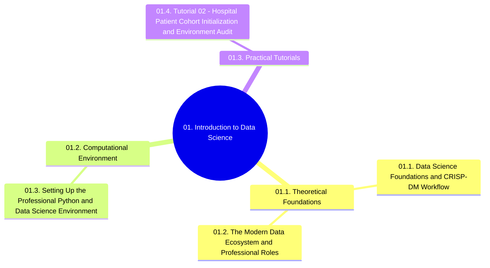

# 01. Introduction to Data Science - Chapter Overview and Navigation

## 1. Chapter Structure

## 2. Navigational Table of Contents

### 01.1. Theoretical Foundations
- [[01.1. Data Science Foundations and CRISP-DM Workflow]]
- [[01.2. The Modern Data Ecosystem and Professional Roles]]

### 01.2. Computational Environment
- [[01.3. Setting Up the Professional Python and Data Science Environment]]

### 01.3. Practical Tutorials
- [[01.4. Tutorial 02 - Hospital Patient Cohort Initialization and Environment Audit]]

## 3. Prerequisite Library Links
- Connects to foundations in [[00. Library Learning Roadmap]]
