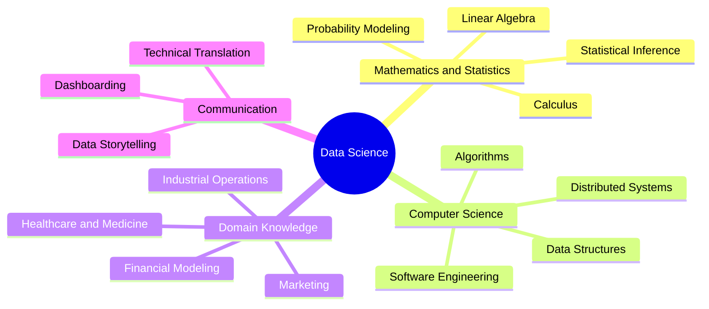
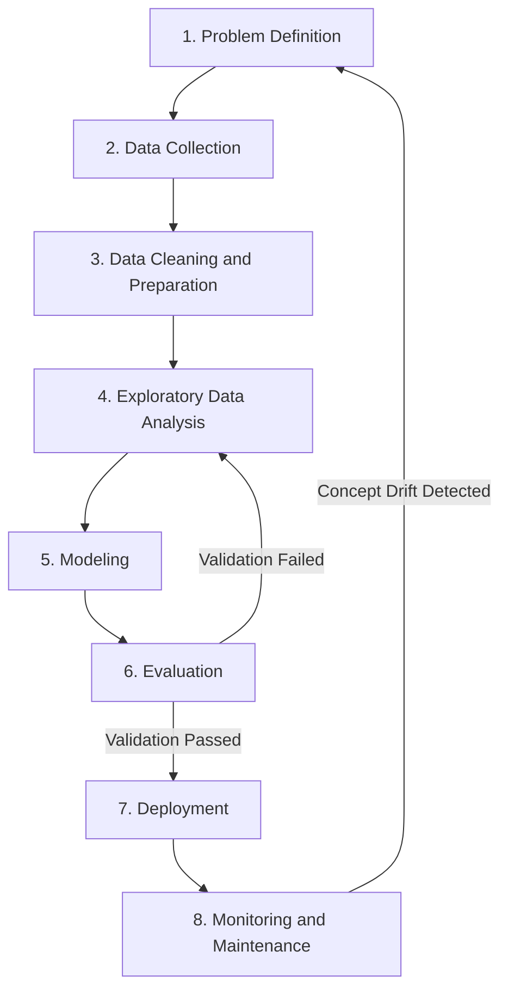

# 01.1. Data Science Foundations and CRISP-DM Workflow

## 1. Chapter Overview
Data Science extracts actionable knowledge from raw, structured, and unstructured data. This note covers the foundations of data science, its core identity, operational value, and the Cross-Industry Standard Process for Data Mining (CRISP-DM) framework.

## 2. Learning Objectives
- Formulate a precise, formal definition of Data Science.
- Deconstruct the multi-disciplinary pillars supporting data-driven discovery.
- Trace the eight stages of the modern data science lifecycle.
- Differentiate between descriptive, diagnostic, predictive, and prescriptive analytics.

## 3. Prerequisites
- Basic familiarity with high-level computing concepts.
- Understanding of empirical experimentation and the scientific method.

## 4. Theoretical Foundations

### Conceptual Architecture of Data Science
Data Science is an interdisciplinary field combining mathematical analysis, computational algorithms, and contextual domain expertise to discover patterns and build predictive engines from complex data corpora.

### The CRISP-DM Cycle
The standard lifecycle of an empirical data science project is governed by the Cross-Industry Standard Process for Data Mining (CRISP-DM). Rather than a linear sequence, it is an iterative loop:

1. **Problem Definition**: Translating ambiguous operational or clinical challenges into concrete, measurable analytical objectives.
2. **Data Collection**: Extracting records across internal transaction databases, external REST APIs, telemetry streams, and flat file archives.
3. **Data Cleaning and Preparation**: Resolving incomplete records, imputing null values, removing duplicates, and standardizing incompatible text encodings.
4. **Exploratory Data Analysis (EDA)**: Calculating summary statistics, skewness, kurtosis, and charting variable distributions to understand patterns.
5. **Modeling**: Choosing and training algorithmic representations (e.g., Logistic Regression, Random Forests, Neural Networks) to isolate mathematical patterns.
6. **Evaluation**: Assessing generalized model predictions against unseen validation sets using domain-specific metrics (e.g., AUC-ROC, F1-Score, RMSE).
7. **Deployment**: Containerizing model artifacts into production microservices exposed via REST endpoints (e.g., FastAPI, Docker).
8. **Monitoring**: Continually auditing live inference pipelines for data drift, concept drift, latency regressions, and software dependency failures.

## 5. Connections to Other Topics
- Relates to [[01.2. The Modern Data Ecosystem and Professional Roles]] for role division across this workflow.
- Connects directly to practical execution in [[01.4. Tutorial 02 - Hospital Patient Cohort Initialization and Environment Audit]].
- Theoretical concepts implemented using [[06. Pandas Structural Primitives - Series and DataFrame Architecture]].

## 6. Chapter Summary
Data Science combines statistics, computer science, and domain knowledge into an iterative workflow governed by CRISP-DM. It translates business and clinical questions into validated models deployed in production environments.

---
