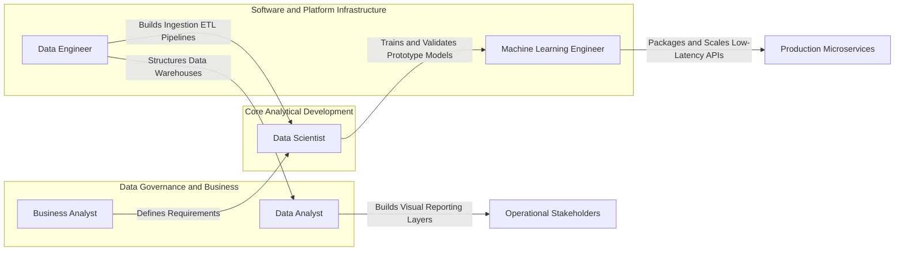

# 01.2. The Modern Data Ecosystem and Professional Roles

## 1. Chapter Overview
Building production data systems requires distinct technical specializations. This note breaks down the division of labor across engineering, research, and business functions, and analyzes the boundaries between Data Science, Machine Learning, Artificial Intelligence, Big Data, and Business Intelligence.

## 2. Learning Objectives
- Differentiate between Data Scientists, Data Analysts, Data Engineers, Machine Learning Engineers, and Business Analysts.
- Understand the technical differences between Data Science, Machine Learning, AI, Big Data, and Business Intelligence.
- Evaluate real-world scenarios to assign the correct architectural domain and professional role.

## 3. Comparative Ecosystem Matrix

| Field | Primary Objective | Time Horizon | Primary Technical Stack | Primary Output |
| :--- | :--- | :--- | :--- | :--- |
| **Business Intelligence (BI)** | Descriptive and Diagnostic analysis of past operations | Historical (Past) | SQL, PowerBI, Tableau, Excel | Executive Dashboards, KPI Reports |
| **Data Science (DS)** | Statistical pattern extraction and predictive modeling | Present and Future | Python, R, Pandas, Scikit-Learn | Statistical Reports, Predictive Algorithms |
| **Machine Learning (ML)** | Designing algorithms that generalize from training data | Predictive (Future) | PyTorch, TensorFlow, Scikit-Learn | Serialized Models (`.pkl`, `.onnx`) |
| **Artificial Intelligence (AI)** | Designing autonomous agents exhibiting cognitive reasoning | Real-time Contextual | Reinforcement Learning, Transformers | Autonomous Agents, LLMs |
| **Big Data** | Ingesting, storing, and transforming high-velocity distributed data | Real-time / Ingestion Scale | Spark, Hadoop, Kafka, Flink | Distributed Data Warehouses, Scaled Pipelines |

## 4. Professional Role Archetypes and Specializations

### The Boundary Between Roles

#### Data Engineer vs. Machine Learning Engineer
- **Data Engineer**: Designs scalable, fault-tolerant ingestion pipelines and data warehouses. Focuses on distributed architectures, network serialization, transactional safety (ACID), and database partitioning (e.g., Apache Spark, Kafka, PostgreSQL, Airflow).
- **Machine Learning Engineer**: Takes prototype models developed by Data Scientists and deploys them to production. Focuses on API latency optimization, GPU memory management, continuous deployment (MLOps), model quantization, and tracking concept drift.

#### Data Analyst vs. Data Scientist
- **Data Analyst**: Focuses on descriptive analysis ("What happened?") and diagnostic analysis ("Why did it happen?"). Specializes in SQL querying, window functions, spreadsheet manipulation, and interactive dashboard creation.
- **Data Scientist**: Focuses on predictive analysis ("What will happen?") and prescriptive analysis ("What should we do?"). Employs statistical tests, multivariate hypothesis testing, feature engineering, and predictive machine learning models.

## 5. Practical Scenario Analysis

### Scenario A: Predicting Customer Churn
- **Primary Domain**: Data Science / Machine Learning.
- **Reasoning**: Involves extracting behavioral feature vectors from historical database entries to predict a binary probability outcome using classification algorithms.

### Scenario B: Processing Sensor Streams from 50,000 IoT Devices
- **Primary Domain**: Big Data Engineering.
- **Reasoning**: Defined by high data Volume, Velocity, and Variety. Demands distributed streaming frameworks (e.g., Apache Kafka, Apache Spark Streaming) rather than single-node memory structures.

### Scenario C: Creating an Executive Dashboard of Quarterly Regional Revenue
- **Primary Domain**: Business Intelligence (BI).
- **Reasoning**: Involves diagnostic and descriptive aggregations of completed transactions displayed via an interactive dashboard interface.

## 6. Connections to Other Topics
- Context for the environment setup covered in [[01.3. Setting Up the Professional Python and Data Science Environment]].
- Relates to package management practices in [[02.10. Code Modularity, Packaging, and Standard Library Systems]].

---
