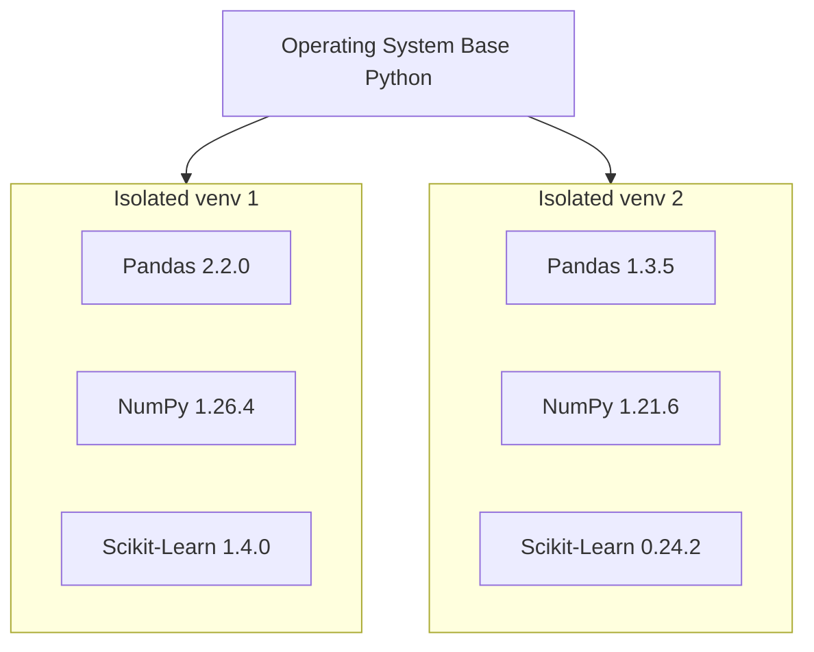

# 01.3. Setting Up the Professional Python and Data Science Environment

## 1. Overview
A reliable, reproducible programming environment prevents dependency conflicts and enables smooth team collaboration. This note covers Python runtime isolation, IDE selection, package management with `pip` and `conda`, and Git version control standards.

## 2. Integrated Development Environments (IDEs)

| Environment | Primary Design Target | Key Strengths | Limitations |
| :--- | :--- | :--- | :--- |
| **Jupyter Notebook** | Exploratory Data Analysis, prototyping, data visualization | Interactive step-by-step execution, inline plots, Markdown notes | Difficult to version control (`.ipynb` JSON diffs), not suited for production APIs |
| **VS Code** | General-purpose software engineering and data science | Extensible ecosystem, integrated terminal, Git integration, remote SSH execution | Requires configuring plugins and interpreters |
| **PyCharm Professional** | Large-scale, production Python applications | Advanced refactoring, deep debugging, built-in database tools | Resource-intensive, commercial license for full feature set |
| **Spyder** | Scientific and statistical computation | MATLAB-like interface, variable explorer, array inspector | Less flexible for general software development |

## 3. Virtual Environment Mechanics

Python installs libraries globally by default, placing compiled packages inside a shared system directory. Running multiple projects on a single global installation often leads to dependency conflicts.



### Dependency Management: `pip` vs. `conda`

| Feature | `pip` (Python Package Installer) | `conda` (Anaconda / Miniconda) |
| :--- | :--- | :--- |
| **Package Ecosystem** | Exclusively Python packages via PyPI | Multi-language packages (Python, C++, R, CUDA) |
| **Dependency Resolution** | Resolves Python-level dependencies | System-level binary resolver, resolves shared C libraries |
| **Environment Tooling** | Requires separate tooling (`venv`, `virtualenv`) | Native, integrated environment management |
| **Binary Portability** | Relies on pre-compiled wheels; falls back to local compiler | Distributes pre-compiled platform-specific binaries |

## 4. Standard Project Directory Structure

```text
my_data_science_project/
│
├── data/
│   ├── raw/             # Immutable raw data extracts
│   └── processed/       # Cleaned, engineered datasets
│
├── notebooks/           # Jupyter notebooks for exploration
│   └── exploratory.ipynb
│
├── src/                 # Production Python modules
│   ├── __init__.py
│   ├── data_loader.py
│   └── features.py
│
├── models/              # Serialized model artifacts (.pkl, .onnx)
├── outputs/             # Exported figures, plots, and metrics
├── tests/               # Unit and integration test scripts
│
├── .gitignore           # Git ignore declarations
├── requirements.txt     # Pip package dependency file
├── environment.yml      # Conda environment definition file
└── README.md            # Project documentation and reproduction steps
```

## 5. Environment Setup Commands

### Using `venv` (Native Python)
```bash
# Initialize project directory
mkdir ClinicalRiskSystem
cd ClinicalRiskSystem

# Initialize isolated virtual environment
python -m venv env

# Activate environment
# On Linux / macOS:
source env/bin/activate
# On Windows (cmd.exe):
env\Scripts\activate.bat
# On Windows (PowerShell):
.\env\Scripts\activate.ps1

# Upgrade installer and install dependencies
pip install --upgrade pip
pip install numpy pandas matplotlib seaborn scikit-learn jupyter

# Export exact dependencies to file
pip freeze > requirements.txt

# Reconstruct environment on another machine
pip install -r requirements.txt
```

### Using `conda`
```bash
# Create isolated environment with specific Python version
conda create --name clinical_env python=3.10 -y

# Activate environment
conda activate clinical_env

# Install required packages
conda install -c conda-forge numpy pandas matplotlib seaborn scikit-learn jupyter -y

# Export environment definition to YAML
conda env export > environment.yml

# Reconstruct environment on another machine
conda env create -f environment.yml
```

## 6. Git Version Control Setup
```bash
git init
echo -e "env/\n__pycache__/\n*.pyc\n.ipynb_checkpoints/\ndata/raw/*\n!data/raw/.gitkeep" > .gitignore
git add .
git commit -m "Initialize project structure and environment"
```

## 7. Connections to Other Topics
- Applied in [[01.4. Tutorial 02 - Hospital Patient Cohort Initialization and Environment Audit]].
- Library architecture detailed in [[00. Library Learning Roadmap]].

---
