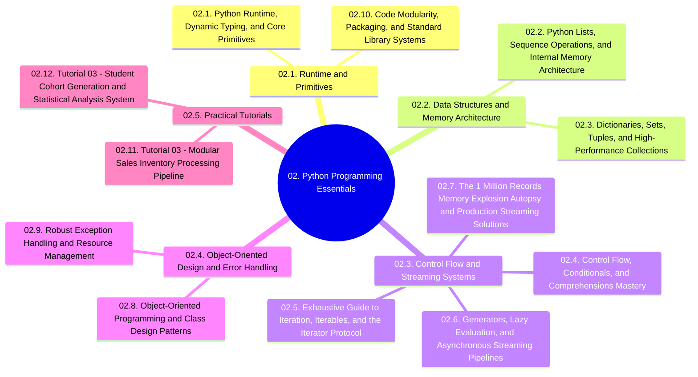

# 02. Python Programming Essentials - Chapter Overview and Navigation

## 1. Chapter Structure

## 2. Navigational Table of Contents

### 02.1. Runtime and Primitives
- [[02.1. Python Runtime, Dynamic Typing, and Core Primitives]]
- [[02.10. Code Modularity, Packaging, and Standard Library Systems]]

### 02.2. Data Structures and Memory Architecture
- [[02.2. Python Lists, Sequence Operations, and Internal Memory Architecture]]
- [[02.3. Dictionaries, Sets, Tuples, and High-Performance Collections]]

### 02.3. Control Flow and Streaming Systems
- [[02.4. Control Flow, Conditionals, and Comprehensions Mastery]]
- [[02.5. Exhaustive Guide to Iteration, Iterables, and the Iterator Protocol]]
- [[02.6. Generators, Lazy Evaluation, and Asynchronous Streaming Pipelines]]
- [[02.7. The 1 Million Records Memory Explosion Autopsy and Production Streaming Solutions]]

### 02.4. Object-Oriented Design and Error Handling
- [[02.8. Object-Oriented Programming and Class Design Patterns]]
- [[02.9. Robust Exception Handling and Resource Management]]

### 02.5. Practical Tutorials
- [[02.11. Tutorial 03 - Modular Sales Inventory Processing Pipeline]]
- [[02.12. Tutorial 03 - Student Cohort Generation and Statistical Analysis System]]

## 3. Prerequisite Library Links
- Connects to foundations in [[00. Library Learning Roadmap]]
