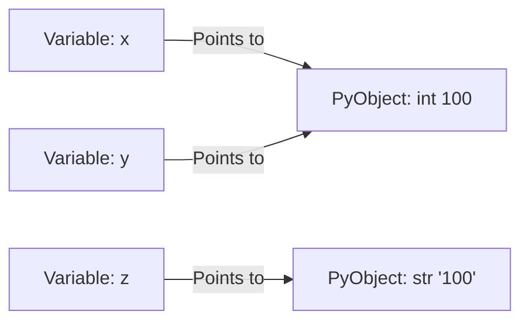

# 02.1. Python Runtime, Dynamic Typing, and Core Primitives

## 1. Overview
This note covers Python's memory model, dynamic typing mechanisms, type casting behavior, and primitive data representations.

## 2. Theoretical Foundations: Dynamic Typing and Object Pointers
In Python, variables do not hold values directly. Instead, variables are pointer references bound to dynamically allocated objects in the heap memory (`PyObject`).



Every `PyObject` structure in CPython contains at least three core fields:
1. `ob_refcnt`: Reference count for automatic garbage collection.
2. `ob_type`: Pointer to the object's type descriptor.
3. Value fields: Pointer or memory buffer holding the actual data.

### Core Data Types

| Type | Internal Class | Mutability | Example | Description |
| :--- | :--- | :--- | :--- | :--- |
| `int` | `PyLongObject` | Immutable | `42` | Arbitrary precision signed integer |
| `float` | `PyFloatObject` | Immutable | `9.81` | IEEE 754 double-precision floating point (64-bit) |
| `str` | `PyUnicodeObject` | Immutable | `"Algiers"` | UTF-8 / UCS-4 encoded character array |
| `bool` | `PyBoolObject` | Immutable | `True`, `False` | Subclass of `int` (`True == 1`, `False == 0`) |

### Explicit Type Casting Mechanics
External datasets often ingest numeric features as strings. Converting these strings requires explicit type casting:

```python
x = "100"          # str
y = int(x)         # str -> int (Parses numeric string to integer)
z = float(x)       # str -> float (Converts to 100.0)
a = str(z)         # float -> str ("100.0")
b = bool(a)        # Non-empty strings evaluate to True; "" evaluates to False

print(f"Values: x={x}, y={y}, z={z}, a='{a}', b={b}")
print(f"Types:  y={type(y)}, z={type(z)}, b={type(b)}")
```

## 3. Python Operators and Truthiness

### Identity (`is`) vs. Equality (`==`)
- **Equality (`==`)**: Evaluates whether the **values** referenced by two objects are equal.
- **Identity (`is`)**: Evaluates whether two pointers reference the **exact same memory address** (`id(a) == id(b)`).

```python
a = [1, 2, 3]
b = [1, 2, 3]

print(a == b)  # True: Identical values
print(a is b)  # False: Distinct heap allocations
```

### Small Integer Caching (-5 to 256)
CPython pre-allocates global singleton integer objects for values between -5 and 256. For integers within this range, variable assignments point to the same cached singleton in memory:

```python
x = 256
y = 256
print(x is y)  # True (Cached integer singleton)

m = 257
n = 257
print(m is n)  # False (Distinct memory allocations)
```

## 4. Connections to Other Topics
- Forms the basis for compound data structures in [[02.2. Python Lists, Sequence Operations, and Internal Memory Architecture]].
- Applied to DataFrame columns in [[07. Pandas Data Ingestion, Inspection, and Type Coercion]].

---
