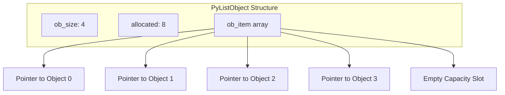

# 02.2. Python Lists, Sequence Operations, and Internal Memory Architecture

## 1. Overview
Lists are Python's primary mutable sequence structure. This note covers list memory architecture in CPython, amortized over-allocation, time complexity of list operations, built-in sequence functions, and mutation side effects.

## 2. Memory Architecture of CPython Lists
A Python list is not a linked list; it is a **dynamically resized array of object references (pointers)**.



### Over-Allocation Growth Strategy
When new elements are appended to a full list, CPython reallocates the underlying pointer array using an over-allocation growth formula:

$$\text{new\_allocated} = \text{new\_size} + (\text{new\_size} \gg 3) + (\text{new\_size} < 9 \ ? \ 3 : 6)$$

This overallocation ensures that appending elements runs in **$O(1)$ amortized time**, avoiding a memory reallocation on every call.

## 3. Systematic Reference of Built-in Functions

### `len()`, `min()`, `max()`, `sum()`
- `len(seq)`: Returns `ob_size` in $O(1)$ time.
- `min(iterable)`, `max(iterable)`: Scans all elements in $O(n)$ time using comparison operators (`<`, `>`).
- `sum(iterable, start=0)`: Adds numerical values sequentially in $O(n)$ time.

### `sorted()` vs. `list.sort()`
- `sorted(iterable, key=None, reverse=False)`: Generates a **new** sorted list, leaving the input unchanged. Runs in $O(n \log n)$ time using Adaptive Timsort.
- `list.sort(key=None, reverse=False)`: Sorts the list **in-place**, modifying `ob_item` directly and returning `None`.

### `reversed()` vs. `list.reverse()`
- `reversed(seq)`: Returns a reverse iterator object in $O(1)$ time without copying data.
- `list.reverse()`: Reverses list pointers **in-place** in $O(n)$ time.

### `enumerate()` and `zip()`
- `enumerate(iterable, start=0)`: Yields tuples of `(index, item)` lazily without generating an intermediate index array.
- `zip(*iterables)`: Yields paired tuples across multiple sequences, terminating when the shortest sequence is exhausted.

```python
names = ["Amel", "Sara", "Ali"]
grades = [16, 14, 18]

for idx, (name, grade) in enumerate(zip(names, grades), start=1):
    print(f"Student #{idx}: {name} -> Grade: {grade}")
```

### `any()` and `all()`
- `any(iterable)`: Returns `True` as soon as any element evaluates to true (short-circuit evaluation).
- `all(iterable)`: Returns `False` as soon as any element evaluates to false (short-circuit evaluation).

## 4. Comprehensive List Methods Reference

| Method | Syntax | Mutates List | Return Value | Time Complexity | Description |
| :--- | :--- | :--- | :--- | :--- | :--- |
| `append` | `l.append(x)` | **Yes** | `None` | $O(1)$ amortized | Appends element pointer to end of list. |
| `extend` | `l.extend(it)` | **Yes** | `None` | $O(k)$ | Unpacks iterable and appends each element to the end. |
| `insert` | `l.insert(i, x)`| **Yes** | `None` | $O(n)$ | Shifts elements from index $i$ onward to the right and inserts $x$. |
| `remove` | `l.remove(x)` | **Yes** | `None` | $O(n)$ | Searches for the first occurrence of $x$, deletes it, and shifts subsequent elements left. Raises `ValueError` if not found. |
| `pop` | `l.pop(i)` | **Yes** | Element | $O(n - i)$ | Removes and returns the element at index $i$. If $i = -1$, runs in $O(1)$ time. |
| `clear` | `l.clear()` | **Yes** | `None` | $O(n)$ | Deallocates all pointers and resets list size to 0. |
| `index` | `l.index(x)` | No | `int` | $O(n)$ | Returns the index of the first occurrence of $x$. Raises `ValueError` if not found. |
| `count` | `l.count(x)` | No | `int` | $O(n)$ | Counts total occurrences of value $x$. |
| `copy` | `l.copy()` | No | `list` | $O(n)$ | Produces a shallow copy of the list. Equivalent to `l[:]`. |

## 5. Critical Distinctions and Edge Cases

### `append()` vs. `extend()`
```python
a = [1, 2]
b = [3, 4]
a.append(b)
print("Result of append:", a)  # [1, 2, [3, 4]] -> Nested sublist

x = [1, 2]
x.extend(b)
print("Result of extend:", x)  # [1, 2, 3, 4]    -> Flattened extension
```

### Pointer Aliasing vs. Shallow Copy vs. Deep Copy
```python
import copy

original = [[1, 2], [3, 4]]

# 1. Pointer Aliasing: Two variables pointing to the same PyListObject
alias = original

# 2. Shallow Copy: New list created, but internal pointers still reference original sublists
shallow = original.copy()

# 3. Deep Copy: Recursively duplicates the list and all nested objects
deep = copy.deepcopy(original)

original[0][0] = 999
print(f"Alias reflects mutation:   {alias[0][0] == 999}")    # True
print(f"Shallow reflects mutation: {shallow[0][0] == 999}")  # True
print(f"Deep is isolated:          {deep[0][0] == 1}")        # True
```

## 6. Connections to Other Topics
- Transition to higher-dimensional array memory in [[01. NumPy Foundations - Memory Layout, ndarray Anatomy, and Array Instantiation]].
- Forms the basis for comprehension operations in [[02.4. Control Flow, Conditionals, and Comprehensions Mastery]].

---
