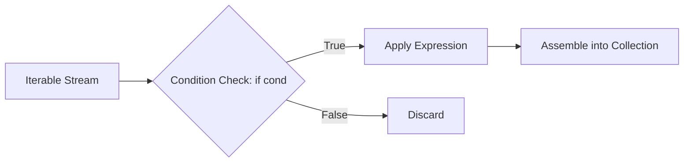

# 02.4. Control Flow, Conditionals, and Comprehensions Mastery

## 1. Overview
This note covers Python's control flow statements, including conditional branching, loop controls (`break`, `continue`, `pass`), and comprehension syntax for lists, sets, and dictionaries.

## 2. Control Flow and Loop Controls
- `break`: Terminates the innermost loop immediately.
- `continue`: Skips the remainder of the current iteration and advances to the next cycle.
- `pass`: An executable null statement used as a placeholder.

### Loop `else` Clause Execution
In Python, loops can include an `else` block. The `else` clause executes **only if the loop completes normally without encountering a `break` statement**:

```python
def verify_patient_records(records):
    for patient in records:
        if patient.get("missing_data"):
            print("Audit failed: corrupted record detected.")
            break
    else:
        print("Audit passed: all patient records verified.")
```

## 3. Comprehension Architecture and Syntax
Comprehensions provide a concise syntax for filtering, transforming, and constructing collections without writing manual loop boilerplate.



### Comprehensive Syntax Forms
```python
# 1. List Comprehension: [expr for item in iterable if condition]
even_squares = [x**2 for x in range(10) if x % 2 == 0]

# 2. Conditional Transformation: [expr_if_true if cond else expr_if_false for item in iterable]
status_tags = ["pass" if grade >= 10 else "fail" for grade in [14, 8, 11, 9]]

# 3. Set Comprehension: {expr for item in iterable} (Automatically deduplicates)
unique_lengths = {len(w) for w in ["apple", "banana", "pear", "apple"]}

# 4. Dictionary Comprehension: {key_expr: val_expr for item in iterable}
square_map = {x: x**2 for x in range(5)}
```

### Cartesian Products and Nested Flattening
The order of `for` clauses in a comprehension matches the order of nested `for` loops, with outer loops placed first:

```python
# Flattening a 2D matrix:
matrix = [[1, 2, 3], [4, 5, 6]]
flattened = [val for row in matrix for val in row]
# Equivalent to:
# for row in matrix:
#     for val in row:
#         flattened.append(val)
```

## 4. Performance: Comprehensions vs. Traditional Loops
List comprehensions run faster than equivalent `for` loops with `.append()` calls because CPython uses a dedicated bytecode instruction (`LIST_APPEND`), avoiding the overhead of attribute lookups on the list object on every iteration.

## 5. Connections to Other Topics
- Connects to lazy generator expressions in [[02.6. Generators, Lazy Evaluation, and Asynchronous Streaming Pipelines]].
- Used for batch transformations in [[02.11. Tutorial 03 - Modular Sales Inventory Processing Pipeline]].

---
