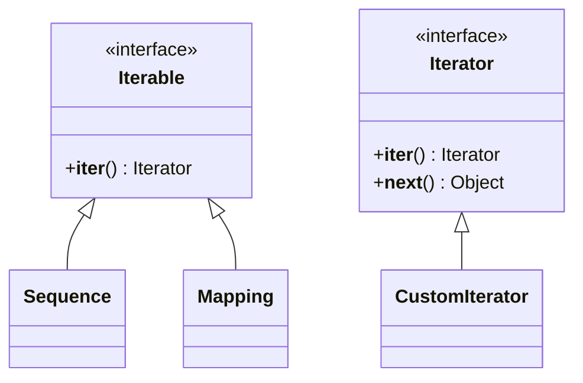

# 02.5. Exhaustive Guide to Iteration, Iterables, and the Iterator Protocol

## 1. Overview
Iteration is a fundamental pattern in Python programming. This note covers the iterator protocol, the distinction between iterables and iterators, the internal mechanics of `for` loops, and how to implement custom iterators.

## 2. Iterables vs. Iterators



### Definitions
- **Iterable**: An object capable of returning its members one at a time. It implements the `__iter__()` method, which returns an iterator. Examples include `list`, `str`, `tuple`, `dict`, and `set`.
- **Iterator**: A stateful object representing a data stream. It implements:
  1. `__iter__()`: Returns the iterator instance itself.
  2. `__next__()`: Returns the next element in the sequence, or raises `StopIteration` when the sequence is exhausted.

### How Python Checks if an Object is Iterable
When calling `iter(obj)`:
1. Python checks if `obj` defines an `__iter__()` method. If present, it executes it to retrieve an iterator.
2. If `__iter__()` is missing, Python checks for the legacy sequence protocol method `__getitem__()`. If present, it creates an iterator that attempts to access elements using integer indices starting from 0.
3. If neither method is implemented, Python raises a `TypeError: 'obj' object is not iterable`.

## 3. Internal Mechanics of a `for` Loop
Behind the scenes, Python translates every `for` loop into an iterator loop managed with `try-except` blocks.

```python
# Conceptual Python representation of a for loop:
fruits = ["apple", "banana", "cherry"]

# 1. Obtain an iterator from the iterable
iterator = iter(fruits)

# 2. Iterate continuously
while True:
    try:
        # Request next item from iterator
        item = next(iterator)
        # Execute loop body
        print(item)
    except StopIteration:
        # Break gracefully when iterator is exhausted
        break
```

## 4. Reusable Iterables vs. One-Time Iterators
- **Iterables (e.g., lists, tuples)** are **reusable**. Calling `iter()` on them returns a fresh, independent iterator starting at index 0.
- **Iterators (e.g., generator objects, file pointers)** are **single-pass**. Once exhausted, they continue to raise `StopIteration` on subsequent calls to `next()`.

```python
nums = [1, 2, 3]
it = iter(nums)

print(list(it))  # [1, 2, 3] -> Consumes the iterator
print(list(it))  # []        -> Exhausted; returns empty list
print(list(nums))# [1, 2, 3] -> Original iterable remains intact
```

## 5. Implementing a Custom Iterator Class
The following example implements a custom Fibonacci sequence iterator:

```python
class FibonacciBounded:
    """An iterator generating Fibonacci numbers up to a maximum threshold."""
    def __init__(self, max_value: int):
        self.max_value = max_value
        self.a = 0
        self.b = 1

    def __iter__(self):
        # An iterator must return itself from __iter__
        return self

    def __next__(self) -> int:
        if self.a > self.max_value:
            raise StopIteration
        
        current = self.a
        self.a, self.b = self.b, self.a + self.b
        return current

# Usage:
fib = FibonacciBounded(20)
for num in fib:
    print(num, end=" ")  # Output: 0 1 1 2 3 5 8 13
```

## 6. Connections to Other Topics
- Explains how generator functions work in [[02.6. Generators, Lazy Evaluation, and Asynchronous Streaming Pipelines]].
- Explains why the list loading approach fails in [[02.7. The 1 Million Records Memory Explosion Autopsy and Production Streaming Solutions]].

---
