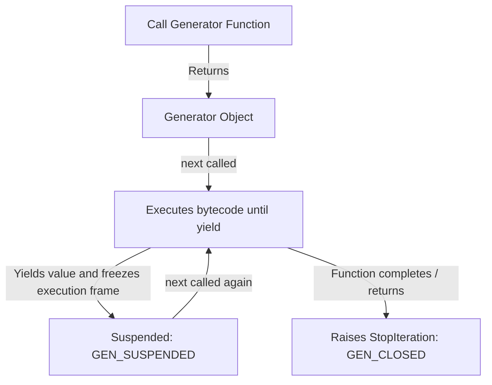

# 02.6. Generators, Lazy Evaluation, and Asynchronous Streaming Pipelines

## 1. Overview
Generators simplify iterator implementation by using the `yield` keyword to support lazy evaluation. This note covers generator frames in CPython, execution state persistence, the difference between `yield` and `return`, generator expressions, and generator pipeline orchestration.

## 2. Generator Mechanics and the `yield` Keyword
A function containing the `yield` keyword becomes a **generator function**. Calling a generator function does not run its body immediately; instead, it compiles and returns a **generator object** (`PyGenObject`).



### Execution State Lifecycle
Generators cycle through four internal execution states:
1. `GEN_CREATED`: Instantiated, waiting for execution to begin.
2. `GEN_RUNNING`: Bytecode actively executing on the Python virtual machine.
3. `GEN_SUSPENDED`: Execution paused at a `yield` statement. Local variables and the instruction pointer (`f_lasti`) remain preserved on the frame stack.
4. `GEN_CLOSED`: Execution finished; the generator is exhausted.

### `yield` vs. `return`

| Characteristic | `return` Statement | `yield` Statement |
| :--- | :--- | :--- |
| **Execution Termination** | Destroys the function's stack frame immediately | Freezes the execution frame; preserves local state |
| **Returned Value** | Passes value to the caller and exits | Yields value to the caller, pausing execution |
| **Re-entry** | Cannot be resumed; re-calling restarts execution | Next call to `next()` resumes from the paused instruction |
| **Number of Values** | Exactly one value per function call | Can yield an unbounded sequence of values on demand |

## 3. Generator Expressions
Generator expressions provide a concise comprehension syntax that evaluates elements lazily instead of allocating an entire list in memory.

```python
# List comprehension (eager allocation: 10,000,000 integers stored in RAM)
# list_data = [x for x in range(10000000)] # Consumes hundreds of megabytes

# Generator expression (lazy evaluation: generates values on demand)
gen_data = (x for x in range(10000000))     # Consumes ~112 bytes of memory
```

## 4. Advanced Generator Methods

### Delegating with `yield from`
The `yield from` statement delegates value generation directly to an inner iterable or sub-generator:

```python
def flatten_nested(nested_lists):
    for sublist in nested_lists:
        yield from sublist  # Cleanly delegates yielding to the sublist

matrix = [[1, 2], [3, 4], [5]]
print(list(flatten_nested(matrix)))  # Output: [1, 2, 3, 4, 5]
```

### Two-Way Communication: `.send()`, `.throw()`, `.close()`
Generators can also receive data dynamically during execution:
- `gen.send(value)`: Sends data into the generator, which evaluates as the result of the current `yield` expression.
- `gen.throw(type, value)`: Raises an exception at the point where the generator is currently suspended.
- `gen.close()`: Raises a `GeneratorExit` exception inside the generator, closing it cleanly.

## 5. Generator Pipelines: Chaining Transformations
Generators can be chained together into memory-efficient data processing pipelines:

```python
def extract_sensor_readings(raw_data):
    for entry in raw_data:
        yield float(entry.strip())

def filter_anomalies(readings):
    for val in readings:
        if 50.0 <= val <= 250.0:  # Retain only valid readings
            yield val

def convert_to_celsius(readings):
    for fahrenheit in readings:
        yield (fahrenheit - 32) * 5 / 9

# Assemble the processing pipeline
raw_stream = [" 72.5\n", "300.2\n", " 68.0\n", "102.4\n"]
pipeline = convert_to_celsius(filter_anomalies(extract_sensor_readings(raw_stream)))

for reading in pipeline:
    print(f"Processed Reading: {reading:.2f} °C")
```

## 6. Connections to Other Topics
- Explains the memory management solution in [[02.7. The 1 Million Records Memory Explosion Autopsy and Production Streaming Solutions]].
- Used for modular file processing in [[02.11. Tutorial 03 - Modular Sales Inventory Processing Pipeline]].

---
