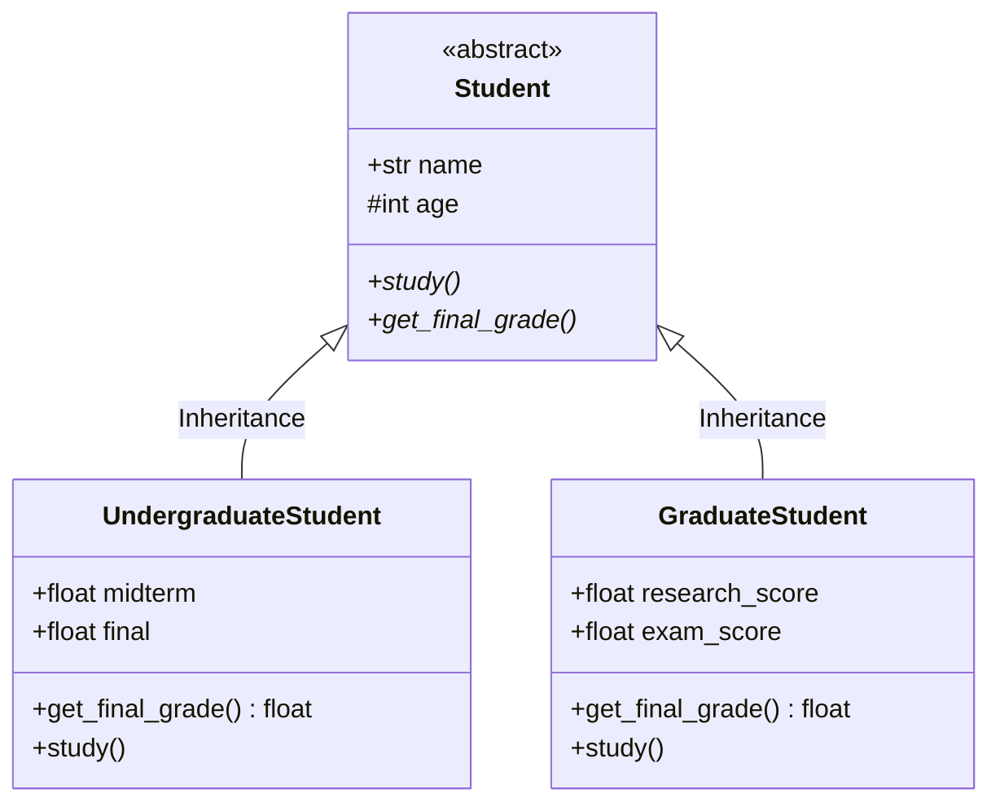
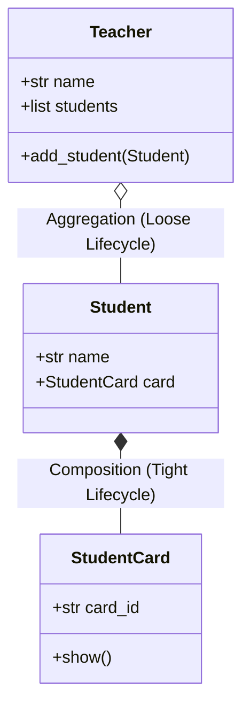

# 02.8. Object-Oriented Programming and Class Design Patterns

## 1. Overview
This note covers Object-Oriented Programming (OOP) in Python, including class and instance attributes, the four pillars of OOP, magic (dunder) methods, and the distinction between object composition and aggregation.

## 2. The Four Pillars of OOP



### Encapsulation (Data Hiding)
Encapsulation bundles data attributes and the methods that operate on them inside objects, restricting direct external access to internal state. In CPython, prefixing an attribute with two underscores (`__`) triggers name mangling, transforming `__balance` to `_ClassName__balance` to prevent accidental modifications:

```python
class BankAccount:
    def __init__(self, initial_balance: float):
        self.__balance = initial_balance  # Private attribute

    def deposit(self, amount: float):
        if amount > 0:
            self.__balance += amount

    def get_balance(self) -> float:
        return self.__balance

acc = BankAccount(1000)
acc.deposit(500)
print(acc.get_balance())  # 1500
# acc.__balance           # Raises AttributeError
```

### Inheritance and Method Overriding
Inheritance enables a specialized subclass to inherit attributes and methods from a parent class, facilitating code reuse:

```python
class Student:
    def __init__(self, name: str):
        self.name = name
    def study(self):
        print(f"{self.name} is studying foundational concepts.")

class GraduateStudent(Student):
    def study(self):
        # Override parent method with domain-specific logic
        print(f"{self.name} is conducting AI research and writing papers.")
```

### Polymorphism
Polymorphism allows different classes to share a common interface while providing unique implementations of those methods:

```python
def conduct_academic_session(cohort: list[Student]):
    for student in cohort:
        student.study()  # Dynamically calls the subclass implementation
```

### Abstraction via Abstract Base Classes (`abc`)
Abstract Base Classes enforce interface contracts across child classes. Any subclass inheriting from an abstract base class must implement all abstract methods before it can be instantiated:

```python
from abc import ABC, abstractmethod

class DiagnosticModel(ABC):
    @abstractmethod
    def predict(self, feature_vector: list) -> float:
        """Abstract prediction method."""
        pass

class LogisticHeartModel(DiagnosticModel):
    def predict(self, feature_vector: list) -> float:
        # Concrete implementation
        return 1.0 / (1.0 + 2.71828 ** (-sum(feature_vector)))
```

## 3. Object Relationships: Composition vs. Aggregation



- **Composition ("Part-of" / Strong coupling)**: The child object's lifecycle is bound to the parent object. If the parent instance is deleted, the child instance is destroyed as well (e.g., a `Student` and their `StudentCard`).
- **Aggregation ("Has-a" / Loose coupling)**: The child object exists independently of the parent object. If the parent instance is deleted, the child instance remains intact (e.g., a `Teacher` and their `Student` cohort).

```python
# Composition Implementation
class StudentCard:
    def __init__(self, card_id):
        self.card_id = card_id

class Student:
    def __init__(self, name, card_id):
        self.name = name
        self.card = StudentCard(card_id)  # Student creates and owns its StudentCard

# Aggregation Implementation
class Teacher:
    def __init__(self, name):
        self.name = name
        self.students = []  # Holds references to independent Student instances

    def add_student(self, student: Student):
        self.students.append(student)
```

## 4. Magic (Dunder) Methods Reference

| Dunder Method | Invocation Trigger | Primary Use Case |
| :--- | :--- | :--- |
| `__init__(self, ...)` | `Class(...)` | Constructor: initializes instance attributes |
| `__str__(self)` | `str(obj)`, `print(obj)`| Returns a readable string representation |
| `__repr__(self)` | Interactive prompt, `repr(obj)`| Returns an unambiguous string representation for debugging |
| `__add__(self, other)` | `a + b` | Operator overloading for vector and metric additions |
| `__eq__(self, other)` | `a == b` | Defines value equality between object instances |
| `__lt__(self, other)` | `a < b` | Defines natural ordering for sorting operations |
| `__len__(self)` | `len(obj)` | Returns internal collection length |

## 5. Connections to Other Topics
- Used to implement the `Product` entity in [[02.11. Tutorial 03 - Modular Sales Inventory Processing Pipeline]].
- Provides the design patterns for custom Transformers in [[04.4. Feature Scaling, Standardization, and Normalization Theory]].

---
