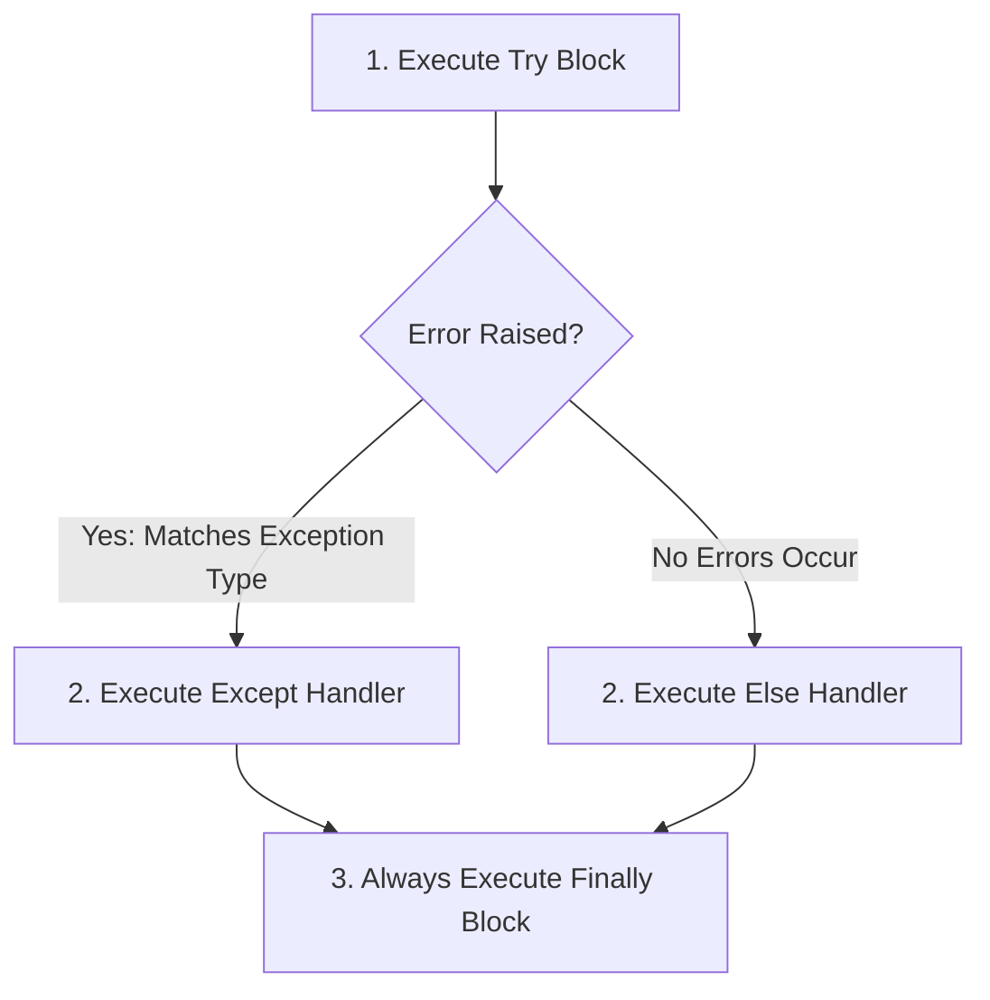

# 02.9. Robust Exception Handling and Resource Management

## 1. Overview
Data science pipelines frequently encounter missing files, inconsistent schemas, and invalid values. This note covers exception handling strategies, the full `try-except-else-finally` block, and context managers.

## 2. Exception Handling Lifecycle



### Try-Except-Else-Finally Mechanics
- `try`: Contains code that could raise a runtime exception.
- `except ExceptionType`: Catches and handles specific exceptions gracefully.
- `else`: Runs code **only if no exceptions were raised in the `try` block**.
- `finally`: Executes cleanup operations **in all circumstances**, even if an unhandled exception or `return` statement occurs.

```python
def load_and_calculate_ratio(filepath: str, denominator: float):
    file_obj = None
    try:
        file_obj = open(filepath, "r", encoding="utf-8")
        numerator = float(file_obj.readline().strip())
        ratio = numerator / denominator
    except FileNotFoundError as err:
        print(f"[Error] File not found: {err.filename}")
        return None
    except ZeroDivisionError:
        print("[Error] Denominator cannot be zero.")
        return None
    except ValueError as err:
        print(f"[Error] Type conversion failure: {err}")
        return None
    else:
        print("[Success] Calculations completed successfully.")
        return ratio
    finally:
        if file_obj and not file_obj.closed:
            file_obj.close()
            print("[Cleanup] File stream safely closed.")
```

## 3. Context Managers (`with` statement)
Managing resources using manual `finally` blocks can be verbose. The `with` statement simplifies this by relying on the **context manager protocol** (`__enter__()` and `__exit__()`). When exiting the block, `__exit__()` runs automatically to release resources, even if an exception occurs.

```python
# Best practice for file I/O:
with open("dataset.csv", mode="r", encoding="utf-8") as f:
    for line in f:
        process_line(line)
# File descriptor is guaranteed to be closed at this point
```

## 4. Connections to Other Topics
- Used to handle malformed records in [[02.11. Tutorial 03 - Modular Sales Inventory Processing Pipeline]].
- Guides error-tolerant ingestion in [[07. Pandas Data Ingestion, Inspection, and Type Coercion]].

---
