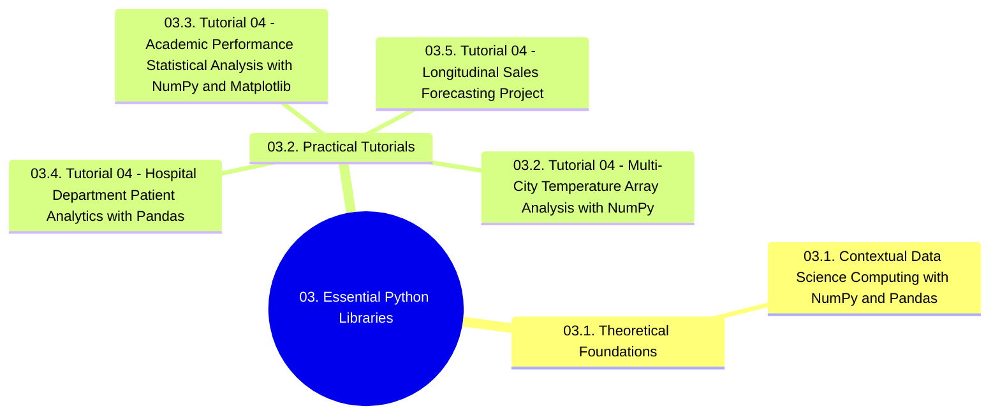

# 03. Essential Python Libraries - Chapter Overview and Navigation

## 1. Chapter Structure

## 2. Navigational Table of Contents

### 03.1. Theoretical Foundations
- [[03.1. Contextual Data Science Computing with NumPy and Pandas]]

### 03.2. Practical Tutorials
- [[03.2. Tutorial 04 - Multi-City Temperature Array Analysis with NumPy]]
- [[03.3. Tutorial 04 - Academic Performance Statistical Analysis with NumPy and Matplotlib]]
- [[03.4. Tutorial 04 - Hospital Department Patient Analytics with Pandas]]
- [[03.5. Tutorial 04 - Longitudinal Sales Forecasting Project]]

## 3. Prerequisite Library Links
- Connects to foundations in [[00. Library Learning Roadmap]]
- Deep-dive references for the two flagship edge-preserving operators: [[25. Bilateral Filtering - Complete Mathematical Theory, Implementation, and Practice]] and [[26. Nagao Filtering - Multi-Implementation Reference with Hardcoded Kernels, Vectorized, and Convolution Approaches]]
