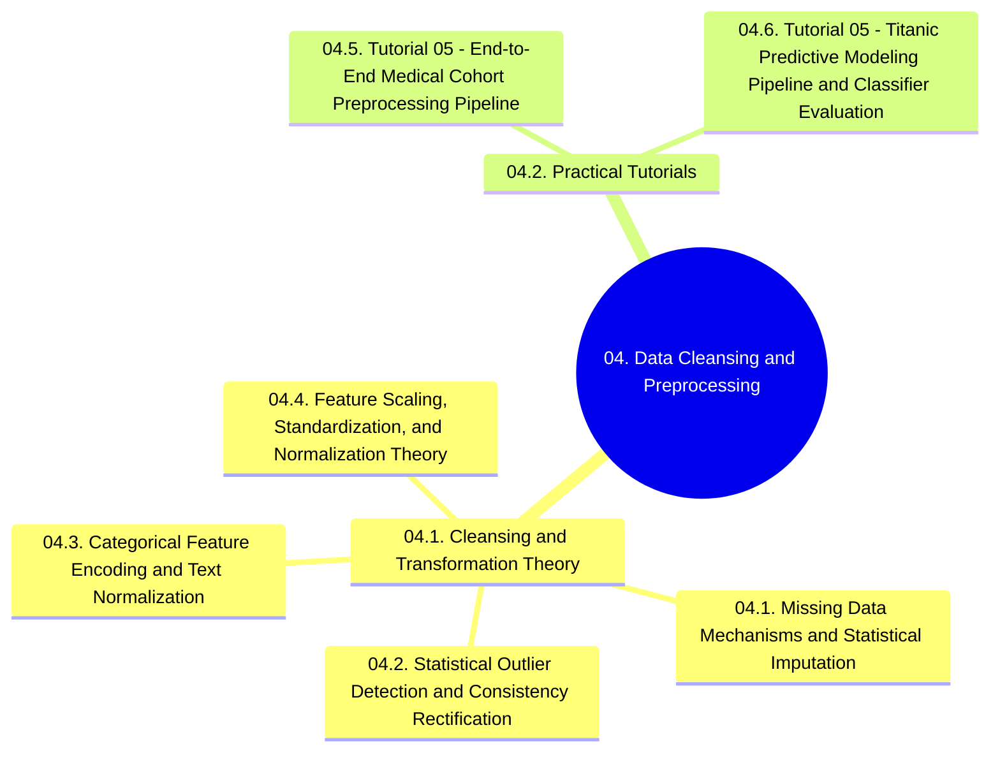

# 04. Data Cleansing and Preprocessing - Chapter Overview and Navigation

## 1. Chapter Structure

## 2. Navigational Table of Contents

### 04.1. Cleansing and Transformation Theory
- [[04.1. Missing Data Mechanisms and Statistical Imputation]]
- [[04.2. Statistical Outlier Detection and Consistency Rectification]]
- [[04.3. Categorical Feature Encoding and Text Normalization]]
- [[04.4. Feature Scaling, Standardization, and Normalization Theory]]

### 04.2. Practical Tutorials
- [[04.5. Tutorial 05 - End-to-End Medical Cohort Preprocessing Pipeline]]
- [[04.6. Tutorial 05 - Titanic Predictive Modeling Pipeline and Classifier Evaluation]]

## 3. Prerequisite Library Links
- Connects to foundations in [[00. Library Learning Roadmap]]
