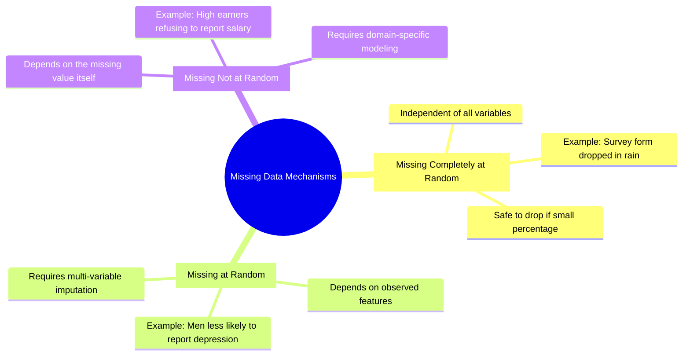

# 04.1. Missing Data Mechanisms and Statistical Imputation

## 1. Overview
Real-world datasets frequently contain missing values. Choosing the right imputation strategy requires understanding **why** data is missing. This note covers the three primary missingness mechanisms and compares common statistical imputation techniques.

## 2. Missing Data Mechanisms



1. **Missing Completely at Random (MCAR)**: The probability of an observation being missing is completely independent of both observed and unobserved features.
2. **Missing at Random (MAR)**: The probability of missingness depends on observed features in the dataset, but not on the unobserved missing value itself.
3. **Missing Not at Random (MNAR)**: The probability of missingness depends directly on the unobserved value itself.

## 3. Imputation Strategies Comparison

| Method | Best Suited For | Advantages | Disadvantages |
| :--- | :--- | :--- | :--- |
| **Row Deletion (`dropna`)** | Minimal missingness (<5%) under MCAR | Simple, preserves original relationships | Discards valid data, introduces bias under MAR/MNAR |
| **Mean Imputation** | Continuous symmetric (normally distributed) features | Simple to compute, maintains sample size | Underestimates variance, distorts correlations |
| **Median Imputation** | Continuous skewed features with outliers | Robust to outliers | Distorts covariance and correlation structures |
| **Mode Imputation** | Categorical and discrete features | Simple to apply to non-numeric data | Overrepresents majority classes |
| **KNN Imputation** | Multi-variable datasets with correlated features | Preserves relationships across variables | Computationally expensive ($O(n^2)$), scale-sensitive |

## 4. Scikit-Learn Imputation Implementation
```python
from sklearn.impute import SimpleImputer, KNNImputer
import pandas as pd

# Median imputation for numerical features
num_imputer = SimpleImputer(strategy="median")
df["Age"] = num_imputer.fit_transform(df[["Age"]])

# Mode imputation for categorical features
cat_imputer = SimpleImputer(strategy="most_frequent")
df["Gender"] = cat_imputer.fit_transform(df[["Gender"]])

# KNN multi-variable imputation
knn_imputer = KNNImputer(n_neighbors=5)
df_imputed = knn_imputer.fit_transform(df[["Age", "BloodPressure", "Cholesterol"]])
```

## 5. Connections to Other Topics
- Next step: [[04.2. Statistical Outlier Detection and Consistency Rectification]].
- Applied in [[04.5. Tutorial 05 - End-to-End Medical Cohort Preprocessing Pipeline]].

---
