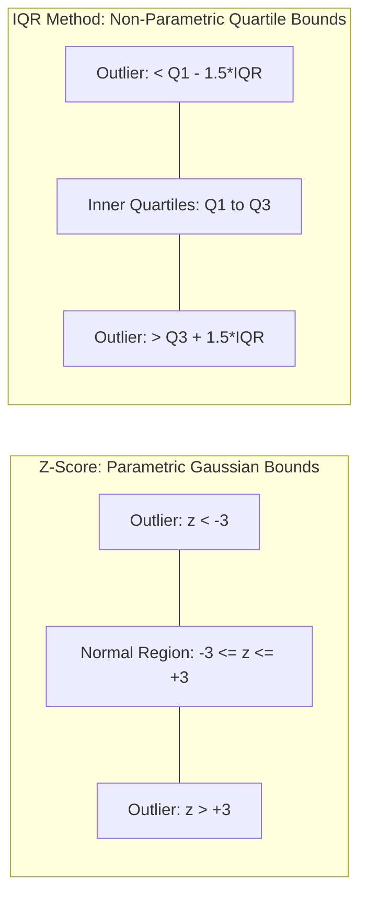

# 04.2. Statistical Outlier Detection and Consistency Rectification

## 1. Overview
Outliers can distort statistical metrics and degrade machine learning model performance. This note covers parametric (Z-score) and non-parametric (Interquartile Range) outlier detection techniques and strategies for handling anomalies.

## 2. Detection Techniques



### Z-Score Method (Parametric)
Calculates how many standard deviations a data point lies away from the mean. It assumes the data follows a normal (Gaussian) distribution:

$$z = \frac{x - \mu}{\sigma}$$

Data points with an absolute Z-score exceeding 3 ($|z| > 3$) are typically flagged as outliers.

### Interquartile Range (IQR) Method (Non-Parametric)
A robust outlier detection method that makes no assumptions about the underlying distribution:

$$\text{IQR} = Q_3 - Q_1$$

$$\text{Lower Fence} = Q_1 - 1.5 \times \text{IQR}$$

$$\text{Upper Fence} = Q_3 + 1.5 \times \text{IQR}$$

Values outside these fences are classified as outliers.

```python
import numpy as np
import pandas as pd

def cap_outliers_iqr(series: pd.Series) -> pd.Series:
    """Caps outliers within IQR boundaries (Winsorization)."""
    Q1 = series.quantile(0.25)
    Q3 = series.quantile(0.75)
    IQR = Q3 - Q1
    lower_fence = Q1 - 1.5 * IQR
    upper_fence = Q3 + 1.5 * IQR
    return series.clip(lower=lower_fence, upper=upper_fence)
```

## 3. Outlier Handling Techniques
- **Trimming (Deletion)**: Dropping outlier rows entirely. Appropriate when values are caused by unambiguous data entry errors.
- **Winsorization (Capping)**: Replacing outlier values with the nearest boundary fence.
- **Log Transformation**: Compresses right-skewed distributions, reducing the leverage of extreme values.

## 4. Connections to Other Topics
- Next step: [[04.3. Categorical Feature Encoding and Text Normalization]].
- Visualizing outliers with box plots covered in [[10. Matplotlib and Seaborn Statistical Plotting for Tabular Data]].

---
