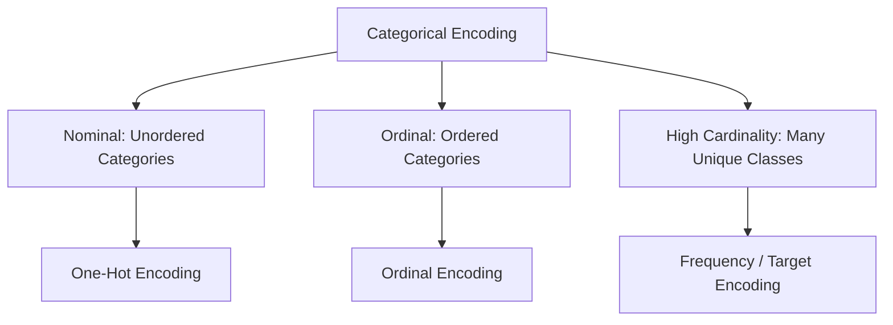

# 04.3. Categorical Feature Encoding and Text Normalization

## 1. Overview
Machine learning models require numerical input matrices. This note covers categorical encoding techniques (One-Hot, Ordinal, Frequency) and text normalization strategies.

## 2. Categorical Encoding Schemes



### One-Hot Encoding (Nominal Features)
Creates a binary indicator column for each category. To avoid perfect multicollinearity (the **dummy variable trap**), drop one reference column by setting `drop_first=True`:

```python
import pandas as pd

# Avoid multicollinearity: drop_first=True
df_encoded = pd.get_dummies(df, columns=["Gender", "City"], drop_first=True, dtype=int)
```

### Ordinal Encoding (Ranked Features)
Maps ordered categories to integers that preserve their natural rank:

```python
from sklearn.preprocessing import OrdinalEncoder

education_order = [["High School", "Bachelor", "Master", "PhD"]]
encoder = OrdinalEncoder(categories=education_order)
df["Education_Rank"] = encoder.fit_transform(df[["Education"]])
```

### Frequency / Count Encoding (High-Cardinality Features)
Replaces categories with their overall frequency in the dataset, avoiding high-dimensional feature expansion:

```python
freq_map = df["ZipCode"].value_counts(normalize=True).to_dict()
df["ZipCode_Freq"] = df["ZipCode"].map(freq_map)
```

## 3. Text Normalization Pipeline
Text columns often contain inconsistent casing and trailing whitespace. Normalize string features using the following pipeline:

```python
def normalize_text_series(series: pd.Series) -> pd.Series:
    """Strips whitespace, converts to lowercase, and replaces null representations."""
    return series.astype(str).str.lower().str.strip().replace("none", np.nan)
```

## 4. Connections to Other Topics
- Next step: [[04.4. Feature Scaling, Standardization, and Normalization Theory]].
- Applied in [[04.5. Tutorial 05 - End-to-End Medical Cohort Preprocessing Pipeline]].

---
