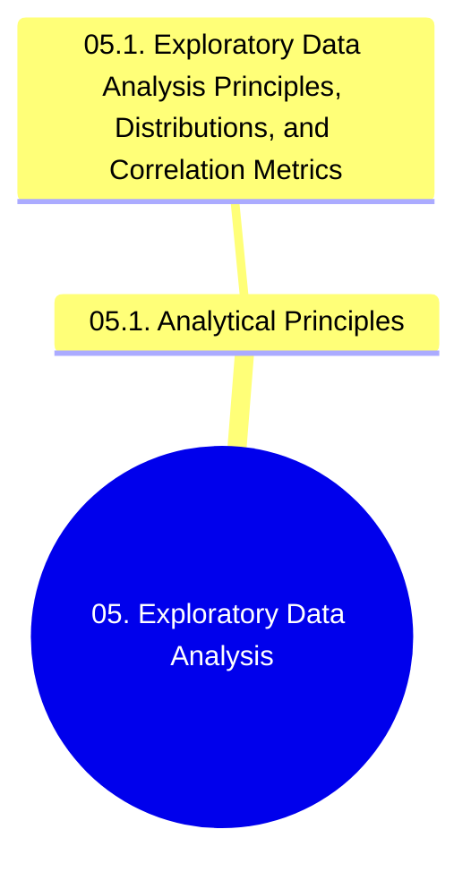

# 05. Exploratory Data Analysis - Chapter Overview and Navigation

## 1. Chapter Structure

## 2. Navigational Table of Contents

### 05.1. Analytical Principles
- [[05.1. Exploratory Data Analysis Principles, Distributions, and Correlation Metrics]]

## 3. Prerequisite Library Links
- Connects to foundations in [[00. Library Learning Roadmap]]
