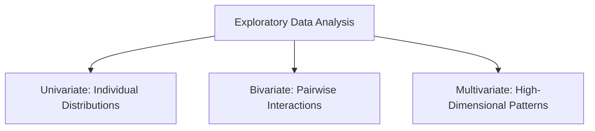
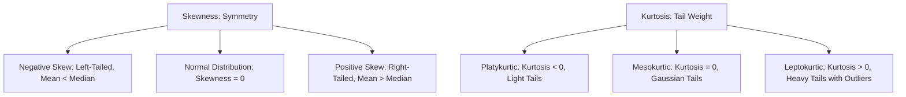

# 05.1. Exploratory Data Analysis Principles, Distributions, and Correlation Metrics

## 1. Overview
Exploratory Data Analysis (EDA) investigates dataset patterns, tests hypotheses, and checks statistical assumptions before formal modeling. This note covers univariate, bivariate, and multivariate analysis, skewness, kurtosis, and correlation coefficients.

## 2. Analysis Types

- **Univariate Analysis**: Examines individual variables in isolation using histograms, KDE plots, and box plots for numeric features, and count plots for categorical features.
- **Bivariate Analysis**: Examines relationships between two features using scatter plots, grouped aggregations, and contingency tables.
- **Multivariate Analysis**: Examines interactions across three or more variables simultaneously using pairplots, correlation heatmaps, and dimensional facets.

## 3. Distribution Moments: Skewness and Kurtosis

### Skewness
Measures the asymmetry of a distribution around its mean:
- **Positive Skew (Right-Tailed)**: The right tail is longer. The mean is typically greater than the median. Can be addressed using log or square-root transformations.
- **Negative Skew (Left-Tailed)**: The left tail is longer. The mean is typically less than the median.
- **Symmetric**: Skewness $\approx 0$.

### Kurtosis
Measures the "tailedness" of a distribution, indicating the frequency of extreme values (outliers):
- **Leptokurtic ($\text{Kurtosis} > 0$)**: Sharp peak and heavy tails, indicating a higher frequency of outliers.
- **Platykurtic ($\text{Kurtosis} < 0$)**: Flatter peak and thinner tails, indicating fewer extreme outliers.
- **Mesokurtic ($\text{Kurtosis} \approx 0$)**: Tailedness matches a normal distribution.

## 4. Correlation Coefficients

### Pearson Correlation ($r$)
Measures the strength and direction of a **linear** relationship between continuous variables:

$$r = \frac{\sum (x_i - \bar{x})(y_i - \bar{y})}{\sqrt{\sum (x_i - \bar{x})^2 \sum (y_i - \bar{y})^2}}$$

- Value range: $[-1, 1]$.
- Assumes variables are normally distributed and linearly related. Sensitive to outliers.

### Spearman Rank Correlation ($\rho$)
A non-parametric metric that measures the **monotonic** relationship between two variables by comparing their ranked values:

$$\rho = 1 - \frac{6 \sum d_i^2}{n(n^2 - 1)}$$

- Robust to non-linearities and outliers.

### Kendall's Tau ($\tau$)
Measures rank correlation based on the number of concordant and discordant pairs:

$$\tau = \frac{\text{Concordant Pairs} - \text{Discordant Pairs}}{\frac{1}{2} n (n - 1)}$$

- Well-suited for small datasets with tied ranks.

## 5. Connections to Other Topics
- Visualized using heatmaps in [[10. Matplotlib and Seaborn Statistical Plotting for Tabular Data]].
- Guides feature selection in [[04.6. Tutorial 05 - Titanic Predictive Modeling Pipeline and Classifier Evaluation]].

---

# Verification and Audit Report
