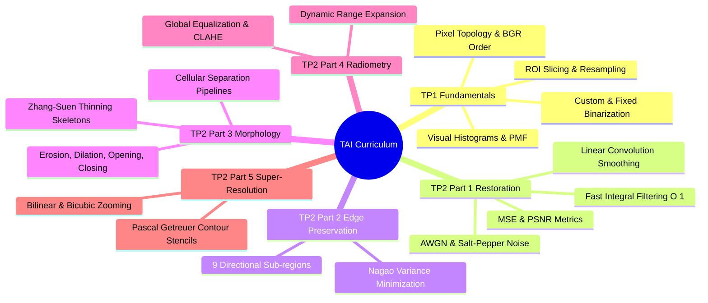

# 06.0. Advanced Image Processing Index and Curriculum MOC

## 1. Track Overview
The Advanced Image Processing (*Traitement Avancé des Images* - TAI) curriculum covers the mathematical foundations, spatial mechanics, and algorithm design patterns required to process, enhance, and reconstruct digital images.

## 2. Laboratory Note Sequence and Coursework Mapping

| Laboratory Note | Focus Topics | Coursework Reference | Key Library Connections |
| :--- | :--- | :--- | :--- |
| **[[06.9.1. TP1 - Digital Image Acquisition, Matrix Topologies, and Fixed Thresholding]]** | Ingestion, BGR memory layout, scanline editing, binary thresholding | TP1 Ex 1, 2, 3 | [[15. OpenCV Core Architecture - Matrix Representation, Channels, and Color Constellations]] |
| **[[06.9.2. TP1 - Spatial Transformations, ROI Extraction, and Multi-Channel Histograms]]** | ROI cropping, affine rotations, Matplotlib multi-channel histograms | TP1 Ex 4, 5 | [[16. Image Spatial Transformations - Interpolation, Scaling, Cropping, and Affine Warping]], [[18. Visual Frequency and Radiometry - Histograms, Equalization, AHE, and CLAHE]] |
| **[[06.9.3. TP2 Part 1 - Discrete Noise Models and Spatial Convolution Smoothing]]** | Additive Gaussian noise, impulse corruption, linear spatial filters, PSNR/MSE | TP2 Ex 1, 2 | [[19. Spatial Image Restoration - Noise Models, Linear Convolution, and Fast Integral Filters]], [[22. Objective Image Quality Assessment - MSE, PSNR, and SSIM Metrics]] |
| **[[06.9.4. TP2 Part 1 Homework - Fast Integral Filtering and Adaptive Smoothing]]** | Constant-time $O(1)$ box filtering, summed-area tables, adaptive smoothing | TP2 Ex 2 Homework | [[19. Spatial Image Restoration - Noise Models, Linear Convolution, and Fast Integral Filters]] |
| **[[06.9.5. TP2 Part 2 - Edge-Preserving Non-Linear Smoothing with Nagao Filter]]** | Non-linear edge preservation, 9 sub-regions, local variance minimization | TP2 Ex 3 | [[20. Non-Linear and Edge-Preserving Filtering - Median, Bilateral, and Nagao Filters]] |
| **[[06.9.6. TP2 Part 3 - Mathematical Morphology, Cell Counting, and Skeletonization]]** | Structuring elements, erosion, dilation, cell counting, Zhang-Suen thinning | TP2 Ex 4 | [[21. Mathematical Morphology - Set Theory, Structuring Elements, and Thinning]] |
| **[[06.9.7. TP2 Part 4 - Contrast Dynamics, Histogram Equalization, and CLAHE]]** | Contrast stretching, global equalization, tile-based CLAHE | TP2 Ex 5 | [[18. Visual Frequency and Radiometry - Histograms, Equalization, AHE, and CLAHE]] |
| **[[06.9.8. TP2 Part 5 - Single-Frame Super-Resolution and Contour Stencils]]** | Single-frame SR, Total Variation along curves, Getreuer stencils | TP2 Ex 6 | [[22. Objective Image Quality Assessment - MSE, PSNR, and SSIM Metrics]], [[24. Super-Resolution and Edge-Adaptive Interpolation - Pascal Getreuer Contour Stencils]] |

## 3. Theory Note Map
The laboratory sequence above is backed by the theory notes of the chapter; see [[06.0. Chapter Overview and Navigation]] for the complete table of contents:
- Foundations and discretization: [[06.1.1. Physical Image Formation, Radiometry, and Optical Sensing]] through [[06.1.11. The Classical Vision Processing Hierarchy - Low, Mid, and High-Level Tasks]].
- Degradation and restoration: [[06.2.1. Physical Noise Models (PSF, Gaussian, Impulse Salt-and-Pepper, Speckle)]] through [[06.2.8. Partial Differential Equations in Restoration (Perona-Malik Anisotropic Diffusion)]].
- Frequency domain: [[06.3.1. 2D Discrete Fourier Transform (DFT), FFT Shift, and Convolution Theorem]] and [[06.3.2. Frequency Filters (Low-Pass, High-Pass, and Band-Reject Notch Filtering)]].
- Morphology: [[06.4.1. Set-Theoretic Foundations, Binary Grids, and Structuring Elements]] and [[06.4.2. Compound Operators (Opening, Closing, Gradient, and Zhang-Suen Thinning)]].
- Contrast and Retinex: [[06.5.1. Dynamic Range Expansion and Noise-Tolerant Contrast Stretching]] and [[06.5.2. Advanced Contrast Models (Histogram Specification and Land's Retinex Theory)]].
- Clustering and deep restoration: [[06.6.1. Feature Space Clustering (Mean-Shift and 2SP-DBSCAN by UMBB iVision)]] and [[06.6.2. Deep Learning Denoising (Patch MLPs, Residual DnCNN, and Uformer)]].
- Segmentation: [[06.7.1. Formal Segmentation Axioms and Homogeneity Predicates]] through [[06.7.8. Segmentation Evaluation Benchmarks (Dice DSC, Jaccard IoU, Hausdorff Distance)]].
- Super-resolution: [[06.8.1. Continuous Image Reconstruction (Nearest, Bilinear, and Keys' Bicubic Spline)]] through [[06.8.4. Document Image Super-Resolution (Bi-ESRGAN Dual Path Architecture)]].

---
