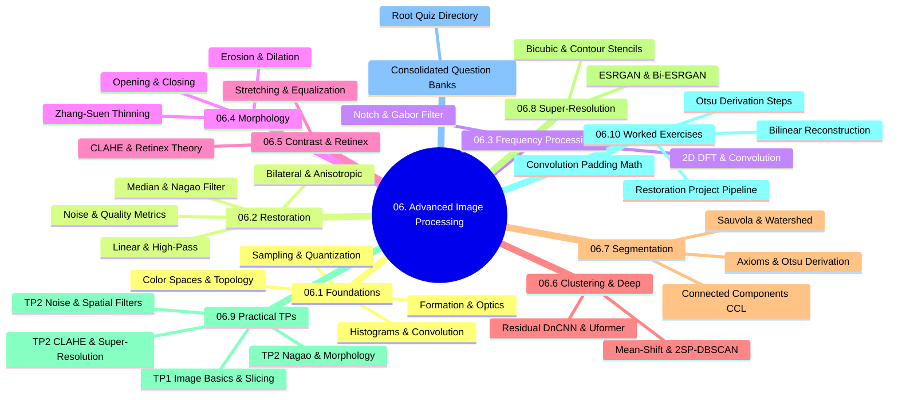

# 06. Advanced Image Processing (TAI) - Curriculum Overview and Navigation

## 1. Chapter Architecture

## 2. Navigational Table of Contents

### 06.1. Image Foundations and Discretization
- [[06.1.1. Physical Image Formation, Radiometry, and Optical Sensing]]
- [[06.1.2. Spatial Discretization, Dirac Comb Sampling, and Nyquist-Shannon Theorem]]
- [[06.1.3. Amplitude Quantization, Dynamic Range, and Bit Depth]]
- [[06.1.4. Image Representations - Raster Matrix vs Mathematical Vector Primitives]]
- [[06.1.5. Color Models - Additive RGB, Subtractive CMYK, and Photometric Grayscale]]
- [[06.1.6. Perceptual and Broadcast Spaces - YUV, YCbCr, HSV, and CIE Lab]]
- [[06.1.7. Digital File Encapsulation, Compression Standards, and Medical DICOM]]
- [[06.1.8. Discrete Spatial Topology, Neighborhoods (N4, N8), and Metric Spaces]]
- [[06.1.9. Tonal Histograms, Probability Densities, and Cumulative Distribution Functions]]
- [[06.1.10. Mathematical 2D Spatial Convolution, Cross-Correlation, and Boundary Padding]]
- [[06.1.11. The Classical Vision Processing Hierarchy - Low, Mid, and High-Level Tasks]]

### 06.2. Degradation, Restoration, and Spatial Filtering
- [[06.2.1. Physical Noise Models (PSF, Gaussian, Impulse Salt-and-Pepper, Speckle)]]
- [[06.2.2. Quantitative Quality Benchmarks (MSE, PSNR, and SSIM)]]
- [[06.2.3. Linear Spatial Smoothing (Mean Box Filter, Gaussian Bell, and 1D Separability)]]
- [[06.2.4. Spatial High-Pass Filtering, Sobel Gradients, and Laplacian Sharpening]]
- [[06.2.5. Order-Statistic Non-Linear Filtering (Median, Min, Max, Min-Max Operators)]]
- [[06.2.6. Structural Edge-Preserving Smoothing (Nagao 9-Sector Multi-Directional Filter)]]
- [[06.2.7. Non-Linear Boundary-Preserving Filtering (Bilateral Joint Spatial-Radiometric Filter)]]
- [[06.2.8. Partial Differential Equations in Restoration (Perona-Malik Anisotropic Diffusion)]]

### 06.3. Frequency Domain and Spectral Processing
- [[06.3.1. 2D Discrete Fourier Transform (DFT), FFT Shift, and Convolution Theorem]]
- [[06.3.2. Frequency Filters (Low-Pass, High-Pass, and Band-Reject Notch Filtering)]]

### 06.4. Mathematical Morphology and Shape Analysis
- [[06.4.1. Set-Theoretic Foundations, Binary Grids, and Structuring Elements]]
- [[06.4.2. Compound Operators (Opening, Closing, Gradient, and Zhang-Suen Thinning)]]

### 06.5. Contrast Dynamics and Radiometric Retinex
- [[06.5.1. Dynamic Range Expansion and Noise-Tolerant Contrast Stretching]]
- [[06.5.2. Advanced Contrast Models (Histogram Specification and Land's Retinex Theory)]]

### 06.6. Clustering and Deep Restoration
- [[06.6.1. Feature Space Clustering (Mean-Shift and 2SP-DBSCAN by UMBB iVision)]]
- [[06.6.2. Deep Learning Denoising (Patch MLPs, Residual DnCNN, and Uformer)]]

### 06.7. Image Segmentation and Regional Extraction
- [[06.7.1. Formal Segmentation Axioms and Homogeneity Predicates]]
- [[06.7.2. Global Optimal Statistical Thresholding (Otsu's Method Derivation)]]
- [[06.7.3. Local Adaptive Thresholding (Niblack and Dynamic Range Sauvola)]]
- [[06.7.4. Complex Document Segmentation (Gaceb's Multi-Scale Mixed Binarization)]]
- [[06.7.5. Morphological Watershed Segmentation and Topological Distance Transforms]]
- [[06.7.6. Connected Component Analysis (Two-Pass CCL and Equivalence Trees)]]
- [[06.7.7. Geometric Region Descriptors (AABB, OBB, Centroids, and Central Moments)]]
- [[06.7.8. Segmentation Evaluation Benchmarks (Dice DSC, Jaccard IoU, Hausdorff Distance)]]

### 06.8. Image Super-Resolution Reconstruction
- [[06.8.1. Continuous Image Reconstruction (Nearest, Bilinear, and Keys' Bicubic Spline)]]
- [[06.8.2. Edge-Adaptive Interpolation (Contour Stencils and Total Variation Minimization)]]
- [[06.8.3. Deep Super-Resolution Frameworks (SRCNN, Perceptual SRGAN, and ESRGAN)]]
- [[06.8.4. Document Image Super-Resolution (Bi-ESRGAN Dual Path Architecture)]]

### 06.9. Practical Laboratories (TPs)
- [[06.9.1. TP1 - Digital Image Acquisition, Matrix Topologies, and Fixed Thresholding]]
- [[06.9.2. TP1 - Spatial Transformations, ROI Extraction, and Multi-Channel Histograms]]
- [[06.9.3. TP2 Part 1 - Discrete Noise Models and Spatial Convolution Smoothing]]
- [[06.9.4. TP2 Part 1 Homework - Fast Integral Filtering and Adaptive Smoothing]]
- [[06.9.5. TP2 Part 2 - Edge-Preserving Non-Linear Smoothing with Nagao Filter]]
- [[06.9.6. TP2 Part 3 - Mathematical Morphology, Cell Counting, and Skeletonization]]
- [[06.9.7. TP2 Part 4 - Contrast Dynamics, Histogram Equalization, and CLAHE]]
- [[06.9.8. TP2 Part 5 - Single-Frame Super-Resolution and Contour Stencils]]

### 06.10. Worked Analytical Exercises and Projects
- [[06.10.1. Exercise 1 - Complete Calculation of 2D Convolution and Boundary Padding Modes]]
- [[06.10.2. Exercise 2 - Exhaustive Step-by-Step Optimization of Otsu's Inter-Class Variance]]
- [[06.10.3. Exercise 3 - Analytical Sub-Pixel Reconstruction via Bilinear Interpolation]]
- [[06.10.4. Project - End-to-End Historical Document Restoration and Extraction Pipeline]]

### Evaluative Question Banks
The former 06.11 question banks have been consolidated into the repository-root [[00. Quiz Master Index|Quiz directory]]. Their content was reviewed, rewritten into the interactive puzzle callout format, and merged into the per-topic banks [[Quiz 06.1 - Image Foundations and Discretization]], [[Quiz 06.2 - Degradation, Restoration, and Spatial Filtering]], [[Quiz 06.3 - Frequency Domain and Spectral Processing]], and [[Quiz 06.4 - Mathematical Morphology and Shape Analysis]]. Every chapter and library topic now has its own bank under `Quiz/`.

## 3. Shared Library Foundations
All library mechanics used across this chapter are explained once in the `Libraries/` section: OpenCV ingestion and color spaces ([[15. OpenCV Core Architecture - Matrix Representation, Channels, and Color Constellations]]), geometric transformations ([[16. Image Spatial Transformations - Interpolation, Scaling, Cropping, and Affine Warping]]), exact 2D convolution ([[17. SciPy Signal and Spatial Operations - 2D Filtering and Morphology]]), histogram and CLAHE APIs ([[18. Visual Frequency and Radiometry - Histograms, Equalization, AHE, and CLAHE]]), noise and linear filtering ([[19. Spatial Image Restoration - Noise Models, Linear Convolution, and Fast Integral Filters]]), non-linear filters ([[20. Non-Linear and Edge-Preserving Filtering - Median, Bilateral, and Nagao Filters]]), morphology and connected components ([[21. Mathematical Morphology - Set Theory, Structuring Elements, and Thinning]]), quality metrics ([[22. Objective Image Quality Assessment - MSE, PSNR, and SSIM Metrics]]), clustering and IoU metrics ([[23. Scikit-Learn Primitives - Clustering, Dimensionality, and Metrics]]), and super-resolution stencils ([[24. Super-Resolution and Edge-Adaptive Interpolation - Pascal Getreuer Contour Stencils]]).
