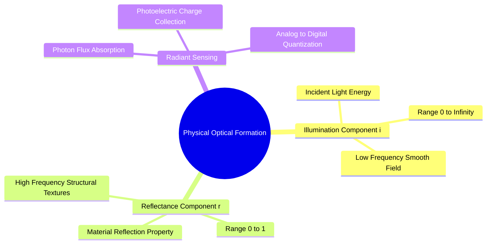

# Physical Image Formation and Optical Sensing

An optical image is formed by focused electromagnetic radiation captured by a sensor. Mathematically, a continuous physical scene is represented as a bounded, continuous bivariate radiant energy distribution:

$$f(x, y) \in \mathbb{R}^+, \quad (x, y) \in \Omega \subset \mathbb{R}^2$$

Where $(x, y)$ are spatial coordinates on the image plane $\Omega$, and $f(x, y)$ represents physical irradiance or illuminance. Because light energy cannot be negative or infinite in physical observation, the function is bounded:

$$0 < f(x, y) < \infty$$

### The Illumination-Reflectance Decomposition Model
In optical imaging, the radiant intensity $f(x, y)$ entering the camera lens decomposes into two physical components:

$$f(x, y) = i(x, y) \cdot r(x, y)$$

1. **Illumination component $i(x, y)$:** The amount of incident light energy originating from environmental light sources that reaches the scene.
   $$0 < i(x, y) < \infty$$
   *Physical characteristic:* Varies smoothly across the scene, behaving as a low-frequency spatial signal.

2. **Reflectance component $r(x, y)$:** The fraction of incident light reflected by physical surfaces into the optical aperture.
   $$0 \le r(x, y) \le 1$$
   * $r = 0$: Total absorption by an ideal black body.
   * $r = 1$: Total reflection by an ideal reflector.
   *Physical characteristic:* Changes abruptly at material boundaries, surface contours, and textural transitions, behaving as a high-frequency spatial signal.

### Physical Sensor Acquisition
Optical light passes through a compound lens system and is focused onto a solid-state sensor array (such as a Charge-Coupled Device [CCD] or Complementary Metal-Oxide-Semiconductor [CMOS] active-pixel sensor). Over an exposure duration $T$, each photo-site absorbs incident photon flux and collects an electrical charge $Q$ via the photoelectric effect:

$$Q = \int_{0}^{T} \int_{A_s} \eta_q \cdot E(x, y, t) \, dx \, dy \, dt$$

where $\eta_q$ is the quantum efficiency, $A_s$ is the physical surface area of the photo-site, and $E(x, y, t)$ is the optical irradiance. This collected charge is converted to an analog voltage, amplified, passed through an anti-aliasing low-pass filter, and converted to discrete numbers by an Analog-to-Digital Converter (ADC).

Related concepts: [[06.1.2. Spatial Discretization, Dirac Comb Sampling, and Nyquist-Shannon Theorem]], [[06.5.2. Advanced Contrast Models (Histogram Specification and Land's Retinex Theory)]].
