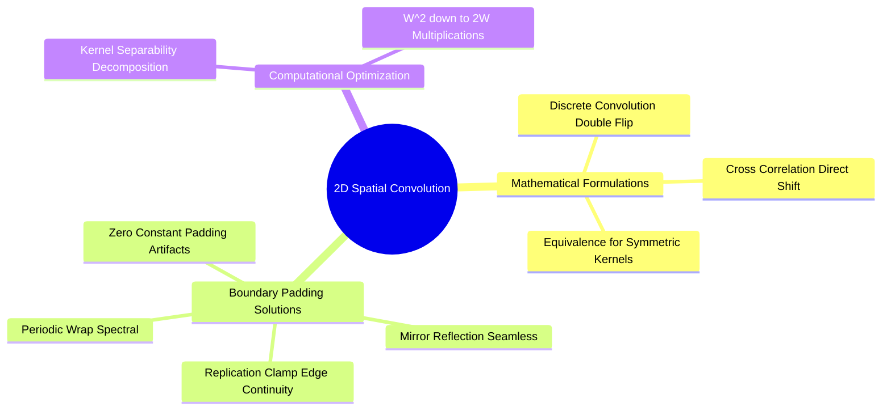

# Mathematical 2D Spatial Convolution, Cross-Correlation, and Boundary Conditions

Linear spatial filtering is the primary operation used for image smoothing, sharpening, and gradient calculation. It operates by convolving an image with a small spatial weight matrix called a **kernel** (or mask).



### 1. Formulations: Convolution vs. Cross-Correlation

#### 2D Discrete Convolution ($*$)
Mathematically, true 2D discrete convolution requires flipping the filter kernel both horizontally and vertically (a $180^\circ$ rotation) before computing the sum of element-wise products:

$$g(x, y) = f(x, y) * h(x, y) = \sum_{s=-K}^{K} \sum_{t=-L}^{L} f(x - s, y - t) \cdot h(s, t)$$

#### 2D Discrete Cross-Correlation ($\otimes$)
Cross-correlation performs the same operation but **without flipping the kernel**:

$$g(x, y) = f(x, y) \otimes h(x, y) = \sum_{s=-K}^{K} \sum_{t=-L}^{L} f(x + s, y + t) \cdot h(s, t)$$

*Crucial Implementation Insight:* Most modern deep learning frameworks (e.g., PyTorch, TensorFlow) and computer vision libraries implement **cross-correlation** but call it "convolution." For spatially symmetric kernels (such as Gaussian, Laplacian, or Box filters), $h(s, t) = h(-s, -t)$, making the mathematical results of convolution and cross-correlation identical.

### 2. Kernel Separability and Computational Complexity
A 2D kernel $h(x, y)$ of size $W \times W$ is **separable** if it can be factored into the outer product of two 1D vectors:

$$h = \mathbf{v} \cdot \mathbf{u}^T$$

Applying a non-separable $W \times W$ kernel directly to an $M \times N$ image requires $W^2$ multiplications and additions per pixel:

$$\text{Complexity}_{\text{Direct}} = \mathcal{O}(M \cdot N \cdot W^2)$$

If the kernel is separable, the 2D operation can be decomposed into two consecutive 1D passes: first convolving each row with the horizontal kernel $\mathbf{u}^T$, then convolving each column of the result with the vertical kernel $\mathbf{v}$:

$$\text{Complexity}_{\text{Separated}} = \mathcal{O}(M \cdot N \cdot 2W)$$

*Example Performance Gain:* For a $15 \times 15$ filter ($W = 15$), a direct 2D convolution requires $W^2 = 225$ multiplications per pixel. A separable implementation requires only $2W = 30$ multiplications per pixel—an **$86.7\%$ reduction** in computational cost.

### 3. Boundary Effects and Padding Strategies
When a kernel is centered on pixels near the edge of an image, part of the kernel extends beyond the image boundaries, where pixel values are undefined.

```text
OutOfBounds   OutOfBounds   OutOfBounds
     ?             ?             ?
OutOfBounds [f(0,0)=100]  [f(0,1)=130]  ...
     ?
OutOfBounds [f(1,0)=110]  [f(1,1)=90]   ...
     ?
```

Four boundary handling strategies are commonly used:
1. **Zero Padding (Constant Border):** Sets all out-of-bounds pixels to zero ($f(x, y) = 0$). Simple to implement, but introduces an artificial dark edge that can distort high-pass filters and edge detectors.
2. **Replication (Clamp Padding):** Clamps out-of-bounds coordinates to the nearest edge pixel ($f(-1, y) = f(0, y)$). Preserves border intensity levels and prevents artificial edges.
3. **Mirror Padding (Reflection):** Reflects pixel values back into the image across the boundary ($f(-1, y) = f(1, y)$). Maintains local intensity gradients, minimizing boundary artifacts.
4. **Periodic Padding (Wrap-Around):** Wraps coordinates to the opposite edge of the image ($f(-1, y) = f(M-1, y)$). Required when performing convolution via the Discrete Fourier Transform (DFT).

Related concepts: [[17. SciPy Signal and Spatial Operations - 2D Filtering and Morphology]], [[06.2.3. Linear Spatial Smoothing (Mean Box Filter, Gaussian Bell, and 1D Separability)]], [[06.10.1. Exercise 1 - Complete Calculation of 2D Convolution and Boundary Padding Modes]].
