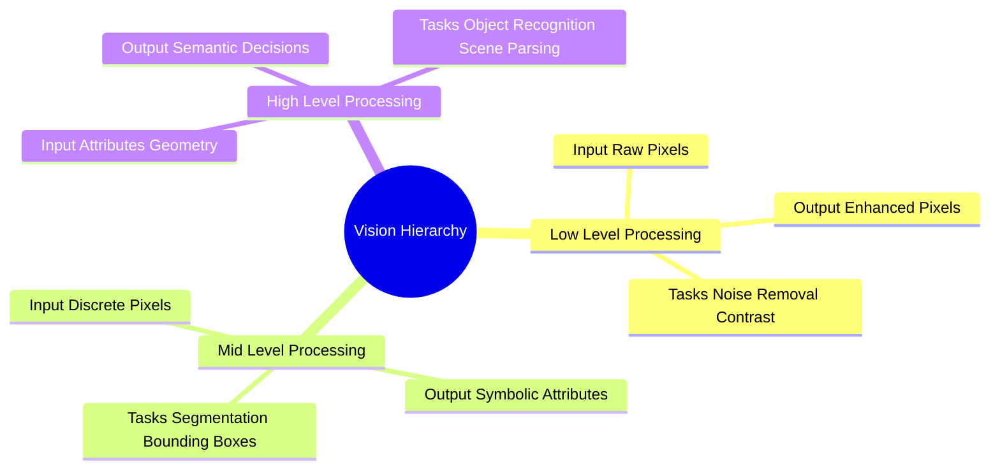

# The Classical Vision Processing Hierarchy: Low, Mid, and High-Level Tasks

Computer vision and image analysis architectures are organized into a three-tiered hierarchy of abstraction, defined by the structure of their inputs and outputs.

### 1. Low-Level Processing (Pixel-to-Pixel)
* **Inputs:** Raw pixel matrices.
* **Outputs:** Processed pixel matrices.
* **Objective:** Improve image quality, remove noise, correct non-uniform lighting, or enhance contrast to prepare the image for downstream analysis.
* **Representative Tasks:** Linear and non-linear filtering, contrast stretching, bilateral smoothing, morphological operations, super-resolution reconstruction.

### 2. Mid-Level Processing (Pixel-to-Attribute)
* **Inputs:** Processed pixel matrices.
* **Outputs:** Symbolic descriptors, segmented regions, coordinate boundaries, or geometric attributes.
* **Objective:** Group pixels into meaningful entities and extract structural features.
* **Representative Tasks:** Global and adaptive binarization, edge detection, morphological watershed segmentation, connected component analysis, bounding box extraction.

### 3. High-Level Processing (Attribute-to-Decision)
* **Inputs:** Structural features, geometric vectors, regional descriptors, and class labels.
* **Outputs:** Semantic interpretations, scene classifications, or automated decisions.
* **Objective:** Emulate biological vision by making inferences and decisions based on the extracted features.
* **Representative Tasks:** Automated medical diagnosis, optical character recognition (OCR), multi-object tracking, autonomous vehicle path planning.

Related concepts: [[06.1.1. Physical Image Formation, Radiometry, and Optical Sensing]], [[06.2.1. Physical Noise Models (PSF, Gaussian, Impulse Salt-and-Pepper, Speckle)]], [[06.7.1. Formal Segmentation Axioms and Homogeneity Predicates]].
