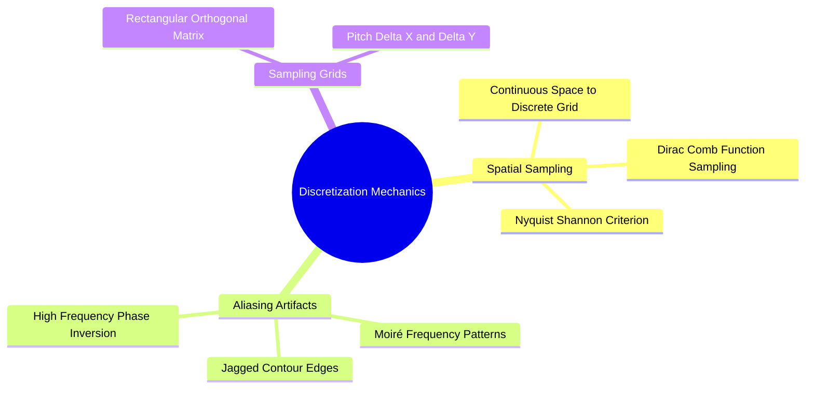

# Discretization: Spatial Sampling and Nyquist-Shannon Theorem

To process a continuous optical image $f(x, y)$ on a computer, it must be discretized into a matrix of numbers. This requires two steps: **spatial sampling** and **amplitude quantization**.

### 1. Spatial Sampling (Coordinate Discretization)
Sampling converts continuous spatial coordinates $(x, y) \in \mathbb{R}^2$ into discrete lattice coordinates $[m, n] \in \mathbb{Z}^2$. Mathematically, this is modeled as multiplying the continuous function $f(x, y)$ by an ideal two-dimensional Dirac comb function (impulse train) $s(x, y)$:

$$s(x, y) = \sum_{m=-\infty}^{\infty} \sum_{n=-\infty}^{\infty} \delta(x - m\Delta x, y - n\Delta y)$$

The sampled continuous signal $f_s(x, y)$ is:

$$f_s(x, y) = f(x, y) \cdot s(x, y) = \sum_{m=-\infty}^{\infty} \sum_{n=-\infty}^{\infty} f(m\Delta x, n\Delta y) \cdot \delta(x - m\Delta x, y - n\Delta y)$$

where $\Delta x$ and $\Delta y$ represent the sampling intervals (pixel pitch).

### 2. The Nyquist-Shannon Sampling Theorem
Let $U_{\text{max}}$ and $V_{\text{max}}$ denote the highest spatial frequencies present in the continuous scene along the horizontal and vertical directions. To reconstruct the continuous signal without distortion or loss of information, the sampling frequencies $(f_{s,x}, f_{s,y})$ must be strictly greater than twice the highest constituent spatial frequencies:

$$f_{s,x} = \frac{1}{\Delta x} > 2 U_{\text{max}}, \quad f_{s,y} = \frac{1}{\Delta y} > 2 V_{\text{max}}$$

The critical threshold $f_N = 2U_{\text{max}}$ is called the **Nyquist rate**.

### 3. Spatial Aliasing Artifacts
When an image is sampled below the Nyquist rate ($f_s \le 2U_{\text{max}}$), high-frequency components overlap with lower-frequency components in the frequency domain. This introduces **aliasing artifacts**, such as:
* **Moiré Patterns:** False, artificial ripple textures that appear when sampling fine, repetitive patterns (e.g., fabric weaves or brick lines).
* **Jagged Contours (Pixelation):** Diagonal edges appear as stair-stepped lines rather than smooth boundaries.

To prevent aliasing, physical cameras place an optical low-pass anti-aliasing filter (blur filter) in front of the sensor to remove frequencies above the Nyquist limit before sampling.

Related concepts: [[01. NumPy Foundations - Memory Layout, ndarray Anatomy, and Array Instantiation]], [[06.1.3. Amplitude Quantization, Dynamic Range, and Bit Depth]], [[06.3.1. 2D Discrete Fourier Transform (DFT), FFT Shift, and Convolution Theorem]].
