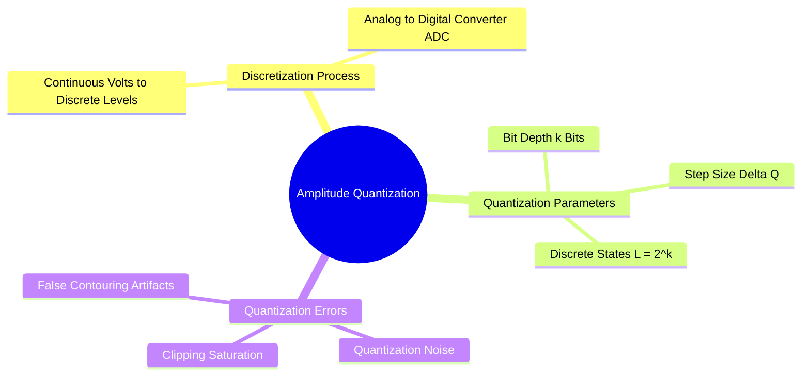

# Amplitude Quantization, Dynamic Range, and Bit Depth

While spatial sampling discretizes the continuous coordinate space $(x, y)$, **amplitude quantization** discretizes the continuous light intensity values $f(x, y)$ into a finite set of discrete values.

### 1. Mathematical Formulation
Let continuous sensor voltage $v \in [V_{\text{min}}, V_{\text{max}}]$ represent measured light intensity. An Analog-to-Digital Converter (ADC) maps this range to $L$ discrete levels:

$$L = 2^k$$

where $k$ is the **quantization resolution (bit depth)** in bits per pixel (bpp). The uniform quantization step size $\Delta q$ is:

$$\Delta q = \frac{V_{\text{max}} - V_{\text{min}}}{L}$$

The quantization function $Q(v)$ maps an analog voltage $v$ to an integer code $k \in \{0, 1, \dots, L-1\}$:

$$Q(v) = \min\left( L - 1, \ \left\lfloor \frac{v - V_{\text{min}}}{\Delta q} \right\rfloor \right)$$

### 2. Common Bit Depths in Computer Vision
* **1-bit (Binary):** $L = 2^1 = 2$ states ($\{0, 1\}$ or $\{0, 255\}$). Used for binary masks, document binarization, and structural silhouettes.
* **8-bit (Standard Grayscale):** $L = 2^8 = 256$ states ($[0, 255]$). The standard for digital displays, where $0$ represents absolute black and $255$ represents peak white.
* **12-bit / 14-bit (Digital Camera RAW):** $L = 4,096$ to $16,384$ states. Preserves highlight and shadow detail before tone-mapping.
* **16-bit (Medical Imaging):** $L = 2^{16} = 65,536$ states. Used in DICOM radiography, CT, and MRI to record subtle tissue density differences.

### 3. Quantization Artifacts: False Contouring
When an image is quantized with an insufficient bit depth (e.g., $k \le 4$, yielding $L \le 16$ levels), smooth intensity variations (such as a clear sky) degenerate into visible, distinct bands of constant tone. This artifact is known as **false contouring**.

Related concepts: [[01. NumPy Foundations - Memory Layout, ndarray Anatomy, and Array Instantiation]], [[06.1.7. Digital File Encapsulation, Compression Standards, and Medical DICOM]], [[06.9.1. TP1 - Digital Image Acquisition, Matrix Topologies, and Fixed Thresholding]].
