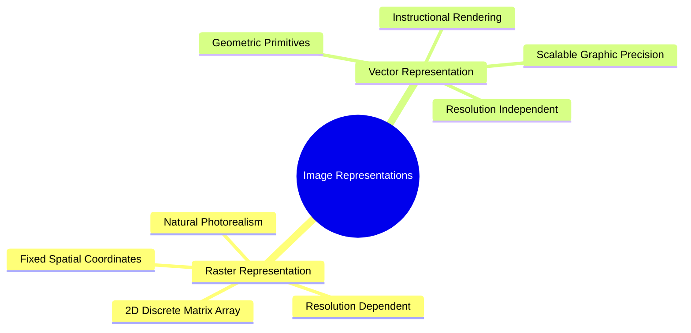

# Image Representations: Raster Matrix vs. Mathematical Vector Primitives

Digital visual data is represented using two primary paradigms: **raster (bitmap)** representations and **vector** representations.

### 1. Raster Representation (Bitmap Arrays)
A raster image is an orthogonal two-dimensional matrix of discrete pixels. In an $M \times N$ raster matrix:

$$I = \begin{pmatrix}
I(0,0) & I(0,1) & \cdots & I(0,N-1) \\
I(1,0) & I(1,1) & \cdots & I(1,N-1) \\
\vdots & \vdots & \ddots & \vdots \\
I(M-1,0) & I(M-1,1) & \cdots & I(M-1,N-1)
\end{pmatrix}$$

#### Characteristics
* **Resolution Dependent:** Quality is tied to the physical pixel dimensions $(M \times N)$. Upscaling a raster image requires interpolation to estimate missing pixel values, which can introduce blurriness and pixelation.
* **Memory Intensive:** Memory usage scales directly with spatial resolution and color depth:
  $$\text{Bytes} = M \times N \times \text{Channels} \times \frac{k}{8}$$
* **Ideal for Continuous Scenes:** Well-suited for complex scenes with continuous variations in tone, such as natural photographs and medical scans.

### 2. Vector Representation (Parametric Primitives)
A vector image stores visual data as mathematical descriptions of geometric shapes (points, lines, Bézier curves, polygons, and fill attributes). For example, a circle is stored parametrically:

$$\mathcal{C} = \{ (x_c, y_c), \ r, \ \mathbf{c}_{\text{stroke}}, \ \mathbf{c}_{\text{fill}}, \ w_{\text{stroke}} \}$$

#### Characteristics
* **Resolution Independent:** Can be scaled to any resolution without loss of fidelity. The image is rendered dynamically at display time by evaluating the underlying mathematical formulas.
* **Compact Storage:** For typography, line art, and geometric diagrams, mathematical instructions take up significantly less storage space than high-resolution pixel matrices.
* **Ineffective for Complex Scenes:** Cannot efficiently model complex, continuous photographic scenes with millions of subtle color variations.

Related concepts: [[02. NumPy Array Manipulation - Slicing, Strides, Shapes, and Vectorized Indexing]], [[06.1.7. Digital File Encapsulation, Compression Standards, and Medical DICOM]], [[06.8.1. Continuous Image Reconstruction (Nearest, Bilinear, and Keys' Bicubic Spline)]].
