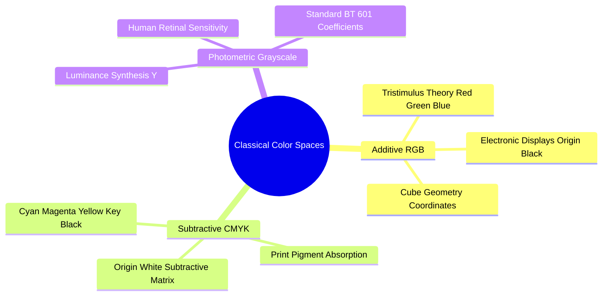

# Color Models: Additive RGB, Subtractive CMYK, and Photometric Grayscale

A color model is a mathematical framework that describes colors as tuples of numbers, typically using three or four primary color components.

### 1. Additive RGB Color Space
The RGB model is an **additive** system based on human trichromatic vision. Colors are created by mixing varying intensities of Red, Green, and Blue light. It is the primary color model used by digital displays, computer monitors, and digital cameras.

* Mathematical Domain: A 3D Cartesian cube $[0, 255]^3$ (for standard 8-bit channels):
  $$\mathbf{C}(x, y) = \begin{pmatrix} R(x, y) \\ G(x, y) \\ B(x, y) \end{pmatrix}, \quad R, G, B \in \{0, 1, \dots, 255\}$$
* Coordinate Extremes:
  * Origin $(0, 0, 0)$: Total absence of light $\to$ Absolute Black.
  * Maximum $(255, 255, 255)$: Full intensity of all three primary lights $\to$ Peak White.
  * Grayscale Diagonal: Line where $R = G = B$. Points along this vector represent neutral shades of gray.

### 2. Subtractive CMYK Color Space
The CMYK model is a **subtractive** system used in printing. Inks deposit pigments onto paper that absorb (subtract) specific wavelengths of light while reflecting others.

* The primary ink colors are Cyan ($C$), Magenta ($M$), and Yellow ($Y$), which are the exact complements of Red, Green, and Blue.
* Conversion from normalized RGB ($[0, 1]$) to CMY:
  $$\begin{pmatrix} C \\ M \\ Y \end{pmatrix} = \begin{pmatrix} 1 \\ 1 \\ 1 \end{pmatrix} - \begin{pmatrix} R \\ G \\ B \end{pmatrix}$$
* To save expensive color inks and produce deeper black tones, a fourth pigment called **Key (Black, $K$)** is added:
  $$K = \min(C, M, Y)$$
  $$C' = \frac{C - K}{1 - K}, \quad M' = \frac{M - K}{1 - K}, \quad Y' = \frac{Y - K}{1 - K} \quad (\text{if } K < 1)$$

### 3. Photometric Grayscale Conversion
Converting an RGB color image to a single grayscale channel requires a weighted sum of the three color components. The human eye does not perceive all wavelengths of light with equal brightness; the retina's green-sensitive cone cells make it far more sensitive to green wavelengths than to red or blue.

Using a simple arithmetic mean:

$$Y_{\text{unweighted}} = \frac{R + G + B}{3} \quad \text{(Perceptually Incorrect)}$$

produces images that do not match human perception of relative brightness. Instead, computer vision standards (such as ITU-R BT.601) use a **photometrically weighted sum** that accounts for human visual sensitivity:

$$Y = 0.299 \cdot R + 0.587 \cdot G + 0.114 \cdot B$$

Notice that Green contributes roughly $59\%$ of the perceived luminance, Red contributes roughly $30\%$, and Blue contributes only $11\%$.

Related concepts: [[04. NumPy Mathematical Engine - Vectorization, ufuncs, and Broadcasting Rules]], [[15. OpenCV Core Architecture - Matrix Representation, Channels, and Color Constellations]], [[06.1.6. Perceptual and Broadcast Spaces - YUV, YCbCr, HSV, and CIE Lab]].
