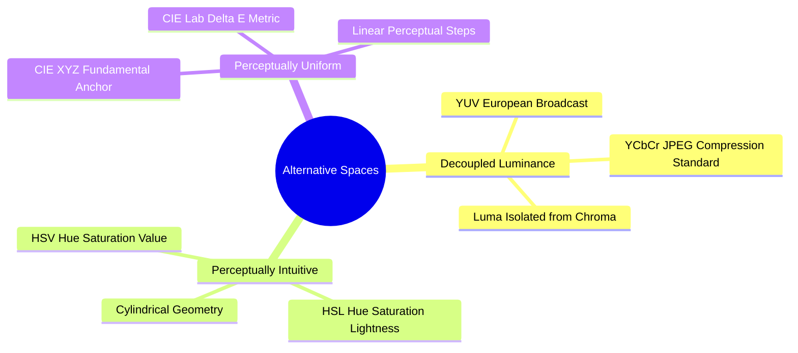

# Perceptual and Broadcast Spaces: YUV, YCbCr, HSV, and Perceptually Uniform Lab

While RGB is well-suited for hardware displays, other color spaces are better designed for human color perception, image processing algorithms, and data compression.

### 1. Decoupled Luminance-Chrominance: YUV and YCbCr
In RGB images, brightness and color information are mixed across all three channels. This means changing the intensity of an image requires modifying all three channels, which can alter the overall hue.

The YUV and YCbCr spaces separate the **luminance (brightness, $Y$)** from the **chrominance (color information, $U, V$ or $Cb, Cr$)**. This separation is widely used in video compression (e.g., MPEG) and image standards (e.g., JPEG). Because the human visual system is far more sensitive to spatial variations in brightness than in color, the chrominance channels can be downsampled (chroma subsampling, like 4:2:0) to save bandwidth without noticeable loss of visual quality.

The standard conversion from RGB to YCbCr (ITU-R BT.601, scaled for 8-bit representations) is:

$$\begin{pmatrix} Y \\ Cb \\ Cr \end{pmatrix} = \begin{pmatrix} 0.299 & 0.587 & 0.114 \\ -0.168736 & -0.331264 & 0.5 \\ 0.5 & -0.418688 & -0.081312 \end{pmatrix} \begin{pmatrix} R \\ G \\ B \end{pmatrix} + \begin{pmatrix} 0 \\ 128 \\ 128 \end{pmatrix}$$

### 2. Perceptually Intuitive Spaces: HSL and HSV
The HSL (Hue, Saturation, Lightness) and HSV (Hue, Saturation, Value) models describe colors in terms that align more closely with human artistic perception:
* **Hue ($H \in [0^\circ, 360^\circ]$):** The pure color wavelength (e.g., red, orange, green, cyan). Represented as an angle around a central vertical axis.
* **Saturation ($S \in [0, 1]$):** The purity or vividness of the color. A saturation of $0$ yields neutral gray; a saturation of $1$ yields a pure, vivid color.
* **Value ($V \in [0, 1]$) / Lightness ($L \in [0, 1]$):** The relative brightness or luminance of the color.

*Advantage:* To isolate an object by color under varying lighting conditions, an algorithm can threshold only the **Hue** channel while ignoring fluctuations in **Value** caused by shadows or highlights.

### 3. Perceptually Uniform Space: CIE $L^*a^*b^*$
In RGB and HSV spaces, the Euclidean distance between two color vectors does not match how different those colors look to a human observer. For example, a small shift in coordinates in a green region may be completely imperceptible, while the same numerical shift in a blue region may appear as a noticeably different shade.

The **CIE $L^*a^*b^*$** space was designed to be **perceptually uniform**: the Euclidean distance $\Delta E^*$ between two color points corresponds directly to the visual difference perceived by a human observer:

$$\Delta E^* = \sqrt{(\Delta L^*)^2 + (\Delta a^*)^2 + (\Delta b^*)^2}$$

* $L^*$: Lightness ($0 \to \text{black}, \ 100 \to \text{diffuse white}$).
* $a^*$: Color axis from Green (negative values) to Red (positive values).
* $b^*$: Color axis from Blue (negative values) to Yellow (positive values).

Because of this uniformity, CIE $L^*a^*b^*$ is the standard space used for color-based image segmentation, histogram equalization, and industrial color-difference testing.

Related concepts: [[15. OpenCV Core Architecture - Matrix Representation, Channels, and Color Constellations]], [[06.1.5. Color Models - Additive RGB, Subtractive CMYK, and Photometric Grayscale]], [[06.5.1. Dynamic Range Expansion and Noise-Tolerant Contrast Stretching]].
