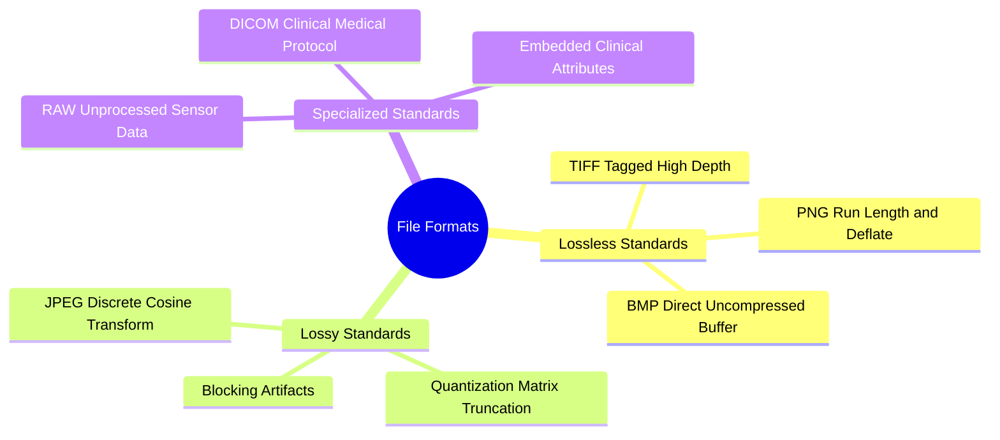

# Digital File Encapsulation, Compression Standards, and Medical DICOM

A digital image file contains more than raw pixel matrices; it encapsulates header information, dimensions, color profiles, structural metadata, and compressed data streams.

### 1. Compression Paradigms: Lossless vs. Lossy
* **Lossless Compression:** Reduces file size without discarding any image information. When decompressed, the reconstructed image is identical to the original pixel-for-pixel:
  $$\hat{I}(x, y) = I(x, y) \quad \forall (x, y)$$
  *Examples:* PNG (uses predictive filtering and DEFLATE/LZ77), TIFF.
* **Lossy Compression:** Achieves significantly smaller file sizes by permanently discarding image details that are less perceptible to the human visual system (such as subtle high-frequency color variations):
  $$\hat{I}(x, y) \neq I(x, y), \quad \text{MSE}(I, \hat{I}) > 0$$
  *Examples:* JPEG (uses the Discrete Cosine Transform [DCT], frequency quantization, and Huffman coding). At high compression ratios, JPEG introduces visible $8 \times 8$ block boundary artifacts.

### 2. Common Storage Formats

| Format | Compression Type | Transparency (Alpha) | Max Bit Depth | Primary Application |
| :--- | :--- | :--- | :--- | :--- |
| **BMP** | None (Raw Array) | Supported | 24-bit / 32-bit | Simple programmatic processing; avoids decompression overhead. |
| **PNG** | Lossless (DEFLATE)| Supported | 16-bit / channel | Web graphics, diagrams, binary segmentation masks. |
| **JPEG**| Lossy (DCT) | Not Supported | 8-bit / channel | Natural photographs, web media. Unsuitable for text or line drawings. |
| **TIFF**| Lossless / Lossy | Supported | Up to 32-bit float | Archival storage, high-resolution scientific and satellite imagery. |
| **RAW** | None (Unprocessed)| Not Supported | 12 to 14-bit | Professional photography. Direct sensor data prior to demosaicing. |

### 3. Specialized Formats: Medical DICOM
**DICOM (Digital Imaging and Communications in Medicine)** is an international standard for storing, transmitting, and viewing medical images. A `.dcm` file is not just an image container; it is a clinical record that bundles the pixel data with comprehensive metadata:
* **Patient Metadata:** Anonymized patient ID, age, sex, clinical history.
* **Acquisition Parameters:** Radiation dose, slice thickness (e.g., $1.0\text{ mm}$), scan orientation, magnetic field strength ($1.5\text{T}$, $3.0\text{T}$).
* **Radiometric Calibration:** Rescale slope and intercept values used to convert raw 16-bit integer pixel values into calibrated physical units (such as **Hounsfield Units [HU]** in CT scans).

Related concepts: [[15. OpenCV Core Architecture - Matrix Representation, Channels, and Color Constellations]], [[06.1.3. Amplitude Quantization, Dynamic Range, and Bit Depth]], [[06.2.2. Quantitative Quality Benchmarks (MSE, PSNR, and SSIM)]].
