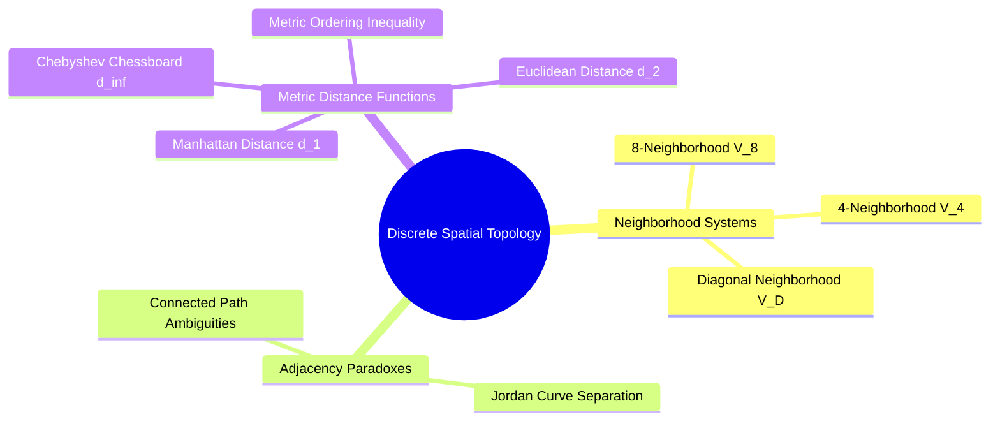

# Discrete Spatial Topology: Neighborhoods, Adjacency, and Metric Spaces

Digital images are sampled onto an integer grid $\mathbb{Z}^2$. Analyzing connectivity, tracing boundaries, and calculating distances requires a formal definition of discrete spatial topology.



### 1. Discrete Pixel Neighborhoods
Let a target pixel $P$ have integer coordinates $(x, y)$.

#### 4-Neighborhood ($V_4(P)$)
The set of four pixels that share a horizontal or vertical edge with $P$:

$$V_4(P) = \{ (x+1, y), \ (x-1, y), \ (x, y+1), \ (x, y-1) \}$$

#### Diagonal Neighborhood ($V_D(P)$)
The set of four pixels that share only a corner with $P$:

$$V_D(P) = \{ (x+1, y+1), \ (x+1, y-1), \ (x-1, y+1), \ (x-1, y-1) \}$$

#### 8-Neighborhood ($V_8(P)$)
The union of the 4-neighborhood and the diagonal neighborhood:

$$V_8(P) = V_4(P) \cup V_D(P)$$

```text
4-Neighborhood:          Diagonal:            8-Neighborhood:
       [X]                    [X]   [X]             [X] [X] [X]
   [X] [P] [X]                    [P]               [X] [P] [X]
       [X]                    [X]   [X]             [X] [X] [X]
```

### 2. Distance Metrics on the Discrete Grid
A distance metric $D(P, Q)$ between two pixels $P(x_p, y_p)$ and $Q(x_q, y_q)$ must satisfy four metric axioms:
1. Non-negativity: $D(P, Q) \ge 0$, and $D(P, Q) = 0 \iff P = Q$
2. Symmetry: $D(P, Q) = D(Q, P)$
3. Triangle inequality: $D(P, R) \le D(P, Q) + D(Q, R)$

#### A. Manhattan Distance ($d_1$, City-Block Distance)
Measures distance assuming movement is restricted to horizontal and vertical steps only (like walking along city blocks). Points at a distance $d_1 \le r$ form a diamond:

$$d_1(P, Q) = |x_p - x_q| + |y_p - y_q|$$

#### B. Euclidean Distance ($d_2$)
The standard straight-line distance in Euclidean space. Points at a distance $d_2 \le r$ form a circle:

$$d_2(P, Q) = \sqrt{(x_p - x_q)^2 + (y_p - y_q)^2}$$

#### C. Chebyshev Distance ($d_\infty$, Chessboard Distance)
Measures distance allowing horizontal, vertical, and diagonal steps, matching the movement of a king on a chessboard. Points at a distance $d_\infty \le r$ form a square:

$$d_\infty(P, Q) = \max(|x_p - x_q|, \ |y_p - y_q|)$$

#### The Fundamental Metric Ordering Inequality
For any two pixels $P$ and $Q$ on a discrete grid, these three metrics are ordered by the following inequality:

$$d_\infty(P, Q) \le d_2(P, Q) \le d_1(P, Q)$$

*Intuition:* Chebyshev distance is the "shortest" metric because diagonal steps cover the same coordinate distance as horizontal and vertical steps combined. Manhattan distance is the "longest" because it prohibits diagonal shortcuts. The straight-line Euclidean distance lies between the two.

### 3. The Connectivity Paradox (Jordan Curve Dilemma)
When analyzing binary images, you must avoid using the same connectivity definition for both the foreground objects and the background. 

Consider a continuous closed loop: by the **Jordan Curve Theorem**, a closed loop divides the plane into two disconnected regions (an interior and an exterior). However, on a discrete grid, if both the foreground loop and the background are evaluated using 8-connectivity, diagonal background pixels can pass directly through the diagonal connections of the foreground loop, breaking the boundary. Conversely, if both are evaluated using 4-connectivity, the foreground loop may be considered disconnected even though it visually appears solid.

**Standard Rule:** To prevent connectivity paradoxes, always use complementary connectivity definitions:
$$\text{Foreground Connectivity} = 8 \iff \text{Background Connectivity} = 4$$
$$\text{Foreground Connectivity} = 4 \iff \text{Background Connectivity} = 8$$

Related concepts: [[02. NumPy Array Manipulation - Slicing, Strides, Shapes, and Vectorized Indexing]], [[06.7.6. Connected Component Analysis (Two-Pass CCL and Equivalence Trees)]], [[06.9.6. TP2 Part 3 - Mathematical Morphology, Cell Counting, and Skeletonization]].
