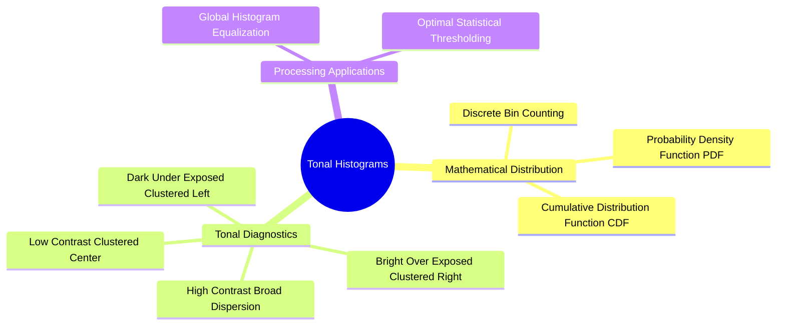

# Tonal Histograms, Probability Densities, and Cumulative Distribution Functions

The histogram is a foundational tool for analyzing an image's tonal distribution. It provides a global summary of brightness and contrast without considering spatial pixel arrangements.

### 1. Mathematical Definitions

#### Unnormalized Intensity Histogram
For a discrete grayscale image $I$ with $L$ gray levels in the range $[0, L-1]$:

$$H(r_k) = n_k$$

where $r_k$ is the $k$-th intensity level, and $n_k$ is the total number of pixels in the image with that intensity:

$$n_k = \sum_{x=0}^{M-1} \sum_{y=0}^{N-1} \delta(I(x, y) - r_k)$$

#### Normalized Histogram (Empirical Probability Density Function, PDF)
To make the histogram independent of image dimensions, divide each bin count by the total number of pixels $N_{\text{total}} = M \times N$:

$$p(r_k) = \frac{n_k}{M \times N}, \quad k = 0, 1, \dots, L-1$$

By definition, the sum of all probabilities equals $1$:

$$\sum_{k=0}^{L-1} p(r_k) = 1, \quad p(r_k) \ge 0$$

#### The Cumulative Distribution Function (CDF)
The Cumulative Distribution Function $P_c(r_k)$ sums the probabilities of all intensity levels up to $r_k$:

$$P_c(r_k) = \sum_{j=0}^{k} p(r_j) = \frac{1}{M \times N} \sum_{j=0}^{k} n_j$$

* Properties:
  * Non-decreasing monotonic step function: $P_c(r_{k}) \ge P_c(r_{k-1})$
  * Normalized bounds: $P_c(r_0) = p(r_0) \ge 0$, and $P_c(r_{L-1}) = 1.0$

### 2. Reading an Image from its Histogram Shape
* **Dark (Underexposed):** The histogram is skewed heavily to the **left** (clustered near intensity $0$).
* **Bright (Overexposed):** The histogram is skewed heavily to the **right** (clustered near intensity $255$).
* **Low Contrast:** The histogram is compressed into a narrow range in the middle. The image appears flat, gray, and washed out.
* **High Contrast:** The histogram spans the entire available range from $0$ to $255$.
* **Bimodal Distribution:** The histogram has two distinct peaks separated by a deep valley. Indicates a clear separation between a dark foreground and a bright background (or vice versa), making it ideal for segmentation via global thresholding.

Related concepts: [[10. Matplotlib and Seaborn Statistical Plotting for Tabular Data]], [[06.5.1. Dynamic Range Expansion and Noise-Tolerant Contrast Stretching]], [[06.7.2. Global Optimal Statistical Thresholding (Otsu's Method Derivation)]].
