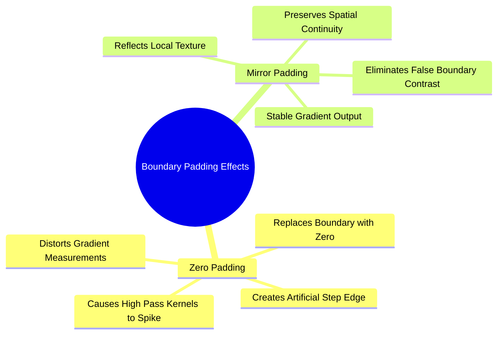

# Exercise 1: Complete Calculation of 2D Convolution and Boundary Padding Modes

### Problem Statement
Given an input $5 \times 5$ grayscale image $f(x, y)$ and a $3 \times 3$ high-pass filter kernel $h(i, j)$, calculate the filtered intensity of the corner pixel $f(0, 0)$ using two boundary handling strategies:
1. **Zero Padding**
2. **Mirror Padding**

The input image $f(x, y)$ is:

$$f(x, y) = \begin{pmatrix} 
100 & 130 & 110 & 120 & 110 \\ 
110 & 90  & 100 & 90  & 100 \\ 
130 & 100 & 90  & 130 & 110 \\ 
120 & 100 & 130 & 110 & 120 \\ 
90  & 110 & 80  & 120 & 100 
\end{pmatrix}$$

The $3 \times 3$ high-pass filter kernel $h(i, j)$ is:

$$h(i, j) = \begin{pmatrix} 
-1 & -1 & -1 \\ 
-1 &  8 & -1 \\ 
-1 & -1 & -1 
\end{pmatrix}$$

---

### Step-by-Step Mathematical Derivation

#### The Unpadded Local Neighborhood
Centering the $3 \times 3$ filter kernel over coordinate $(0, 0)$ requires values from out-of-bounds coordinates where row $< 0$ or col $< 0$:

$$\text{Neighborhood} = \begin{pmatrix} 
f(-1,-1) & f(-1,0) & f(-1,1) \\ 
f(0,-1)

& f(0,0) & f(0,1) \\ 
f(1,-1) & f(1,0) & f(1,1) 
\end{pmatrix} = \begin{pmatrix} 
? & ? & ? \\ 
? & 100 & 130 \\ 
? & 110 & 90 
\end{pmatrix}$$

Because the kernel $h(i, j)$ is symmetric along both horizontal and vertical axes ($h(i, j) = h(-i, -j)$), 2D convolution and 2D cross-correlation yield identical numerical expressions.

---

### Part A: Convolution with Zero Padding (Constant Border)

In zero padding, any spatial index falling outside the defined matrix bounds $[0, 4] \times [0, 4]$ is assigned a value of zero:

$$f(x, y) = 0 \quad \text{for } x < 0 \text{ or } y < 0$$

#### 1. Construct the Padded Neighborhood Matrix

Substituting $0$ for all undefined coordinates:

$$f_{\text{zero}} = \begin{pmatrix} 
0 & 0 & 0 \\ 
0 & 100 & 130 \\ 
0 & 110 & 90 
\end{pmatrix}$$

#### 2. Element-Wise Kernel Multiplication

Align the center element of the high-pass kernel ($w_5 = 8$) with the target pixel $f(0, 0) = 100$:

$$\begin{aligned}
g_{\text{zero}}(0, 0) = & \sum_{i=-1}^{1} \sum_{j=-1}^{1} f_{\text{zero}}(i, j) \cdot h(i, j) \\
= & (0 \times -1) + (0 \times -1) + (0 \times -1) \\
  & + (0 \times -1) + (100 \times 8) + (130 \times -1) \\
  & + (0 \times -1) + (110 \times -1) + (90 \times -1)
\end{aligned}$$

#### 3. Sum the Products

$$g_{\text{zero}}(0, 0) = 0 + 0 + 0 + 0 + 800 - 130 + 0 - 110 - 90$$

$$g_{\text{zero}}(0, 0) = 800 - (130 + 110 + 90) = 800 - 330 = \mathbf{470}$$

---

### Part B: Convolution with Mirror Padding (Reflection Border)

In mirror (reflection) padding, out-of-bounds coordinates are filled by reflecting interior pixel values across the boundary:

* Top-left diagonal: $f(-1, -1) = f(1, 1) = 90$
* Top edge: $f(-1, 0) = f(1, 0) = 110$
* Top-right corner: $f(-1, 1) = f(1, 1) = 90$
* Left edge: $f(0, -1) = f(0, 1) = 130$
* Bottom-left: $f(1, -1) = f(1, 1) = 90$

#### 1. Construct the Padded Neighborhood Matrix

$$f_{\text{mirror}} = \begin{pmatrix} 
90  & 110 & 90 \\ 
130 & 100 & 130 \\ 
90  & 110 & 90 
\end{pmatrix}$$

#### 2. Element-Wise Kernel Multiplication

$$\begin{aligned}
g_{\text{mirror}}(0, 0) = & \sum_{i=-1}^{1} \sum_{j=-1}^{1} f_{\text{mirror}}(i, j) \cdot h(i, j) \\
= & (90 \times -1) + (110 \times -1) + (90 \times -1) \\
  & + (130 \times -1) + (100 \times 8) + (130 \times -1) \\
  & + (90 \times -1) + (110 \times -1) + (90 \times -1)
\end{aligned}$$

#### 3. Sum the Products

$$g_{\text{mirror}}(0, 0) = (-90 - 110 - 90 - 130) + 800 + (-130 - 90 - 110 - 90)$$

$$\text{Negative Sum} = -(90 + 110 + 90 + 130 + 130 + 90 + 110 + 90) = -840$$

$$g_{\text{mirror}}(0, 0) = 800 - 840 = \mathbf{-40}$$

---

### Comparative Analysis and Takeaways

| Boundary Strategy | Raw Filter Output | 8-Bit Clamped Value | Observed Artifact |
| :--- | :--- | :--- | :--- |
| **Zero Padding** | $+470$ | $255$ (Saturated White) | Artificial high-contrast border edge |
| **Mirror Padding**| $-40$ | $0$ (Clamped Black) | Preserves local continuity |

#### Why the Outputs Differ
* The high-pass kernel calculates the difference between the center pixel and its neighbors. Because the kernel weights sum to zero ($-1 \times 8 + 8 = 0$), the filter outputs $0$ in completely flat, uniform areas.
* **With Zero Padding:** Filling five neighbor positions with zeros creates a large, artificial step edge ($100 \to 0$). The high-pass filter interprets this artificial drop as a sharp edge, producing a large positive response ($+470$).
* **With Mirror Padding:** Reflecting neighboring pixels maintains local intensity levels ($90, 110, 130$). Because the target pixel ($100$) is close to its neighbors' average, the filter outputs a value near zero ($-40$).

Related concepts: [[17. SciPy Signal and Spatial Operations - 2D Filtering and Morphology]], [[06.1.10. Mathematical 2D Spatial Convolution, Cross-Correlation, and Boundary Padding]], [[06.2.4. Spatial High-Pass Filtering, Sobel Gradients, and Laplacian Sharpening]].
